# AEH - Bộ Câu Hỏi Phỏng Vấn Mobile Developer

> **Công ty:** Authentic Education Hub (AEH)  
> **Vị trí:** Mobile Developer - Flutter  
> **Domain:** Nền tảng giáo dục số, online learning, digital learning content ecosystem  
> **Nguồn JD:** `%5BAEH%5D%20-%20JD%20Mobile%20Developer.pdf`  
> **File gốc tiếng Anh:** `aeh-mobile-developer-interview-prep.md`  
> **Điểm mạnh từ CV:** Finhay eKYC, Netchat AI chatbot, Raise 2.0 education app, QRCheckin enterprise app, MSB banking app

---

## 0. Cách Dùng File Này

| Phần | Nội dung | Mức ưu tiên |
|---|---|---|
| 1 | Giới thiệu bản thân cho AEH | Phải thuộc |
| 2 | Mapping JD với CV | Phải thuộc |
| 2.1 | Mô tả những dự án gần đây | Phải thuộc |
| 3 | Flutter/Dart core | Cao |
| 4 | Architecture, SOLID, Clean Architecture | Cao |
| 5 | State management: BLoC, GetX, Riverpod | Cao |
| 6 | REST API, Firebase, Notification, Socket | Cao |
| 7 | AI, OCR, AI Agents | Rất cao |
| 8 | Làm việc với backend: Spring Boot, Microservices, AWS/GCP | Cao |
| 9 | System design và technical docs | Cao |
| 10 | Git flow, code review, bug handling | Cao |
| 11 | Third-party integration, KYC, Payment, Store release | Trung bình cao |
| 12 | Phụ lục code dài | Trung bình cao |
| 13 | Behavioral questions | Cao |
| 14 | Câu hỏi nên hỏi AEH | Trung bình |
| 15 | Cheat sheet trước buổi phỏng vấn | Trung bình |

**Quy tắc trả lời:** ngắn gọn, trực tiếp, gắn với kinh nghiệm thật trong CV. Khi trả lời tiếng Anh, Sếp có thể dùng ý tiếng Việt trong file này rồi chuyển sang câu tiếng Anh đơn giản.

---

## 1. Giới Thiệu Bản Thân

### Q1. Tell me about yourself.

### Câu trả lời gợi ý

> "Em là Long, có hơn 7 năm kinh nghiệm phát triển mobile với React Native, Flutter và native iOS/Android.
>
> Với Flutter, em có kinh nghiệm production về Clean Architecture, BLoC/Cubit, Riverpod, Provider, MobX, Dio, Retrofit, Firebase, Sentry, OneSignal, và native bridge qua MethodChannel/EventChannel.
>
> Kinh nghiệm Flutter gần nhất và mạnh nhất của em là Finhay, nơi em làm hybrid fintech app có eKYC, NFC reading, liveness verification, authentication, secure token handling và Flutter-Native bridge.
>
> Em cũng từng làm Netchat, một Flutter AI chatbot app, và Raise 2.0, một education app dùng Riverpod, go_router, Dio, Firebase, audio/video playback và clean modular architecture.
>
> Em quan tâm AEH vì vị trí này kết hợp Flutter, education technology, AI/OCR/AI Agents, backend collaboration và product quality. Những điểm này khá khớp với kinh nghiệm của em."

### 3 câu nên thuộc

- "Flutter + education + AI integration khá khớp với kinh nghiệm Finhay, Netchat và Raise 2.0 của em."
- "Em có thể own một feature từ lúc clarify requirement, design architecture, implement, test cho tới release."
- "Em quen làm việc với backend team, API contract, Git flow, code review và production bug fixing."

---

## 2. Mapping JD Với CV

| Yêu cầu AEH | Bằng chứng tốt nhất từ CV | Góc trả lời |
|---|---|---|
| 5+ năm Flutter/mobile | 7+ năm mobile, 4+ năm Flutter | Senior mobile ownership |
| Flutter & Dart | Finhay, Netchat, Raise, QRCheckin, EPS | Có kinh nghiệm production |
| BLoC / GetX / Riverpod | Netchat BLoC/Cubit, Raise Riverpod, QRCheckin MobX, EPS Provider/BLoC | Adapt được nhiều state management |
| REST API | Dio, Retrofit, backend collaboration | Có discipline về API integration |
| Firebase / Notification / Socket | Firebase, OneSignal, FCM, EventFlux chatbot streaming | Có real-time và push experience |
| SOLID / Design Pattern / Clean Architecture | Finhay, Netchat, Raise, QRCheckin | Có architecture mindset |
| Technical docs | Onboarding docs, API contracts, maintainability guidelines | Có senior process |
| Git flow / conflict | Team coordination, release, CI/CD | Biết delivery quality |
| KYC / Payment / Store | Finhay eKYC, ViettelPay Pro, in-app purchase, TestFlight/Fastlane | Có third-party integration |
| AI / OCR / AI Agents | Netchat AI chatbot, Finhay eKYC/OCR/NFC/liveness | Rất liên quan tới AEH smart modules |

---

## 2.1. Mô Tả Những Dự Án Gần Đây

> Mục tiêu của phần này là giúp Sếp trả lời các câu kiểu: "Tell me about your recent projects", "What was your responsibility?", "What technologies did you use?", "What was impressive or challenging?"

### Cách trả lời tổng quan

> "Trong các dự án gần đây, em thường làm ở vai trò mobile developer hoặc technical lead, tập trung vào production mobile app, architecture, native bridge, API integration, third-party SDK, release flow và phối hợp với backend/QA/design.
>
> Những dự án nổi bật nhất gồm Finhay về fintech/eKYC, MSB Internet Banking về super-app banking, ABC Education và Raise 2.0 về education app, Musaic về AI pipeline, Mydio về audio streaming, và MyClip về video editor/native media processing."

### 1. Finhay - Hybrid Native + Cross-Platform Fintech App

**Vai trò:** Mobile Developer, code-owner phần native và cross-platform interop.

**Trách nhiệm chính**
- Thiết kế bridge giữa native và cross-platform layer cho NFC scan, liveness SDK, eKYC result, completion/cancel flow.
- Tham gia migration eKYC UI từ native iOS/Android sang cross-platform layer nhưng vẫn giữ NFC/liveness SDK ở native.
- Xây authentication, social login, secure token lifecycle, phased rollout bằng Remote Config và fallback về legacy native flow.
- Chuẩn hóa navigation flow để tránh unsafe back-stack trong eKYC và authentication.

**Công nghệ sử dụng**
- React Native, TypeScript, Swift, UIKit, RxSwift, Kotlin
- NativeModules, RCTEventEmitter, NFC SDK, Liveness SDK
- Firebase, Remote Config, Fastlane, TestFlight

**Điểm ấn tượng khi kể với AEH**
- Dự án có security-sensitive flow, khá giống yêu cầu AEH về KYC, third-party SDK, secure integration và native bridge.
- Có thể nhấn mạnh: "I worked on a high-risk fintech flow where mobile had to coordinate native SDKs, cross-platform UI, secure token handling, and rollback strategy."

### 2. Musaic - AI Image-to-Music Generator

**Vai trò:** Fullstack Developer, tự design và build end-to-end side project.

**Trách nhiệm chính**
- Thiết kế Flutter Clean Architecture frontend và NestJS modular backend.
- Xây AI pipeline: image input -> Gemini Vision analysis -> prompt enhancement -> AI music provider -> background worker -> MP3 storage.
- Implement multi-provider fallback cho AI music generation, ví dụ Mubert, Suno, Mureka.
- Xây credit system, payment/top-up flow, auth guard và audio playback.

**Công nghệ sử dụng**
- Flutter, Dart, BLoC, go_router, get_it, dio, just_audio
- NestJS, TypeScript, Prisma, PostgreSQL, BullMQ, Redis
- LangChain.js, Google Gemini, Mubert/Suno/Mureka APIs, Google Cloud Storage, RevenueCat

**Điểm ấn tượng khi kể với AEH**
- Rất phù hợp với JD có AI/OCR/AI Agents vì Sếp có thể nói về AI workflow, async processing, fallback, credit-based monetization và mobile/backend collaboration.
- Có thể nhấn mạnh: "This project helped me understand how mobile should integrate AI features through a clear backend contract instead of putting AI logic directly inside the app."

### 3. MSB Internet Banking - Super-App Micro Front-End

**Vai trò:** Mobile Developer, owner domain account và daily transaction.

**Trách nhiệm chính**
- Own các tính năng account inquiry, transaction history, account settings và customer self-service.
- Implement và stabilize các daily transaction journeys như transfer, bill payment, top-up và savings.
- Tích hợp host-app contracts như auth context, HTTP client, navigation, popup/toast/spinner.
- Hỗ trợ release readiness qua DEV, SIT, UAT, Pilot và Production.

**Công nghệ sử dụng**
- React Native, TypeScript
- Module Federation, Repack, Rspack
- React Navigation v7, Zustand, React Hook Form, Zod
- Firebase, Notifee

**Điểm ấn tượng khi kể với AEH**
- Dự án banking có độ ổn định cao, nhiều module team cùng làm, phù hợp để nói về scalable architecture, API contract, release quality và production issue triage.
- Có thể nhấn mạnh: "I worked in a super-app environment where each module had to follow strict host contracts and release discipline."

### 4. ABC Education App - Education App Với Native iOS Parental Control

**Vai trò:** Technical Lead, mobile architect, native bridge author.

**Trách nhiệm chính**
- Lead technical delivery từ architecture tới production cho mobile và backend tracks.
- Design và implement iOS Screen Time capabilities bằng custom Expo Modules.
- Viết JS-to-Native bridge contracts cho permission request, app selection, block/unblock state và event flow.
- Implement extension layer như ShieldConfiguration, WidgetKit, App Groups để sync blocked-state giữa app và extensions.

**Công nghệ sử dụng**
- React Native, Expo Dev Client, TypeScript
- Swift, SwiftUI, FamilyControls, ManagedSettings, DeviceActivity
- WidgetKit, AppIntents, App Groups
- NestJS, MongoDB, Google Cloud

**Điểm ấn tượng khi kể với AEH**
- Đây cũng là education domain rất gần với AEH. Có thể dùng để chứng minh Sếp hiểu product dành cho học tập, parental control, mobile architecture và native capability.
- Có thể nhấn mạnh: "This project is close to AEH's domain because it combines education, mobile UX, backend services, and complex native integration."

### 5. Raise 2.0 - Flutter Education App Cho Trẻ Em

**Vai trò:** Mobile Developer, phụ trách phát triển Flutter features trong education product.

**Mô tả dự án**
- Raise 2.0 là ứng dụng giáo dục và hoạt động dành cho phụ huynh, hỗ trợ sự phát triển của trẻ em theo nhiều khía cạnh học tập và sinh hoạt.
- Dự án phù hợp trực tiếp với AEH vì cùng domain education, có learning content, media content, user engagement và product experience cho gia đình/trẻ em.

**Trách nhiệm chính**
- Phát triển Flutter features ở nhiều phần: UI, networking, data flow, media playback và analytics.
- Làm việc với modular architecture để codebase dễ mở rộng khi sản phẩm thêm learning modules hoặc activity modules mới.
- Tích hợp routing, API layer, Firebase, localization, deep linking, Sentry và media player.
- Hỗ trợ maintain product quality, xử lý edge cases và đảm bảo trải nghiệm ổn định trên nhiều màn hình/mobile devices.

**Công nghệ sử dụng**
- Flutter, Dart, Clean Architecture
- Riverpod, go_router, Dio, dartz
- Firebase, easy_localization, flutter_screenutil
- just_audio, video_player, chewie
- Branch SDK, sentry_flutter

**Điểm ấn tượng khi kể với AEH**
- Đây là project nên ưu tiên kể khi interviewer hỏi về education domain, vì Raise 2.0 gần với AEH hơn các dự án banking/fintech.
- Có thể nhấn mạnh: "Raise 2.0 is highly relevant to AEH because it is a Flutter education product for children and parents. I worked on UI, API integration, media playback, analytics, localization, and modular architecture."
- Nếu muốn trả lời ngắn: "In Raise 2.0, I worked on a Flutter education app for children and parents, using Riverpod, go_router, Dio, Firebase, localization, audio/video playback, Branch deep link, and Sentry. This experience is directly relevant to AEH's education platform."

### 6. Mydio - National-Scale Audio Streaming

**Vai trò:** Mobile Developer, phụ trách core audio domain phía React Native.

**Trách nhiệm chính**
- Design RN codebase theo Clean-Architecture-style và bounded contexts như audio, home, library, user, auth, favorite, explore.
- Build audio flows: detail, chapters, albums, series, similar content, like/rating, VIP checks, pre-signed audio links và listening log sync.
- Refine mini-player/full-player behavior, app-state sync, animation, chapter-change handling và playback recovery.
- Integrate native Android playback, media session, notification và subscription/IAP flow.

**Công nghệ sử dụng**
- React Native, TypeScript, Expo Dev Client
- MobX, InversifySugar
- ExoPlayer, React Native Track Player
- Firebase, In-App Purchase, Fastlane

**Điểm ấn tượng khi kể với AEH**
- Dự án này mạnh về media playback, background behavior, subscription và performance. Với AEH, có thể liên hệ tới lesson audio/video playback và premium content.
- Có thể nhấn mạnh: "I handled playback reliability, background behavior, and subscription checks, which are useful for education products with media lessons."

### 7. MyClip - Short Video & Native Video Editor

**Vai trò:** Mobile Developer, owner phần video editor bridge.

**Trách nhiệm chính**
- Build RN video features như recording, gallery selection, upload, trimming, cut-flow, text overlay, speed control, preview và draft/offline handling.
- Viết custom native video-editor bridge bằng Swift, Objective-C++, Kotlin và FFmpeg.
- Implement playback/interaction flows như video detail, related videos, quality selection, comments, fullscreen controls và streaming behavior.
- Hỗ trợ middle/junior developers và release workflow.

**Công nghệ sử dụng**
- React Native, TypeScript
- Swift, Objective-C++, Kotlin, FFmpeg
- Redux, Fastlane, GitLab CI/CD

**Điểm ấn tượng khi kể với AEH**
- Dự án này cho thấy khả năng xử lý native-heavy feature và media processing phức tạp.
- Với AEH, có thể liên hệ tới video lesson, media processing, upload flow và native module integration.

### Nên chọn project nào khi phỏng vấn AEH?

- Nếu hỏi về **Flutter / Clean Architecture / AI**: chọn **Musaic**, **Raise 2.0** và **Netchat/Finhay** nếu muốn nói thêm về AI chatbot/eKYC.
- Nếu hỏi về **education domain**: ưu tiên **Raise 2.0**, sau đó **ABC Education App**.
- Nếu hỏi về **native bridge / SDK integration**: chọn **Finhay**, **ABC Education**, hoặc **MyClip**.
- Nếu hỏi về **production quality / release / large team**: chọn **MSB Internet Banking**.
- Nếu hỏi về **media learning content**: chọn **Raise 2.0**, **Mydio** và **MyClip**.

---

## 3. Flutter & Dart Core

### Q2. Kinh nghiệm Flutter production của bạn là gì?

### Câu trả lời

> "Em đã làm nhiều Flutter app chạy production như Finhay, Netchat, Raise 2.0, QRCheckin, EPS và Health Record.
>
> Trong production, em thường tập trung vào Clean Architecture, state management, API integration, error handling, performance, release readiness và maintainability.
>
> Ví dụ, ở Finhay em làm eKYC và authentication flow có Flutter-Native bridge. Ở Netchat, em làm Flutter AI chatbot với BLoC/Cubit và Clean Architecture. Ở Raise 2.0, em dùng Riverpod, go_router, Dio, Firebase, audio/video playback và modular architecture."

#### Diagram Sample - Flutter Production Feature Skeleton

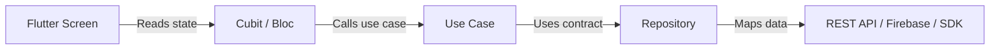

**Giải thích:** Đây là shape production em hay dùng: UI mỏng, state quản lý behavior màn hình, domain quản lý business flow, repository quản lý data access.

### Q3. Những Dart features quan trọng nhất với Flutter là gì?

### Câu trả lời

> "Với Flutter hằng ngày, các Dart features quan trọng nhất là null safety, async/await, Future, Stream, extension methods, mixins, sealed classes và records.
>
> Null safety giúp giảm runtime null crash. Future phù hợp cho tác vụ async trả về một kết quả như REST API. Stream phù hợp với dữ liệu liên tục như socket events, Firebase snapshots hoặc chatbot streaming.
>
> Trong production, em cũng quan tâm type safety vì nó giúp code review và refactor an toàn hơn."

#### Code Sample - Dart Features Used Daily

```dart
extension NullableStringX on String? {
  String get displayName => this?.trim().isNotEmpty == true ? this! : 'Guest';
}

Future<String> loadUserName() async {
  final rawName = await Future<String?>.value(null);
  return rawName.displayName;
}
```

**Giải thích:** Null safety, extension methods và async/await giúp Flutter code an toàn hơn và dễ đọc hơn.

### Q4. Future khác Stream như thế nào?

### Câu trả lời

> "Future trả về một async result, còn Stream có thể trả nhiều giá trị theo thời gian.
>
> Em dùng Future cho REST API, đọc local storage hoặc load profile một lần. Em dùng Stream cho socket, Firebase updates, real-time chat hoặc AI chatbot streaming.
>
> Trong Netchat, streaming behavior rất quan trọng vì chatbot response có thể đến từng phần, nên Stream phù hợp hơn một Future đơn lẻ."

#### Code Sample - Future vs Stream

```dart
Future<List<Course>> fetchCourses() async => const <Course>[];

Stream<String> streamAiAnswer() async* {
  yield 'Hello';
  yield ' from';
  yield ' AEH AI tutor';
}
```

**Giải thích:** `Future` dùng cho một kết quả. `Stream` dùng cho nhiều giá trị theo thời gian như AI streaming, socket events hoặc Firebase updates.

### Q5. Bạn handle error trong Flutter như thế nào?

### Câu trả lời

> "Em thích handle error theo từng layer.
>
> Ở data layer, em catch API, timeout, parsing và network exceptions. Ở domain layer, em convert chúng thành business-friendly failures. Ở presentation layer, em show UI states rõ ràng như loading, success, empty và error.
>
> Với production app, em cũng log error quan trọng lên Sentry hoặc Firebase Crashlytics, nhưng tránh log sensitive user data."

#### Code Sample - Error Mapping

```dart
sealed class AppFailure {
  const AppFailure(this.message);
  final String message;
}

class NetworkFailure extends AppFailure {
  const NetworkFailure() : super('Network error. Please try again.');
}

class CourseRepository {
  Future<List<Course>> getCourses() async {
    try {
      return const <Course>[];
    } catch (_) {
      throw const NetworkFailure();
    }
  }
}
```

**Giải thích:** Convert technical exceptions thành user-friendly failures trước khi chúng lên UI.

### Q6. Bạn cải thiện performance Flutter như thế nào?

### Câu trả lời

> "Em thường bắt đầu bằng việc kiểm tra rebuilds, expensive widgets, image loading, list rendering và async work.
>
> Em dùng const widgets khi có thể, tách widget lớn thành component nhỏ hơn, dùng ListView.builder cho list dài, tránh heavy work trong build(), và profile bằng Flutter DevTools.
>
> Nếu parsing hoặc computation nặng, em move nó ra khỏi UI thread, ví dụ dùng compute hoặc isolate."

#### Code Sample - Performance: ListView.builder + const

```dart
class CourseList extends StatelessWidget {
  const CourseList({required this.courses, super.key});

  final List<Course> courses;

  @override
  Widget build(BuildContext context) => ListView.builder(
        itemCount: courses.length,
        itemBuilder: (context, index) => CourseTile(
          course: courses[index],
        ),
      );
}
```

**Giải thích:** Dùng lazy rendering cho list dài và giữ widget nhỏ để giảm rebuild cost.

---

## 4. Architecture, SOLID, Clean Architecture

### Q7. Bạn dùng architecture nào trong Flutter?

### Câu trả lời

> "Với project vừa và lớn, em ưu tiên feature-based Clean Architecture.
>
> Mỗi feature có presentation, domain và data layer. Presentation chứa screens và state management. Domain chứa business rules, entities và repository contracts. Data chứa API clients, DTOs, local storage và repository implementations.
>
> Cấu trúc này giúp code testable, maintainable và dễ cho nhiều developer làm song song."

#### Diagram Sample - Clean Architecture

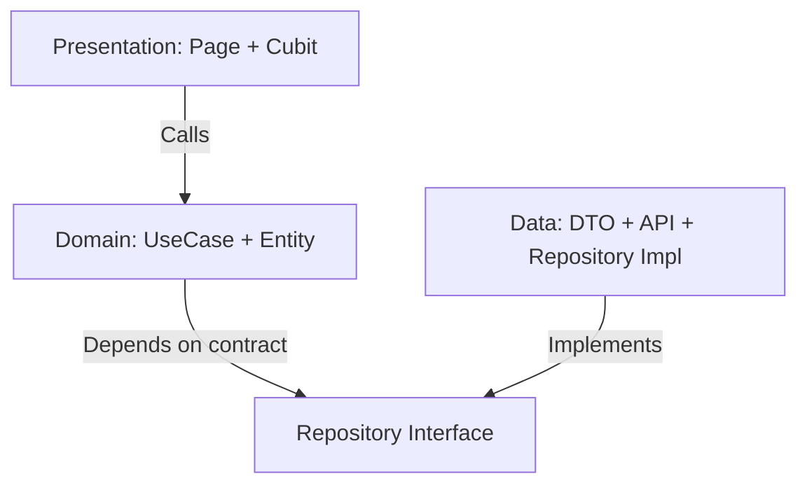

**Giải thích:** Domain không phụ thuộc Flutter hoặc Dio. Data implementation phụ thuộc vào domain contracts.

### Q8. Vì sao Clean Architecture quan trọng?

### Câu trả lời

> "Lợi ích chính là separation of concerns.
>
> UI không nên biết chi tiết API. Business logic không nên phụ thuộc trực tiếp vào Flutter widgets. Data models không nên leak khắp mọi layer.
>
> Với kinh nghiệm Finhay và Netchat, boundary rõ ràng giúp team maintain các flow phức tạp như eKYC, authentication và chatbot response handling."

#### Diagram Sample - Why Clean Architecture Matters

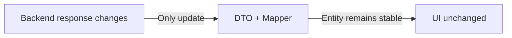

**Giải thích:** Clean Architecture bảo vệ UI và business logic khi backend response thay đổi.

### Q9. Bạn áp dụng SOLID trong Flutter như thế nào?

### Câu trả lời

> "Em áp dụng SOLID qua small classes, clear interfaces, dependency inversion và single responsibility.
>
> Ví dụ, screen không nên gọi Dio trực tiếp. Screen nên gọi Cubit/Bloc hoặc controller. Cubit gọi use case hoặc repository. Repository phụ thuộc vào API abstraction.
>
> Cách này giúp code dễ test hơn và dễ thay implementation sau này."

#### Code Sample - SOLID / Dependency Inversion

```dart
abstract interface class AuthRepository {
  Future<bool> isLoggedIn();
}

class CheckLoginStatus {
  const CheckLoginStatus(this._repository);

  final AuthRepository _repository;

  Future<bool> call() => _repository.isLoggedIn();
}
```

**Giải thích:** Use case phụ thuộc abstraction, không phụ thuộc trực tiếp vào Dio, Firebase hoặc local storage.

### Q9.1. Bạn biết gì về DI? DI là gì và bạn ứng dụng như thế nào?

### Câu trả lời

> "DI là Dependency Injection, nghĩa là thay vì một class tự tạo dependency bên trong nó, dependency sẽ được truyền từ bên ngoài vào, thường qua constructor.
>
> Mục tiêu của DI là giảm coupling, tăng testability và giúp code dễ thay đổi implementation. Ví dụ, Cubit không nên tự tạo Repository, Repository không nên tự tạo Dio. Các dependency này nên được inject từ ngoài vào.
>
> Trong Flutter, em thường dùng DI cùng Clean Architecture. Use case nhận repository interface, repository implementation nhận data source, data source nhận Dio hoặc API client. Với project lớn, em có thể dùng get_it/injectable để quản lý dependency graph. Repository/service thường là lazy singleton, còn Cubit/BLoC nên là factory để mỗi màn hình có state mới."

#### Code Sample - Constructor Injection + GetIt

```dart
abstract interface class CourseRepository {
  Future<List<Course>> getCourses();
}

class GetCourses {
  const GetCourses(this._repository);

  final CourseRepository _repository;

  Future<List<Course>> call() => _repository.getCourses();
}

class CourseCubit extends Cubit<CourseState> {
  CourseCubit(this._getCourses) : super(const CourseState.initial());

  final GetCourses _getCourses;

  Future<void> load() async {
    emit(const CourseState.loading());
    final courses = await _getCourses();
    emit(CourseState.success(courses));
  }
}

final getIt = GetIt.instance;

void configureDependencies() {
  getIt
    ..registerLazySingleton<CourseRepository>(
      () => CourseRepositoryImpl(getIt()),
    )
    ..registerFactory(
      () => CourseCubit(getIt()),
    );
}
```

**Giải thích:** `CourseCubit` không tự tạo `GetCourses`, `GetCourses` không tự tạo `CourseRepository`. Tất cả dependency được inject từ ngoài vào, nên khi test có thể thay `CourseRepositoryImpl` bằng mock/fake repository.

#### Interview Short Answer

> "DI helps me keep the code loosely coupled and testable. In Flutter Clean Architecture, I inject repositories into use cases, use cases into Cubits or BLoCs, and external dependencies like Dio through modules. I usually register repositories as lazy singletons and Cubits/BLoCs as factories."

### Q10. Repository pattern là gì và dùng như thế nào?

### Câu trả lời

> "Repository pattern che giấu data source khỏi phần còn lại của app.
>
> UI và domain layer không cần biết data đến từ REST API, cache, local database, Firebase hay third-party SDK.
>
> Ví dụ, trong education app, CourseRepository có thể fetch course từ REST API, cache local, và sau này support offline mode mà không cần sửa UI."

#### Code Sample - Repository Pattern

```dart
abstract interface class LessonRepository {
  Future<List<Lesson>> getLessons(String courseId);
}

class LessonRepositoryImpl implements LessonRepository {
  const LessonRepositoryImpl(this._remote);

  final LessonRemoteDataSource _remote;

  @override
  Future<List<Lesson>> getLessons(String courseId) async {
    final dtos = await _remote.getLessons(courseId);
    return dtos.map((dto) => dto.toEntity()).toList();
  }
}
```

**Giải thích:** Repository che giấu lessons đến từ REST API, cache, Firebase hay local DB.

### Q11. Bạn sẽ design learning module cho AEH như thế nào?

### Câu trả lời

> "Em sẽ design nó như một feature module.
>
> Presentation layer có course list, lesson detail, quiz và progress screens. Domain layer có entities như Course, Lesson, Quiz và LearningProgress. Data layer có REST API services, DTOs, cache và repository implementations.
>
> Nếu có AI hoặc OCR, em sẽ isolate nó sau một service interface để UI không phụ thuộc trực tiếp vào một AI provider cụ thể."

#### Diagram Sample - AEH Learning Module

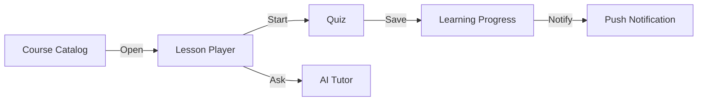

**Giải thích:** Diagram này cho thấy course, lesson, quiz, AI, progress và notification nên được tách thành module rõ ràng.

---

## 5. State Management

### Q12. BLoC khác Cubit như thế nào?

### Câu trả lời

> "Cubit đơn giản hơn vì expose methods và emit states trực tiếp. BLoC structured hơn vì dùng events và states.
>
> Em dùng Cubit cho flow đơn giản như loading data, submit form hoặc toggle UI state. Em dùng BLoC khi feature có nhiều events, transition phức tạp hoặc cần tracking event rõ ràng.
>
> Trong Netchat, BLoC/Cubit phù hợp vì chatbot UI có loading, streaming, success và error states."

#### Code Sample - Cubit vs Bloc Simple Cubit

```dart
class SearchCubit extends Cubit<SearchState> {
  SearchCubit(this._repository) : super(const SearchState.initial());

  final CourseRepository _repository;

  Future<void> search(String keyword) async {
    emit(const SearchState.loading());
    final courses = await _repository.search(keyword);
    emit(SearchState.success(courses));
  }
}
```

**Giải thích:** Cubit tốt cho flow đơn giản dựa trên method. BLoC tốt hơn khi cần event tracking rõ ràng.

### Q13. Riverpod khác BLoC như thế nào?

### Câu trả lời

> "Cả hai đều tốt, nhưng giải quyết vấn đề theo hướng khác nhau.
>
> BLoC explicit và tốt cho event-driven flows. Riverpod flexible và tốt cho dependency management, derived state và modular features.
>
> Trong Raise 2.0, em dùng Riverpod với go_router, khá phù hợp cho education product theo modular architecture. Ở project khác, BLoC/Cubit phù hợp hơn cho business flow cần explicit state."

#### Code Sample - Riverpod Provider

```dart
final courseRepositoryProvider = Provider<CourseRepository>((ref) {
  return CourseRepositoryImpl(ref.watch(courseRemoteDataSourceProvider));
});

final courseListProvider = FutureProvider<List<Course>>((ref) {
  return ref.watch(courseRepositoryProvider).getCourses();
});
```

#### Riverpod Hoạt Động Như Thế Nào?

- `ProviderScope` là root container, giữ toàn bộ provider graph của app.
- `Provider`, `FutureProvider`, `StreamProvider`, `NotifierProvider` hoặc `AsyncNotifierProvider` mô tả cách tạo dependency/state.
- Widget dùng `ref.watch(provider)` để subscribe và rebuild khi provider thay đổi.
- Widget dùng `ref.read(provider)` trong callback như `onPressed`, khi chỉ cần gọi action mà không cần rebuild.
- Widget dùng `ref.listen(provider)` cho side effects như navigation, dialog, snackbar.
- Provider có thể phụ thuộc provider khác qua `ref.watch`, nên Riverpod tự build dependency graph và tự update derived state.
- Khi test, có thể override provider trong `ProviderScope(overrides: [...])`, nên rất dễ thay real repository bằng fake/mock repository.

#### Diagram Sample - Riverpod Flow

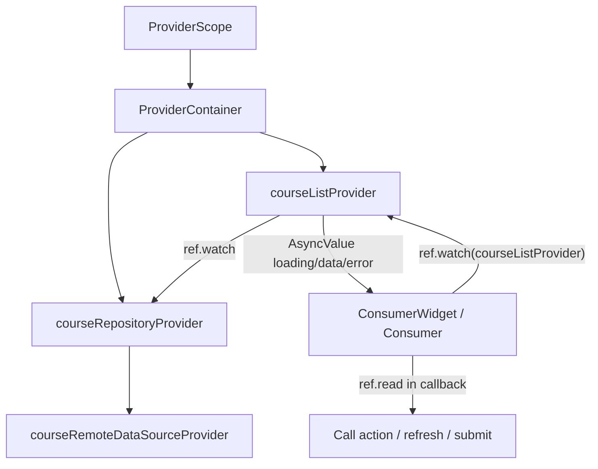

**Giải thích:** Riverpod tiện cho dependency graph và derived async state. Điểm mạnh của Riverpod là UI không tự tạo dependency; UI chỉ watch/read provider, còn provider graph quyết định data lấy từ đâu và update khi nào.

#### Interview Short Answer

> "Riverpod works around a provider graph. The app starts with ProviderScope, providers declare dependencies through ref.watch, and UI listens with ref.watch. For actions, I use ref.read, and for side effects I use ref.listen. In Raise 2.0, Riverpod worked well because the education app had modular features, API integration, media state, Firebase, and navigation with go_router."

### Q14. Bạn nghĩ gì về GetX?

### Câu trả lời

> "GetX build nhanh và tiện cho project đơn giản, nhưng em cẩn thận khi dùng trong codebase lớn.
>
> Nếu project đã dùng GetX, em vẫn làm được. Nhưng để maintain lâu dài, em ưu tiên boundaries rõ ràng, dependencies explicit và tránh quá nhiều hidden global state.
>
> Với AEH, em sẽ follow standard hiện tại của team, dù là BLoC, Riverpod, GetX hoặc pattern tương tự."

#### Code Sample - GetX Simple Controller

```dart
class CourseController extends GetxController {
  CourseController(this._repository);

  final CourseRepository _repository;
  final courses = <Course>[].obs;

  Future<void> loadCourses() async {
    courses.value = await _repository.getCourses();
  }
}
```

#### GetX Hoạt Động Như Thế Nào?

- `GetxController` chứa state và business logic cho một module/screen.
- Biến reactive được khai báo bằng `.obs`, ví dụ `final courses = <Course>[].obs`.
- UI dùng `Obx(() => ...)` để lắng nghe biến `.obs`; khi value thay đổi, phần UI trong `Obx` rebuild.
- Với simple state không cần reactive stream, có thể dùng `GetBuilder` và gọi `update()` trong controller.
- Dependency thường được khai báo trong `Bindings`, ví dụ `Get.lazyPut(() => CourseController(...))`, để tách DI khỏi UI.
- UI lấy controller bằng `Get.find<CourseController>()` thay vì tự tạo controller trong widget.
- GetX quản lý lifecycle qua `onInit`, `onReady`, `onClose`, nhưng không nên lạm dụng global/permanent controller trong app lớn.

#### Diagram Sample - GetX Flow

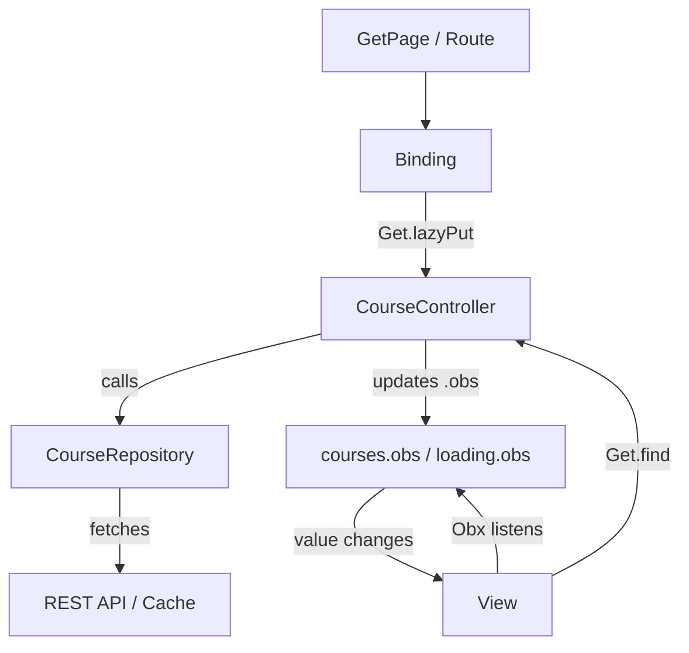

**Giải thích:** GetX nhanh cho flow đơn giản vì controller, DI, routing và reactive UI nằm trong cùng ecosystem. Nhưng app lớn vẫn cần repository/service boundaries rõ, tránh đưa quá nhiều logic hoặc global state vào controller.

#### Interview Short Answer

> "GetX works with controllers and reactive variables. A controller owns state and actions, `.obs` makes state reactive, and `Obx` rebuilds only the UI that depends on that state. I prefer using Bindings for dependency injection instead of calling Get.put directly inside widgets. GetX is fast for simple modules, but in large projects I still keep Clean Architecture boundaries."

### Q15. Làm sao để tránh state management bị rối?

### Câu trả lời

> "Em giữ state gần feature, tránh đưa mọi thứ vào một global store, và tách UI state khỏi business state.
>
> Em cũng define state classes rõ ràng: initial, loading, success, empty và failure.
>
> Với flow phức tạp, em document state transitions để developer khác dễ hiểu và review."

#### Diagram Sample - Avoid Messy State

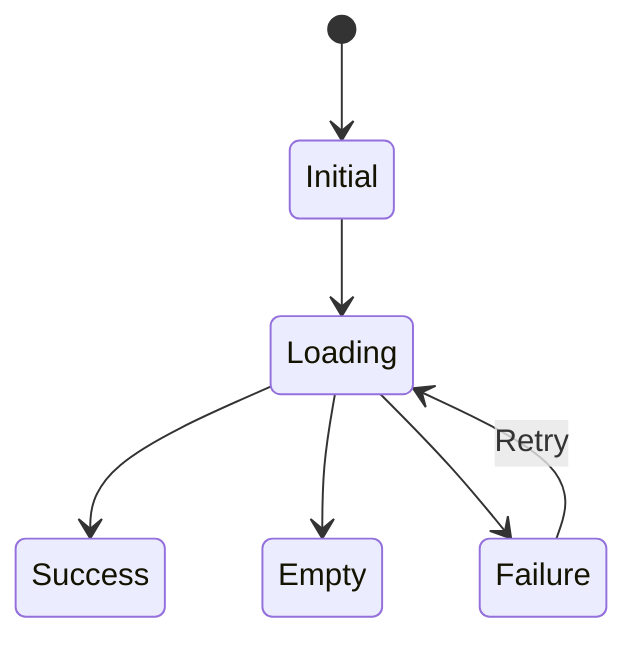

**Giải thích:** Define explicit states. Không trộn loading flags, error strings và data random trong UI.

---

## 6. REST API, Firebase, Notification, Socket

### Q16. Bạn design API layer trong Flutter như thế nào?

### Câu trả lời

> "Em thường tạo type-safe API layer bằng Dio hoặc Retrofit.
>
> API layer handle base URL, interceptors, authentication headers, timeout, refresh token, logging ở non-production và error mapping.
>
> Repository nhận API results và convert thành domain entities hoặc failures."

#### Code Sample - Dio API Layer

```dart
class ApiClient {
  ApiClient(this._dio);

  final Dio _dio;

  Future<Response<dynamic>> getCourses() => _dio.get('/courses');
}
```

**Giải thích:** Centralize networking. Feature code không nên tự tạo Dio thủ công.

### Q17. Bạn handle token refresh như thế nào?

### Câu trả lời

> "Em dùng interceptor để detect 401 response, refresh token, retry failed request, và tránh nhiều refresh calls chạy cùng lúc.
>
> Token nên được store an toàn, ví dụ flutter_secure_storage hoặc platform secure storage.
>
> Với fintech và education app, cần tránh expose token trong logs hoặc crash reports."

#### Code Sample - Token Refresh Shape

```dart
class AuthInterceptor extends Interceptor {
  AuthInterceptor(this._tokenStore);

  final TokenStore _tokenStore;

  @override
  Future<void> onRequest(
    RequestOptions options,
    RequestInterceptorHandler handler,
  ) async {
    final token = await _tokenStore.readAccessToken();
    if (token != null) {
      options.headers['Authorization'] = 'Bearer $token';
    }
    handler.next(options);
  }
}
```

**Giải thích:** Đưa auth headers vào interceptor. Với 401, refresh token ở một chỗ và retry an toàn.

### Q18. Bạn dùng Firebase trong mobile app như thế nào?

### Câu trả lời

> "Em từng dùng Firebase cho analytics, crash reporting, messaging và app distribution.
>
> Với AEH, Firebase có thể giúp track learning behavior, monitor crashes, receive push notifications và support testing builds.
>
> Em sẽ wrap Firebase sau service để usage không bị rải khắp codebase."

#### Code Sample - Firebase Analytics Wrapper

```dart
class AnalyticsService {
  const AnalyticsService(this._analytics);

  final FirebaseAnalytics _analytics;

  Future<void> logLessonStarted(String lessonId) {
    return _analytics.logEvent(
      name: 'lesson_started',
      parameters: <String, Object>{'lesson_id': lessonId},
    );
  }
}
```

**Giải thích:** Wrap Firebase để analytics naming nhất quán và không bị scatter trong screens.

### Q19. Bạn implement push notification như thế nào?

### Câu trả lời

> "Flow thường gồm request permission, FCM token registration, backend token sync, foreground handling, background handling và deep link khi user tap notification.
>
> Với education product, notification có thể remind user về lessons, assignments, live classes hoặc progress milestones.
>
> Em cũng sẽ define notification categories và tránh gửi notification quá noisy."

#### Code Sample - Push Notification Flow

```dart
class PushTokenRegistrar {
  const PushTokenRegistrar(this._messaging, this._apiClient);

  final FirebaseMessaging _messaging;
  final ApiClient _apiClient;

  Future<void> register() async {
    final token = await _messaging.getToken();
    if (token == null) return;
    await _apiClient.post('/devices', data: <String, Object>{'token': token});
  }
}
```

**Giải thích:** Mobile lấy FCM token và gửi lên backend để AEH có thể gửi reminders.

### Q20. Bạn làm việc với Socket hoặc real-time feature như thế nào?

### Câu trả lời

> "Em coi socket như một stream events chạy dài.
>
> Em define connection states, reconnect strategy, heartbeat, authentication, event parsing và cleanup khi screen hoặc session kết thúc.
>
> Với AEH, socket có thể dùng cho live class events, chat, AI response streaming hoặc real-time learning progress."

#### Code Sample - Socket / Realtime Stream

```dart
Stream<LiveClassEvent> liveClassEvents(WebSocketChannel channel) {
  return channel.stream.map((raw) {
    final json = jsonDecode(raw as String) as Map<String, dynamic>;
    return LiveClassEvent.fromJson(json);
  });
}
```

**Giải thích:** Socket messages tự nhiên là một stream. Map raw events thành typed domain events.

---

## 7. AI, OCR, AI Agents

### Q21. Bạn có kinh nghiệm gì với AI-related mobile features?

### Câu trả lời

> "Em từng làm Netchat, một Flutter-based AI chatbot application tích hợp server APIs và có business documentation requirements.
>
> Em làm độc lập phía mobile, phối hợp với BA, backend, QA và client stakeholders, fix UI issues và cải thiện production behavior.
>
> Kinh nghiệm này liên quan trực tiếp tới AEH vì JD có nhắc AI modules và AI Agents."

#### Diagram Sample - AI Feature In Mobile

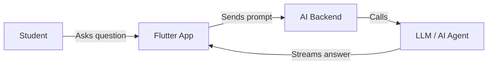

**Giải thích:** Mobile không nên own AI logic. Mobile own UX, state, request contract và streaming display.

### Q22. Bạn sẽ integrate AI chatbot trong Flutter app như thế nào?

### Câu trả lời

> "Em sẽ tách chatbot thành UI, state management, conversation service, API client và streaming parser.
>
> UI cần support typing, loading, partial response, retry, error và conversation history.
>
> Nếu response stream từ backend, em sẽ dùng Stream và state model rõ để UI update dần."

#### Code Sample - AI Chat Streaming State

```dart
class AiChatCubit extends Cubit<AiChatState> {
  AiChatCubit(this._service) : super(const AiChatState.initial());

  final AiChatService _service;

  Future<void> send(String message) async {
    emit(const AiChatState.streaming(''));
    var fullText = '';
    await for (final chunk in _service.streamAnswer(message)) {
      fullText += chunk;
      emit(AiChatState.streaming(fullText));
    }
    emit(AiChatState.done(fullText));
  }
}
```

**Giải thích:** Cách này support partial AI response thay vì chờ toàn bộ answer.

### Q23. Bạn sẽ integrate OCR như thế nào?

### Câu trả lời

> "OCR integration có thể local, server-side hoặc third-party SDK based.
>
> Em sẽ clarify requirement trước: image capture, document type, accuracy, offline need, data privacy và processing latency.
>
> Từ kinh nghiệm Finhay, identity verification flow cần UX cẩn thận, error handling, SDK handoff và fallback behavior."

#### Code Sample - OCR Abstraction

```dart
abstract interface class OcrService {
  Future<OcrResult> extractText(String imagePath);
}

class OcrResult {
  const OcrResult({required this.text, required this.confidence});

  final String text;
  final double confidence;
}
```

**Giải thích:** Che giấu OCR provider details. UI chỉ phụ thuộc stable interface.

### Q24. Bạn sẽ integrate AI Agents như thế nào?

### Câu trả lời

> "Em sẽ coi AI Agents là backend-driven intelligent services, không phải UI logic.
>
> Ở mobile, em tập trung vào request/response contract, session state, streaming output, user confirmation, error handling và privacy boundaries.
>
> Với education platform, AI Agents có thể hỗ trợ personalized learning paths, homework hints, content search hoặc automated feedback."

#### Diagram Sample - AI Agent Integration

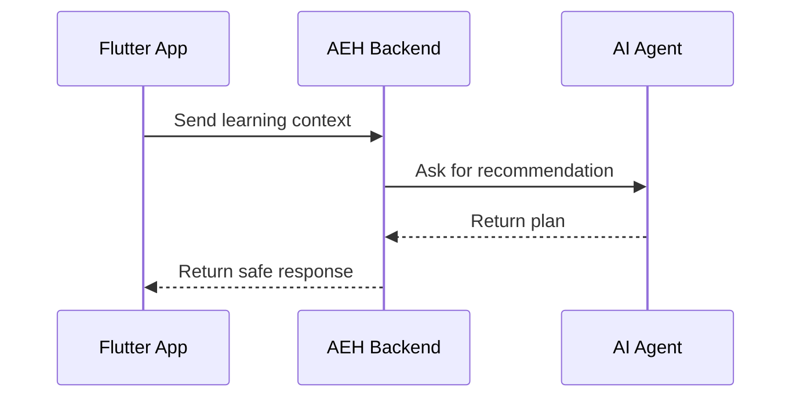

**Giải thích:** AI Agent nên được backend control. Mobile display và confirm actions một cách an toàn.

### Q25. Rủi ro của AI/OCR trong mobile là gì?

### Câu trả lời

> "Rủi ro chính là kết quả không chính xác, response chậm, privacy issues, cost cao và fallback behavior kém.
>
> Với OCR, app phải handle ảnh xấu, thiếu sáng, blur, network failure và retry.
>
> Với AI, app nên show loading state rõ, tránh expose sensitive data, và cho user retry hoặc correct result."

#### Code Sample - AI/OCR Failure State

```dart
sealed class AiResultState {
  const AiResultState();
}

class AiResultLoading extends AiResultState {
  const AiResultLoading();
}

class AiResultFailure extends AiResultState {
  const AiResultFailure(this.message);
  final String message;
}
```

**Giải thích:** AI/OCR có thể fail vì latency, bad input hoặc model uncertainty. Nên model các states này rõ ràng.

---

## 8. Backend Collaboration: Spring Boot, Microservices, AWS/GCP

### Q26. Bạn làm việc với backend team như thế nào?

### Câu trả lời

> "Em thường align API contract, request/response format, error codes, authentication, pagination và edge cases trước khi implement.
>
> Nếu có Swagger hoặc API spec thì em sẽ dùng làm nguồn chính.
>
> Ở các project trước, em phối hợp chặt với backend, QA, product và design team để align business rules và release quality."

#### Code Sample - Backend API Contract Example

```json
{
  "lessonId": "lesson_123",
  "studentAnswer": "Photosynthesis is...",
  "metadata": {
    "platform": "ios",
    "appVersion": "1.4.0"
  }
}
```

**Giải thích:** Khi làm với backend, cần clarify payload, error codes, auth, pagination và edge cases trước khi implement.

### Q27. Microservices ảnh hưởng gì tới mobile?

### Câu trả lời

> "Từ góc nhìn mobile, microservices nghĩa là app có thể phụ thuộc nhiều backend services, mỗi service có latency, error behavior và deployment cycle riêng.
>
> Mobile app không nên expose complexity này trực tiếp cho users.
>
> Em sẽ handle errors nhất quán, define retry rules và phối hợp backend về stable API contracts."

#### Diagram Sample - Microservices From Mobile View

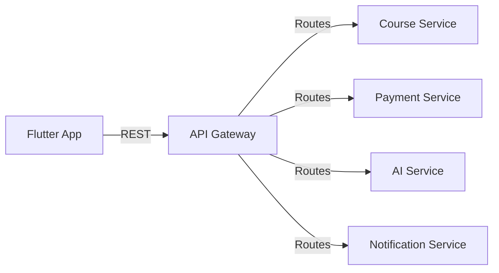

**Giải thích:** Mobile nên nhìn thấy stable APIs, dù backend bên trong chia thành nhiều microservices.

### Q28. Bạn xử lý API inconsistency giữa microservices như thế nào?

### Câu trả lời

> "Em sẽ define common API response model trong mobile app và map các backend errors khác nhau thành app failures nhất quán.
>
> Nếu vấn đề xảy ra thường xuyên, em sẽ đề xuất backend align error format qua API spec.
>
> Em cũng document các API quirks để QA và developer khác test đúng."

#### Code Sample - Normalize API Errors

```dart
class AppFailure {
  const AppFailure(this.message);

  final String message;
}

class ApiErrorMapper {
  AppFailure map(Response<dynamic> response) {
    return switch (response.statusCode) {
      401 => const AppFailure('Session expired. Please login again.'),
      403 => const AppFailure('You do not have permission.'),
      500 => const AppFailure('Server error. Please try later.'),
      _ => const AppFailure('Something went wrong.'),
    };
  }
}
```

**Giải thích:** Mỗi service có thể trả error khác nhau. Mobile map chúng thành user-facing failures nhất quán.

### Q29. AWS/GCP ảnh hưởng gì tới mobile development?

### Câu trả lời

> "Mobile developer không phải lúc nào cũng deploy backend infrastructure, nhưng cần hiểu environment và cloud behavior.
>
> Ví dụ, mỗi environment có thể có base URLs, API gateways, storage, notification setup và analytics configuration khác nhau.
>
> Em sẽ quản lý environment config cẩn thận và tránh hardcode production values."

#### Code Sample - Environment Config

```dart
class AppConfig {
  const AppConfig({required this.baseUrl});

  final String baseUrl;

  factory AppConfig.fromEnvironment() => const AppConfig(
        baseUrl: String.fromEnvironment('BASE_URL'),
      );
}
```

**Giải thích:** Dùng `--dart-define`; không hardcode production base URLs trong source code.

---

## 9. System Design, Technical Docs

### Q30. Bạn design một online learning app đơn giản như thế nào?

### Câu trả lời

> "Ở high level, Flutter app có các module như authentication, course catalog, lesson player, quiz, progress, notification, payment và AI assistant.
>
> App giao tiếp với backend microservices qua REST API và có thể dùng socket cho real-time features.
>
> Em sẽ dùng Clean Architecture theo từng feature, cùng shared core modules cho networking, storage, analytics, notification, design system và error handling."

#### Diagram Sample - Online Learning App Architecture

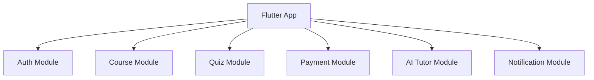

**Giải thích:** Split product theo business modules, không chỉ theo technical folders.

### Q31. Bạn có thể viết những technical documents nào?

### Câu trả lời

> "Em có thể viết API integration notes, feature technical design, module architecture, state transition diagrams, DB schema notes khi cần và release notes.
>
> Với mobile features, em thường document user flow, API contract, edge cases, error states và testing notes.
>
> Documentation tốt giúp backend, QA và mobile developers align trước khi implement."

#### Code Sample - Technical Doc Template

```md
# Feature Technical Design

## Goal
Describe business goal.

## User Flow
Step-by-step flow.

## API Contract
Endpoint, request, response, errors.

## Edge Cases
Offline, timeout, permission denied.

## Test Notes
Unit, widget, integration, manual QA.
```

**Giải thích:** Docs tốt giúp giảm misunderstanding giữa mobile, backend, QA và product.

### Q32. Bạn document AI homework feedback feature như thế nào?

### Câu trả lời

> "Em sẽ document goal, user flow, API contract, request payload, response payload, loading/error states, privacy rules, analytics events và test cases.
>
> Em cũng mô tả fallback behavior khi AI service chậm hoặc unavailable.
>
> Điều này quan trọng vì AI features có thể fail theo cách không deterministic."

#### Diagram Sample - AI Homework Feedback Feature

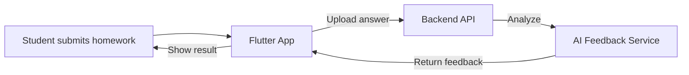

**Giải thích:** Cần document request, response, privacy, loading state, retry và fallback khi AI chậm.

---

## 10. Git Flow, Code Review, Conflict

### Q33. Bạn thích Git flow như thế nào?

### Câu trả lời

> "Em thích Git flow rõ ràng với protected main branch, feature branches, pull requests, code review và CI checks.
>
> Với project release nhiều, có thể dùng develop, release branches, hotfix branches và tags.
>
> Exact flow tùy team, nhưng quan trọng là traceability và safe release."

#### Diagram Sample - Git Flow

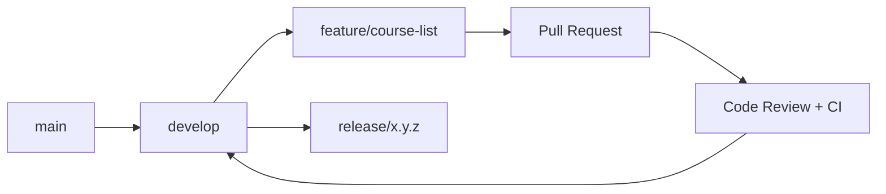

**Giải thích:** Git flow nên giúp changes reviewable và releases traceable.

### Q34. Bạn xử lý merge conflicts như thế nào?

### Câu trả lời

> "Đầu tiên, em xác định files bị conflict và hiểu cả hai thay đổi.
>
> Em tránh blindly accept một side. Nếu conflict chạm business logic, em sẽ trao đổi với developer liên quan.
>
> Sau khi resolve, em chạy tests hoặc ít nhất verify affected flow."

#### Code Sample - Conflict Handling Checklist

```text
1. Pull latest target branch.
2. Identify conflicted files.
3. Understand both changes.
4. Resolve manually.
5. Run tests or verify affected flow.
6. Ask original author if business logic is unclear.
```

**Giải thích:** Không blindly accept current hoặc incoming change nếu conflict chạm business logic.

### Q35. Bạn review code như thế nào?

### Câu trả lời

> "Em review code dựa trên correctness, readability, architecture, edge cases, error handling, security và test coverage.
>
> Em cũng check code có follow project conventions không và có tạo hidden coupling không.
>
> Comment review nên specific và actionable, không chỉ là personal preference."

#### Code Sample - Code Review Checklist

```text
Correctness: Does it solve the requirement?
Architecture: Is logic in the right layer?
Error handling: Are failures handled?
Security: Any token or PII leak?
Testing: Are success and failure cases covered?
Maintainability: Is naming clear?
```

**Giải thích:** Review nên cụ thể và actionable, không phải tranh luận preference cá nhân.

### Q36. Bạn detect và fix bug hiệu quả như thế nào?

### Câu trả lời

> "Em bắt đầu bằng reproduce issue và collect logs, device info, app version, environment và user steps.
>
> Sau đó em isolate layer: UI, state management, API, local storage, native SDK hoặc backend.
>
> Sau khi fix, em verify original case và add regression coverage nếu có thể."

#### Diagram Sample - Bug Investigation Flow

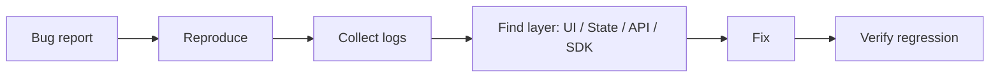

**Giải thích:** Bắt đầu từ reproduction, sau đó isolate layer trước khi sửa code.

---

## 11. Third-Party Integration, KYC, Payment, Store

### Q37. Bạn từng làm third-party integrations nào?

### Câu trả lời

> "Em từng làm với NFC/liveness SDKs, social sign-in, Firebase, OneSignal, Branch deep linking, in-app purchase, media SDKs và App Store/TestFlight/Fastlane release flows.
>
> Ở Finhay, third-party identity verification rất critical. Ở Mydio, em làm in-app purchase và media playback. Ở QRCheckin, em làm OneSignal và Sentry.
>
> Điều này liên quan tới AEH vì JD ưu tiên kinh nghiệm KYC, Payment, Apple Store và Google Play."

#### Code Sample - Third-Party SDK Adapter

```dart
abstract interface class PaymentGateway {
  Future<PaymentResult> pay(PaymentRequest request);
}

class StripePaymentGateway implements PaymentGateway {
  @override
  Future<PaymentResult> pay(PaymentRequest request) async {
    // Call Stripe SDK or backend checkout session.
    return const PaymentResult.success();
  }
}
```

**Giải thích:** Wrap third-party SDK sau interface để app có thể thay provider sau này.

### Q38. Bạn integrate payment trong mobile app như thế nào?

### Câu trả lời

> "Em sẽ define payment flow rõ: product selection, payment intent, provider checkout, result callback, backend verification và UI state update.
>
> Mobile app không nên chỉ trust client-side payment result. Backend verification rất quan trọng.
>
> Em cũng handle pending, failed, cancelled và duplicate payment states."

#### Diagram Sample - Payment Flow

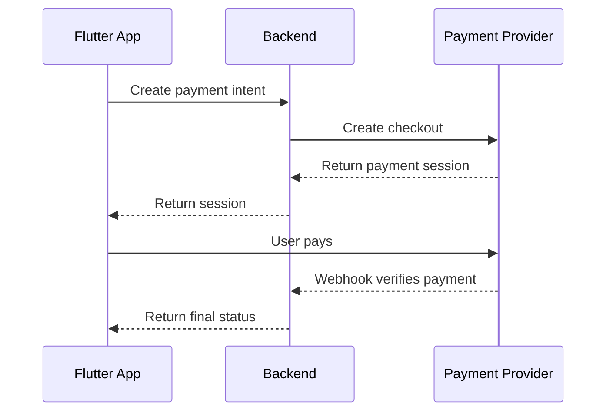

**Giải thích:** Không trust client-only payment result. Backend verification là bắt buộc.

### Q39. Bạn chuẩn bị App Store / Google Play release như thế nào?

### Câu trả lời

> "Em check versioning, signing, build flavor, environment config, permissions, privacy descriptions, crash reporting và release notes.
>
> Em cũng đảm bảo QA verify critical flows trên cả hai platform.
>
> Ở các project trước, em đã dùng Fastlane, TestFlight, Firebase App Distribution, DeployGate và CI/CD flows."

#### Code Sample - Release Checklist

```text
Before release:
- Check app version and build number.
- Check signing and flavor.
- Verify DEV / SIT / UAT / PROD config.
- Run smoke tests for login, course, payment, notification.
- Upload dSYM / mapping files for crash reporting.
- Prepare release notes.
```

**Giải thích:** Release không chỉ là build app. Nó gồm config, QA, store metadata, monitoring và rollback awareness.

---

## 12. Phụ Lục - Code Dài Hơn Để Giải Thích Khi Bị Hỏi Sâu

> Dùng phần này khi interviewer hỏi: "Can you show how you would implement it?"

### Example 1. Feature-Based Clean Architecture Cho Course Module

```text
lib/
  features/
    course/
      presentation/
        pages/course_list_page.dart
        cubit/course_list_cubit.dart
        cubit/course_list_state.dart
      domain/
        entities/course.dart
        repositories/course_repository.dart
        usecases/get_courses.dart
      data/
        datasources/course_remote_data_source.dart
        models/course_dto.dart
        repositories/course_repository_impl.dart
  core/
    network/
    error/
    storage/
    analytics/
```

**Giải thích:** Structure theo feature giúp module course độc lập hơn. Khi team mở rộng app giáo dục, mỗi module như quiz, lesson, payment, AI tutor có boundary riêng.

### Example 2. Entity, DTO Và Mapper

```dart
class Course {
  const Course({
    required this.id,
    required this.title,
    required this.lessonCount,
  });

  final String id;
  final String title;
  final int lessonCount;
}

class CourseDto {
  const CourseDto({
    required this.id,
    required this.name,
    required this.totalLessons,
  });

  final String id;
  final String name;
  final int totalLessons;

  Course toEntity() => Course(
        id: id,
        title: name,
        lessonCount: totalLessons,
      );
}
```

**Giải thích:** DTO follow backend response. Entity follow business meaning. Khi backend đổi field name, thường chỉ cần sửa DTO/mapper.

### Example 3. Remote Data Source

```dart
class CourseRemoteDataSource {
  const CourseRemoteDataSource(this._apiClient);

  final ApiClient _apiClient;

  Future<List<CourseDto>> getCourses() async {
    final response = await _apiClient.get('/courses');
    final items = response.data as List<dynamic>;

    return items
        .map((item) => CourseDto.fromJson(item as Map<String, dynamic>))
        .toList();
  }
}
```

**Giải thích:** Data source chỉ biết API details. Repository quyết định map sang domain và handle failures.

### Example 4. Cubit State Flow

```dart
sealed class CourseListState {
  const CourseListState();
}

class CourseListInitial extends CourseListState {
  const CourseListInitial();
}

class CourseListLoading extends CourseListState {
  const CourseListLoading();
}

class CourseListSuccess extends CourseListState {
  const CourseListSuccess(this.courses);

  final List<Course> courses;
}

class CourseListFailure extends CourseListState {
  const CourseListFailure(this.message);

  final String message;
}
```

**Giải thích:** State rõ ràng giúp UI dễ render và test case dễ viết hơn.

### Example 5. BlocBuilder Với buildWhen

```dart
BlocBuilder<CourseListCubit, CourseListState>(
  buildWhen: (previous, current) => previous.runtimeType != current.runtimeType,
  builder: (context, state) {
    return switch (state) {
      CourseListLoading() => const CircularProgressIndicator(),
      CourseListSuccess(:final courses) => CourseList(courses: courses),
      CourseListFailure(:final message) => Text(message),
      _ => const SizedBox.shrink(),
    };
  },
)
```

**Giải thích:** `buildWhen` giúp tránh rebuild không cần thiết, nhất là với subtree nặng.

---

## 13. Behavioral Questions

### Q40. Hãy kể về một technical problem khó bạn từng xử lý.

### Câu trả lời

> "Ở Finhay, một vấn đề khó là migrate eKYC UI từ native iOS/Android sang Flutter trong khi vẫn giữ native NFC và liveness SDKs.
>
> Risk khá cao vì eKYC liên quan security, SDK handoff, navigation, callback results và fallback behavior.
>
> Em tham gia design Flutter-Native bridge contract, chuẩn hóa navigation behavior và plan phased rollout với Remote Config và fallback về legacy native flow."

### Q41. Bạn làm việc thế nào khi deadline gấp?

### Câu trả lời

> "Em clarify must-have scope trước, sau đó chia work thành deliverables nhỏ hơn.
>
> Em ưu tiên high-risk parts sớm, đặc biệt là API contract, native SDK, authentication và release blockers.
>
> Nếu scope quá lớn, em communicate trade-offs sớm thay vì giấu risk."

### Q42. Bạn mentor junior developers như thế nào?

### Câu trả lời

> "Em mentor bằng cách đưa context rõ, giải thích architecture decisions, review pull requests và pair khi gặp bug khó.
>
> Em muốn junior hiểu vì sao chọn solution, không chỉ biết viết code gì.
>
> Ở các role trước, em từng coordinate tasks và support middle/junior developers trong khi vẫn giữ module boundaries rõ."

### Q43. Khi requirement chưa rõ, bạn làm gì?

### Câu trả lời

> "Em hỏi clarifying questions và ghi lại assumptions.
>
> Em thường confirm user flow, API behavior, edge cases, error states và acceptance criteria.
>
> Nếu requirement ảnh hưởng backend hoặc QA, em align với họ trước khi code."

### Q44. Vì sao bạn chọn AEH?

### Câu trả lời

> "AEH hấp dẫn với em vì đây là digital education platform, không chỉ là một mobile app generic.
>
> JD kết hợp Flutter, system design, backend collaboration, AI, OCR, AI Agents và product quality.
>
> Điều này khớp với kinh nghiệm của em về education apps, AI chatbot, eKYC/OCR-like flows và production mobile architecture."

---

## 14. Câu Hỏi Nên Hỏi AEH

1. Hiện tại Flutter architecture của team là BLoC, GetX, Riverpod hay custom pattern?
2. Product đầu tiên em sẽ tham gia là ClassForMe hay platform khác của AEH?
3. AI/OCR/AI Agents đã có backend sẵn chưa, hay mobile sẽ cùng design integration flow?
4. Team đã có API specs và DB schema documents chưa?
5. Git flow và release process hiện tại như thế nào?
6. Firebase, notifications và socket đang được dùng cho use case nào?
7. Technical problem lớn nhất của mobile app hiện tại là gì?
8. Mobile team phối hợp với Java Spring Boot microservice team như thế nào?
9. Payment và store release do mobile team handle hay có release team riêng?
10. Trong 3 tháng đầu, như thế nào được xem là thành công ở role này?

---

## 15. Cheat Sheet Trước Buổi Phỏng Vấn

### 30-second pitch

> "Em có hơn 7 năm kinh nghiệm mobile với Flutter, React Native và native iOS/Android. Với Flutter, em có kinh nghiệm Clean Architecture, BLoC/Cubit, Riverpod, Dio, Firebase, notification, native bridge và production release. Những project liên quan nhất với AEH là Finhay cho eKYC/OCR-like identity flows, Netchat cho AI chatbot, và Raise 2.0 cho education domain."

### 5 keywords mạnh nhất

- Flutter production delivery
- Clean Architecture
- AI chatbot / OCR-like eKYC flow
- Backend API collaboration
- Git flow, code review, production bug fixing
