# AEH - Mobile Developer Interview Prep

> **Company:** Authentic Education Hub (AEH)  
> **Role:** Mobile Developer - Flutter  
> **Domain:** Digital education platform, online learning, digital learning content ecosystem  
> **Source JD:** `%5BAEH%5D%20-%20JD%20Mobile%20Developer.pdf`  
> **Reference format:** `virtusa-flutter-mobile-interview-prep.md`  
> **Best CV anchors:** Finhay eKYC, Netchat AI chatbot, Raise 2.0 education app, QRCheckin enterprise app, MSB banking app

---

## 0. How To Use This File

| Block | Focus | Priority |
|---|---|---|
| 1 | Self-introduction for AEH | Must memorize |
| 2 | JD-to-CV matching | Must memorize |
| 3 | Flutter/Dart core | High |
| 4 | Architecture, SOLID, Clean Architecture | High |
| 5 | State management: BLoC, GetX, Riverpod | High |
| 6 | REST API, Firebase, Notification, Socket | High |
| 7 | AI, OCR, AI Agents integration | Very high |
| 8 | Backend collaboration: Spring Boot, Microservices, AWS/GCP | High |
| 9 | System design and technical docs | High |
| 10 | Git flow, code review, bug handling | High |
| 11 | Third-party integration, KYC, Payment, Store release | Medium-high |
| 12 | Appendix: longer code examples | Medium-high |
| 13 | Behavioral questions | High |
| 14 | Questions to ask AEH | Medium |
| 15 | Last-minute cheat sheet | Medium |

**Rule for answers:** short, direct, and tied to real CV examples.

---

## 1. Self-Introduction

### Q1. Tell me about yourself.

### Answer - English

> "Hi, I'm Long. I have over 7 years of mobile development experience across React Native, Flutter, and native iOS/Android.
>
> For Flutter, I have production experience with Clean Architecture, BLoC, Cubit, Riverpod, Provider, MobX, Dio, Retrofit, Firebase, Sentry, OneSignal, and native bridge integration through MethodChannel and EventChannel.
>
> My strongest recent Flutter-related experience is at Finhay, where I worked on a hybrid fintech app involving eKYC, NFC reading, liveness verification, authentication, secure token handling, and Flutter-Native bridge design.
>
> I also worked on Netchat, a Flutter-based AI chatbot application, and Raise 2.0, an education app using Riverpod, go_router, Dio, Firebase, audio/video playback, and clean modular architecture.
>
> I am interested in AEH because the role combines Flutter, education technology, AI/OCR/AI Agents, backend collaboration, and product quality, which match my experience very well."

### Answer - Vietnamese backup

> "Em là Long, có hơn 7 năm kinh nghiệm mobile với React Native, Flutter và native iOS/Android.
>
> Với Flutter, em có kinh nghiệm production về Clean Architecture, BLoC/Cubit/Riverpod, Dio/Retrofit, Firebase, notification, native bridge qua MethodChannel/EventChannel.
>
> Ở Finhay, em làm hybrid fintech app liên quan tới eKYC, NFC, liveness, authentication và Flutter-Native bridge. Ngoài ra em từng làm Netchat là AI chatbot Flutter app, và Raise 2.0 là app giáo dục cho phụ huynh/trẻ em.
>
> Em quan tâm AEH vì JD kết hợp Flutter, education platform, AI/OCR/AI Agents, backend microservice và chất lượng sản phẩm."

### 3 phrases to memorize

- "Flutter + education + AI integration is a strong match with my Finhay, Netchat, and Raise 2.0 experience."
- "I can own a feature from requirement clarification to architecture, implementation, testing, and release."
- "I am comfortable working with backend teams, API contracts, Git flow, code review, and production bug fixing."

---

## 2. JD-To-CV Matching

| AEH Requirement | Best CV Evidence | Interview Angle |
|---|---|---|
| 5+ years Flutter/mobile | 7+ years mobile, 4+ years Flutter | Senior mobile ownership |
| Flutter & Dart | Finhay, Netchat, Raise, QRCheckin, EPS | Production Flutter experience |
| BLoC / GetX / Riverpod | Netchat BLoC/Cubit, Raise Riverpod, QRCheckin MobX, EPS Provider/BLoC | Can adapt state management |
| REST API | Dio, Retrofit, backend collaboration | API integration discipline |
| Firebase / Notification / Socket | Firebase, OneSignal, FCM, EventFlux chatbot streaming | Real-time and push experience |
| SOLID / Design Pattern / Clean Architecture | Finhay, Netchat, Raise, QRCheckin | Architecture mindset |
| Technical docs | Onboarding docs, API contracts, maintainability guidelines | Senior process |
| Git flow / conflict | Team coordination, release, CI/CD | Delivery quality |
| KYC / Payment / Store | Finhay eKYC, ViettelPay Pro, in-app purchase, TestFlight/Fastlane | Third-party integration |
| AI / OCR / AI Agents | Netchat AI chatbot, Finhay eKYC/OCR/NFC/liveness | Very relevant to AEH smart modules |

---

## 3. Flutter & Dart Core

### Q2. What is your Flutter production experience?

### Answer

> "I have worked on multiple production Flutter apps, including Finhay, Netchat, Raise 2.0, QRCheckin, EPS, and Health Record.
>
> In production, I usually focus on clean architecture, state management, API integration, error handling, performance, release readiness, and maintainability.
>
> For example, in Finhay, I worked on eKYC and authentication flows with Flutter-Native bridge integration. In Netchat, I worked on a Flutter AI chatbot with BLoC/Cubit and Clean Architecture. In Raise 2.0, I worked with Riverpod, go_router, Dio, Firebase, audio/video playback, and modular architecture."

#### Diagram Sample - Flutter Production Feature Skeleton

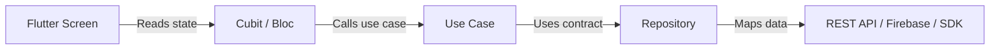

**Explain:** This is the production shape I usually describe: UI is thin, state owns screen behavior, domain owns business flow, repository owns data access.

### Q3. What are the most important Dart features for Flutter development?

### Answer

> "For daily Flutter work, the most important Dart features are null safety, async/await, Future, Stream, extension methods, mixins, sealed classes, and records.
>
> Null safety helps prevent runtime null crashes. Future is useful for one-time async work like REST API calls. Stream is useful for continuous data such as socket events, Firebase snapshots, or chatbot streaming.
>
> In production, I also care about type safety because it makes code review and refactoring safer."

#### Code Sample - Dart Features Used Daily

```dart
extension NullableStringX on String? {
  String get displayName => this?.trim().isNotEmpty == true ? this! : 'Guest';
}

Future<String> loadUserName() async {
  final rawName = await Future<String?>.value(null);
  return rawName.displayName;
}
```

**Explain:** Null safety, extension methods, and async/await make Flutter code safer and easier to read.

### Q4. Future vs Stream?

### Answer

> "Future returns one async result, while Stream can return multiple values over time.
>
> I use Future for REST API calls, reading local storage, or loading a profile once. I use Stream for sockets, Firebase updates, real-time chat, or AI chatbot streaming.
>
> In Netchat, streaming behavior was important because chatbot responses can arrive gradually, so a Stream-style approach fits better than a single Future."

#### Code Sample - Future vs Stream

```dart
Future<List<Course>> fetchCourses() async => const <Course>[];

Stream<String> streamAiAnswer() async* {
  yield 'Hello';
  yield ' from';
  yield ' AEH AI tutor';
}
```

**Explain:** `Future` is for one result. `Stream` is for many values over time, such as AI streaming, socket events, or Firebase updates.

### Q5. How do you handle errors in Flutter?

### Answer

> "I prefer handling errors by layer.
>
> In the data layer, I catch API, timeout, parsing, and network exceptions. In the domain layer, I convert them into business-friendly failures. In the presentation layer, I show clear UI states such as loading, success, empty, and error.
>
> For production apps, I also log important errors to Sentry or Firebase Crashlytics, but I avoid logging sensitive user data."

#### Code Sample - Error Mapping

```dart
sealed class AppFailure {
  const AppFailure(this.message);
  final String message;
}

class NetworkFailure extends AppFailure {
  const NetworkFailure() : super('Network error. Please try again.');
}

class CourseRepository {
  Future<List<Course>> getCourses() async {
    try {
      return const <Course>[];
    } catch (_) {
      throw const NetworkFailure();
    }
  }
}
```

**Explain:** Convert technical exceptions into user-friendly failures before they reach the UI.

### Q6. How do you improve Flutter performance?

### Answer

> "I usually start by checking rebuilds, expensive widgets, image loading, list rendering, and async work.
>
> I use const widgets where possible, split large widgets into smaller components, use ListView.builder for long lists, avoid heavy work in build(), and profile with Flutter DevTools.
>
> If parsing or computation is heavy, I move it away from the UI thread, for example with compute or an isolate."

#### Code Sample - Performance: ListView.builder + const

```dart
class CourseList extends StatelessWidget {
  const CourseList({required this.courses, super.key});

  final List<Course> courses;

  @override
  Widget build(BuildContext context) => ListView.builder(
        itemCount: courses.length,
        itemBuilder: (context, index) => CourseTile(
          course: courses[index],
        ),
      );
}
```

**Explain:** Use lazy rendering for long lists and keep widgets small to reduce rebuild cost.

---

## 4. Architecture, SOLID, Clean Architecture

### Q7. What architecture do you use in Flutter?

### Answer

> "For medium and large projects, I prefer feature-based Clean Architecture.
>
> Each feature has presentation, domain, and data layers. Presentation contains screens and state management. Domain contains business rules, entities, and repository contracts. Data contains API clients, DTOs, local storage, and repository implementations.
>
> This structure keeps the code testable, maintainable, and easier for multiple developers to work on."

#### Diagram Sample - Clean Architecture

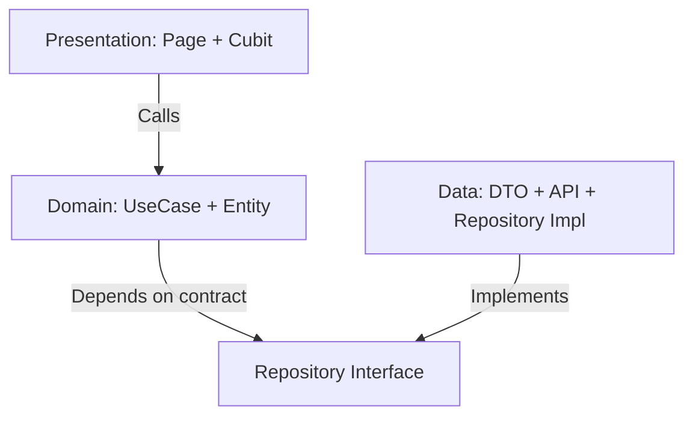

**Explain:** Domain does not depend on Flutter or Dio. Data implementation depends inward on domain contracts.

### Q8. Why does Clean Architecture matter?

### Answer

> "The main benefit is separation of concerns.
>
> UI should not know API details. Business logic should not depend directly on Flutter widgets. Data models should not leak into every layer.
>
> In my Finhay and Netchat experience, clear boundaries helped us maintain complex flows like eKYC, authentication, and chatbot response handling."

#### Diagram Sample - Why Clean Architecture Matters

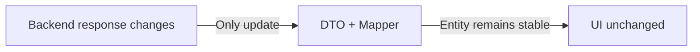

**Explain:** Clean Architecture protects UI and business logic from backend response changes.

### Q9. How do you apply SOLID in Flutter?

### Answer

> "I apply SOLID mainly through small classes, clear interfaces, dependency inversion, and single responsibility.
>
> For example, a screen should not directly call Dio. It should call a Cubit/Bloc or controller. The Cubit calls a use case or repository. The repository depends on an API abstraction.
>
> This makes it easier to test and easier to replace implementations later."

#### Code Sample - SOLID / Dependency Inversion

```dart
abstract interface class AuthRepository {
  Future<bool> isLoggedIn();
}

class CheckLoginStatus {
  const CheckLoginStatus(this._repository);

  final AuthRepository _repository;

  Future<bool> call() => _repository.isLoggedIn();
}
```

**Explain:** The use case depends on an abstraction, not on Dio, Firebase, or local storage directly.

### Q10. Repository pattern: why and how?

### Answer

> "Repository pattern hides the data source from the rest of the app.
>
> The UI and domain layer do not need to know whether data comes from REST API, cache, local database, Firebase, or a third-party SDK.
>
> For example, in an education app, a CourseRepository could fetch courses from REST API, cache them locally, and later support offline mode without changing the UI."

#### Code Sample - Repository Pattern

```dart
abstract interface class LessonRepository {
  Future<List<Lesson>> getLessons(String courseId);
}

class LessonRepositoryImpl implements LessonRepository {
  const LessonRepositoryImpl(this._remote);

  final LessonRemoteDataSource _remote;

  @override
  Future<List<Lesson>> getLessons(String courseId) async {
    final dtos = await _remote.getLessons(courseId);
    return dtos.map((dto) => dto.toEntity()).toList();
  }
}
```

**Explain:** Repository hides whether lessons come from REST API, cache, Firebase, or local DB.

### Q11. How would you design an AEH learning module feature?

### Answer

> "I would design it as a feature module.
>
> The presentation layer contains screens like course list, lesson detail, quiz, and progress. The domain layer contains entities such as Course, Lesson, Quiz, and LearningProgress. The data layer contains REST API services, DTOs, cache, and repository implementations.
>
> If AI or OCR is involved, I would isolate it behind a service interface so the UI does not depend directly on a specific AI provider."

#### Diagram Sample - AEH Learning Module

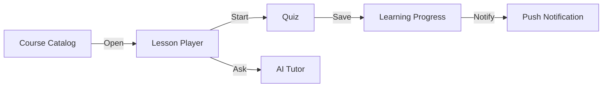

**Explain:** This shows how course, lesson, quiz, AI, progress, and notification can be separated into modules.

---

## 5. State Management

### Q12. BLoC vs Cubit?

### Answer

> "Cubit is simpler because it exposes methods and emits states directly. BLoC is more structured because it uses events and states.
>
> I use Cubit for simple feature flows like loading data, submitting a form, or toggling UI state. I use BLoC when the feature has many events, complex transitions, or needs clear event tracking.
>
> In Netchat, BLoC/Cubit was suitable because chatbot UI has loading, streaming, success, and error states."

#### Code Sample - Cubit vs Bloc Simple Cubit

```dart
class SearchCubit extends Cubit<SearchState> {
  SearchCubit(this._repository) : super(const SearchState.initial());

  final CourseRepository _repository;

  Future<void> search(String keyword) async {
    emit(const SearchState.loading());
    final courses = await _repository.search(keyword);
    emit(SearchState.success(courses));
  }
}
```

**Explain:** Cubit is good for simple method-driven flows. Bloc is better when you need explicit event tracking.

### Q13. Riverpod vs BLoC?

### Answer

> "Both are good, but they solve problems differently.
>
> BLoC is explicit and good for event-driven flows. Riverpod is flexible and good for dependency management, derived state, and modular features.
>
> In Raise 2.0, I used Riverpod with go_router, which worked well for a modular education product. In other projects, BLoC/Cubit worked better for explicit business flows."

#### Code Sample - Riverpod Provider

```dart
final courseRepositoryProvider = Provider<CourseRepository>((ref) {
  return CourseRepositoryImpl(ref.watch(courseRemoteDataSourceProvider));
});

final courseListProvider = FutureProvider<List<Course>>((ref) {
  return ref.watch(courseRepositoryProvider).getCourses();
});
```

**Explain:** Riverpod is convenient for dependency graph and derived async state.

### Q14. GetX: what do you think?

### Answer

> "GetX is fast to build with and convenient for simple projects, but I am careful with it in large codebases.
>
> If the project already uses GetX, I can work with it. But for long-term maintainability, I prefer clear boundaries, explicit dependencies, and avoiding too much hidden global state.
>
> For AEH, I would follow the team's existing standard, whether it is BLoC, Riverpod, GetX, or a similar pattern."

#### Code Sample - GetX Simple Controller

```dart
class CourseController extends GetxController {
  CourseController(this._repository);

  final CourseRepository _repository;
  final courses = <Course>[].obs;

  Future<void> loadCourses() async {
    courses.value = await _repository.getCourses();
  }
}
```

**Explain:** GetX is fast for simple flows, but for large apps I still keep repository and service boundaries clear.

### Q15. How do you avoid messy state management?

### Answer

> "I keep state close to the feature, avoid putting everything into one global store, and separate UI state from business state.
>
> I also define clear state classes: initial, loading, success, empty, and failure.
>
> For complex flows, I document state transitions so other team members can understand and review them."

#### Diagram Sample - Avoid Messy State

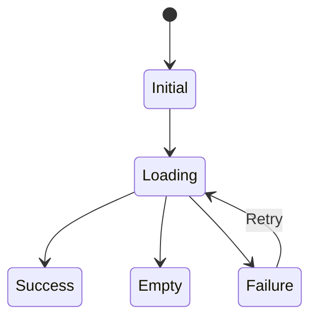

**Explain:** Define explicit states. Do not mix loading flags, error strings, and data randomly in UI.

---

## 6. REST API, Firebase, Notification, Socket

### Q16. How do you design the API layer in Flutter?

### Answer

> "I usually create a type-safe API layer using Dio or Retrofit.
>
> The API layer handles base URL, interceptors, authentication headers, timeout, refresh token, logging in non-production, and error mapping.
>
> The repository receives API results and converts them into domain entities or failures."

#### Code Sample - Dio API Layer

```dart
class ApiClient {
  ApiClient(this._dio);

  final Dio _dio;

  Future<Response<dynamic>> getCourses() => _dio.get('/courses');
}
```

**Explain:** Centralize networking. Feature code should not create Dio manually.

### Q17. How do you handle token refresh?

### Answer

> "I use an interceptor to detect 401 responses, refresh the token, retry the failed request, and avoid multiple refresh calls running at the same time.
>
> Tokens should be stored securely, for example in flutter_secure_storage or platform secure storage.
>
> In fintech and education apps, we must avoid exposing tokens in logs or crash reports."

#### Code Sample - Token Refresh Shape

```dart
class AuthInterceptor extends Interceptor {
  AuthInterceptor(this._tokenStore);

  final TokenStore _tokenStore;

  @override
  void onRequest(RequestOptions options, RequestInterceptorHandler handler) async {
    final token = await _tokenStore.readAccessToken();
    if (token != null) {
      options.headers['Authorization'] = 'Bearer $token';
    }
    handler.next(options);
  }
}
```

**Explain:** Put auth headers in interceptor. For 401, refresh token in one place and retry safely.

### Q18. How do you use Firebase in a mobile app?

### Answer

> "I have used Firebase for analytics, crash reporting, messaging, and app distribution.
>
> For AEH, Firebase can help track learning behavior, monitor crashes, receive push notifications, and support testing builds.
>
> I would keep Firebase usage behind services so it does not spread across the whole codebase."

#### Code Sample - Firebase Analytics Wrapper

```dart
class AnalyticsService {
  const AnalyticsService(this._analytics);

  final FirebaseAnalytics _analytics;

  Future<void> logLessonStarted(String lessonId) {
    return _analytics.logEvent(
      name: 'lesson_started',
      parameters: <String, Object>{'lesson_id': lessonId},
    );
  }
}
```

**Explain:** Wrap Firebase so analytics naming is consistent and not scattered across screens.

### Q19. How do you implement push notifications?

### Answer

> "The flow usually includes permission request, FCM token registration, backend token sync, foreground handling, background handling, and deep linking from notification tap.
>
> For education products, notifications can remind users about lessons, assignments, live classes, or progress milestones.
>
> I would also define notification categories and avoid sending noisy notifications."

#### Code Sample - Push Notification Flow

```dart
class PushTokenRegistrar {
  const PushTokenRegistrar(this._messaging, this._apiClient);

  final FirebaseMessaging _messaging;
  final ApiClient _apiClient;

  Future<void> register() async {
    final token = await _messaging.getToken();
    if (token == null) return;
    await _apiClient.post('/devices', data: <String, Object>{'token': token});
  }
}
```

**Explain:** Mobile gets the FCM token and sends it to backend so AEH can send reminders.

### Q20. How do you work with Socket or real-time features?

### Answer

> "I treat socket as a long-running stream of events.
>
> I define connection states, reconnect strategy, heartbeat, authentication, event parsing, and cleanup when the screen or session ends.
>
> For AEH, socket could be useful for live class events, chat, AI response streaming, or real-time learning progress."

#### Code Sample - Socket / Realtime Stream

```dart
Stream<LiveClassEvent> liveClassEvents(WebSocketChannel channel) {
  return channel.stream.map((raw) {
    final json = jsonDecode(raw as String) as Map<String, dynamic>;
    return LiveClassEvent.fromJson(json);
  });
}
```

**Explain:** Socket messages are naturally a stream. Map raw events into typed domain events.

---

## 7. AI, OCR, AI Agents

### Q21. What experience do you have with AI-related mobile features?

### Answer

> "I worked on Netchat, a Flutter-based AI chatbot application integrated with server APIs and business documentation requirements.
>
> I worked independently on the mobile side, coordinated with BA, backend, QA, and client stakeholders, fixed UI issues, and improved production behavior.
>
> That experience is relevant to AEH because the JD mentions AI modules and AI Agents."

#### Diagram Sample - AI Feature In Mobile

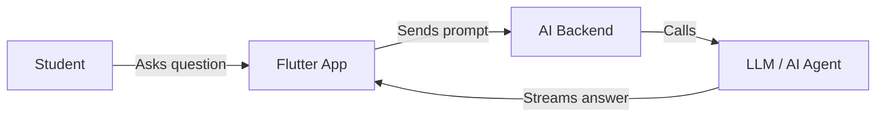

**Explain:** Mobile should not own AI logic. Mobile owns UX, state, request contract, and streaming display.

### Q22. How would you integrate an AI chatbot in a Flutter app?

### Answer

> "I would separate the chatbot into UI, state management, conversation service, API client, and streaming parser.
>
> The UI should support typing, loading, partial response, retry, error, and conversation history.
>
> If responses stream from backend, I would use Stream and a clear state model so the UI can update progressively."

#### Code Sample - AI Chat Streaming State

```dart
class AiChatCubit extends Cubit<AiChatState> {
  AiChatCubit(this._service) : super(const AiChatState.initial());

  final AiChatService _service;

  Future<void> send(String message) async {
    emit(const AiChatState.streaming(''));
    var fullText = '';
    await for (final chunk in _service.streamAnswer(message)) {
      fullText += chunk;
      emit(AiChatState.streaming(fullText));
    }
    emit(AiChatState.done(fullText));
  }
}
```

**Explain:** This supports partial AI response instead of waiting for the whole answer.

### Q23. How would you integrate OCR?

### Answer

> "OCR integration can be local, server-side, or third-party SDK based.
>
> I would start by clarifying the requirement: image capture, document type, accuracy, offline need, data privacy, and processing latency.
>
> From my Finhay experience, identity verification flows need careful UX, error handling, SDK handoff, and fallback behavior."

#### Code Sample - OCR Abstraction

```dart
abstract interface class OcrService {
  Future<OcrResult> extractText(String imagePath);
}

class OcrResult {
  const OcrResult({required this.text, required this.confidence});

  final String text;
  final double confidence;
}
```

**Explain:** Hide OCR provider details. UI only depends on the stable interface.

### Q24. How would you integrate AI Agents?

### Answer

> "I would treat AI Agents as backend-driven intelligent services, not as UI logic.
>
> On mobile, I would focus on request/response contract, session state, streaming output, user confirmation, error handling, and privacy boundaries.
>
> For an education platform, AI Agents could help with personalized learning paths, homework hints, content search, or automated feedback."

#### Diagram Sample - AI Agent Integration

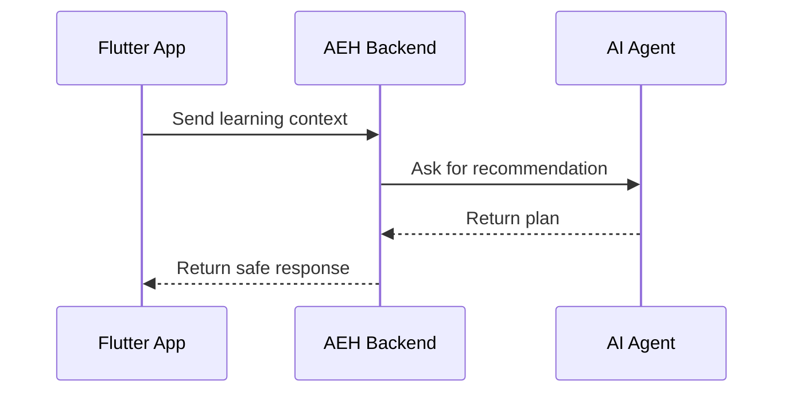

**Explain:** AI Agent should be backend-controlled. Mobile should display and confirm actions safely.

### Q25. What are the risks of AI/OCR in mobile?

### Answer

> "The main risks are inaccurate results, slow response, privacy issues, high cost, and poor fallback behavior.
>
> For OCR, the app must handle bad images, low light, blur, network failure, and retry.
>
> For AI, the app should show clear loading states, avoid exposing sensitive data, and let users retry or correct the result."

#### Code Sample - AI/OCR Failure State

```dart
sealed class AiResultState {
  const AiResultState();
}

class AiResultLoading extends AiResultState {
  const AiResultLoading();
}

class AiResultFailure extends AiResultState {
  const AiResultFailure(this.message);
  final String message;
}
```

**Explain:** AI/OCR can fail due to latency, bad input, or model uncertainty. Model those states explicitly.

---

## 8. Backend Collaboration: Spring Boot, Microservices, AWS/GCP

### Q26. How do you work with backend teams?

### Answer

> "I usually align on API contract, request/response format, error codes, authentication, pagination, and edge cases before implementation.
>
> I also ask for Swagger or API spec if available.
>
> In my previous projects, I coordinated closely with backend, QA, product, and design teams to align business rules and release quality."

#### Code Sample - Backend API Contract Example

```json
{
  "lessonId": "lesson_123",
  "studentAnswer": "Photosynthesis is...",
  "metadata": {
    "platform": "ios",
    "appVersion": "1.4.0"
  }
}
```

**Explain:** When working with backend, clarify payload, error codes, auth, pagination, and edge cases before implementation.

### Q27. What do you know about microservices from a mobile perspective?

### Answer

> "From a mobile perspective, microservices mean the app may depend on multiple backend services, each with its own latency, error behavior, and deployment cycle.
>
> The mobile app should not directly expose this complexity to users.
>
> I would handle errors consistently, define retry rules, and coordinate with backend teams on stable API contracts."

#### Diagram Sample - Microservices From Mobile View

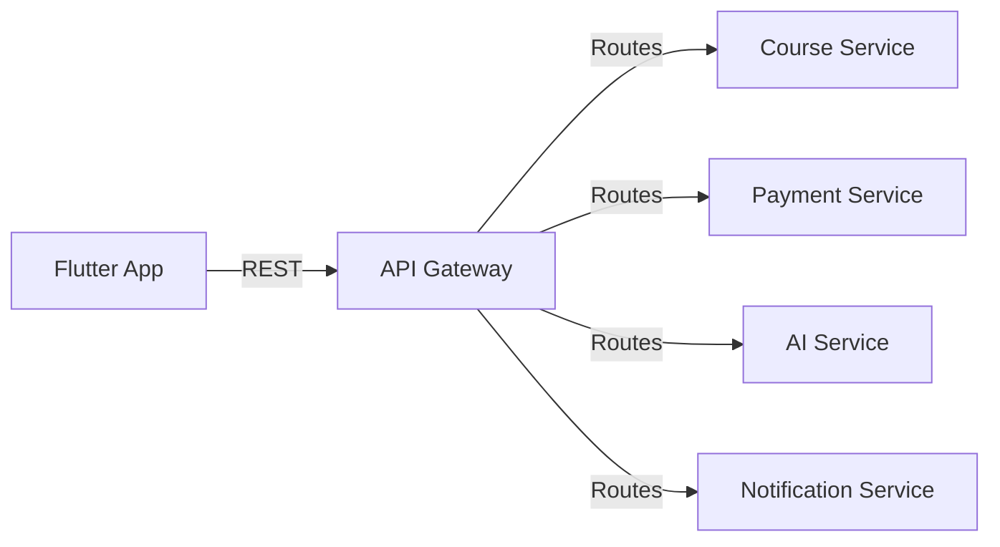

**Explain:** Mobile should see stable APIs, even if backend is split into microservices.

### Q28. How would you handle API inconsistency across microservices?

### Answer

> "I would define a common API response model in the mobile app and map different backend errors into consistent app failures.
>
> If the problem is frequent, I would propose aligning backend error format through API spec.
>
> I would also document known API quirks so QA and other developers can test correctly."

#### Code Sample - Normalize API Errors

```dart
class ApiErrorMapper {
  AppFailure map(Response<dynamic> response) {
    return switch (response.statusCode) {
      401 => const AppFailure('Session expired. Please login again.'),
      403 => const AppFailure('You do not have permission.'),
      500 => const AppFailure('Server error. Please try later.'),
      _ => const AppFailure('Something went wrong.'),
    };
  }
}
```

**Explain:** Different services may return different errors. Mobile maps them into consistent user-facing failures.

### Q29. How does AWS/GCP affect mobile development?

### Answer

> "Mobile developers do not always deploy backend infrastructure directly, but we need to understand environments and cloud behavior.
>
> For example, different environments may have different base URLs, API gateways, storage, notification setup, and analytics configuration.
>
> I would manage environment config carefully and avoid hardcoding production values."

#### Code Sample - Environment Config

```dart
class AppConfig {
  const AppConfig({required this.baseUrl});

  final String baseUrl;

  factory AppConfig.fromEnvironment() => const AppConfig(
        baseUrl: String.fromEnvironment('BASE_URL'),
      );
}
```

**Explain:** Use `--dart-define`; do not hardcode production base URLs in source code.

---

## 9. System Design, Technical Docs

### Q30. Can you design a simple online learning app architecture?

### Answer

> "At a high level, the Flutter app has modules such as authentication, course catalog, lesson player, quiz, progress, notification, payment, and AI assistant.
>
> The app communicates with backend microservices through REST API and possibly socket for real-time features.
>
> I would use Clean Architecture per feature, with shared core modules for networking, storage, analytics, notification, design system, and error handling."

#### Diagram Sample - Online Learning App Architecture

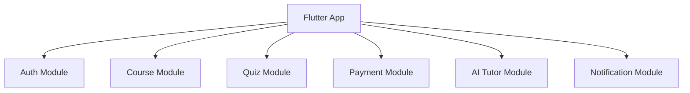

**Explain:** Split product by business modules, not by technical folders only.

### Q31. What technical documents can you write?

### Answer

> "I can write API integration notes, feature technical design, module architecture, state transition diagrams, DB schema notes if needed, and release notes.
>
> For mobile features, I usually document user flow, API contract, edge cases, error states, and testing notes.
>
> Good documentation helps backend, QA, and mobile developers align before implementation."

#### Code Sample - Technical Doc Template

```md
# Feature Technical Design

## Goal
Describe business goal.

## User Flow
Step-by-step flow.

## API Contract
Endpoint, request, response, errors.

## Edge Cases
Offline, timeout, permission denied.

## Test Notes
Unit, widget, integration, manual QA.
```

**Explain:** Good docs reduce misunderstanding between mobile, backend, QA, and product.

### Q32. How would you document a new AI homework feedback feature?

### Answer

> "I would document the goal, user flow, API contract, request payload, response payload, loading/error states, privacy rules, analytics events, and test cases.
>
> I would also describe fallback behavior when AI service is slow or unavailable.
>
> This is important because AI features can fail in non-deterministic ways."

#### Diagram Sample - AI Homework Feedback Feature

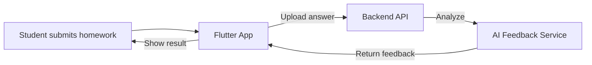

**Explain:** Document request, response, privacy, loading state, retry, and fallback when AI is slow.

---

## 10. Git Flow, Code Review, Conflict

### Q33. What Git flow do you prefer?

### Answer

> "I prefer a clear Git flow with protected main branch, feature branches, pull requests, code review, and CI checks.
>
> For release-heavy projects, we can use develop, release branches, hotfix branches, and tags.
>
> The exact flow depends on the team, but the key is traceability and safe release."

#### Diagram Sample - Git Flow

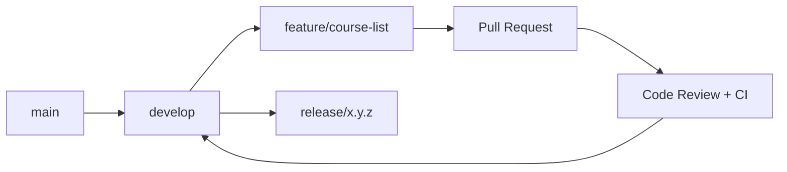

**Explain:** Git flow should make changes reviewable and releases traceable.

### Q34. How do you handle merge conflicts?

### Answer

> "First, I identify which files conflict and understand both changes.
>
> I avoid blindly accepting one side. If the conflict touches business logic, I talk to the developer who changed it.
>
> After resolving, I run tests or at least verify the affected flow."

#### Code Sample - Conflict Handling Checklist

```text
1. Pull latest target branch.
2. Identify conflicted files.
3. Understand both changes.
4. Resolve manually.
5. Run tests or verify affected flow.
6. Ask original author if business logic is unclear.
```

**Explain:** Never blindly accept current or incoming change if the conflict touches business logic.

### Q35. How do you review code?

### Answer

> "I review code based on correctness, readability, architecture, edge cases, error handling, security, and test coverage.
>
> I also check whether the code follows project conventions and whether it introduces hidden coupling.
>
> My comments should be specific and actionable, not just personal preference."

#### Code Sample - Code Review Checklist

```text
Correctness: Does it solve the requirement?
Architecture: Is logic in the right layer?
Error handling: Are failures handled?
Security: Any token or PII leak?
Testing: Are success and failure cases covered?
Maintainability: Is naming clear?
```

**Explain:** Review should be specific and actionable, not personal preference.

### Q36. How do you detect and fix bugs efficiently?

### Answer

> "I start by reproducing the issue and collecting logs, device info, app version, environment, and user steps.
>
> Then I isolate the layer: UI, state management, API, local storage, native SDK, or backend.
>
> After fixing, I verify the original case and add regression coverage if possible."

#### Diagram Sample - Bug Investigation Flow

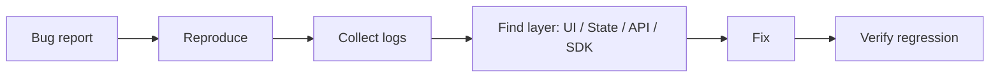

**Explain:** Start from reproduction, then isolate the layer before changing code.

---

## 11. Third-Party Integration, KYC, Payment, Store

### Q37. What third-party integrations have you worked with?

### Answer

> "I have worked with NFC/liveness SDKs, social sign-in, Firebase, OneSignal, Branch deep linking, in-app purchase, media SDKs, and App Store/TestFlight/Fastlane-related release flows.
>
> In Finhay, third-party identity verification was critical. In Mydio, I worked with in-app purchase and media playback. In QRCheckin, I worked with OneSignal and Sentry.
>
> This is relevant because AEH prefers experience with KYC, Payment, Apple Store, and Google Play."

#### Code Sample - Third-Party SDK Adapter

```dart
abstract interface class PaymentGateway {
  Future<PaymentResult> pay(PaymentRequest request);
}

class StripePaymentGateway implements PaymentGateway {
  @override
  Future<PaymentResult> pay(PaymentRequest request) async {
    // Call Stripe SDK or backend checkout session.
    return const PaymentResult.success();
  }
}
```

**Explain:** Wrap third-party SDKs behind an interface so the app can replace providers later.

### Q38. How do you integrate payment in a mobile app?

### Answer

> "I would define the payment flow clearly: product selection, payment intent, provider checkout, result callback, backend verification, and UI state update.
>
> The mobile app should not trust only client-side payment result. Backend verification is important.
>
> I would also handle pending, failed, cancelled, and duplicate payment states."

#### Diagram Sample - Payment Flow

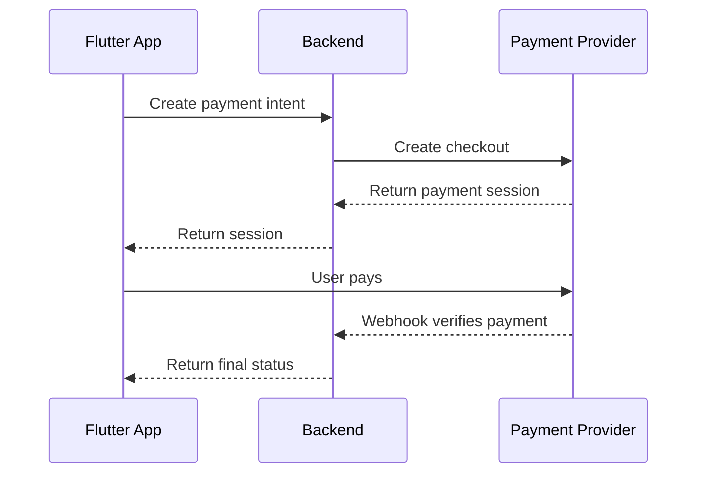

**Explain:** Do not trust client-only payment result. Backend verification is required.

### Q39. How do you prepare App Store / Google Play release?

### Answer

> "I check versioning, signing, build flavor, environment config, permissions, privacy descriptions, crash reporting, and release notes.
>
> I also make sure QA verifies critical flows on both platforms.
>
> In previous projects, I used Fastlane, TestFlight, Firebase App Distribution, DeployGate, and CI/CD flows."

#### Code Sample - Release Checklist

```text
Before release:
- Check app version and build number.
- Check signing and flavor.
- Verify DEV / SIT / UAT / PROD config.
- Run smoke tests for login, course, payment, notification.
- Upload dSYM / mapping files for crash reporting.
- Prepare release notes.
```

**Explain:** Release is not only building the app. It includes config, QA, store metadata, monitoring, and rollback awareness.

---

## 12. Appendix - Longer Code Examples + Explanation

> Use this section when the interviewer asks: "Can you show how you would implement it?"

### Example 1. Feature-Based Clean Architecture For AEH Course Module

```text
lib/
  features/
    course/
      presentation/
        pages/course_list_page.dart
        cubit/course_list_cubit.dart
        cubit/course_list_state.dart
      domain/
        entities/course.dart
        repositories/course_repository.dart
        use_cases/get_courses.dart
      data/
        data_sources/course_remote_data_source.dart
        dto/course_dto.dart
        repositories/course_repository_impl.dart
  core/
    network/api_client.dart
    error/app_failure.dart
    notification/notification_service.dart
```

**Explanation**

This structure keeps UI, business rules, and API logic separated. The presentation layer only handles screen and state. The domain layer owns business contracts. The data layer owns API, DTO, cache, and mapping. For AEH, this is useful because course, lesson, quiz, payment, notification, and AI modules can grow independently.

**Interview answer**

> "I would use feature-based Clean Architecture. Each feature has presentation, domain, and data layers. This makes the app easier to test, easier to review, and safer when multiple developers work on the same codebase."

---

### Example 2. Entity, DTO, Repository Contract

```dart
// domain/entities/course.dart
class Course {
  const Course({
    required this.id,
    required this.title,
    required this.lessonCount,
    required this.isEnrolled,
  });

  final String id;
  final String title;
  final int lessonCount;
  final bool isEnrolled;
}
```

```dart
// data/dto/course_dto.dart
import '../../domain/entities/course.dart';

class CourseDto {
  const CourseDto({
    required this.id,
    required this.title,
    required this.lessonCount,
    required this.isEnrolled,
  });

  factory CourseDto.fromJson(Map<String, dynamic> json) => CourseDto(
        id: json['id'] as String,
        title: json['title'] as String,
        lessonCount: json['lessonCount'] as int? ?? 0,
        isEnrolled: json['isEnrolled'] as bool? ?? false,
      );

  final String id;
  final String title;
  final int lessonCount;
  final bool isEnrolled;

  Course toEntity() => Course(
        id: id,
        title: title,
        lessonCount: lessonCount,
        isEnrolled: isEnrolled,
      );
}
```

```dart
// domain/repositories/course_repository.dart
abstract interface class CourseRepository {
  Future<List<Course>> getCourses();
}
```

**Explanation**

`Course` is the clean domain model used by UI and business logic. `CourseDto` is the API model. Mapping DTO to entity prevents backend response details from leaking into the app. This is important when backend microservices change field names or response shapes.

**Interview answer**

> "I separate DTO from entity. DTO follows the API response, while entity represents the app business model. This gives us a stable domain layer even if backend response changes."

---

### Example 3. Remote Data Source + Repository Implementation

```dart
// data/data_sources/course_remote_data_source.dart
import '../dto/course_dto.dart';
import '../../../../core/network/api_client.dart';

class CourseRemoteDataSource {
  const CourseRemoteDataSource(this._apiClient);

  final ApiClient _apiClient;

  Future<List<CourseDto>> getCourses() async {
    final response = await _apiClient.get('/courses');
    final items = response.data['items'] as List<dynamic>? ?? <dynamic>[];

    return items
        .map((item) => CourseDto.fromJson(item as Map<String, dynamic>))
        .toList();
  }
}
```

```dart
// data/repositories/course_repository_impl.dart
import '../../domain/entities/course.dart';
import '../../domain/repositories/course_repository.dart';
import '../data_sources/course_remote_data_source.dart';

class CourseRepositoryImpl implements CourseRepository {
  const CourseRepositoryImpl(this._remoteDataSource);

  final CourseRemoteDataSource _remoteDataSource;

  @override
  Future<List<Course>> getCourses() async {
    final dtos = await _remoteDataSource.getCourses();
    return dtos.map((dto) => dto.toEntity()).toList();
  }
}
```

**Explanation**

The repository is the boundary between domain and data. The UI does not know about Dio, JSON, DTO, or API endpoint. If AEH later adds cache or offline mode, we can update the repository implementation without changing screens.

**Interview answer**

> "The repository hides the data source. Today data may come from REST API. Later it can come from cache or local database. The UI should not care."

---

### Example 4. Cubit State For Course List

```dart
// presentation/cubit/course_list_state.dart
import 'package:freezed_annotation/freezed_annotation.dart';

import '../../domain/entities/course.dart';

part 'course_list_state.freezed.dart';

@freezed
sealed class CourseListState with _$CourseListState {
  const factory CourseListState.initial() = CourseListInitial;
  const factory CourseListState.loading() = CourseListLoading;
  const factory CourseListState.success(List<Course> courses) = CourseListSuccess;
  const factory CourseListState.empty() = CourseListEmpty;
  const factory CourseListState.failure(String message) = CourseListFailure;
}
```

```dart
// presentation/cubit/course_list_cubit.dart
import 'package:flutter_bloc/flutter_bloc.dart';

import '../../domain/repositories/course_repository.dart';
import 'course_list_state.dart';

class CourseListCubit extends Cubit<CourseListState> {
  CourseListCubit(this._repository)
      : super(const CourseListState.initial());

  final CourseRepository _repository;

  Future<void> loadCourses() async {
    emit(const CourseListState.loading());

    try {
      final courses = await _repository.getCourses();
      if (courses.isEmpty) {
        emit(const CourseListState.empty());
        return;
      }

      emit(CourseListState.success(courses));
    } catch (_) {
      emit(
        const CourseListState.failure(
          'Cannot load courses. Please try again.',
        ),
      );
    }
  }
}
```

**Explanation**

The Cubit owns loading, success, empty, and failure states. The UI only renders the current state. This avoids business logic inside widgets and makes the flow easy to test.

**Interview answer**

> "For simple screens, I use Cubit with explicit states. The UI listens to state and renders loading, success, empty, or failure. This keeps the screen clean and testable."

---

### Example 5. UI With BlocBuilder And buildWhen

```dart
// presentation/pages/course_list_page.dart
import 'package:flutter/material.dart';
import 'package:flutter_bloc/flutter_bloc.dart';

import '../cubit/course_list_cubit.dart';
import '../cubit/course_list_state.dart';

class CourseListPage extends StatefulWidget {
  const CourseListPage({super.key});

  @override
  State<CourseListPage> createState() => _CourseListPageState();
}

class _CourseListPageState extends State<CourseListPage> {
  @override
  void initState() {
    super.initState();
    context.read<CourseListCubit>().loadCourses();
  }

  @override
  Widget build(BuildContext context) => Scaffold(
        appBar: AppBar(title: const Text('Courses')),
        body: BlocBuilder<CourseListCubit, CourseListState>(
          buildWhen: (previous, current) => previous != current,
          builder: (context, state) => state.when(
            initial: () => const SizedBox.shrink(),
            loading: () => const Center(
              child: CircularProgressIndicator(),
            ),
            empty: () => const Center(
              child: Text('No courses available.'),
            ),
            failure: (message) => Center(
              child: Text(message),
            ),
            success: (courses) => ListView.builder(
              itemCount: courses.length,
              itemBuilder: (context, index) {
                final course = courses[index];
                return ListTile(
                  title: Text(course.title),
                  subtitle: Text('${course.lessonCount} lessons'),
                );
              },
            ),
          ),
        ),
      );
}
```

**Explanation**

`BlocBuilder` is only for rebuilding UI. Navigation, snackbar, and dialog side effects should go to `BlocListener`. `buildWhen` is useful when the subtree is heavy or the state changes often.

**Interview answer**

> "I avoid putting business logic in the widget. The page only triggers loading and renders states. Heavy side effects should be handled in BlocListener, not BlocBuilder."

---

### Example 6. Dio API Client With Token Interceptor

```dart
// core/network/api_client.dart
import 'package:dio/dio.dart';

class ApiClient {
  ApiClient({
    required TokenStore tokenStore,
    required String baseUrl,
  })  : _tokenStore = tokenStore,
        _dio = Dio(
          BaseOptions(
            baseUrl: baseUrl,
            connectTimeout: const Duration(seconds: 20),
            receiveTimeout: const Duration(seconds: 20),
          ),
        ) {
    _dio.interceptors.add(
      InterceptorsWrapper(
        onRequest: (options, handler) async {
          final token = await _tokenStore.readAccessToken();
          if (token != null) {
            options.headers['Authorization'] = 'Bearer $token';
          }
          handler.next(options);
        },
      ),
    );
  }

  final Dio _dio;
  final TokenStore _tokenStore;

  Future<Response<dynamic>> get(String path) => _dio.get(path);
}

abstract interface class TokenStore {
  Future<String?> readAccessToken();
}
```

**Explanation**

The API client owns base URL, timeout, headers, and interceptors. `TokenStore` is injected so the API layer does not directly depend on a concrete storage package. API keys and base URLs should come from environment config, not hardcoded values.

**Interview answer**

> "I centralize networking in an API client. Interceptors handle token, timeout, and common headers. Feature code should not manually attach tokens in every request."

---

### Example 7. Firebase Push Notification Service

```dart
// core/notification/push_notification_service.dart
import 'package:firebase_messaging/firebase_messaging.dart';

class PushNotificationService {
  const PushNotificationService(this._messaging);

  final FirebaseMessaging _messaging;

  Future<void> initialize() async {
    final settings = await _messaging.requestPermission();
    if (settings.authorizationStatus == AuthorizationStatus.denied) {
      return;
    }

    final token = await _messaging.getToken();
    if (token != null) {
      await _syncTokenToBackend(token);
    }

    FirebaseMessaging.onMessage.listen(_handleForegroundMessage);
    FirebaseMessaging.onMessageOpenedApp.listen(_handleNotificationTap);
  }

  Future<void> _syncTokenToBackend(String token) async {
    // Send token to backend so AEH can push learning reminders.
  }

  void _handleForegroundMessage(RemoteMessage message) {
    // Show local notification or update in-app state.
  }

  void _handleNotificationTap(RemoteMessage message) {
    // Navigate to lesson, assignment, or chat screen.
  }
}
```

**Explanation**

Push notification has four important parts: permission, token sync, foreground handling, and tap handling. For AEH, notification can be used for lesson reminders, assignment deadlines, live class updates, or AI feedback completion.

**Interview answer**

> "I do not put Firebase code directly in screens. I wrap it in a notification service, then sync token to backend and handle foreground/background behavior in one place."

---

### Example 8. AI Chatbot Streaming With Stream

```dart
// features/ai_chat/data/ai_chat_service.dart
import 'dart:convert';

import '../../../../core/network/api_client.dart';

class AiChatService {
  const AiChatService(this._apiClient);

  final ApiClient _apiClient;

  Stream<String> sendMessage(String message) async* {
    final response = await _apiClient.get(
      '/ai/chat/stream?message=${Uri.encodeQueryComponent(message)}',
    );

    final rawChunks = response.data as List<dynamic>? ?? <dynamic>[];
    for (final chunk in rawChunks) {
      final json = jsonDecode(chunk as String) as Map<String, dynamic>;
      yield json['text'] as String? ?? '';
    }
  }
}
```

**Explanation**

AI answers may arrive gradually, so `Stream` fits better than `Future`. In a real app, the backend may use Server-Sent Events, WebSocket, or chunked response. The mobile side should model partial response, complete response, retry, and error states.

**Interview answer**

> "For AI chatbot, I would model the response as a stream. The UI can show partial text while the backend is still generating the answer."

---

### Example 9. OCR Service Abstraction

```dart
// features/ocr/domain/ocr_service.dart
class OcrResult {
  const OcrResult({
    required this.rawText,
    required this.confidence,
  });

  final String rawText;
  final double confidence;
}

abstract interface class OcrService {
  Future<OcrResult> extractText(String imagePath);
}
```

```dart
// features/ocr/data/server_ocr_service.dart
class ServerOcrService implements OcrService {
  const ServerOcrService(this._apiClient);

  final ApiClient _apiClient;

  @override
  Future<OcrResult> extractText(String imagePath) async {
    final response = await _apiClient.get('/ocr/result');

    return OcrResult(
      rawText: response.data['rawText'] as String? ?? '',
      confidence: (response.data['confidence'] as num?)?.toDouble() ?? 0,
    );
  }
}
```

**Explanation**

The UI should depend on `OcrService`, not on a specific OCR provider. This allows AEH to switch between server OCR, on-device OCR, or third-party OCR without rewriting the UI.

**Interview answer**

> "I would hide OCR provider details behind an interface. The app only needs a stable result model, while the implementation can be server-side, on-device, or third-party."

---

### Example 10. Cubit Test With bloc_test

```dart
import 'package:bloc_test/bloc_test.dart';
import 'package:flutter_test/flutter_test.dart';
import 'package:mocktail/mocktail.dart';

class MockCourseRepository extends Mock implements CourseRepository {}

void main() {
  late CourseRepository repository;

  setUp(() {
    repository = MockCourseRepository();
  });

  blocTest<CourseListCubit, CourseListState>(
    'emits loading then success when courses are loaded',
    build: () {
      when(() => repository.getCourses()).thenAnswer(
        (_) async => const <Course>[
          Course(
            id: 'course-1',
            title: 'Flutter Basics',
            lessonCount: 12,
            isEnrolled: false,
          ),
        ],
      );

      return CourseListCubit(repository);
    },
    act: (cubit) => cubit.loadCourses(),
    expect: () => <CourseListState>[
      const CourseListState.loading(),
      const CourseListState.success(
        <Course>[
          Course(
            id: 'course-1',
            title: 'Flutter Basics',
            lessonCount: 12,
            isEnrolled: false,
          ),
        ],
      ),
    ],
  );
}
```

**Explanation**

This test verifies the state sequence. For production teams, this is more valuable than only testing methods because users see states: loading, success, empty, and failure.

**Interview answer**

> "For Cubit or BLoC, I test emitted states. A good test should cover success, empty, and failure cases, not only the happy path."

---

## 13. Behavioral Questions

### Q40. Tell me about a challenging technical problem you solved.

### Answer

> "At Finhay, one challenging problem was migrating eKYC UI from native iOS/Android to Flutter while keeping native NFC and liveness SDKs.
>
> The risk was high because eKYC is security-sensitive and involves SDK handoff, navigation, callback results, and fallback behavior.
>
> I helped design the Flutter-Native bridge contract, standardize navigation behavior, and plan a phased rollout with Remote Config and fallback to the legacy native flow."

### Q41. How do you work under tight deadlines?

### Answer

> "I first clarify the must-have scope, then break the work into smaller deliverables.
>
> I prioritize high-risk parts early, especially API contract, native SDK, authentication, and release blockers.
>
> If scope is too large, I communicate trade-offs early instead of hiding risk."

### Q42. How do you mentor junior developers?

### Answer

> "I mentor by giving clear task context, explaining architecture decisions, reviewing pull requests, and pairing on difficult bugs.
>
> I try to help junior developers understand why a solution is chosen, not only what code to write.
>
> In previous roles, I helped coordinate tasks and support middle and junior developers while keeping module boundaries clear."

### Q43. What do you do when requirements are unclear?

### Answer

> "I ask clarifying questions and write down assumptions.
>
> I usually confirm user flow, API behavior, edge cases, error states, and acceptance criteria.
>
> If the requirement affects backend or QA, I align with them before coding."

### Q44. Why AEH?

### Answer

> "AEH is interesting to me because it is a digital education platform, not just a generic mobile app.
>
> The JD combines Flutter, system design, backend collaboration, AI, OCR, AI Agents, and product quality.
>
> That matches my experience with education apps, AI chatbot, eKYC/OCR-like flows, and production mobile architecture."

---

## 14. Questions You Should Ask AEH

1. What is the current Flutter architecture: BLoC, GetX, Riverpod, or a custom pattern?
2. Which product should I work on first: ClassForMe or another AEH learning platform?
3. Are AI/OCR/AI Agents already built by backend, or will mobile help design the integration flow?
4. Do you already have API specs and DB schema documents?
5. What is the current Git flow and release process?
6. How are Firebase, notifications, and socket features used in the product today?
7. What are the biggest technical problems in the mobile app right now?
8. How does the mobile team coordinate with Java Spring Boot microservice teams?
9. Are payment and store release handled by mobile team or a separate release team?
10. What does success look like for this role in the first 3 months?

---

## 15. Last-Minute Cheat Sheet

### 30-second pitch

> "I have 7+ years in mobile, with strong Flutter, React Native, and native iOS/Android experience. For Flutter, I have worked with Clean Architecture, BLoC/Cubit, Riverpod, Dio, Firebase, notification, native bridge, and production release. My most relevant projects for AEH are Finhay for eKYC/OCR-like identity flows, Netchat for AI chatbot, and Raise 2.0 for education domain."

### 5 strongest keywords

- Flutter production delivery
- Clean Architecture
- AI chatbot / OCR-like eKYC flow
- Backend API collaboration
- Git flow, code review, production bug fixing

### If they ask about salary or availability

> "I am open to discussion based on the role scope, responsibility level, and growth path. I care about both compensation and the opportunity to contribute to product architecture and technical quality."
