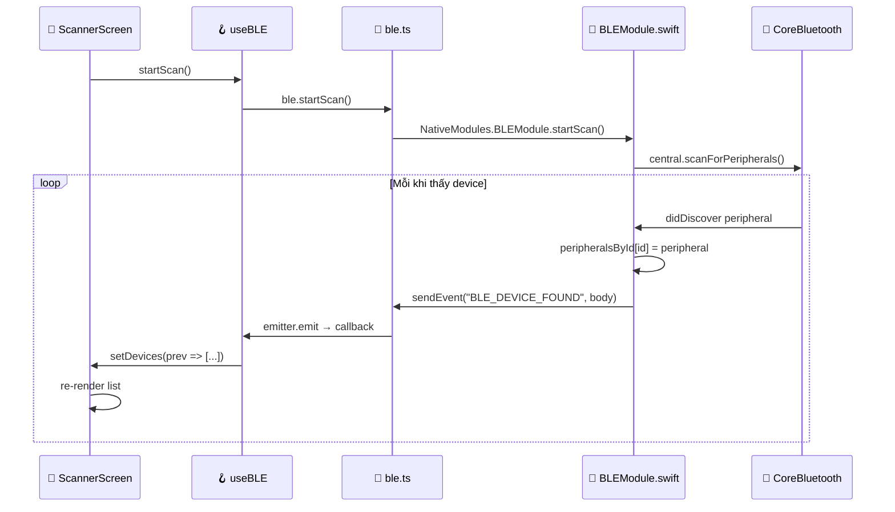
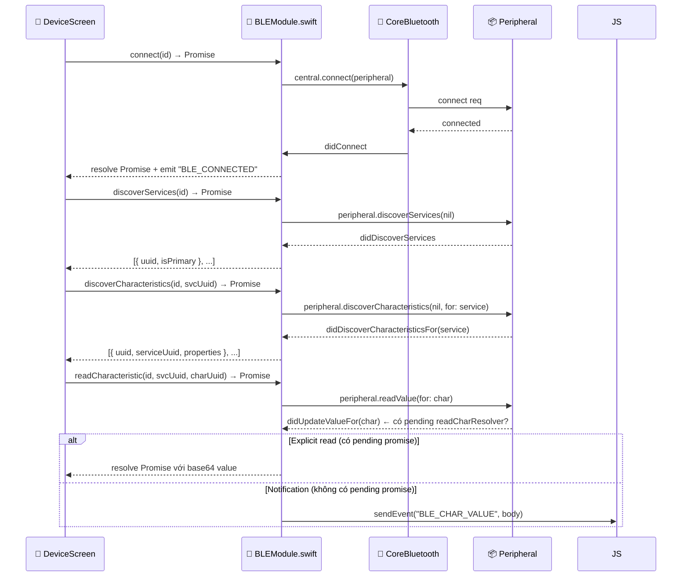

# 🛠 Mini Project — RN Bluetooth Manager App

> **🎯 Mục đích:** Build một app React Native quản lý BLE thiết bị, **tự viết Native Module Swift + Kotlin** từ đầu (không dùng library), để hiểu sâu cầu nối RN ↔ Native ↔ CoreBluetooth/Android BLE.
>
> **⏱ Thời gian:** ~6–8 tiếng (1 buổi cuối tuần).
>
> **📦 Output:** App chạy được trên iPhone và Android thật, có 4 màn hình: Permission → Scanner → Device Detail → Read/Write/Notify.

---

## 🗺 Architecture tổng quan

```
┌────────────────────────────────────────────────────────────┐
│                                                            │
│   📱 React Native (TypeScript)                              │
│   ┌──────────────────────────────────────────────────┐     │
│   │  ScannerScreen    DeviceScreen    PermissionScreen│    │
│   └────────┬─────────────────────────────────────────┘     │
│            │                                                │
│            ▼                                                │
│   ┌──────────────────────────────────────────────────┐     │
│   │  useBLE() hook  →  ble.ts wrapper                │     │
│   └────────┬─────────────────────────────────────────┘     │
│            │ NativeModules.BLEModule                        │
│            │ NativeEventEmitter('BLE_*' events)             │
└────────────┼───────────────────────────────────────────────┘
             │
             ▼
   ╔═════════════════════════════╦═══════════════════════════╗
   ║  🍎 iOS — Swift              ║  🤖 Android — Kotlin       ║
   ║  ────────────────             ║  ────────────────          ║
   ║  • BLEModule.swift           ║  • BLEModule.kt            ║
   ║  • BLEModule.m (bridge)      ║  • BLEPackage.kt           ║
   ║  • CoreBluetooth             ║  • BluetoothLE API         ║
   ╚══════════════════╤═══════════╩═══════════╤══════════════╝
                      │                       │
                      ▼                       ▼
   ┌────────────────────────────────────────────────────────┐
   │  📡 Physical Bluetooth peripheral                       │
   │     (router, sensor, headphone, hoặc dùng nRF Connect   │
   │      trên 1 iPhone/Android khác làm peripheral giả lập) │
   └────────────────────────────────────────────────────────┘
```

---

## 📋 Tính năng app sẽ làm

```
┌────────────────────────────────────────────────────────────┐
│  📱 PermissionScreen                                        │
│     • Kiểm tra + xin permission BT, Location               │
│     • Hiển thị state                                       │
├────────────────────────────────────────────────────────────┤
│  📱 ScannerScreen                                           │
│     • Button: Start/Stop Scan                              │
│     • List devices found (name, RSSI, ID)                  │
│     • Pull-to-refresh                                      │
│     • Tap device → DeviceScreen                            │
├────────────────────────────────────────────────────────────┤
│  📱 DeviceScreen                                            │
│     • Button: Connect/Disconnect                           │
│     • Show connection state                                │
│     • List services & characteristics                      │
│     • Tap characteristic → can Read / Write / Subscribe    │
└────────────────────────────────────────────────────────────┘
```

---

# 📦 Bước 1 — Khởi tạo project

> ⚠️ **Kiểm tra Node version trước** — project yêu cầu Node ≥ 22.11.0. Node 20 sẽ báo lỗi `util.styleText is not a function` khi chạy Metro.

```bash
# 0. Đảm bảo đúng Node version
nvm use 22.14.0
node --version   # phải là v22.x.x

# 1. Tạo RN project (bare workflow, không Expo vì cần native modules)
npx react-native@latest init BLEManager --template react-native-template-typescript
cd BLEManager

# 2. Cài deps
yarn add @react-navigation/native @react-navigation/native-stack
yarn add react-native-screens react-native-safe-area-context

# Nếu yarn báo lỗi engine incompatibility, thêm --ignore-engines:
# yarn add ... --ignore-engines

# 3. iOS pods
cd ios && pod install && cd ..

# 4. Verify build
yarn ios     # build iOS (xem note bên dưới nếu lỗi Xcode 26)
yarn android # build Android
```

> **⚠️ Xcode 26 — Nếu `yarn ios` báo error code 70:**
> Xcode 26 không build được cho iOS 18 simulator qua CLI. Workaround:
> 1. `npx react-native start` → chạy Metro trước
> 2. Mở `ios/BLEManager.xcworkspace` trong Xcode.app
> 3. `Product → Destination` → chọn iOS 26.x simulator
> 4. Click Run (⌘R)

### 📁 Cấu trúc folders đề xuất

```
BLEManager/
├── ios/
│   └── BLEManager/
│       ├── BLEModule.swift          ← native iOS module
│       ├── BLEModule.m              ← Objective-C bridge
│       └── BLEManager-Bridging-Header.h
├── android/
│   └── app/src/main/java/com/blemanager/
│       ├── BLEModule.kt             ← native Android module
│       └── BLEPackage.kt            ← register module
├── src/
│   ├── native/
│   │   ├── ble.ts                   ← TS wrapper
│   │   └── types.ts                 ← shared types
│   ├── hook/                        ← singular "hook" (không phải "hooks")
│   │   └── useBLE.ts                ← React hook
│   └── screens/
│       ├── PermissionScreen.tsx
│       ├── ScannerScreen.tsx
│       └── DeviceScreen.tsx
└── App.tsx
```

### ✅ Verify Bước 1

```bash
# App chạy được và thấy màn Hello World mặc định của RN
# Metro bundler running ở http://localhost:8081
# Không có lỗi TypeScript: ./node_modules/.bin/tsc --noEmit
```

---

# 📦 Bước 2 — JS Layer (TypeScript)

## 2.1 `src/native/types.ts` — Shared types

```typescript
// Trạng thái BLE
export type BLEState =
  | 'unknown'
  | 'resetting'
  | 'unsupported'
  | 'unauthorized'
  | 'poweredOff'
  | 'poweredOn';

// 1 device thấy được khi scan
export interface BLEDevice {
  id: string;          // UUID (iOS) hoặc MAC (Android)
  name: string | null;
  rssi: number;        // signal strength (dBm), càng âm càng yếu
  isConnectable: boolean;
}

// 1 service trên peripheral
export interface BLEService {
  uuid: string;
  isPrimary: boolean;
}

// 1 characteristic trong service
export interface BLECharacteristic {
  uuid: string;
  serviceUuid: string;
  properties: {
    read: boolean;
    write: boolean;
    writeWithoutResponse: boolean;
    notify: boolean;
    indicate: boolean;
  };
}

// Value nhận về (base64 encoded)
export interface BLECharValue {
  serviceUuid: string;
  charUuid: string;
  value: string;       // base64
}
```

## 2.2 `src/native/ble.ts` — Native module wrapper

> **🔑 Pattern quan trọng:** Native module sẽ là `null` khi chạy trên simulator (vì BLEModule chưa được link).
> KHÔNG `throw` — thay vào đó export `BLE_AVAILABLE` flag và guard mọi call.
> Nếu throw, app crash ngay khi import file này.

```typescript
import { NativeModules, NativeEventEmitter } from 'react-native';
import type {
  BLEState,
  BLEDevice,
  BLEService,
  BLECharacteristic,
  BLECharValue,
} from './types';

// 🌉 Pull module ra
const { BLEModule } = NativeModules;

// ⚠️ BLEModule = null trong simulator — KHÔNG throw
// Dùng BLE_AVAILABLE để guard mọi call phía dưới
export const BLE_AVAILABLE = !!BLEModule;

// Subscription stub khi module không available
const NOOP_SUB = { remove: () => {} };

// Emitter chỉ tạo khi module thực sự tồn tại
// NativeEventEmitter(null) sẽ crash — phải guard!
const emitter = BLE_AVAILABLE ? new NativeEventEmitter(BLEModule) : null;

// 🧱 Event names (phải khớp với native code)
const EVENTS = {
  STATE_CHANGE:  'BLE_STATE_CHANGE',
  DEVICE_FOUND:  'BLE_DEVICE_FOUND',
  CONNECTED:     'BLE_CONNECTED',
  DISCONNECTED:  'BLE_DISCONNECTED',
  CHAR_VALUE:    'BLE_CHAR_VALUE',
} as const;

// ──────────────────── 🎯 Public API ────────────────────

export const ble = {
  // 🔍 State
  getState: (): Promise<BLEState> =>
    BLE_AVAILABLE
      ? BLEModule.getState()
      : Promise.resolve('unknown' as BLEState),

  // 🔍 Scan
  startScan: (serviceUuids: string[] | null = null): Promise<void> =>
    BLE_AVAILABLE
      ? BLEModule.startScan(serviceUuids)
      : Promise.reject(new Error('BLE not available')),

  stopScan: (): Promise<void> =>
    BLE_AVAILABLE ? BLEModule.stopScan() : Promise.resolve(),

  // 🤝 Connect
  connect: (deviceId: string): Promise<void> =>
    BLE_AVAILABLE
      ? BLEModule.connect(deviceId)
      : Promise.reject(new Error('BLE not available')),

  disconnect: (deviceId: string): Promise<void> =>
    BLE_AVAILABLE ? BLEModule.disconnect(deviceId) : Promise.resolve(),

  // 🔍 Discover services
  discoverServices: (deviceId: string): Promise<BLEService[]> =>
    BLE_AVAILABLE
      ? BLEModule.discoverServices(deviceId)
      : Promise.resolve([]),

  // 🔍 Discover characteristics của 1 service cụ thể
  // iOS: gọi peripheral.discoverCharacteristics(nil, for: service) → async callback
  // Android: sync vì discoverServices đã lấy hết chars rồi
  discoverCharacteristics: (
    deviceId: string,
    serviceUuid: string,
  ): Promise<BLECharacteristic[]> =>
    BLE_AVAILABLE
      ? BLEModule.discoverCharacteristics(deviceId, serviceUuid)
      : Promise.resolve([]),

  // 📖 Read — trả về base64 string
  readCharacteristic: (
    deviceId: string,
    serviceUuid: string,
    charUuid: string,
  ): Promise<string> =>
    BLE_AVAILABLE
      ? BLEModule.readCharacteristic(deviceId, serviceUuid, charUuid)
      : Promise.reject(new Error('BLE not available')),

  // ✍️ Write (data = base64)
  writeCharacteristic: (
    deviceId: string,
    serviceUuid: string,
    charUuid: string,
    base64Data: string,
    withResponse: boolean = true,
  ): Promise<void> =>
    BLE_AVAILABLE
      ? BLEModule.writeCharacteristic(
          deviceId,
          serviceUuid,
          charUuid,
          base64Data,
          withResponse,
        )
      : Promise.reject(new Error('BLE not available')),

  // 🔔 Notify subscribe
  setNotification: (
    deviceId: string,
    serviceUuid: string,
    charUuid: string,
    enable: boolean,
  ): Promise<void> =>
    BLE_AVAILABLE
      ? BLEModule.setNotification(deviceId, serviceUuid, charUuid, enable)
      : Promise.reject(new Error('BLE not available')),

  // ──────────── 📡 Event subscriptions ────────────
  // Trả về { remove() } — nhớ gọi remove() trong useEffect cleanup!

  onStateChange: (cb: (state: BLEState) => void) =>
    emitter?.addListener(EVENTS.STATE_CHANGE, (data) => cb(data.state)) ??
    NOOP_SUB,

  onDeviceFound: (cb: (device: BLEDevice) => void) =>
    emitter?.addListener(EVENTS.DEVICE_FOUND, cb) ?? NOOP_SUB,

  onConnected: (cb: (deviceId: string) => void) =>
    emitter?.addListener(EVENTS.CONNECTED, (data) => cb(data.deviceId)) ??
    NOOP_SUB,

  onDisconnected: (cb: (deviceId: string) => void) =>
    emitter?.addListener(EVENTS.DISCONNECTED, (data) => cb(data.deviceId)) ??
    NOOP_SUB,

  onCharValue: (cb: (value: BLECharValue) => void) =>
    emitter?.addListener(EVENTS.CHAR_VALUE, cb) ?? NOOP_SUB,
};
```

## 2.3 `src/hook/useBLE.ts` — React hook

> ⚠️ Folder là `hook/` (singular) — không phải `hooks/`.

```typescript
import { useEffect, useState, useCallback } from 'react';
import { ble } from '../native/ble';
import type { BLEDevice, BLEState } from '../native/types';

export function useBLE() {
  const [state, setState] = useState<BLEState>('unknown');
  const [devices, setDevices] = useState<BLEDevice[]>([]);
  const [isScanning, setIsScanning] = useState(false);

  // 🔁 Subscribe lifecycle events
  useEffect(() => {
    const subs = [
      ble.onStateChange(setState),
      ble.onDeviceFound((device) => {
        setDevices((prev) => {
          // dedup theo id
          if (prev.some((d) => d.id === device.id)) return prev;
          return [...prev, device];
        });
      }),
    ];

    // Init state
    ble.getState().then(setState);

    return () => subs.forEach((s) => s.remove());
  }, []);

  const startScan = useCallback(async () => {
    setDevices([]);
    setIsScanning(true);
    await ble.startScan();
  }, []);

  const stopScan = useCallback(async () => {
    setIsScanning(false);
    await ble.stopScan();
  }, []);

  return { state, devices, isScanning, startScan, stopScan };
}
```

## 2.4 `src/hook/useDevice.ts` — Hook cho DeviceScreen

> **Tại sao cần hook riêng thay vì gộp vào `useBLE`?**
> `useBLE` là global singleton — quản lý adapter state và scan list, dùng chung toàn app.
> `useDevice` là per-instance — mỗi DeviceScreen mount sẽ có state riêng (connState, services, chars)
> cho đúng một `deviceId`. Nếu gộp, navigating back/forward sẽ làm state bị shared và lộn xộn.

```typescript
import { useCallback, useEffect, useState } from 'react';
import { ble } from '../native/ble';
import type { BLECharacteristic, BLEService } from '../native/types';

// Tách riêng khỏi BLEState vì đây là trạng thái kết nối của 1 device cụ thể,
// không phải trạng thái của BT adapter
export type ConnState =
  | 'idle'          // chưa làm gì
  | 'connecting'    // đang connect (Promise chưa resolve)
  | 'connected'     // nhận được event BLE_CONNECTED
  | 'disconnecting' // đang disconnect
  | 'disconnected'; // nhận được event BLE_DISCONNECTED

export function useDevice(deviceId: string) {
  const [connState, setConnState] = useState<ConnState>('idle');
  const [services, setServices] = useState<BLEService[]>([]);
  // Map serviceUuid → danh sách characteristics của service đó
  const [characteristics, setCharacteristics] = useState<
    Record<string, BLECharacteristic[]>
  >({});
  const [isDiscovering, setIsDiscovering] = useState(false);
  const [error, setError] = useState<string | null>(null);

  // ─── Subscribe events — lọc theo đúng deviceId ───
  // Quan trọng: filter bằng `id === deviceId` vì app có thể có nhiều DeviceScreen
  useEffect(() => {
    const subs = [
      ble.onConnected(id => {
        if (id === deviceId) {
          setConnState('connected');
          setError(null);
        }
      }),
      ble.onDisconnected(id => {
        if (id === deviceId) {
          setConnState('disconnected');
          // Reset services/chars vì disconnect → data cũ không còn valid
          setServices([]);
          setCharacteristics({});
        }
      }),
    ];
    return () => subs.forEach(s => s.remove());
  }, [deviceId]);

  // ─── Connect ───
  const connect = useCallback(async () => {
    setError(null);
    setConnState('connecting');
    try {
      await ble.connect(deviceId);
      // connState KHÔNG set 'connected' ở đây — đợi event BLE_CONNECTED từ native
      // (thực tế native resolve Promise VÀ emit event — ta dùng event để update state)
    } catch (e: unknown) {
      setConnState('idle');
      setError(e instanceof Error ? e.message : 'Connection failed');
    }
  }, [deviceId]);

  // ─── Disconnect ───
  const disconnect = useCallback(async () => {
    setConnState('disconnecting');
    try {
      await ble.disconnect(deviceId);
      // connState cũng đợi BLE_DISCONNECTED event
    } catch (e: unknown) {
      setError(e instanceof Error ? e.message : 'Disconnect failed');
    }
  }, [deviceId]);

  // ─── Discover tất cả services + characteristics ───
  // Chạy sau khi connect thành công.
  // Dùng Promise.all để discover chars của tất cả services song song (nhanh hơn tuần tự)
  const discoverAll = useCallback(async () => {
    setError(null);
    setIsDiscovering(true);
    try {
      // Bước 1: lấy danh sách services
      const svcs = await ble.discoverServices(deviceId);
      setServices(svcs);

      // Bước 2: với mỗi service, lấy chars — chạy song song
      const entries = await Promise.all(
        svcs.map(async svc => {
          const chars = await ble.discoverCharacteristics(deviceId, svc.uuid);
          return [svc.uuid, chars] as const;
        }),
      );
      // Kết quả: { [serviceUuid]: BLECharacteristic[] }
      setCharacteristics(Object.fromEntries(entries));
    } catch (e: unknown) {
      setError(e instanceof Error ? e.message : 'Discovery failed');
    } finally {
      setIsDiscovering(false);
    }
  }, [deviceId]);

  // ─── Read một characteristic ───
  // Trả về base64 string hoặc null nếu lỗi
  const readChar = useCallback(
    async (serviceUuid: string, charUuid: string): Promise<string | null> => {
      try {
        return await ble.readCharacteristic(deviceId, serviceUuid, charUuid);
      } catch (e: unknown) {
        setError(e instanceof Error ? e.message : 'Read failed');
        return null;
      }
    },
    [deviceId],
  );

  return {
    connState,
    services,
    characteristics, // dùng: characteristics[serviceUuid] ?? []
    isDiscovering,
    error,
    connect,
    disconnect,
    discoverAll,
    readChar,
  };
}
```

**Cách dùng trong DeviceScreen:**

```typescript
// DeviceScreen.tsx
const { connState, services, characteristics, connect, discoverAll, readChar }
  = useDevice(deviceId);

// Auto-discover khi vừa connect xong
useEffect(() => {
  if (connState === 'connected') discoverAll();
}, [connState, discoverAll]);

// Lấy chars của 1 service:
const chars = characteristics[service.uuid] ?? [];
```

## 2.5 `src/screens/ScannerScreen.tsx`

```typescript
import React from 'react';
import {
  View, Text, FlatList, TouchableOpacity, StyleSheet, Button,
} from 'react-native';
import { useBLE } from '../hook/useBLE';   // ← hook/ singular
import type { NativeStackScreenProps } from '@react-navigation/native-stack';

export function ScannerScreen({ navigation }: NativeStackScreenProps<any>) {
  const { state, devices, isScanning, startScan, stopScan } = useBLE();

  return (
    <View style={styles.container}>
      <Text style={styles.state}>BT State: {state}</Text>

      <Button
        title={isScanning ? 'Stop Scan' : 'Start Scan'}
        onPress={isScanning ? stopScan : startScan}
        disabled={state !== 'poweredOn'}
      />

      <FlatList
        data={devices}
        keyExtractor={(item) => item.id}
        renderItem={({ item }) => (
          <TouchableOpacity
            style={styles.row}
            onPress={() =>
              navigation.navigate('Device', { deviceId: item.id, name: item.name })
            }
          >
            <Text style={styles.name}>{item.name ?? 'Unknown'}</Text>
            <Text style={styles.id}>{item.id}</Text>
            <Text style={styles.rssi}>RSSI: {item.rssi} dBm</Text>
          </TouchableOpacity>
        )}
        ListEmptyComponent={
          <Text style={styles.empty}>
            {isScanning ? 'Scanning...' : 'No devices yet. Tap Start Scan.'}
          </Text>
        }
      />
    </View>
  );
}

const styles = StyleSheet.create({
  container: { flex: 1, padding: 16 },
  state: { marginVertical: 8, fontWeight: '600' },
  row: { padding: 12, borderBottomWidth: 1, borderColor: '#eee' },
  name: { fontSize: 16, fontWeight: '600' },
  id: { fontSize: 12, color: '#666' },
  rssi: { fontSize: 12, color: '#0a7' },
  empty: { textAlign: 'center', marginTop: 40, color: '#999' },
});
```

> DeviceScreen + PermissionScreen skip ở đây cho gọn — pattern tương tự.

### ✅ Verify Bước 2

```bash
# TypeScript không báo lỗi
./node_modules/.bin/tsc --noEmit

# Không có lỗi import path
./node_modules/.bin/eslint src/ --format stylish

# Chạy app trên simulator:
# - BLE_AVAILABLE = false → ScannerScreen render bình thường, state = 'unknown'
# - Không crash khi import ble.ts
# - useDevice('fake-id') trả connState = 'idle', services = [], characteristics = {}
```

---

# 🍎 Bước 3 — iOS Native Module (Swift)

## 3.0 — Thêm file vào Xcode project (bước bắt buộc, hay bị bỏ qua)

> ⚠️ Chỉ tạo file bằng Finder/terminal là **chưa đủ**. Xcode phải biết file đó tồn tại.
> Nếu bỏ qua bước này, Xcode sẽ báo `Use of undeclared type 'BLEModule'`.

**Thứ tự thêm file:**

```
1. Mở Xcode → ios/BLEManager.xcworkspace
2. Trong Project Navigator (cột trái), click chuột phải vào thư mục BLEManager/
3. Chọn "New File..." (không phải "Add Files...")
4. Tạo BLEModule.swift:
   - Chọn template "Swift File" → tên "BLEModule"
   - Xcode hỏi "Create Bridging Header?" → Chọn "Create Bridging Header"
   - File BLEManager-Bridging-Header.h sẽ tự tạo
5. Tạo BLEModule.m:
   - "New File..." → chọn template "Objective-C File" → tên "BLEModule"
   - Không cần tạo thêm header
```

**`ios/BLEManager/BLEManager-Bridging-Header.h`** — Thêm dòng sau:

```objc
#import <React/RCTBridgeModule.h>
#import <React/RCTEventEmitter.h>
```

## 3.1 `ios/BLEManager/BLEModule.swift`

```swift
import Foundation
import CoreBluetooth
import React

@objc(BLEModule)
class BLEModule: RCTEventEmitter {

    // ──────────── 🧰 State ────────────
    private var central: CBCentralManager!
    private let centralQueue = DispatchQueue(label: "com.blemanager.ble", qos: .userInitiated)

    // Cache peripherals đã thấy/connect — PHẢI giữ strong ref!
    // Nếu không giữ, CBPeripheral bị deallocate và mọi callback sẽ không gọi.
    private var peripheralsById: [String: CBPeripheral] = [:]

    // Pending promises — mỗi async operation lưu resolve/reject tại đây
    // Key là deviceId (hoặc deviceId_serviceUuid cho char operations)
    private var connectResolver:    [String: RCTPromiseResolveBlock] = [:]
    private var connectRejecter:    [String: RCTPromiseRejectBlock]  = [:]
    private var discoverSvcResolver:[String: RCTPromiseResolveBlock] = [:]
    private var discoverSvcRejecter:[String: RCTPromiseRejectBlock]  = [:]
    // Key: "\(deviceId)_\(serviceUuid)" — vì 1 device có nhiều services
    private var discoverCharResolver:[String: RCTPromiseResolveBlock] = [:]
    private var discoverCharRejecter:[String: RCTPromiseRejectBlock]  = [:]
    // Key: charUuid — vì mỗi lần chỉ read 1 char cụ thể
    private var readCharResolver:   [String: RCTPromiseResolveBlock] = [:]
    private var readCharRejecter:   [String: RCTPromiseRejectBlock]  = [:]

    // ──────────── 🚀 Lifecycle ────────────
    override init() {
        super.init()
        central = CBCentralManager(delegate: self, queue: centralQueue)
    }

    // Cho RN biết module không cần chạy trên main thread
    @objc override static func requiresMainQueueSetup() -> Bool { false }

    // Danh sách events mà module có thể emit — RN sẽ warn nếu emit event không có trong list này
    override func supportedEvents() -> [String]! {
        return [
            "BLE_STATE_CHANGE",
            "BLE_DEVICE_FOUND",
            "BLE_CONNECTED",
            "BLE_DISCONNECTED",
            "BLE_CHAR_VALUE",
        ]
    }

    // ──────────── 📤 Exported methods ────────────

    @objc
    func getState(_ resolve: @escaping RCTPromiseResolveBlock,
                  rejecter reject: @escaping RCTPromiseRejectBlock) {
        resolve(mapState(central.state))
    }

    @objc
    func startScan(_ serviceUuids: [String]?,
                   resolver resolve: @escaping RCTPromiseResolveBlock,
                   rejecter reject: @escaping RCTPromiseRejectBlock) {
        guard central.state == .poweredOn else {
            reject("BT_NOT_READY", "Bluetooth state: \(mapState(central.state))", nil)
            return
        }
        let uuids = serviceUuids?.map { CBUUID(string: $0) }
        central.scanForPeripherals(
            withServices: uuids,
            options: [CBCentralManagerScanOptionAllowDuplicatesKey: false]
        )
        resolve(nil)
    }

    @objc
    func stopScan(_ resolve: @escaping RCTPromiseResolveBlock,
                  rejecter reject: @escaping RCTPromiseRejectBlock) {
        central.stopScan()
        resolve(nil)
    }

    @objc
    func connect(_ deviceId: String,
                 resolver resolve: @escaping RCTPromiseResolveBlock,
                 rejecter reject: @escaping RCTPromiseRejectBlock) {
        guard let peripheral = peripheralsById[deviceId] else {
            reject("UNKNOWN_DEVICE", "No device with id \(deviceId). Scan first.", nil)
            return
        }
        connectResolver[deviceId] = resolve
        connectRejecter[deviceId] = reject
        peripheral.delegate = self  // ⚠️ Phải set delegate TRƯỚC khi connect
        central.connect(peripheral, options: nil)
    }

    @objc
    func disconnect(_ deviceId: String,
                    resolver resolve: @escaping RCTPromiseResolveBlock,
                    rejecter reject: @escaping RCTPromiseRejectBlock) {
        guard let peripheral = peripheralsById[deviceId] else {
            reject("UNKNOWN_DEVICE", "No device", nil)
            return
        }
        central.cancelPeripheralConnection(peripheral)
        resolve(nil)
    }

    @objc
    func discoverServices(_ deviceId: String,
                          resolver resolve: @escaping RCTPromiseResolveBlock,
                          rejecter reject: @escaping RCTPromiseRejectBlock) {
        guard let peripheral = peripheralsById[deviceId] else {
            reject("UNKNOWN_DEVICE", "No device", nil)
            return
        }
        discoverSvcResolver[deviceId] = resolve
        discoverSvcRejecter[deviceId] = reject
        // nil = discover tất cả services (không filter theo UUID)
        peripheral.discoverServices(nil)
    }

    @objc
    func discoverCharacteristics(_ deviceId: String,
                                 serviceUuid: String,
                                 resolver resolve: @escaping RCTPromiseResolveBlock,
                                 rejecter reject: @escaping RCTPromiseRejectBlock) {
        guard let peripheral = peripheralsById[deviceId] else {
            reject("UNKNOWN_DEVICE", "No device with id \(deviceId)", nil)
            return
        }

        let serviceCBUUID = CBUUID(string: serviceUuid)
        guard let service = peripheral.services?.first(where: { $0.uuid == serviceCBUUID }) else {
            // Service chưa được discover — cần gọi discoverServices trước
            reject("SERVICE_NOT_FOUND", "Service \(serviceUuid) not found. Call discoverServices first.", nil)
            return
        }

        // Key = deviceId + serviceUuid vì 1 peripheral có nhiều services
        // didDiscoverCharacteristicsFor sẽ fire 1 lần cho mỗi service
        let key = "\(deviceId)_\(serviceUuid)"
        discoverCharResolver[key] = resolve
        discoverCharRejecter[key] = reject
        peripheral.discoverCharacteristics(nil, for: service)
    }

    @objc
    func readCharacteristic(_ deviceId: String,
                            serviceUuid: String,
                            charUuid: String,
                            resolver resolve: @escaping RCTPromiseResolveBlock,
                            rejecter reject: @escaping RCTPromiseRejectBlock) {
        guard let peripheral = peripheralsById[deviceId],
              let char = findChar(peripheral, serviceUuid, charUuid) else {
            reject("BAD_INPUT", "Device/char not found. Connect and discover first.", nil)
            return
        }
        // Lưu promise — didUpdateValueFor sẽ resolve nó
        readCharResolver[charUuid] = resolve
        readCharRejecter[charUuid] = reject
        peripheral.readValue(for: char)
    }

    @objc
    func writeCharacteristic(_ deviceId: String,
                             serviceUuid: String,
                             charUuid: String,
                             base64Data: String,
                             withResponse: Bool,
                             resolver resolve: @escaping RCTPromiseResolveBlock,
                             rejecter reject: @escaping RCTPromiseRejectBlock) {
        guard let peripheral = peripheralsById[deviceId],
              let char = findChar(peripheral, serviceUuid, charUuid),
              let data = Data(base64Encoded: base64Data) else {
            reject("BAD_INPUT", "Device/char/data invalid", nil)
            return
        }
        let type: CBCharacteristicWriteType = withResponse ? .withResponse : .withoutResponse
        peripheral.writeValue(data, for: char, type: type)
        resolve(nil)  // Simplified — ideally chờ didWriteValueFor
    }

    @objc
    func setNotification(_ deviceId: String,
                         serviceUuid: String,
                         charUuid: String,
                         enable: Bool,
                         resolver resolve: @escaping RCTPromiseResolveBlock,
                         rejecter reject: @escaping RCTPromiseRejectBlock) {
        guard let peripheral = peripheralsById[deviceId],
              let char = findChar(peripheral, serviceUuid, charUuid) else {
            reject("BAD_INPUT", "Device/char invalid", nil)
            return
        }
        peripheral.setNotifyValue(enable, for: char)
        resolve(nil)
    }

    // ──────────── 🔧 Helpers ────────────

    private func mapState(_ state: CBManagerState) -> String {
        switch state {
        case .poweredOn:    return "poweredOn"
        case .poweredOff:   return "poweredOff"
        case .unauthorized: return "unauthorized"
        case .unsupported:  return "unsupported"
        case .resetting:    return "resetting"
        default:            return "unknown"
        }
    }

    private func findChar(_ peripheral: CBPeripheral,
                          _ serviceUuid: String,
                          _ charUuid: String) -> CBCharacteristic? {
        return peripheral.services?
            .first { $0.uuid == CBUUID(string: serviceUuid) }?
            .characteristics?
            .first { $0.uuid == CBUUID(string: charUuid) }
    }
}

// ──────────── 📡 CBCentralManagerDelegate ────────────
extension BLEModule: CBCentralManagerDelegate {

    func centralManagerDidUpdateState(_ central: CBCentralManager) {
        sendEvent(withName: "BLE_STATE_CHANGE",
                  body: ["state": mapState(central.state)])
    }

    func centralManager(_ central: CBCentralManager,
                        didDiscover peripheral: CBPeripheral,
                        advertisementData: [String: Any],
                        rssi RSSI: NSNumber) {
        let id = peripheral.identifier.uuidString
        peripheralsById[id] = peripheral  // giữ strong ref

        sendEvent(withName: "BLE_DEVICE_FOUND", body: [
            "id":            id,
            "name":          peripheral.name as Any,
            "rssi":          RSSI.intValue,
            "isConnectable": (advertisementData[CBAdvertisementDataIsConnectable] as? Bool) ?? false,
        ])
    }

    func centralManager(_ central: CBCentralManager,
                        didConnect peripheral: CBPeripheral) {
        let id = peripheral.identifier.uuidString
        connectResolver[id]?(nil)
        connectResolver.removeValue(forKey: id)
        connectRejecter.removeValue(forKey: id)
        sendEvent(withName: "BLE_CONNECTED", body: ["deviceId": id])
    }

    func centralManager(_ central: CBCentralManager,
                        didFailToConnect peripheral: CBPeripheral,
                        error: Error?) {
        let id = peripheral.identifier.uuidString
        connectRejecter[id]?("CONNECT_FAIL", error?.localizedDescription ?? "Unknown error", error)
        connectResolver.removeValue(forKey: id)
        connectRejecter.removeValue(forKey: id)
    }

    func centralManager(_ central: CBCentralManager,
                        didDisconnectPeripheral peripheral: CBPeripheral,
                        error: Error?) {
        sendEvent(withName: "BLE_DISCONNECTED",
                  body: ["deviceId": peripheral.identifier.uuidString])
    }
}

// ──────────── 📡 CBPeripheralDelegate ────────────
extension BLEModule: CBPeripheralDelegate {

    func peripheral(_ peripheral: CBPeripheral,
                    didDiscoverServices error: Error?) {
        let id = peripheral.identifier.uuidString

        if let error = error {
            discoverSvcRejecter[id]?("DISCOVER_FAIL", error.localizedDescription, error)
            discoverSvcResolver.removeValue(forKey: id)
            discoverSvcRejecter.removeValue(forKey: id)
            return
        }

        let services = (peripheral.services ?? []).map { service in
            ["uuid": service.uuid.uuidString, "isPrimary": service.isPrimary]
        }
        discoverSvcResolver[id]?(services)
        discoverSvcResolver.removeValue(forKey: id)
        discoverSvcRejecter.removeValue(forKey: id)
    }

    func peripheral(_ peripheral: CBPeripheral,
                    didDiscoverCharacteristicsFor service: CBService,
                    error: Error?) {
        let id = peripheral.identifier.uuidString
        // Key phải là deviceId + serviceUuid (không chỉ deviceId)
        // vì callback fire riêng cho từng service
        let key = "\(id)_\(service.uuid.uuidString)"

        if let error = error {
            discoverCharRejecter[key]?("DISCOVER_CHARS_FAIL", error.localizedDescription, error)
            discoverCharResolver.removeValue(forKey: key)
            discoverCharRejecter.removeValue(forKey: key)
            return
        }

        let chars = (service.characteristics ?? []).map { char in
            return [
                "uuid":       char.uuid.uuidString,
                "serviceUuid": service.uuid.uuidString,
                "properties": [
                    "read":                 char.properties.contains(.read),
                    "write":                char.properties.contains(.write),
                    "writeWithoutResponse": char.properties.contains(.writeWithoutResponse),
                    "notify":               char.properties.contains(.notify),
                    "indicate":             char.properties.contains(.indicate),
                ],
            ] as [String: Any]
        }
        discoverCharResolver[key]?(chars)
        discoverCharResolver.removeValue(forKey: key)
        discoverCharRejecter.removeValue(forKey: key)
    }

    func peripheral(_ peripheral: CBPeripheral,
                    didUpdateValueFor characteristic: CBCharacteristic,
                    error: Error?) {
        let charUuid = characteristic.uuid.uuidString

        if let error = error {
            // Nếu đang chờ read promise → reject nó
            readCharRejecter[charUuid]?("READ_FAIL", error.localizedDescription, error)
            readCharResolver.removeValue(forKey: charUuid)
            readCharRejecter.removeValue(forKey: charUuid)
            return
        }

        guard let data = characteristic.value else { return }
        let base64 = data.base64EncodedString()

        // Phân biệt explicit read vs notification:
        // - Nếu có pending promise → là read → resolve promise
        // - Nếu không → là notification → emit event cho JS
        if let resolve = readCharResolver[charUuid] {
            resolve(base64)
            readCharResolver.removeValue(forKey: charUuid)
            readCharRejecter.removeValue(forKey: charUuid)
        } else {
            // Notification từ setNotifyValue
            sendEvent(withName: "BLE_CHAR_VALUE", body: [
                "serviceUuid": characteristic.service?.uuid.uuidString ?? "",
                "charUuid":    charUuid,
                "value":       base64,
            ])
        }
    }
}
```

## 3.2 `ios/BLEManager/BLEModule.m` — Objective-C bridge

> Mỗi method trong Swift phải có 1 entry tương ứng ở đây.
> Tên tham số phải khớp chính xác với Swift (case-sensitive).

```objc
#import <React/RCTBridgeModule.h>
#import <React/RCTEventEmitter.h>

@interface RCT_EXTERN_MODULE(BLEModule, RCTEventEmitter)

RCT_EXTERN_METHOD(getState:(RCTPromiseResolveBlock)resolve
                  rejecter:(RCTPromiseRejectBlock)reject)

RCT_EXTERN_METHOD(startScan:(NSArray<NSString *> *)serviceUuids
                  resolver:(RCTPromiseResolveBlock)resolve
                  rejecter:(RCTPromiseRejectBlock)reject)

RCT_EXTERN_METHOD(stopScan:(RCTPromiseResolveBlock)resolve
                  rejecter:(RCTPromiseRejectBlock)reject)

RCT_EXTERN_METHOD(connect:(NSString *)deviceId
                  resolver:(RCTPromiseResolveBlock)resolve
                  rejecter:(RCTPromiseRejectBlock)reject)

RCT_EXTERN_METHOD(disconnect:(NSString *)deviceId
                  resolver:(RCTPromiseResolveBlock)resolve
                  rejecter:(RCTPromiseRejectBlock)reject)

RCT_EXTERN_METHOD(discoverServices:(NSString *)deviceId
                  resolver:(RCTPromiseResolveBlock)resolve
                  rejecter:(RCTPromiseRejectBlock)reject)

RCT_EXTERN_METHOD(discoverCharacteristics:(NSString *)deviceId
                  serviceUuid:(NSString *)serviceUuid
                  resolver:(RCTPromiseResolveBlock)resolve
                  rejecter:(RCTPromiseRejectBlock)reject)

RCT_EXTERN_METHOD(readCharacteristic:(NSString *)deviceId
                  serviceUuid:(NSString *)serviceUuid
                  charUuid:(NSString *)charUuid
                  resolver:(RCTPromiseResolveBlock)resolve
                  rejecter:(RCTPromiseRejectBlock)reject)

RCT_EXTERN_METHOD(writeCharacteristic:(NSString *)deviceId
                  serviceUuid:(NSString *)serviceUuid
                  charUuid:(NSString *)charUuid
                  base64Data:(NSString *)base64Data
                  withResponse:(BOOL)withResponse
                  resolver:(RCTPromiseResolveBlock)resolve
                  rejecter:(RCTPromiseRejectBlock)reject)

RCT_EXTERN_METHOD(setNotification:(NSString *)deviceId
                  serviceUuid:(NSString *)serviceUuid
                  charUuid:(NSString *)charUuid
                  enable:(BOOL)enable
                  resolver:(RCTPromiseResolveBlock)resolve
                  rejecter:(RCTPromiseRejectBlock)reject)

@end
```

## 3.3 `ios/BLEManager/Info.plist` — Permissions

```xml
<key>NSBluetoothAlwaysUsageDescription</key>
<string>App needs Bluetooth to scan and connect to nearby devices</string>
<key>NSBluetoothPeripheralUsageDescription</key>
<string>App uses Bluetooth to communicate with devices</string>
```

### ✅ Verify Bước 3

```
1. Build Xcode thành công (không có compile error)
2. Trong Xcode console (sau khi app launch), in NativeModules:
   → Trong JS console: console.log(Object.keys(require('react-native').NativeModules))
   → Phải thấy "BLEModule" trong list

3. Gọi thử từ JS console:
   NativeModules.BLEModule.getState()
     .then(s => console.log('state:', s))    // phải log "poweredOn" / "poweredOff"

4. Nếu thấy lỗi "BLEModule is undefined":
   → File chưa được add vào Xcode project (xem Bước 3.0)
   → Bridging header thiếu #import
   → Chạy lại pod install và rebuild
```

---

# 🤖 Bước 4 — Android Native Module (Kotlin)

## 4.1 `android/app/src/main/java/com/blemanager/BLEModule.kt`

```kotlin
package com.blemanager

import android.bluetooth.*
import android.bluetooth.le.*
import android.content.Context
import android.os.Build
import android.util.Base64
import com.facebook.react.bridge.*
import com.facebook.react.modules.core.DeviceEventManagerModule
import java.util.*

class BLEModule(private val reactCtx: ReactApplicationContext)
    : ReactContextBaseJavaModule(reactCtx) {

    override fun getName() = "BLEModule"

    // ──────────── 🧰 State ────────────
    private val btManager: BluetoothManager
        get() = reactCtx.getSystemService(Context.BLUETOOTH_SERVICE) as BluetoothManager
    private val btAdapter: BluetoothAdapter? get() = btManager.adapter
    private val scanner: BluetoothLeScanner? get() = btAdapter?.bluetoothLeScanner

    private val devicesById = mutableMapOf<String, BluetoothDevice>()
    private val gattById = mutableMapOf<String, BluetoothGatt>()

    private val connectPromises = mutableMapOf<String, Promise>()
    private val discoverServicesPromises = mutableMapOf<String, Promise>()
    // Key: charUuid
    private val readCharPromises = mutableMapOf<String, Promise>()

    // ──────────── 📡 Helpers ────────────

    private fun emit(event: String, params: WritableMap) {
        reactCtx
            .getJSModule(DeviceEventManagerModule.RCTDeviceEventEmitter::class.java)
            .emit(event, params)
    }

    private fun mapState(): String {
        val a = btAdapter ?: return "unsupported"
        return when (a.state) {
            BluetoothAdapter.STATE_ON  -> "poweredOn"
            BluetoothAdapter.STATE_OFF -> "poweredOff"
            else -> "resetting"
        }
    }

    // ──────────── 📤 Exposed methods ────────────

    @ReactMethod
    fun getState(promise: Promise) = promise.resolve(mapState())

    @ReactMethod
    fun startScan(serviceUuids: ReadableArray?, promise: Promise) {
        val sc = scanner ?: return promise.reject("NO_SCANNER", "BT not ready")

        val filters = serviceUuids?.let { arr ->
            (0 until arr.size()).map {
                ScanFilter.Builder()
                    .setServiceUuid(android.os.ParcelUuid.fromString(arr.getString(it)))
                    .build()
            }
        } ?: emptyList()

        val settings = ScanSettings.Builder()
            .setScanMode(ScanSettings.SCAN_MODE_LOW_LATENCY)
            .build()

        sc.startScan(filters, settings, scanCallback)
        promise.resolve(null)
    }

    @ReactMethod
    fun stopScan(promise: Promise) {
        scanner?.stopScan(scanCallback)
        promise.resolve(null)
    }

    @ReactMethod
    fun connect(deviceId: String, promise: Promise) {
        val device = devicesById[deviceId]
            ?: return promise.reject("UNKNOWN_DEVICE", "No device $deviceId. Scan first.")
        connectPromises[deviceId] = promise
        // autoConnect = false → connect ngay lập tức (không đợi background)
        val gatt = device.connectGatt(reactCtx, false, gattCallback)
        gattById[deviceId] = gatt
    }

    @ReactMethod
    fun disconnect(deviceId: String, promise: Promise) {
        gattById[deviceId]?.disconnect()
        promise.resolve(null)
    }

    @ReactMethod
    fun discoverServices(deviceId: String, promise: Promise) {
        val gatt = gattById[deviceId]
            ?: return promise.reject("NOT_CONNECTED", "Not connected to $deviceId")
        discoverServicesPromises[deviceId] = promise
        gatt.discoverServices()
    }

    // Android khác iOS: discoverServices() đã lấy luôn tất cả characteristics.
    // discoverCharacteristics chỉ cần đọc từ cache gatt — không cần async round-trip.
    @ReactMethod
    fun discoverCharacteristics(deviceId: String, serviceUuid: String, promise: Promise) {
        val gatt = gattById[deviceId]
            ?: return promise.reject("NOT_CONNECTED", "Not connected to $deviceId")

        val service = gatt.getService(UUID.fromString(serviceUuid))
            ?: return promise.reject(
                "SERVICE_NOT_FOUND",
                "Service $serviceUuid not found. Call discoverServices first."
            )

        // Đã có từ discoverServices — trả luôn không cần thêm BLE round-trip
        val arr = Arguments.createArray()
        service.characteristics.forEach { char ->
            arr.pushMap(Arguments.createMap().apply {
                putString("uuid", char.uuid.toString())
                putString("serviceUuid", serviceUuid)
                putMap("properties", Arguments.createMap().apply {
                    putBoolean("read",
                        char.properties and BluetoothGattCharacteristic.PROPERTY_READ != 0)
                    putBoolean("write",
                        char.properties and BluetoothGattCharacteristic.PROPERTY_WRITE != 0)
                    putBoolean("writeWithoutResponse",
                        char.properties and BluetoothGattCharacteristic.PROPERTY_WRITE_NO_RESPONSE != 0)
                    putBoolean("notify",
                        char.properties and BluetoothGattCharacteristic.PROPERTY_NOTIFY != 0)
                    putBoolean("indicate",
                        char.properties and BluetoothGattCharacteristic.PROPERTY_INDICATE != 0)
                })
            })
        }
        promise.resolve(arr)
    }

    @ReactMethod
    fun readCharacteristic(deviceId: String, serviceUuid: String, charUuid: String, promise: Promise) {
        val gatt = gattById[deviceId]
            ?: return promise.reject("NOT_CONNECTED", "Not connected to $deviceId")

        val char = gatt.getService(UUID.fromString(serviceUuid))
                       ?.getCharacteristic(UUID.fromString(charUuid))
            ?: return promise.reject("CHAR_NOT_FOUND", "Characteristic $charUuid not found")

        readCharPromises[charUuid] = promise
        gatt.readCharacteristic(char)
    }

    @ReactMethod
    fun writeCharacteristic(
        deviceId: String, serviceUuid: String, charUuid: String,
        base64Data: String, withResponse: Boolean, promise: Promise
    ) {
        val gatt = gattById[deviceId] ?: return promise.reject("NOT_CONNECTED", "?")
        val char = gatt.getService(UUID.fromString(serviceUuid))
                       ?.getCharacteristic(UUID.fromString(charUuid))
            ?: return promise.reject("CHAR_NOT_FOUND", "?")

        val bytes = Base64.decode(base64Data, Base64.DEFAULT)
        char.writeType = if (withResponse)
            BluetoothGattCharacteristic.WRITE_TYPE_DEFAULT
        else
            BluetoothGattCharacteristic.WRITE_TYPE_NO_RESPONSE

        if (Build.VERSION.SDK_INT >= Build.VERSION_CODES.TIRAMISU) {
            // API 33+: writeCharacteristic nhận bytes trực tiếp
            gatt.writeCharacteristic(char, bytes, char.writeType)
        } else {
            @Suppress("DEPRECATION")
            char.value = bytes
            gatt.writeCharacteristic(char)
        }
        promise.resolve(null)
    }

    @ReactMethod
    fun setNotification(
        deviceId: String, serviceUuid: String, charUuid: String,
        enable: Boolean, promise: Promise
    ) {
        val gatt = gattById[deviceId] ?: return promise.reject("NOT_CONNECTED", "?")
        val char = gatt.getService(UUID.fromString(serviceUuid))
                       ?.getCharacteristic(UUID.fromString(charUuid))
            ?: return promise.reject("CHAR_NOT_FOUND", "?")

        gatt.setCharacteristicNotification(char, enable)

        // ⚠️ Android yêu cầu thêm bước write CCCD descriptor
        // Thiếu bước này → setNotification trả true nhưng sẽ không nhận notification
        val cccdUuid = UUID.fromString("00002902-0000-1000-8000-00805f9b34fb")
        val cccd = char.getDescriptor(cccdUuid) ?: return promise.resolve(null)

        if (Build.VERSION.SDK_INT >= Build.VERSION_CODES.TIRAMISU) {
            val value = if (enable)
                BluetoothGattDescriptor.ENABLE_NOTIFICATION_VALUE
            else
                BluetoothGattDescriptor.DISABLE_NOTIFICATION_VALUE
            gatt.writeDescriptor(cccd, value)
        } else {
            @Suppress("DEPRECATION")
            cccd.value = if (enable)
                BluetoothGattDescriptor.ENABLE_NOTIFICATION_VALUE
            else
                BluetoothGattDescriptor.DISABLE_NOTIFICATION_VALUE
            gatt.writeDescriptor(cccd)
        }
        promise.resolve(null)
    }

    // ──────────── 📡 Scan callback ────────────
    private val scanCallback = object : ScanCallback() {
        override fun onScanResult(callbackType: Int, result: ScanResult) {
            val device = result.device
            val id = device.address
            devicesById[id] = device

            emit("BLE_DEVICE_FOUND", Arguments.createMap().apply {
                putString("id", id)
                putString("name", device.name)
                putInt("rssi", result.rssi)
                putBoolean("isConnectable", result.isConnectable)
            })
        }
    }

    // ──────────── 📡 GATT callback ────────────
    private val gattCallback = object : BluetoothGattCallback() {

        override fun onConnectionStateChange(gatt: BluetoothGatt, status: Int, newState: Int) {
            val id = gatt.device.address
            when (newState) {
                BluetoothProfile.STATE_CONNECTED -> {
                    connectPromises.remove(id)?.resolve(null)
                    emit("BLE_CONNECTED", Arguments.createMap().apply {
                        putString("deviceId", id)
                    })
                }
                BluetoothProfile.STATE_DISCONNECTED -> {
                    connectPromises.remove(id)?.reject("DISCONNECTED", "Failed during connect")
                    emit("BLE_DISCONNECTED", Arguments.createMap().apply {
                        putString("deviceId", id)
                    })
                    // Quan trọng: phải close() để tránh memory leak + connection exhaustion
                    gattById.remove(id)?.close()
                }
            }
        }

        override fun onServicesDiscovered(gatt: BluetoothGatt, status: Int) {
            val id = gatt.device.address
            val arr = Arguments.createArray()
            gatt.services.forEach { s ->
                arr.pushMap(Arguments.createMap().apply {
                    putString("uuid", s.uuid.toString())
                    putBoolean("isPrimary",
                        s.type == BluetoothGattService.SERVICE_TYPE_PRIMARY)
                })
            }
            discoverServicesPromises.remove(id)?.resolve(arr)
        }

        // API 33+: onCharacteristicRead với value param (không dùng char.value deprecated)
        override fun onCharacteristicRead(
            gatt: BluetoothGatt,
            characteristic: BluetoothGattCharacteristic,
            value: ByteArray,
            status: Int
        ) {
            val charUuid = characteristic.uuid.toString()
            if (status == BluetoothGatt.GATT_SUCCESS) {
                readCharPromises.remove(charUuid)
                    ?.resolve(Base64.encodeToString(value, Base64.NO_WRAP))
            } else {
                readCharPromises.remove(charUuid)?.reject("READ_FAIL", "GATT status: $status")
            }
        }

        // API < 33 (deprecated nhưng vẫn cần override để tương thích)
        @Deprecated("Use onCharacteristicRead(gatt, char, value, status) for API 33+")
        override fun onCharacteristicRead(
            gatt: BluetoothGatt,
            characteristic: BluetoothGattCharacteristic,
            status: Int
        ) {
            if (Build.VERSION.SDK_INT < Build.VERSION_CODES.TIRAMISU) {
                val charUuid = characteristic.uuid.toString()
                @Suppress("DEPRECATION")
                val bytes = characteristic.value ?: return
                if (status == BluetoothGatt.GATT_SUCCESS) {
                    readCharPromises.remove(charUuid)
                        ?.resolve(Base64.encodeToString(bytes, Base64.NO_WRAP))
                } else {
                    readCharPromises.remove(charUuid)?.reject("READ_FAIL", "GATT status: $status")
                }
            }
        }

        // Notification từ setNotifyValue — fire nhiều lần, dùng event thay vì promise
        override fun onCharacteristicChanged(
            gatt: BluetoothGatt,
            characteristic: BluetoothGattCharacteristic,
            value: ByteArray           // API 33+: value truyền trực tiếp, không dùng char.value
        ) {
            emit("BLE_CHAR_VALUE", Arguments.createMap().apply {
                putString("serviceUuid", characteristic.service.uuid.toString())
                putString("charUuid", characteristic.uuid.toString())
                putString("value", Base64.encodeToString(value, Base64.NO_WRAP))
            })
        }

        @Deprecated("Use onCharacteristicChanged(gatt, char, value) for API 33+")
        override fun onCharacteristicChanged(
            gatt: BluetoothGatt,
            characteristic: BluetoothGattCharacteristic
        ) {
            if (Build.VERSION.SDK_INT < Build.VERSION_CODES.TIRAMISU) {
                @Suppress("DEPRECATION")
                val bytes = characteristic.value ?: return
                emit("BLE_CHAR_VALUE", Arguments.createMap().apply {
                    putString("serviceUuid", characteristic.service.uuid.toString())
                    putString("charUuid", characteristic.uuid.toString())
                    putString("value", Base64.encodeToString(bytes, Base64.NO_WRAP))
                })
            }
        }
    }
}
```

## 4.2 `BLEPackage.kt` — Đăng ký module

```kotlin
package com.blemanager

import com.facebook.react.ReactPackage
import com.facebook.react.bridge.NativeModule
import com.facebook.react.bridge.ReactApplicationContext
import com.facebook.react.uimanager.ViewManager

class BLEPackage : ReactPackage {
    override fun createNativeModules(reactCtx: ReactApplicationContext): List<NativeModule> =
        listOf(BLEModule(reactCtx))

    override fun createViewManagers(reactCtx: ReactApplicationContext): List<ViewManager<*, *>> =
        emptyList()
}
```

Sau đó add vào `MainApplication.kt`:
```kotlin
override fun getPackages(): List<ReactPackage> =
    PackageList(this).packages.apply {
        add(BLEPackage())  // ← thêm dòng này
    }
```

## 4.3 `AndroidManifest.xml` — Permissions

```xml
<!-- Android 11 và cũ hơn -->
<uses-permission android:name="android.permission.BLUETOOTH"
                 android:maxSdkVersion="30" />
<uses-permission android:name="android.permission.BLUETOOTH_ADMIN"
                 android:maxSdkVersion="30" />
<uses-permission android:name="android.permission.ACCESS_FINE_LOCATION"
                 android:maxSdkVersion="30" />

<!-- Android 12+ (API 31+) -->
<uses-permission android:name="android.permission.BLUETOOTH_SCAN"
                 android:usesPermissionFlags="neverForLocation" />
<uses-permission android:name="android.permission.BLUETOOTH_CONNECT" />
```

### ✅ Verify Bước 4

```
1. Build Android thành công: yarn android (hoặc mở Android Studio)
2. Trong Logcat, filter tag "BLEModule":
   - Scan → thấy log từ scanCallback
   - Connect → thấy "BLE_CONNECTED" event

3. Nếu thấy SecurityException khi scan:
   → Thiếu runtime permission. Thêm PermissionsAndroid.request() trong JS.

4. Nếu scan không trả device nào (API ≤ 30):
   → Thiếu ACCESS_FINE_LOCATION permission.

5. Nếu notifications không đến dù setNotification trả success:
   → Kiểm tra CCCD descriptor write (dòng `gatt.writeDescriptor`).
```

---

# 🔁 Bước 5 — Event flow visual (để hiểu cơ chế)

## Scan flow



## Connect + Discover + Read flow



---

# 🧪 Bước 6 — Test với device thật

## Phương án 1: dùng peripheral có sẵn 🎧

- Bật tai nghe Bluetooth → app scan thấy được (nhưng có thể không connect được vì là Classic).
- Bật smartwatch / fitness band → BLE → connect, discover services.
- Bất kỳ thiết bị BLE nào xung quanh.

## Phương án 2: dùng nRF Connect làm peripheral giả lập ⭐

```
   📱 iPhone 1 (chạy app của anh)        📱 iPhone 2 (chạy nRF Connect)
   ─────────────────────                 ────────────────────────────
        Central                                Peripheral
        
        Scan ───────────────────────►  Advertise as "Test Device"
                                          with custom service UUID
        
        Connect ────────────────────►   Accepts
        
        Discover ───────────────────►   3 services, 5 characteristics
        
        Write "Hello" ──────────────►    nRF Connect log shows write
        
        Subscribe ──────────────────►   nRF Connect → tap "Send notification"
                                          → "Hello back" → ◄── notify
```

**Hướng dẫn nRF Connect làm peripheral:**
1. Mở nRF Connect (free trên App Store / Play Store).
2. Tab **Advertiser** → New advertiser packet → set name + service UUID.
3. Tab **GATT Server** → New server → add service + characteristics với properties (READ/WRITE/NOTIFY).
4. Start advertise → app của anh sẽ scan thấy.

---

# ⚠️ Bước 7 — Gotchas (đọc TRƯỚC khi code để đỡ trầy)

```
┌──────────────────────────────────────────────────────────────┐
│  🍎 iOS                                                       │
├──────────────────────────────────────────────────────────────┤
│ ❌ Quên peripheralsById[id] = peripheral                     │
│    → CBPeripheral bị deallocate, callback không gọi          │
│                                                              │
│ ❌ Quên peripheral.delegate = self trước connect             │
│    → didDiscoverServices / didUpdateValueFor không bao giờ   │
│    gọi                                                       │
│                                                              │
│ ❌ discoverCharacteristics dùng sai key (chỉ deviceId)       │
│    → Khi discover 2 services song song, promise bị overwrite │
│    → Phải dùng key = "\(deviceId)_\(serviceUuid)"            │
│                                                              │
│ ❌ Set Info.plist thiếu NSBluetoothAlwaysUsageDescription    │
│    → app crash khi init CBCentralManager                     │
│                                                              │
│ ❌ didUpdateValueFor resolve promise mà không xóa khỏi dict  │
│    → Promise bị resolve 2 lần khi notification fire sau đó  │
│                                                              │
│ ❌ Multiple writes liên tiếp không đợi didWriteValueFor      │
│    → flaky bug                                               │
├──────────────────────────────────────────────────────────────┤
│  🤖 Android                                                   │
├──────────────────────────────────────────────────────────────┤
│ ❌ Thiếu BLUETOOTH_SCAN/CONNECT permission trên API 31+      │
│    → SecurityException                                       │
│                                                              │
│ ❌ Quên xin Location permission trên API ≤ 30                │
│    → scan không trả device nào (không có lỗi, chỉ im lặng)  │
│                                                              │
│ ❌ Quên write CCCD descriptor (UUID 2902) khi enable notify  │
│    → setNotification trả true nhưng không nhận notification  │
│                                                              │
│ ❌ Dùng char.value / char.setValue trực tiếp trên API 33+   │
│    → Deprecated, giá trị có thể null. Dùng overload mới của │
│    onCharacteristicRead(gatt, char, value: ByteArray, status)│
│                                                              │
│ ❌ Spam connect/disconnect                                   │
│    → Android BT stack bị stuck, phải bật tắt BT thủ công     │
│                                                              │
│ ❌ Quên gatt.close() khi disconnect                          │
│    → memory leak + connection count exhausted (max ~7 GATT)  │
├──────────────────────────────────────────────────────────────┤
│  📜 JS / RN                                                   │
├──────────────────────────────────────────────────────────────┤
│ ❌ new NativeEventEmitter(null) khi BLEModule không có       │
│    → crash ngay khi import. Phải guard: BLE_AVAILABLE        │
│                                                              │
│ ❌ Quên gọi subscription.remove() trong useEffect cleanup    │
│    → memory leak + duplicate callbacks khi re-mount          │
│                                                              │
│ ❌ Import từ '../hooks/useBLE' (với s)                       │
│    → Module not found. Folder là hook/ (singular)            │
└──────────────────────────────────────────────────────────────┘
```

---

# 🎯 Bước 8 — Mở rộng (khi anh đã chạy ổn)

1. **Auto-reconnect** — khi disconnect bất ngờ, thử reconnect 3 lần với exponential backoff.
2. **MTU negotiation** — sau khi connect, request MTU 247 để OTA nhanh.
3. **Progress bar** — viết 1 demo OTA gửi file dummy 100KB qua write chunks + notify progress.
4. **Pairing/bonding** — handle case device cần PIN.
5. **Background mode** — config `UIBackgroundModes: bluetooth-central` để scan trong background (iOS).
6. **Unit test** — mock BLEModule, test useBLE hook với React Testing Library.

---

# 📅 Time estimate

```
┌──────────────────────────────────────────────────────────┐
│ Step                                         Time         │
├──────────────────────────────────────────────────────────┤
│ 1. Init RN project + folder structure        30 min       │
│ 2. JS layer (types + ble.ts + hook)           1 hour      │
│ 3. iOS Swift module                           2 hours     │
│ 4. Android Kotlin module                      2 hours     │
│ 5. Screens (Scanner + Device)                 1 hour      │
│ 6. Test với nRF Connect                       1 hour      │
│ ─────────────────────────────────────────────────────    │
│ TOTAL                                         ~7.5 hours  │
└──────────────────────────────────────────────────────────┘
```

→ Anh có thể chia thành 2 ngày: **Day 1 = iOS side end-to-end**, **Day 2 = Android side + test E2E**.

---

# 🏆 Khi nào coi là DONE?

```
✅ Scan thấy ít nhất 3 BLE devices xung quanh
✅ Tap 1 device → connect thành công
✅ Discover thấy services + characteristics
✅ Đọc được value từ 1 characteristic READ
✅ Ghi 1 value vào characteristic WRITE
✅ Subscribe notify → nhận event khi peripheral push update
✅ Disconnect cleanly, có thể reconnect lại
✅ Test trên CẢ iOS thật + Android thật (không phải simulator)
```

---

# 🚀 Bước tiếp theo gợi ý

1. **Build ngay project này** trước khi đọc tiếp gì khác — kiến thức **stick** khi code chạy được.
2. **Screenshot lại flow** chạy thực → save vào personal wiki làm reference cho sau này.
3. **Khi đi làm ngày đầu**, anh có thể nói với team: *"Em đã tự build 1 mini BLE manager với Swift + Kotlin native module trước khi vào, repo ở đây nếu anh muốn xem"* → ghi điểm cực nhanh.
