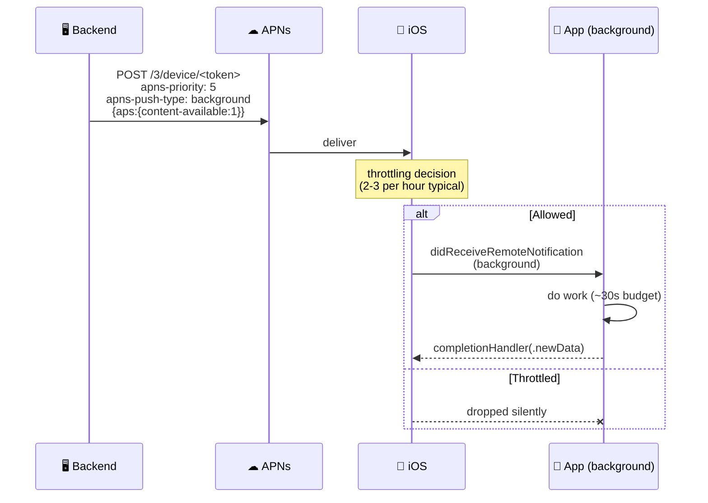
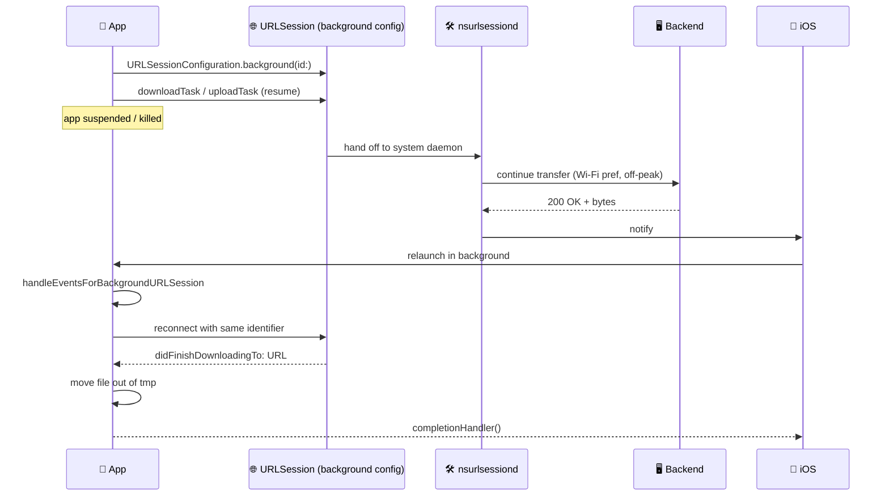

# 📚 NTQ Solution — iOS Senior Interview Prep (27 questions)

> **🎯 Mục đích:** Bộ câu hỏi & câu trả lời mẫu phỏng vấn vị trí **iOS Developer Senior — SDC11** tại **NTQ Solution** (Entertainment domain, Swift native, focus rất mạnh vào **Background Processing**).
>
> **🏷 Tag:** **[V#]** = vocab, **[S#]** = structure (lấy từ 2 file SpeakFun trong cùng folder).
>
> **📋 Cách dùng:** Đọc câu hỏi → tự trả lời 60s → mở sample answer so sánh → highlight phrase chưa nhớ.
>
> **🏢 Job context (từ JD):**
> - Senior iOS, Entertainment, 5+ years Swift
> - **Cốt lõi: Background Processing** — BGTaskScheduler, Background App Refresh, Silent Push + Push Notification Service Extension, Background URLSession, CoreLocation background, Low Power Mode / App Nap / OS throttling
> - Architecture: Clean Architecture / MVVM / VIPER
> - Code review, technical leadership, mentoring iOS team
> - Collaborate với BE/Infra cho APIs, sync logic, retry mechanisms, event-driven background workflows
> - Domain match preferred: tracking, large-scale sync, IoT, fintech, health, event-driven streaming
>
> **🎯 Strategy cá nhân:**
> CV của Long có 4 năm iOS native + 7 năm RN with deep iOS bridging. Khi pitch về kinh nghiệm:
> - **Background work nổi bật**: Mydio (audio background playback + media session), ABC Education (DeviceActivity/Screen Time = background scheduling), MyClip (background upload + native bridge), Finhay (NFC eKYC native)
> - **Tech Lead 4 năm tại Hisoft + ABC Education** → cover phần code review / mentoring
> - **Honest framing**: "I have 4 years of focused native iOS plus 7 years bridging RN ↔ iOS — that's where my background processing depth comes from"

---

## 🗺 Map of all 27 questions

```
┌──────────────────────────────────────────────────────────────────┐
│  🌙 Nhóm A — Background Processing CORE       Q1–Q8   (P0!!!)   │
│  🔄 Nhóm B — App Lifecycle & State            Q9–Q11  (P0)      │
│  🏛  Nhóm C — Architecture (Clean/MVVM/VIPER)  Q12–Q14 (P0)      │
│  ⚙ Nhóm D — Concurrency, Memory, Performance  Q15–Q18 (P0)      │
│  🌐 Nhóm E — Networking & Data Sync           Q19–Q21 (P1)      │
│  🔒 Nhóm F — Security & Permissions           Q22–Q23 (P1)      │
│  👥 Nhóm G — Code Review & Mentoring          Q24–Q25 (P0 NTQ)  │
│  💬 Nhóm H — Behavioral / Personal Anchor     Q26–Q27 (P1)      │
└──────────────────────────────────────────────────────────────────┘
```

---

# 🌙 Nhóm A — Background Processing CORE (P0 — cốt lõi của JD NTQ)

## Q1. BGTaskScheduler vs Background Fetch (legacy) — khi nào dùng cái nào?

### 📊 Comparison

```
   📜 LEGACY (iOS 7–12)                ⚡ MODERN (iOS 13+)
   ┌──────────────────────────┐        ┌──────────────────────────────┐
   │ Background Fetch         │        │ BGTaskScheduler              │
   │  • performFetchWith…     │        │  • BGAppRefreshTask          │
   │  • OS-decided cadence    │        │  • BGProcessingTask          │
   │  • ~30s budget           │        │  • Identifier in Info.plist  │
   │  • single hook only      │        │  • Submit + handler pattern  │
   │  ❌ deprecated iOS 13     │        │  • Fine-grained control      │
   └──────────────────────────┘        └──────────────────────────────┘
```

### 💬 Sample answer

> "**BGTaskScheduler** is the modern replacement, introduced in iOS 13. **Let me walk you through** **[V29 / S7]** the difference.
>
> - **Background Fetch** (the old `application(_:performFetchWithCompletionHandler:)`) gave you one hook, with the OS deciding when to call you. Limited to ~30 seconds, no separation between short refresh and long processing tasks.
> - **BGTaskScheduler** gives two task types:
>   - 🔄 **`BGAppRefreshTask`** — short, periodic refresh (a few seconds), like updating a feed.
>   - ⚙️ **`BGProcessingTask`** — longer maintenance work (DB cleanup, large sync), can require power and network conditions.
>
> **My typical setup:** declare task identifiers in `Info.plist` under `BGTaskSchedulerPermittedIdentifiers`, register handlers in `application(_:didFinishLaunching…)`, then **submit a `BGAppRefreshTaskRequest` with `earliestBeginDate`** when going to background. The OS schedules based on user behavior and system load.
>
> **A key aspect** **[S41]** is **always set an `expirationHandler`** — the OS gives you ~30s; if you exceed it without handling expiration, your task is killed and your app may be throttled later."

> ⚠️ **Bẫy:** Đừng nói "BGTaskScheduler chạy theo schedule chính xác" — OS quyết định, có thể không chạy luôn nếu user ít mở app.

---

## Q2. Background App Refresh — limits, system constraints, best practices

### 📊 Constraints map

```
   📅 SCHEDULING
   ├─ OS heuristic: based on app usage pattern
   ├─ "earliestBeginDate" is a HINT, not a guarantee
   └─ Skipped if Low Power Mode / Background Refresh OFF

   ⏱ TIME BUDGET
   ├─ ~30 seconds typical
   ├─ Killed if expirationHandler not set
   └─ Killed faster if device is hot / low battery

   🔄 RESCHEDULE PATTERN
   ├─ Re-submit at the START of the handler
   ├─ Otherwise it runs once and never again
   └─ Setting BGTaskScheduler is NOT idempotent — submit fresh each time
```

### 💬 Sample answer

> "**My approach involves** **[S34]** treating Background App Refresh as a **best-effort** mechanism, never a guarantee.
>
> **Constraints I keep in mind:**
> - **Time budget is ~30 seconds** — design the work to fit, with a clear cutoff in `expirationHandler`.
> - **OS heuristic** — iOS schedules based on user habits. A user who opens the app every morning at 8am will get refreshes around then.
> - **System throttling** — Low Power Mode, thermal pressure, or low battery will skip the refresh.
> - **User toggle** — users can disable Background App Refresh per-app in Settings; we should detect this via `UIApplication.shared.backgroundRefreshStatus`.
>
> **One key pattern** **[S41]**: at the **start** of the task handler, immediately submit the next request. If you wait until the end and the task is killed, you'll never get scheduled again.
>
> **It's essential to ensure that** **[S44]** the work is incremental — if killed mid-way, the next run can resume."

---

## Q3. Silent Push Notifications — flow, payload, throttling

### 📊 Silent push flow



### 💬 Sample answer

> "**Silent push** is a content-available notification that wakes the app in the background without showing UI.
>
> **The solution involves** **[S37]** three pieces:
>
> 1. **Payload contract** — `{ "aps": { "content-available": 1 } }`, `apns-priority: 5`, `apns-push-type: background`. **A key aspect** **[S41]** is that priority must be 5 (not 10) and push-type must be `background` — otherwise APNs may reject or treat it as alert.
> 2. **App handler** — `application(_:didReceiveRemoteNotification:fetchCompletionHandler:)` — do work, call completion within ~30s. Newer apps should use `UNUserNotificationCenter` plus background modes capability.
> 3. **Backend cadence** — APNs throttles silent pushes aggressively, **typically a few per hour per device**. Don't try to use silent push as a real-time channel — for that, use WebSocket while in foreground, silent push only for trigger-and-sync.
>
> **One challenge** **[S35]** I've seen is teams firing silent push every 5 minutes and wondering why most are dropped. The fix is **debouncing on the backend** plus a **server-side fallback** like a WebSocket reconnect when foreground.
>
> **Real use case from CV**: at Mydio (Viettel audio streaming), we used a similar pattern to refresh subscription state — silent push on entitlement change, app does a `URLSession` background refresh, updates local cache."

---

## Q4. Push Notification Service Extension — use case + implementation

### 📊 Anatomy

```
   📨 Push arrives at device
            │
            ▼
   ┌─────────────────────────────────────────┐
   │ NotificationServiceExtension            │
   │ (separate process, ~30s budget)         │
   │                                         │
   │  • didReceive(_:withContentHandler:)    │
   │  • mutate UNMutableNotificationContent  │
   │  • fetch attachment from server         │
   │  • decrypt E2EE payload                 │
   │  • localize / personalize text          │
   └────────────────┬────────────────────────┘
                    ▼
   ┌─────────────────────────────────────────┐
   │ contentHandler(modified)                │
   │  → iOS shows notification               │
   └─────────────────────────────────────────┘
```

### 💬 Sample answer

> "**Push Notification Service Extension** runs in a **separate process** — wakes up when a push arrives, gives you ~30s to mutate the notification before iOS shows it.
>
> **Common use cases:**
> - 🖼 **Rich media** — download an image attachment and attach it via `UNNotificationAttachment`.
> - 🔓 **E2EE decryption** — server sends encrypted blob; the extension decrypts and replaces the body so the user sees plain text.
> - 🌍 **Localization / personalization** — server sends keys, extension localizes locally.
> - 📊 **Pre-fetch detail** — fetch the related item detail so when the user taps, it opens instantly.
>
> **Implementation outline:**
> 1. Add a new **Notification Service Extension target** in Xcode.
> 2. Override `didReceive(_:withContentHandler:)` — modify `bestAttemptContent`, then call `contentHandler(content)`.
> 3. Override `serviceExtensionTimeWillExpire()` — your last chance to deliver something before iOS gives up.
> 4. Backend payload must include `mutable-content: 1` — otherwise iOS won't invoke the extension.
>
> **A key aspect** **[S41]** is **memory ceiling — 24MB on iOS 14+**. Keep work lean, no big in-memory parsing.
>
> **It's essential to ensure that** **[S44]** the extension always calls the contentHandler — even on error, fall back to the original content. Otherwise the user sees nothing."

---

## Q5. Background URLSession (Background Transfer Service) — flow upload/download

### 📊 Flow diagram



### 💬 Sample answer

> "**Background URLSession** lets uploads and downloads continue **even after the app is suspended or killed**. The transfer is handed off to a system daemon (`nsurlsessiond`) and resumed in your app via a relaunch.
>
> **The solution involves** **[S37]** several pieces:
>
> 1. **Configuration** — `URLSessionConfiguration.background(withIdentifier: 'com.app.bg-upload')`. The identifier is critical — same identifier must be used to reconnect on relaunch.
> 2. **Task creation** — only `downloadTask` / `uploadTask` work in background; data tasks don't.
> 3. **App relaunch** — when the transfer finishes, iOS relaunches your app and calls `application(_:handleEventsForBackgroundURLSession:completionHandler:)`. Save the completionHandler, **rebuild the URLSession with the same identifier**, and your delegate methods fire.
> 4. **Move files immediately** — `didFinishDownloadingTo:` provides a tmp URL that's deleted right after the delegate returns. Move it to a permanent location synchronously.
> 5. **Discretionary + Wi-Fi** — set `isDiscretionary = true` for power saving; OS will prefer Wi-Fi and off-peak times.
>
> **One challenge** **[S35]** I've handled at MyClip (Viettel video upload) is **users killing the app mid-upload** — with background URLSession, the upload survives. We just need to handle the relaunch path correctly.
>
> **A key aspect** **[S41]** is **idempotent backend** — the same upload may complete after the app reconstructs state, so the API should dedupe by client-generated request ID."

---

## Q6. CoreLocation background updates — modes, battery efficiency

### 📊 Background location modes

```
┌──────────────────────────────────────┬──────────────────────────────────┐
│ 📍 MODE                              │ 🔋 BATTERY / TRIGGER             │
├──────────────────────────────────────┼──────────────────────────────────┤
│ Standard updates + bg mode "location"│ High drain — continuous           │
│ Significant Location Changes (SLC)   │ Low drain — ~500m, cell-tower    │
│ Region monitoring (geofence)         │ Low — enter/exit events          │
│ Visit monitoring                     │ Low — places user lingers        │
│ Beacon ranging (background)          │ Medium — only near beacon        │
└──────────────────────────────────────┴──────────────────────────────────┘
```

### 💬 Sample answer

> "**There are several background location modes** — each trades accuracy for battery.
>
> - **Standard updates** with `UIBackgroundModes: location` — continuous, highest accuracy, **high battery drain**. Use only for active tracking like navigation or fitness recording.
> - **Significant Location Changes (SLC)** — uses cell-tower transitions, ~500m precision, **very low drain**. Wakes the app on movement; great for triggering a sync when the user changes neighborhoods.
> - **Region monitoring (geofencing)** — fire on enter/exit of a circular region. Up to 20 regions per app.
> - **Visit monitoring** — iOS detects places where the user lingers (home, office) and notifies you.
>
> **My typical pattern for an Entertainment app needing 'nearby content' refresh:** SLC instead of standard updates — battery friendly, still lets us refresh when the user moves into a new city.
>
> **A key aspect** **[S41]** is **`allowsBackgroundLocationUpdates`** must be set after you have `Always` permission, and `pausesLocationUpdatesAutomatically` should be tuned per use case.
>
> **It's essential to ensure that** **[S44]** the user understands why we need 'Always' — the permission prompt should be preceded by an explainer screen, otherwise iOS auto-downgrades to 'When In Use' and our background path silently breaks."

---

## Q7. Low Power Mode + App Nap + OS throttling — cách handle?

### 📊 Throttling layers

```
   ┌────────────────────────────────────────────────┐
   │ 🪫 LOW POWER MODE (battery < 20% or user opt) │
   │  • Background Refresh paused                  │
   │  • Network requests deferred                  │
   │  • Animations / fetches throttled             │
   │  → Detect: ProcessInfo.isLowPowerModeEnabled  │
   └────────────────────────────────────────────────┘

   ┌────────────────────────────────────────────────┐
   │ 😴 APP NAP (macOS, similar concept on iOS)    │
   │  • App goes to suspended faster when idle     │
   │  • Timers + scheduled work deferred           │
   └────────────────────────────────────────────────┘

   ┌────────────────────────────────────────────────┐
   │ 🌡 THERMAL THROTTLING                          │
   │  • CPU clamped on hot device                  │
   │  → Detect: ProcessInfo.thermalState            │
   └────────────────────────────────────────────────┘
```

### 💬 Sample answer

> "**Three layers** to be aware of:
>
> 1. 🪫 **Low Power Mode** — kicks in below 20% battery or when user enables it. **Background App Refresh is paused**, network is deferred, animations slow down. **Detect via** `ProcessInfo.processInfo.isLowPowerModeEnabled` and observe `Notification.Name.NSProcessInfoPowerStateDidChange`.
> 2. 😴 **App Nap / suspension** — iOS suspends apps quickly when nothing is happening. Don't keep retain cycles or live timers expecting them to fire after suspension.
> 3. 🌡 **Thermal throttling** — `ProcessInfo.processInfo.thermalState` reports `.nominal / .fair / .serious / .critical`. On `.serious` or higher, drop frame rate, pause background sync, scale down image decoding.
>
> **My approach involves** **[S34]** building a **'capacity sensor'** that aggregates these signals and exposes a single 'should I do heavy work now?' boolean to the rest of the app.
>
> **A key aspect** **[S41]** is **graceful degradation** — when the device is constrained, do less, not nothing. Pause prefetch, skip analytics flush, but still respond to user actions.
>
> **One thing I learned** is to **test on a hot device** — simulator never throttles, so you'll only see real behavior on a physical iPhone after 10 minutes of video playback in the sun."

---

## Q8. Background task lifecycle + sandbox + permissions

### 📊 Lifecycle of a background task

```
   📱 App in foreground
       │
       │  user backgrounds app
       ▼
   ⏸ INACTIVE → BACKGROUND
       │
       │  beginBackgroundTask(withName:)
       ▼
   ⏱ ~30s budget
       │
       ├─ work completes  → endBackgroundTask(_:) ✅
       │
       └─ time runs out   → expirationHandler called
                            (must call endBackgroundTask there!)
                            otherwise → app KILLED 💀

   🔒 SANDBOX
   ├─ Container directory only
   ├─ No access to other apps' data
   └─ App Group container for sharing with extensions
```

### 💬 Sample answer

> "**For a short background continuation** — say finishing an upload right after the user backgrounds the app — use `UIApplication.shared.beginBackgroundTask(withName: …, expirationHandler:)`. **The main rule** **[S38]**: always call `endBackgroundTask(_:)`, even from the expiration handler, otherwise iOS will kill the app and may throttle future background time.
>
> **For longer scheduled work**, BGTaskScheduler is the right tool (covered in Q1).
>
> **Sandboxing:**
> - Each app has its own **container directory** — `Documents`, `Library`, `tmp`. No access to other apps' files.
> - To share with extensions (Notification Service, Widget, Today extension), use **App Groups** — common UserDefaults and shared container directory.
>
> **Permissions for background work:**
> - Background Modes capability must be enabled in Xcode for: Background fetch, Remote notifications, Location updates, Audio, VoIP, etc.
> - Each capability triggers App Store review scrutiny — you must justify usage.
>
> **A key aspect** **[S41]** I learned at ABC Education: when integrating Screen Time / DeviceActivity, the App Group setup is **non-obvious** — the parent app and the DeviceActivityMonitor extension both need the same group ID, with shared UserDefaults for state sync."

---

# 🔄 Nhóm B — App Lifecycle & State (P0)

## Q9. iOS app lifecycle states — explain in detail

### 📊 State diagram

```
       ┌──────────┐
       │ Not      │
       │ Running  │
       └─────┬────┘
             │ launch
             ▼
       ┌──────────┐
       │ Inactive │ ← transient (incoming call, control center, etc.)
       └─────┬────┘
             │
             ▼
       ┌──────────┐                     ┌──────────┐
       │ Active   │ ◄──── resume ───── │ Background│
       └─────┬────┘                     └─────┬────┘
             │ user backgrounds                │ time runs out
             ▼                                 ▼
       ┌──────────┐                     ┌──────────┐
       │ Background│                    │ Suspended│ (frozen, in RAM)
       └─────┬────┘                     └─────┬────┘
             │                                 │ memory pressure
             ▼                                 ▼
       (same as above)                  ┌──────────┐
                                        │ Terminated│
                                        └──────────┘
```

### 💬 Sample answer

> "**iOS apps move through five states:**
>
> - 🚫 **Not Running** — never launched or terminated.
> - ⏳ **Inactive** — transient state (incoming call, Control Center pulled).
> - ✅ **Active** — frontmost, receiving events.
> - 🌙 **Background** — running but not visible. Time-limited.
> - ❄️ **Suspended** — in RAM but not executing. iOS may free it on memory pressure.
>
> **Key transitions to handle in code:**
> - `applicationWillResignActive` — pause game loop, stop timers.
> - `applicationDidEnterBackground` — start short-lived background task if needed, save state.
> - `applicationWillEnterForeground` — refresh expired tokens, reconnect WebSocket.
> - `applicationDidBecomeActive` — resume animations, refetch foreground data.
>
> **A key aspect** **[S41]** is that **suspension can happen any time** — never assume timers will fire or that a network call started moments ago will complete. **It's essential to ensure that** **[S44]** state is persisted before going to background.
>
> **For Scene-based apps (iOS 13+)**, these callbacks live on `UISceneDelegate` instead, which I'll cover in Q10."

---

## Q10. SceneDelegate vs AppDelegate (multi-scene)

### 📊 Responsibilities

```
   ┌────────── 🚀 AppDelegate ──────────┐    ┌────────── 🎬 SceneDelegate ──────────┐
   │ • App-wide setup (DI, Firebase)    │    │ • Per-scene UI lifecycle              │
   │ • didFinishLaunchingWithOptions    │    │ • willConnectTo session               │
   │ • Background task registration     │    │ • sceneDidEnterBackground             │
   │ • Push token registration          │    │ • Window setup                        │
   │ • State restoration (legacy)       │    │ • Multi-window support (iPadOS)       │
   └────────────────────────────────────┘    └───────────────────────────────────────┘
```

### 💬 Sample answer

> "**Since iOS 13**, lifecycle responsibility is split:
>
> - **AppDelegate** keeps app-wide setup — DI container, Firebase, BGTaskScheduler registration, push notification token, URL handling at the app level.
> - **SceneDelegate** handles per-window lifecycle — `sceneWillResignActive`, `sceneDidEnterBackground`, window setup. **A key aspect** **[S41]** is that on iPad, you can have **multiple scenes simultaneously** (split view, multiple windows of the same app) — each with its own SceneDelegate instance.
>
> **For an iPhone-only app**, the practical impact is small — SceneDelegate just hosts window creation. For iPad/Mac Catalyst apps, scenes matter more.
>
> **One thing I learned** is that **background tasks should still be registered in AppDelegate** — they're app-wide, not per-scene. The handler can dispatch work to whatever scene needs it via NotificationCenter or a shared coordinator."

---

## Q11. Background task time budget — 30s rule + expirationHandler

### 📊 Budget anatomy

```
   ⏱ beginBackgroundTask
       │
       │   work runs...
       ▼
   ┌───────────────────────────────┐
   │ ~30s budget (typical)         │
   │                               │
   │  ┌───── ✅ work done ─────┐  │
   │  │                         │  │
   │  ▼                         ▼  │
   │ endBackgroundTask(token)      │
   │                               │
   │  OR                           │
   │                               │
   │  ┌── ⏰ time about to expire │
   │  │                            │
   │  ▼                            │
   │ expirationHandler fires       │
   │  → MUST call endBackgroundTask│
   │  → otherwise app TERMINATED   │
   └───────────────────────────────┘
```

### 💬 Sample answer

> "**The 30-second rule** is roughly the budget for `beginBackgroundTask`-based continuation when the app goes to background — though the actual time depends on system state.
>
> **The pattern:**
>
> ```swift
> let token = UIApplication.shared.beginBackgroundTask(withName: 'finalizeUpload') {
>     // expirationHandler
>     uploadTask.cancel()
>     UIApplication.shared.endBackgroundTask(token)
> }
> uploadTask.start { result in
>     UIApplication.shared.endBackgroundTask(token)
> }
> ```
>
> **A key aspect** **[S41]** — **the expirationHandler is your last chance**. iOS calls it when the budget is about to run out. You **must** call `endBackgroundTask` from inside it, otherwise the app is force-killed and may be throttled in the future.
>
> **For longer work**, don't try to extend the 30s — use `BGProcessingTask` instead, which can run for minutes when the device is plugged in and on Wi-Fi.
>
> **It's essential to ensure that** **[S44]** the work is **resumable** — if killed mid-way, the next launch should continue from a checkpoint, not restart."

---

# 🏛 Nhóm C — Architecture (Clean Architecture / MVVM / VIPER)

## Q12. Clean Architecture vs MVVM vs VIPER — chọn cho dự án Entertainment?

### 📊 Quick compare

```
┌─────────────┬──────────────────┬──────────────┬─────────────────┐
│  📐 Pattern │ Layers           │ Boilerplate  │ Best for        │
├─────────────┼──────────────────┼──────────────┼─────────────────┤
│ MVVM        │ V – VM – M       │ Low          │ Most apps       │
│ VIPER       │ V–I–P–E–R        │ High         │ Large team      │
│ Clean Arch  │ Pres–Dom–Data    │ Medium       │ Long-lived app  │
└─────────────┴──────────────────┴──────────────┴─────────────────┘

   Combine:
   ┌────────────────────────────────────────────────┐
   │  Clean Architecture (layer separation)         │
   │     +                                          │
   │  MVVM (within Presentation layer)              │
   │     +                                          │
   │  Coordinator (navigation outside ViewModel)    │
   └────────────────────────────────────────────────┘
```

### 💬 Sample answer

> "**Each pattern has its place:**
>
> - **MVVM** — View, ViewModel, Model. **The main benefit** **[S38]** is that the ViewModel is **testable without UIKit / SwiftUI** — pure logic, no view dependencies. Best default for most screens.
> - **VIPER** — View, Interactor, Presenter, Entity, Router. Forces strict separation; useful in **large teams** where multiple devs touch the same screen — fewer merge conflicts. Downside: **a lot of boilerplate** for simple screens.
> - **Clean Architecture** — splits the app into **Presentation / Domain / Data** layers with one-way dependencies. The Domain (use cases + entities) is pure Swift, no framework imports. Great for **long-lived products** that change technology over time.
>
> **My typical setup combines them:**
> - **Clean Architecture** at the layer level.
> - **MVVM** inside the Presentation layer.
> - **Coordinator pattern** to keep navigation out of the ViewController.
>
> **For an Entertainment app at NTQ** — likely media-heavy with background sync and long lifespan — I'd start with **Clean Architecture + MVVM + Coordinator**. VIPER would be overkill unless the team is 20+ iOS engineers.
>
> **A key aspect** **[S41]** is **not over-engineering small screens** — a settings page doesn't need a Coordinator and three layers. Match complexity to actual need.
>
> **From my CV**: I applied this combo at Mydio (Viettel audio) for the audio domain bounded contexts — clean separation between playback engine, subscription state, and UI."

---

## Q13. Dependency Injection trong iOS — Factory vs Swinject vs manual

### 📊 Compare

```
┌────────────────┬─────────────────┬──────────────────────────────────┐
│ 🛠 Approach    │ ✅ Pros          │ ❌ Cons                           │
├────────────────┼─────────────────┼──────────────────────────────────┤
│ Manual init    │ Simple, explicit│ Verbose, hard to swap for tests  │
│ Property wrappers│ Clean, declarative│ Magic, harder onboarding       │
│ Factory (lib)  │ Light, type-safe│ Newer, smaller community         │
│ Swinject       │ Mature, flexible│ Runtime resolution, slower start │
│ Resolver       │ Property-wrapper│ Less active maintenance          │
└────────────────┴─────────────────┴──────────────────────────────────┘
```

### 💬 Sample answer

> "**Three approaches I'd consider:**
>
> 1. 🪶 **Manual initializer injection** — pass dependencies through `init`. Simplest, no library. **Works well for small apps** but verbose at scale.
> 2. ⚡ **Factory** (Michael Long's library) — lightweight, **type-safe at compile time**, no runtime container. My current preference for new projects — minimal overhead, clean syntax.
> 3. 🏛 **Swinject** — mature, flexible, supports complex graphs and scoping. Best when the team already knows it or the app is enterprise-scale.
>
> **My typical setup**: Factory for new iOS projects, manual init for small screens, with **a single composition root** at the AppDelegate level that wires everything up.
>
> **A key aspect** **[S41]** is **constructor injection over property injection** — makes dependencies explicit in the type signature, easier to test.
>
> **For testing**, I swap real implementations with mocks at the composition root — no need to touch the screen code. **It's designed to be** **[S40]** flexible and testable."

---

## Q14. Coordinator pattern — vì sao tách navigation khỏi ViewController?

### 📊 Without vs With Coordinator

```
   ❌ WITHOUT                              ✅ WITH COORDINATOR
   ┌──────────────────┐                   ┌──────────────────┐
   │ ViewController   │                   │ ViewController   │
   │  • UI            │                   │  • UI only       │
   │  • Business      │                   └──────┬───────────┘
   │  • NAVIGATION    │                          │ delegate
   │ ❌ tightly coupled│                          ▼
   └──────────────────┘                   ┌──────────────────┐
                                          │ Coordinator      │
                                          │  • Navigation    │
                                          │  • Flow logic    │
                                          │  • DI for next VC│
                                          └──────────────────┘
```

### 💬 Sample answer

> "**The Coordinator pattern** moves navigation logic out of the ViewController into a dedicated object.
>
> **Without it**, ViewControllers know about each other — `present(NextVC, …)` couples Screen A to Screen B. Hard to:
> - Reuse a screen in a different flow.
> - Test the flow in isolation.
> - Change the flow without touching every VC.
>
> **With Coordinators:**
> - The VC fires a delegate callback like `coordinator?.didTapNext(with: data)`.
> - The Coordinator decides what's next, instantiates the next VC, injects its dependencies.
>
> **My typical setup**: a `Coordinator` protocol with `start()` + `childCoordinators`, an `AppCoordinator` at the root, and `FeatureCoordinator` per major flow (Auth, Onboarding, Player, Settings).
>
> **A key aspect** **[S41]** is **memory management** — Coordinators are reference types, easy to leak. Use `[weak self]` in callbacks and remove child coordinators when their flow ends.
>
> **From my experience at MSB super-app**: each business module owned its internal Coordinator, while the host shell owned the top-level navigation — a pattern that scaled well across module teams."

---

# ⚙ Nhóm D — Concurrency, Memory, Performance (P0)

## Q15. GCD vs OperationQueue vs Swift Concurrency (async/await + actors)

### 📊 Compare

```
┌────────────────┬────────────────────┬──────────────────────────────────┐
│ Tool           │ Best for           │ Notes                            │
├────────────────┼────────────────────┼──────────────────────────────────┤
│ GCD (DispatchQueue)│ Simple async    │ Low-level, no cancel, callback hell│
│ OperationQueue │ Dependency graph   │ Cancellable, can chain, KVO    │
│ async / await  │ Modern default     │ Structured, readable, type-safe │
│ Task / TaskGroup│ Concurrent work   │ Cancellation, child tasks       │
│ Actor          │ Shared mutable state│ Thread-safe by isolation       │
└────────────────┴────────────────────┴──────────────────────────────────┘
```

### 💬 Sample answer

> "**My default in 2026 is Swift Concurrency** (async/await + actors) — it gives **structured concurrency**, automatic cancellation propagation, and far better readability than GCD callbacks.
>
> **When to use what:**
> - 🆕 **async/await** — new code, networking, file I/O, anything that returns a value asynchronously.
> - 🔒 **Actor** — protect shared mutable state. For example a `DownloadCoordinator` actor that manages active downloads — no manual locks needed.
> - 📊 **TaskGroup** — fan-out/fan-in concurrent work, like prefetching multiple media items in parallel with cancellation.
> - 🪜 **OperationQueue** — when I need a **dependency graph** between operations, or interop with older Obj-C APIs that take `NSOperation`.
> - ⚙️ **GCD** — for very low-level dispatching when async/await isn't available (legacy code, certain delegate callbacks).
>
> **A key aspect** **[S41]** for background processing: when async/await crosses into a background URLSession delegate, mark the delegate or the surrounding type with `@MainActor` or use an actor to keep state thread-safe.
>
> **One thing I learned** is **`@MainActor` is your friend** for UI-bound code — the compiler enforces correct thread, no more 'updating UI from background' crashes."

---

## Q16. Memory management — ARC, retain cycles, [weak self]

### 📊 Common cycle patterns

```
   🪤 RETAIN CYCLE EXAMPLE
   ┌────────────────┐         ┌────────────────┐
   │ ViewController │ ──ref──►│ Closure        │
   │                │ ◄─ref── │ captures self  │
   └────────────────┘         └────────────────┘
                  (both kept alive forever)

   ✅ FIX
   { [weak self] result in
       guard let self else { return }
       self.handle(result)
   }
```

### 💬 Sample answer

> "**ARC** (Automatic Reference Counting) handles memory in Swift — the compiler inserts retain/release calls. **A key risk** **[S41]** is **retain cycles** — two objects holding strong references to each other so neither is ever freed.
>
> **Most common cycles I look for:**
> 1. 🪤 **Closure capturing `self`** — `[weak self]` or `[unowned self]` to break.
> 2. 🔗 **Delegate held strongly** — delegates should be `weak var`.
> 3. 🎯 **Combine sinks not stored** or stored in a strong `Set<AnyCancellable>` on `self` while the closure also captures `self`.
> 4. ⏰ **Timer with target self** — `Timer.scheduledTimer(target: self, ...)` retains; use the closure-based API + `[weak self]`.
>
> **My typical workflow** **[S34]**: profile in Xcode Instruments — **Allocations** for total memory, **Leaks** for cycles, **Time Profiler** for CPU bottlenecks. Run on a real device, ideally in release-like config (Hermes / optimizations on).
>
> **`weak` vs `unowned`**: `weak` is safer (becomes nil if deallocated), `unowned` is faster but crashes if the reference is gone. **I default to `weak`** unless the lifetime relationship is provably tight.
>
> **One thing I learned** at MyClip is that **video editor objects with FFmpeg buffers** can hold huge memory — releasing them late causes pressure spikes. We added explicit `tearDown()` methods to release native buffers deterministically."

---

## Q17. Battery efficiency — best practices cho long-running tasks

### 📊 Battery cost map

```
   🔥 EXPENSIVE                       🌱 EFFICIENT
   ─────────────                     ─────────────
   • Standard location updates       • SLC / region monitoring
   • Continuous network polling      • WebSocket + push trigger
   • Always-on screen                • Adaptive frame rate
   • CPU spin loops                  • Coalesced timers
   • Wake on every event             • Batched processing
   • Decoded high-res images         • Right-sized + cached
```

### 💬 Sample answer

> "**Battery efficiency comes from doing less, less often, and at better times.**
>
> **My checklist for long-running tasks:**
>
> 1. 🌐 **Network** — coalesce requests, use HTTP/2 multiplexing, avoid polling. WebSocket + silent push triggers when needed instead of `Timer + fetch`.
> 2. 📍 **Location** — SLC over standard updates. Stop CoreLocation when not needed.
> 3. 💾 **Disk I/O** — batch writes, use background priority queues.
> 4. 🖼 **Image** — request right-sized variants from CDN, decode off main thread, cache aggressively.
> 5. ⏰ **Timers** — coalesce with `DispatchSource` tolerance; respect `isLowPowerModeEnabled`.
> 6. 🔋 **`isDiscretionary` on URLSession** — let iOS choose when to transfer.
> 7. 🌡 **Thermal awareness** — check `thermalState`; on `.serious`+, drop to skeleton mode.
>
> **A key aspect** **[S41]** is **Energy Log in Xcode Instruments** — measures CPU + GPU + network energy. Run a real-world session, see what spikes, then optimize the top one.
>
> **It's essential to ensure that** **[S44]** background work scales down when the app is constrained — never assume same budget as foreground."

---

## Q18. Profiling tools — Instruments deep dive

### 📊 Tool guide

```
┌──────────────────────┬──────────────────────────────────────┐
│ 🔍 Instrument        │ 🎯 Use case                           │
├──────────────────────┼──────────────────────────────────────┤
│ Time Profiler        │ CPU hot spots, function-level        │
│ Allocations          │ Memory growth, leaks, transient peaks│
│ Leaks                │ Retain cycles                        │
│ Energy Log           │ Battery cost by subsystem            │
│ Network              │ HTTP traffic, sizes, durations       │
│ Core Animation       │ Frame drops, offscreen rendering     │
│ System Trace         │ Threading, scheduling, blocked time  │
│ os_signpost          │ Custom markers in your own code      │
└──────────────────────┴──────────────────────────────────────┘
```

### 💬 Sample answer

> "**Xcode Instruments** is the primary profiler — each tool answers a different question.
>
> **My typical workflow** **[S34]**:
> 1. **Time Profiler** first — find which function eats CPU.
> 2. **Allocations + Leaks** for memory.
> 3. **Energy Log** if battery is the complaint.
> 4. **Core Animation** for scroll jank — flags offscreen rendering, blended layers.
> 5. **os_signpost** in my own code to mark custom intervals — shows up alongside system events in System Trace.
>
> **A key aspect** **[S41]** is **profile on a real device in Release configuration** — Debug builds with optimizations off give misleading numbers.
>
> **One thing I learned** at Mydio is that the **mini-player → full-player transition was janky** because of an offscreen-rendered shadow on the album art. Core Animation instrument flagged it red; switching to a precomputed shadow image fixed it instantly.
>
> **For background processing specifically**, the pattern I use is: add `os_signpost` events at `BGTask` start/end and at every checkpoint, then play back the trace to see exactly where time is spent and whether the task fits in the budget."

---

# 🌐 Nhóm E — Networking & Data Sync (P1)

## Q19. URLSession deep dive — configuration, delegate vs Combine vs async

### 📊 Configuration types

```
┌────────────────────────┬─────────────────────────────────────┐
│ Configuration          │ Behavior                            │
├────────────────────────┼─────────────────────────────────────┤
│ .default               │ Disk cache, cookies, foreground only│
│ .ephemeral             │ No persistent cookies/cache         │
│ .background(id:)       │ Survives suspend/kill, system daemon│
└────────────────────────┴─────────────────────────────────────┘

┌────────────────────────┬─────────────────────────────────────┐
│ API style              │ When                                 │
├────────────────────────┼─────────────────────────────────────┤
│ Delegate               │ Background, progress, custom auth   │
│ Combine publishers     │ Reactive pipelines (legacy)         │
│ async/await            │ Modern default                      │
└────────────────────────┴─────────────────────────────────────┘
```

### 💬 Sample answer

> "**URLSession is far more powerful than the basic `dataTask` we all start with.**
>
> **Configuration matters:**
> - **`.default`** — foreground requests with disk cache and cookies.
> - **`.ephemeral`** — no persisted state, useful for sensitive flows.
> - **`.background(withIdentifier:)`** — survives app suspend/kill, runs on system daemon. Required for background uploads/downloads (covered in Q5).
>
> **API style:**
> - **async/await** — my default. `let (data, _) = try await URLSession.shared.data(for: request)`.
> - **Delegate** — needed for background sessions, fine-grained progress, custom auth challenges (certificate pinning, mTLS).
> - **Combine** — useful in reactive codebases, but the team is shifting away from it for new code.
>
> **A key aspect** **[S41]** for an Entertainment app: **HLS / DASH streaming uses its own player stack** (AVPlayer) — don't try to rebuild it on URLSession. Use URLSession for catalog APIs and metadata, AVPlayer for the actual media.
>
> **For retry & timeouts**: I wrap URLSession in a thin client with **per-request timeout, exponential backoff with jitter, and a circuit breaker** for repeatedly failing endpoints. **It's designed to be** **[S40]** **robust** **[V7]** under poor networks."

---

## Q20. Retry mechanism + offline-first sync (event-driven)

### 📊 Sync architecture

```
   📱 Local Action (write)
        │
        ▼
   ┌────────────────────────────────┐
   │ 📥 Local DB write (CoreData)   │   ✅ instant UX
   └────────────┬───────────────────┘
                │ enqueue
                ▼
   ┌────────────────────────────────┐
   │ 📨 Outbox queue (persisted)    │   survives kill
   └────────────┬───────────────────┘
                │ background sync
                ▼
   ┌────────────────────────────────┐
   │ 🔁 Retry policy                │
   │  • exponential backoff         │
   │  • jitter (avoid thundering)   │
   │  • dead-letter after N         │
   └────────────┬───────────────────┘
                ▼
   ┌────────────────────────────────┐
   │ ☁ Server                       │
   │  • idempotency-key dedupe      │
   └────────────────────────────────┘
```

### 💬 Sample answer

> "**The solution involves** **[S37]** several pieces working together:
>
> 1. 📥 **Optimistic local write** — write to CoreData immediately, return to UI instantly. The user sees their action as 'done' even offline.
> 2. 📨 **Persisted outbox queue** — every mutation goes into a queue table, survives app kill.
> 3. 🔁 **Retry policy** — exponential backoff with jitter (1s → 2s → 4s → cap), dead-letter after N failures with user-visible 'sync failed' state.
> 4. 🆔 **Idempotency keys** — every request includes a client-generated UUID; server dedupes. Critical because **the same request may fire twice** — once before the app is killed, once after relaunch.
> 5. 🔄 **Background sync hook** — register a `BGProcessingTask` to drain the outbox when the device is on Wi-Fi and charging.
> 6. ⚡ **Conflict resolution** — last-write-wins with server timestamp, or CRDT for collaborative data.
>
> **A key aspect** **[S41]** is the **idempotency contract with backend** — without it, retries cause duplicate orders/likes/comments. I always raise this in the API design phase.
>
> **Real example from my CV**: at Mydio, the listening-log sync followed this pattern — every track-played event went to a local outbox, drained on Wi-Fi via background URLSession, with the backend deduping by client event ID."

---

## Q21. CoreData vs SwiftData vs Realm — chọn cho large-scale sync?

### 📊 Compare

```
┌──────────┬──────────────────────┬──────────────────────────┐
│ DB       │ ✅ Pros               │ ❌ Cons                   │
├──────────┼──────────────────────┼──────────────────────────┤
│ CoreData │ Mature, NSFetchedResults│ Verbose, threading care │
│ SwiftData│ Modern Swift, @Model  │ iOS 17+, newer ecosystem │
│ Realm    │ Cross-platform, fast  │ External dep, big binary │
│ SQLite   │ Lowest level          │ Manual everything        │
└──────────┴──────────────────────┴──────────────────────────┘
```

### 💬 Sample answer

> "**For large-scale sync on iOS 16+ today, CoreData is still my primary recommendation** — battle-tested, integrates with `NSFetchedResultsController` for efficient table/collection updates, and supports CloudKit sync if needed.
>
> - **CoreData** — mature, supports background contexts for off-main-thread writes, lightweight migrations. **Threading rule**: never share managed objects across contexts; pass `NSManagedObjectID` instead.
> - **SwiftData** — Apple's new declarative wrapper (iOS 17+). `@Model` macro, less boilerplate, but the ecosystem is still maturing — I'd use it for greenfield iOS 17+ apps but stick with CoreData for backward compat.
> - **Realm** — fast, cross-platform, simple object model. Trade-off is an external dependency and binary size.
> - **Raw SQLite** (or GRDB) — only when I need full SQL control.
>
> **A key aspect** **[S41]** for background sync: **use a private background context** for the sync work, save into a `NSPersistentContainer` parent, and let the main context observe via `NSPersistentStoreRemoteChange` notifications. This keeps the main thread responsive even on huge syncs.
>
> **One thing I learned** is **batch operations** (`NSBatchInsertRequest`, `NSBatchDeleteRequest`) bypass the object graph for huge writes — orders of magnitude faster for initial sync of, say, 50k records."

---

# 🔒 Nhóm F — Security & Permissions (P1)

## Q22. Keychain Services — token storage + biometric gate

### 📊 Token lifecycle

```
   🔑 Login success
       │
       ▼
   ┌─────────────────────────────┐
   │ Save refresh token to       │
   │ Keychain                    │
   │  • kSecClassGenericPassword │
   │  • accessControl: biometric │
   │  • accessibility: After1stUnlock│
   └─────────────────────────────┘
       │
       │  request access
       ▼
   ┌─────────────────────────────┐
   │ FaceID / TouchID prompt     │
   │  → user passes              │
   │  → token returned           │
   └─────────────────────────────┘
       │
       ▼
   📱 Use token for API
```

### 💬 Sample answer

> "**The Keychain is the only place to store credentials, tokens, or anything sensitive on iOS.**
>
> **My typical setup:**
> - Use `kSecClassGenericPassword` for tokens, `kSecClassInternetPassword` for site-bound creds.
> - **Accessibility** — `kSecAttrAccessibleAfterFirstUnlockThisDeviceOnly` for tokens that should survive reboot but never sync to iCloud / migrate to a new device.
> - **`SecAccessControl`** — gate with biometric (`.userPresence` or `.biometryCurrentSet`) for high-value items like the refresh token or signing key.
>
> **A key aspect** **[S41]** is **clearing on logout** — `SecItemDelete` everything related to the user account, including any cached data in `Documents` that could leak on shared devices.
>
> **For biometric prompt**, use `LocalAuthentication` (`LAContext`) to evaluate policy first if you want a custom UX, then read from Keychain — Keychain will skip the prompt if `LAContext` was already authenticated within the reuse window.
>
> **From my CV**: at Finhay, the eKYC flow used Keychain Services with `.biometryCurrentSet` for the device-bound key — invalidated automatically if the user adds a new fingerprint, prevents unauthorized rebinding."

---

## Q23. App Transport Security + Certificate Pinning

### 📊 ATS layers

```
   📱 App ──HTTPS──► 🌐 Server
        │
        │ App Transport Security enforces:
        │  • TLS 1.2+
        │  • Forward secrecy ciphers
        │  • Valid cert chain
        │
        │ Certificate Pinning adds:
        │  • Compare server cert (or public key) hash
        │    against bundled hash
        │  • Reject if mismatch (even if CA-trusted)
```

### 💬 Sample answer

> "**App Transport Security (ATS)** is the iOS default — enforces TLS 1.2+, strong ciphers, valid cert chain. **It's essential to ensure that** **[S44]** ATS is **not globally disabled** in `Info.plist` — that's an App Store review red flag. If we need an exception (e.g. legacy partner endpoint), pin the exception to that specific domain.
>
> **Certificate pinning** is an extra layer on top — even if a malicious CA issues a valid-looking cert (corporate MITM, network attack), the app rejects the connection because the cert (or public key) hash doesn't match the bundled one.
>
> **Implementation:**
> - Implement `URLSessionDelegate.urlSession(_:didReceive:completionHandler:)`.
> - In the challenge, compare the server's `SecCertificate` (or its public key) hash against bundled hashes.
> - On mismatch, call `completionHandler(.cancelAuthenticationChallenge, nil)`.
>
> **A key aspect** **[S41]** is **pin rotation strategy** — bundle multiple pins (current + next) so the server can rotate without breaking deployed apps. Have a remote-config kill switch as last resort.
>
> **From my CV**: at Finhay we used Alamofire's `ServerTrustManager` with pinned hashes — fintech requirement, blocks corporate MITM proxies that some users have on their network."

---

# 👥 Nhóm G — Code Review & Mentoring (P0 — JD nhấn mạnh)

## Q24. Code review checklist cho iOS Swift codebase

### 📊 Review checklist

```
   ✅ ARCHITECTURE
   ├─ Layer boundaries respected (no UIKit in Domain)
   ├─ DI used, no singletons sneaking in
   └─ Coordinator owns navigation, not VC

   ✅ SWIFT IDIOMS
   ├─ No force-unwrap (!) without provable safety
   ├─ value types preferred (struct over class)
   ├─ `weak self` in async closures
   └─ async/await over completion callbacks

   ✅ THREADING
   ├─ UI updates on @MainActor
   ├─ Heavy work off main
   └─ Background tasks have expirationHandler

   ✅ ERROR HANDLING
   ├─ Errors typed, not stringly-typed
   ├─ User-facing message vs log message separated
   └─ Retry policy explicit

   ✅ TESTABILITY
   ├─ Logic testable without UIKit
   ├─ Networking mockable
   └─ Snapshot test for complex layouts

   ✅ HYGIENE
   ├─ No print/NSLog in production paths
   ├─ Localization strings, not hardcoded
   ├─ Accessibility labels present
   └─ Dead code removed
```

### 💬 Sample answer

> "**My typical checklist when reviewing iOS Swift PRs** **[S34]**:
>
> **Architecture**:
> - Layer boundaries — no UIKit imports in the Domain layer, Repositories return Domain entities, not API DTOs.
> - DI used consistently — no `Singleton.shared` sneaking in.
>
> **Swift idioms**:
> - **No force-unwrap** unless provably safe (e.g. `IBOutlet`).
> - **`weak self`** in any closure that could outlive the owner.
> - **async/await** preferred over completion callbacks for new code.
> - Value types (struct) by default, class only when reference semantics or inheritance is needed.
>
> **Threading**:
> - UI updates marked `@MainActor`.
> - Heavy work off main thread.
> - Background tasks have `expirationHandler`.
>
> **Error handling**:
> - Typed `Error` enums, not stringly-typed.
> - Separation between user-facing message and log message.
>
> **Testability**:
> - ViewModel testable without UIKit dependencies.
> - Networking is mockable via protocol.
>
> **Hygiene**:
> - No `print` left in production paths.
> - Strings localized.
> - Accessibility labels present (`accessibilityIdentifier` for UI tests).
>
> **One thing I learned** at Hisoft (4 years as tech lead) is that the **most valuable PR comments aren't 'this is wrong' — they're 'why did you choose this approach?'** Helps the author think, often leads to a better design without me dictating."

---

## Q25. Mentoring junior iOS developer — your approach

### 📊 Mentoring model

```
   📈 GROWTH ARC
   ┌──────────────────────────────────────────┐
   │ Stage 1 — Pair on small tasks            │
   │   • Walk through together                │
   │   • Explain "why", not just "what"       │
   ├──────────────────────────────────────────┤
   │ Stage 2 — Small features, supervised PR  │
   │   • Detailed code review                 │
   │   • Encourage asking questions early     │
   ├──────────────────────────────────────────┤
   │ Stage 3 — Owns medium feature end-to-end │
   │   • Light review, focus on design        │
   │   • Push to present at team meeting      │
   ├──────────────────────────────────────────┤
   │ Stage 4 — Owns module, mentors others    │
   └──────────────────────────────────────────┘
```

### 💬 Sample answer

> "**My approach involves** **[S34]** matching the level of support to where the person is.
>
> **My typical playbook:**
>
> 1. **Start with paired work** — small tasks together, narrating the 'why' behind decisions. Junior devs learn faster watching the thought process than reading code.
> 2. **Set up safe defaults** — clear PR template, lint rules pre-configured, CI catches obvious issues. Reduces 'gotcha' moments.
> 3. **Code review as teaching, not gatekeeping** — questions over commands. *'What happens if this network call fails?'* prompts thinking; *'Add a try-catch'* doesn't.
> 4. **Delegate ownership early** — give them a small feature, full ownership, light supervision. **A key aspect** **[S41]** is letting them feel the consequences (a bug, a missed edge case) — that's where real learning happens.
> 5. **Encourage questions, don't punish ignorance** — set the norm that 'I don't know' is the best answer when true.
> 6. **Push them to present** — explaining their work to the team forces deeper understanding.
>
> **One thing I learned** at Hisoft and ABC Education (where I led 6-person teams) is that **the senior who answers every question is actually slowing the team down** — sometimes the best response is *'How would you find out?'* and let them dig.
>
> **For NTQ specifically**, mentoring iOS team members on **background processing** is a great fit — it's a topic where small mistakes (forgotten `expirationHandler`, wrong push priority) cause big production bugs, and a structured walkthrough up front saves weeks of debugging later."

---

# 💬 Nhóm H — Behavioral / Personal Anchor

## Q26. The most complex background processing project you've worked on?

### 💬 Sample answer (story format)

> "**Sure, let me walk you through** **[V29 / S7]** the **ABC Education** project — that was my deepest end-to-end native iOS background work.
>
> **Context:** Educational app for children with strong **parental control**. The parental control side had to monitor kids' app usage in the background, block apps when limits were hit, and sync state across the parent's and child's devices.
>
> **What made it hard:**
> 1. **DeviceActivity / FamilyControls / ManagedSettings** — Apple's Screen Time framework runs in a **separate extension process** with its own lifecycle, sandbox, and ~30s budget per callback.
> 2. **App Group sharing** — the parent app, the child app, the DeviceActivityMonitor extension, and the Shield Configuration extension all needed to share state. Required careful App Group setup with shared `UserDefaults` and shared container directory.
> 3. **Background reliability** — schedules had to fire even after device reboot, even on Low Power Mode, with no user interaction for hours.
> 4. **Push + WebSocket mix** — silent push to nudge a sync, WebSocket for live parental dashboard updates when foreground.
>
> **What I owned:**
> - Designed the JS ↔ Native bridge contracts (NativeModules, RCTEventEmitter, Expo Modules Core) for permission request, app selection, block/unblock state, and event flow.
> - Implemented the parental-control extension layer (ShieldConfiguration, home-screen widgets) with App Groups for shared blocked-state synchronization.
> - Led the team of 6 (mobile + backend + design + BA) end-to-end from architecture to production.
>
> **Result:** Shipped to production with reliable background blocking. **One thing I learned** is that **testing background flows requires patience and a real device** — you can't shortcut the OS scheduler. We built an internal 'force-trigger' debug menu to speed up QA.
>
> **For NTQ's Entertainment background work**, I'd bring this same playbook — design the data contract, account for system constraints up front, and instrument heavily so production issues are debuggable."

---

## Q27. Why NTQ + your career goal?

### 💬 Sample answer

> "**I'm interested in NTQ** for three reasons:
>
> 1. **The role matches where I want to deepen.** I have 4 years of focused native iOS plus 7 years bridging React Native ↔ iOS. The NTQ role focuses on **background processing** — exactly the area where my experience at Mydio (audio background), MyClip (video), ABC Education (DeviceActivity), and Finhay (NFC eKYC) overlaps. I want to push deeper into that craft, not stay generalist forever.
>
> 2. **NTQ's scale and international exposure.** 1300+ engineers, offices in Japan / Korea / EU / US, large-scale Entertainment projects. That's the environment where I can learn from senior architects and contribute to systems with real reliability requirements.
>
> 3. **Mentoring + technical leadership.** I led teams of 6 at Hisoft and ABC Education, and the Senior iOS role explicitly includes code review and mentoring. That's the direction I want to grow — toward Tech Lead and eventually Engineering Manager.
>
> **My long-term goal** is to be the kind of engineer who can **own a hard subsystem end-to-end** — design, implementation, mentoring, and production support — and gradually take on more leadership responsibility. NTQ's structured ranking program and learning culture (training led by 15+ year experts) line up well with that path.
>
> **Honest framing**: my CV positions me as 'Senior Mobile Developer / React Native', but my native iOS work is substantial — I'd want to be transparent about that, demonstrate my Swift depth in interview tasks, and earn the trust to own iOS-native projects from day one."

---

## ⚡ Cheat Sheet — Phrase mở đầu câu trả lời

| 🎯 Khi cần | 💬 Dùng |
|---|---|
| Mở đầu giải thích | *"Sure, let me walk you through…"* **[V29 / S7]** |
| Trình bày giải pháp | *"The solution involves / consists of…"* **[S37]** |
| Nhấn mạnh điểm quan trọng | *"A key aspect of this is…"* **[S41]** |
| Mô tả chất lượng | *"It's designed to be robust / scalable / reliable"* **[S40]** |
| Chuyển sang trade-off | *"One challenge is… / One thing I learned is…"* **[S35]** |
| Đề xuất softly | *"We could consider + V-ing…"* **[S67]** |
| Nhấn nguyên tắc | *"It's essential to ensure that…"* **[S44]** |
| Wrap up | *"So just to summarize…"* **[S68]** |

---

## 🏢 Reverse questions — hỏi lại NTQ

```
1. Đội iOS hiện tại bao nhiêu người, tỉ lệ junior/mid/senior, ai là tech lead?
2. Sản phẩm Entertainment cụ thể là gì — streaming media, gaming, social?
3. iOS deployment target hiện tại? SwiftUI hay UIKit chiếm chủ đạo?
4. Background workflows phức tạp nhất hiện đang chạy là loại nào?
5. CI/CD pipeline cho iOS — Fastlane? Xcode Cloud? GitLab/Jenkins?
6. Quy trình code review — bao nhiêu reviewer required, SLA?
7. Có internal tooling cho QA test background scenarios không?
8. Roadmap 6-12 tháng tới có gì lớn về background/architecture?
9. NTQ Ranking Program — promotion path từ Senior lên Lead/Architect ra sao?
10. Cơ hội tham gia dự án quốc tế (Japan/Korea/EU)?
```

---

## 📅 Plan ôn 4 ngày trước phỏng vấn

```
┌──────┬──────────────────────────────────────────────────────────────┐
│ 📅   │ ✅ TASK                                                      │
├──────┼──────────────────────────────────────────────────────────────┤
│ Day 1│ Q1–Q8 — Background Processing CORE                           │
│       │ • Code thử BGTaskScheduler + silent push trên project demo  │
├──────┼──────────────────────────────────────────────────────────────┤
│ Day 2│ Q9–Q14 — Lifecycle + Architecture                            │
│       │ • Vẽ lại Clean Architecture diagram cho Mydio / Finhay      │
├──────┼──────────────────────────────────────────────────────────────┤
│ Day 3│ Q15–Q23 — Concurrency + Networking + Security                │
│       │ • Refresh syntax async/await + actor                         │
├──────┼──────────────────────────────────────────────────────────────┤
│ Day 4│ Q24–Q27 — Mentoring + Behavioral                             │
│       │ • Mock interview record 10 câu khó nhất, sửa pronunciation  │
│       │ • Research thêm sản phẩm Entertainment NTQ trên LinkedIn    │
└──────┴──────────────────────────────────────────────────────────────┘
```

---

## 📝 Anchor mỗi nhóm câu hỏi vào dự án CV thật

> Khi nhà tuyển dụng hỏi 'tell me about a time when…', dùng các project sau làm anchor — interviewer luôn hỏi follow-up, có sẵn project thật trả lời sẽ thuyết phục hơn nhiều:

| Nhóm câu hỏi | Anchor project (CV Long) |
|---|---|
| **Background URLSession + upload sống sót app kill** (Q5) | **MyClip** (Viettel video upload, FFmpeg) |
| **Audio background playback + media session** | **Mydio** (Viettel audio, ExoPlayer + RNTrackPlayer) |
| **Background scheduling + extension + App Groups** (Q4, Q8) | **ABC Education** (FamilyControls, DeviceActivity, Shield) |
| **NFC + biometric + Keychain + secure flows** (Q22) | **Finhay** (eKYC, NFC card reading, liveness) |
| **Production iOS + payment + UIKit native** | **ViettelPay Pro** (iOS-only, SOAP/XML, AFNetworking) |
| **Tech lead + code review + mentoring** (Q24, Q25) | **Hisoft Vietnam** (4 năm), **ABC Education** (lead 6 người) |
| **Architecture: Clean + MVVM + Coordinator** (Q12, Q14) | **Mydio** (bounded contexts), **MSB super-app** |
| **Native bridge + cross-team coordination** | **Finhay**, **MyClip**, **ABC Education** |

---

## 🎯 Honest framing — câu mở đầu phỏng vấn

> Khi NTQ hỏi *"Tell me about your iOS experience"*, dùng câu mở đầu trung thực nhưng confident:
>
> > "**Sure, let me give you the honest picture** **[V29]**. I have **4 years of focused native iOS development** — Swift, UIKit, SwiftUI, RxSwift, Alamofire — across products like ViettelPay Pro (full native iOS), Hiron (e-commerce + medical native iOS), and the iOS native modules at Finhay (NFC, Keychain, eKYC SDK integration).
> >
> > On top of that, I have **7 years of React Native** where I deeply integrated with iOS — authoring NativeModules, RCTEventEmitter contracts, custom Expo Modules. At ABC Education I built the entire native iOS layer for FamilyControls / DeviceActivity / Shield extensions.
> >
> > **My native iOS muscle memory is real**, even if my CV title says 'Senior Mobile / React Native'. I'm applying to NTQ specifically because I want to **focus deeper on iOS native and background processing** — that's where my interest and the role match exactly."
