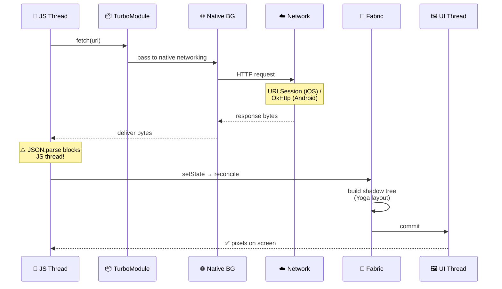
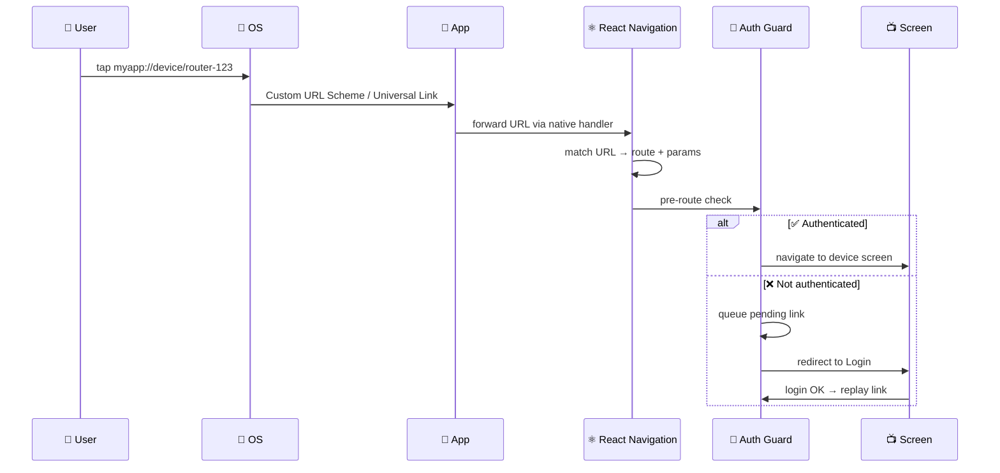
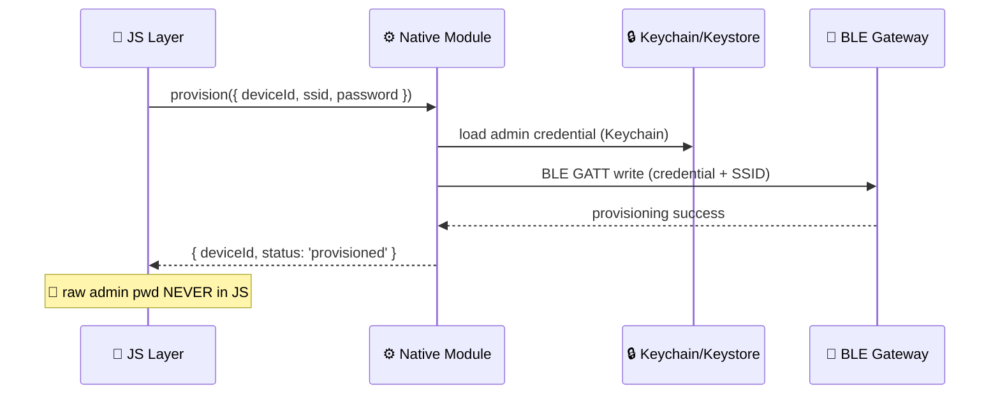
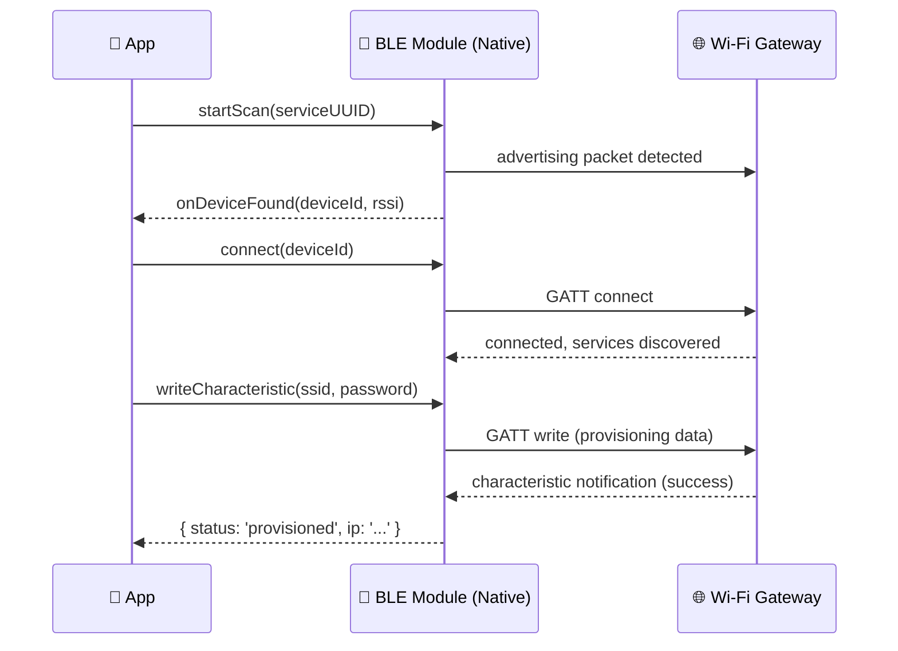

# 📚 React Native Theory Prep — FULL (33 questions)

> **🎯 Mục đích:** Ôn lý thuyết React Native cho phỏng vấn senior tại **Netcomm/Zhone** (Mobile App Engineer — companion app cho thiết bị mạng: 5G FWA, Wi-Fi gateways, mesh, ONT).
>
> **⚠️ Lưu ý đặc thù:** Test code gồm **thuật toán + code native**, không dùng AI. Có thể hỏi thêm **iOS và Android native**. Domain không phải Web3 — domain **networking equipment companion app** (BLE provisioning, OTA firmware, parental controls, mesh management).
>
> **🏷 Tag:** **[V#]** = vocab, **[S#]** = structure (lấy từ 2 file SpeakFun trong cùng folder; hiện có 120 vocab + 79 structures).
>
> **📋 Cách dùng:** Đọc câu hỏi → tự trả lời 60s → mở sample answer so sánh → highlight phrase chưa nhớ.

---

## 🗺 Map of all 33 questions

```
┌─────────────────────────────────────────────────────────────┐
│  📦 Nhóm A — Bridge & Architecture          Q1–Q5  (P0)    │
│  ⚡ Nhóm B — Performance & Rendering         Q6–Q10 (P0)    │
│  🧭 Nhóm C — Navigation, State, Storage     Q11–Q15 (P1)   │
│  🧪 Nhóm D — Testing & TypeScript           Q16–Q18 (P1)   │
│  🛠  Nhóm E — Tooling & Native Bridging     Q19–Q25 (P1)   │
│  📡 Nhóm F — Native iOS/Android Fundamentals Q26–Q30 (P0*) │
│  🧮 Nhóm G — Algorithm & Coding Test        Q31–Q33 (P0*)  │
└─────────────────────────────────────────────────────────────┘

* P0 cho Netcomm/Zhone: test code = thuật toán + native, HR xác nhận.
```

---

# 📦 Nhóm A — Bridge & Architecture (P0, gần như chắc chắn hỏi)

## Q1. So sánh Old Bridge vs New Architecture (JSI / Fabric / TurboModules)

### 📊 Diagram

```
┌────────────── 📜 OLD BRIDGE ──────────────┐    ┌────────────── ⚡ NEW ARCH (JSI) ──────────────┐
│                                           │    │                                                │
│   🧵 JS              🧵 Native            │    │   🧵 JS  ───── ⚡ JSI (sync) ─────► 🧵 Native  │
│      │                  ▲                 │    │                                                │
│      │ 📤 JSON serialize│                 │    │   ┌─ 📦 TurboModules (lazy, type-safe)        │
│      ▼                  │                 │    │   ├─ 🎨 Fabric renderer (sync layout)         │
│   [ async msg queue ]   │                 │    │   └─ 🤝 C++ host objects (zero-copy)          │
│      │                  │                 │    │                                                │
│      │ 📥 JSON deserialize                │    │                                                │
│      └────────► ────────┘                 │    │                                                │
│                                           │    │                                                │
│   ❌ Slow • async • serialization cost    │    │   ✅ Fast • sync • no serialization            │
└───────────────────────────────────────────┘    └────────────────────────────────────────────────┘
```

### 💬 Sample answer

> "Sure, **let me walk you through** **[V29 / S7]** the difference. **In the old bridge**, JS and Native communicate through an **asynchronous, serialized message queue** — every call has to be JSON-serialized, passed across the bridge, then deserialized on the other side. **One challenge** **[S35]** was that this created bottlenecks for high-frequency events like animations or gestures.
>
> **The New Architecture solves this through** **[S39]** three pieces:
> - 🔌 **JSI (JavaScript Interface)** — gives JS direct access to C++ host objects, so calls are synchronous and serialization-free.
> - 📦 **TurboModules** — native modules loaded lazily and called via JSI; type-safe through Codegen.
> - 🎨 **Fabric** — the new renderer; concurrent rendering and synchronous layout.
>
> **It's designed to be** **[S40]** more **scalable** **[V59]** and **robust** **[V7]**, with significantly lower latency for native calls."

> ⚠️ **Bẫy:** Đừng nói "JSI replaces the bridge" — JSI là thay cho cách *call* qua bridge, không phải thay toàn bộ kiến trúc.

---

## Q2. Hermes engine là gì? Lợi ích?

### 📊 Diagram

```
   🏗 BUILD TIME                    🚀 RUNTIME
   ┌──────────────────┐             ┌──────────────────┐
   │  📝 JS source    │             │  📦 .hbc bytecode│
   │        │         │  ──ship──►  │        │         │
   │        ▼         │             │        ▼         │
   │  [Hermes]        │             │  ⚡ skip parsing │
   │  compile         │             │  ✅ run faster   │
   └──────────────────┘             └──────────────────┘
                                       │
                                       ▼
                          ⚡ Faster startup
                          📉 Lower RAM
                          📦 Smaller bundle
                          🔍 Chrome DevTools support
```

### 💬 Sample answer

> "Hermes is a JS engine open-sourced by Meta, **designed to be** **[S40]** optimized for React Native on mobile. **The main benefit** **[S38]** is faster startup time — Hermes pre-compiles JS to bytecode at build time, so the app skips parsing on launch. It also has lower memory **footprint** and a smaller APK/IPA size.
>
> **A key aspect** **[S41]** for debugging: Hermes ships with a built-in inspector compatible with Chrome DevTools. Since RN 0.70 it's the default engine."

---

## Q3. Step-by-step: chuyện gì xảy ra khi gọi `fetch()` từ JS đến khi data hiển thị?

### 📊 Sequence diagram



### 💬 Sample answer

> "**Let me walk you through** **[V29 / S7]** the flow, in the New Architecture context.
>
> 1. JS calls `fetch(url)` on the **JS thread**.
> 2. `fetch` is implemented via a TurboModule → request handed off to the **native networking module**.
> 3. The actual HTTP request runs on a **native background thread** (URLSession on iOS, OkHttp on Android), so the JS thread stays free.
> 4. When the response arrives, the body is delivered back to JS — JSON parsing happens **on the JS thread** in the JS engine (Hermes).
> 5. `setState` is called → React schedules a re-render.
> 6. Fabric computes the new shadow tree, runs Yoga layout, and commits to the native UI thread.
> 7. The **native UI thread** mounts views and the user sees the result.
>
> **One key point** **[S41]** is that JSON.parse on a huge payload still blocks the JS thread, so for big responses **we could consider** **[S67]** streaming or moving parsing to a native module."

> ⚠️ **Bẫy:** Trả lời "fetch chạy trên main thread" → sai ngay.

---

## Q4. Threading model trong RN

### 📊 Visual

```
┌────────────────┐  ┌────────────────┐  ┌────────────────┐
│  🧵 JS Thread  │  │  🖼 UI Thread  │  │  🌐 BG Threads │
├────────────────┤  ├────────────────┤  ├────────────────┤
│ • React        │  │ • Rendering    │  │ • Networking   │
│ • Your JS code │  │ • Gestures     │  │ • Image decode │
│ • JSON.parse   │  │ • View mount   │  │ • BLE scan     │
│ • State logic  │  │ • Animations   │  │ • OTA download │
│ ⚠️ single!     │  │   (native drv) │  │ • Yoga layout  │
└────────────────┘  └────────────────┘  └────────────────┘
            🚫 NEVER block JS thread → app freezes
```

### 💬 Sample answer

> "There are three main threads:
> - 🧵 **JS Thread** — runs your JavaScript, including React reconciliation.
> - 🖼 **Main / UI Thread** — handles native UI rendering, gesture input, view mounting.
> - 🌐 **Background Threads** — networking, image decoding, BLE scanning, OTA downloads.
>
> **It's essential to ensure that** **[S44]** heavy work — BLE scanning, firmware chunk download, large JSON parsing — never **runs** on the JS thread, otherwise the **interface** **[V54]** will **lag** **[V90]** or **freeze** **[V89]**."

---

## Q5. Tại sao BLE provisioning và OTA firmware operations phải chạy native, không chạy JS?

### 📊 Trust boundary

```
┌─────────────────────────────────────────────┐
│         📱 JS Bundle (untrusted)            │
│   ┌─────────────────────────────────────┐   │
│   │  deviceId  ✅                        │   │
│   │  firmwareVersion  ✅                 │   │
│   │  adminPassword  ❌ NEVER             │   │
│   └─────────────────┬───────────────────┘   │
└─────────────────────┼───────────────────────┘
                      │ JSI bridge
                      ▼
┌─────────────────────────────────────────────┐
│      ⚙ Native BLE Module (trusted)          │
│   CoreBluetooth (iOS) / BluetoothLE (Android)│
│   Keychain-backed device credential         │
└─────────────────────┬───────────────────────┘
                      │
                      ▼
┌─────────────────────────────────────────────┐
│   📶 Wi-Fi Gateway / Mesh Node              │
│   (BLE GATT provisioning + SSID setup)      │
└─────────────────────────────────────────────┘
```

### 💬 Sample answer

> "Two reasons. First, **security** — device admin credentials in JS live in the Hermes heap and can be inspected via debugger or memory dump. The native module can store them in Keychain/Keystore so they never enter app memory in plaintext.
>
> Second, **performance** — BLE operations (GATT scan, connect, characteristic write) and firmware chunk streaming are long-running, time-sensitive tasks. Running them on the JS thread would **freeze** **[V89]** the **interface** **[V54]**. Native code runs off the JS thread and gives direct access to CoreBluetooth or Android BluetoothLE APIs.
>
> **A key aspect** **[S41]** is that the JS layer should only receive a device handle and status events — it should never manage raw BLE sockets or hold credentials directly."

---

# ⚡ Nhóm B — Performance & Rendering (P0)

## Q6. `useMemo`, `useCallback`, `React.memo` — khi nào dùng, khi nào KHÔNG?

### 📊 Decision tree

```
   ❓ Should I memoize?
        │
   ┌────┴────────────────────────────┐
   │                                 │
   ▼                                 ▼
🤔 Cheap value?                🤔 Expensive compute?
   │                                 │
   ▼                                 ▼
   ❌ NO (skip)                      ✅ useMemo
                                     
   🤔 Passing fn to memoized child?  → ✅ useCallback
   🤔 Inside FlatList renderItem?    → ✅ React.memo on item
   🤔 Dep array unstable?            → ❌ memoization useless
```

### 💬 Sample answer

> "**My rule of thumb:** don't reach for them by default. They have a cost too — extra memory and dependency-array bookkeeping.
>
> **Use them when:**
> - The computation is genuinely expensive (filtering device list, parsing mesh topology JSON).
> - You're passing a function or object to a memoized child that re-renders on identity change.
> - You're inside a `FlatList` `renderItem` and the item component is wrapped in `React.memo`.
>
> **Don't use them when:**
> - The value is a primitive cheap to compute.
> - The dependency array changes every render anyway — then memoization is just overhead.
>
> **One thing I learned** is that over-memoizing actually slowed things down because the dep arrays were unstable."

---

## Q7. FlatList vs ScrollView vs SectionList — chọn cái nào?

### 📊 Comparison

| | 📜 ScrollView | 📋 FlatList | 📑 SectionList |
|---|---|---|---|
| **Renders** | All eagerly | Virtualized | Virtualized + grouped |
| **Best for** | < 20 items | Long flat lists | Grouped headers |
| **Memory** | High | Low | Low |

### 📊 FlatList windowing

```
                  Total: 10,000 items
                  ━━━━━━━━━━━━━━━━━━

         ╔════════════════════════════╗
   ✂ unmount above
         ║                            ║
         ║  🟦 buffer (windowSize)    ║
         ║                            ║
         ╠════════════════════════════╣
         ║  🟩 Item 12  [rendered]    ║
         ║  🟩 Item 13  [rendered] 👀 ║   ← visible
         ║  🟩 Item 14  [rendered] 👀 ║
         ║  🟩 Item 15  [rendered]    ║
         ╠════════════════════════════╣
         ║                            ║
         ║  🟦 buffer                 ║
         ║                            ║
         ╚════════════════════════════╝
   ✂ unmount below
```

### 💬 Sample answer

> "**ScrollView** renders all children eagerly — fine for short, fixed lists (under ~20 items). **FlatList** virtualizes — only renders visible items + a buffer (`windowSize`). **SectionList** is FlatList with grouped sections.
>
> **For long lists, I always go with** **[V101]** FlatList. **A key aspect** **[S41]** of optimization:
> - 🔑 Provide stable `keyExtractor`.
> - 📐 `getItemLayout` if item heights are fixed → skips measurement pass.
> - ✂️ `removeClippedSubviews` on Android.
> - ⚙️ `initialNumToRender`, `maxToRenderPerBatch`, `windowSize` tuning.
> - 🧊 Wrap `renderItem` component in `React.memo` with a stable equality check.
>
> For **really** long lists (10k+), **we could consider** **[S67]** `@shopify/flash-list` — it reuses cells like UICollectionView and gives much better memory."
>
> **For paginated feeds**, **I've come up with** **[S74 / V112]** two common options: button-based pagination and **infinite** **[V114]** scrolling. **We fetch** **[V113]** the first page first, then **fetch** **[V113]** more when the user scrolls **[S78]**. **The advantages are** **[S76]** lower **bandwidth** **[V115]**, lower memory usage, and faster first paint. **Pagination alone reduces** **[S77]** initial payload size significantly for large device logs."

---

## Q8. Memory leak trong RN — nguyên nhân thường gặp?

### 📊 Top 5 sources

```
┌─────────────────────────────────────────────────────────┐
│  🚨 SOURCE                  🛠 FIX                       │
├─────────────────────────────────────────────────────────┤
│ ⏰ setInterval/Timeout      → return clearXxx in effect │
│ 📡 Native event listener   → .remove() on cleanup      │
│ 🔗 Navigation refs         → null out ref in cleanup   │
│ 🖼 Large image bitmaps     → FastImage + resize        │
│ 🪤 Closure traps           → use ref instead of state  │
└─────────────────────────────────────────────────────────┘
```

### 💬 Sample answer

> "**One challenge** **[S35]** I've seen multiple times:
>
> 1. ⏰ **Uncleared timers** — `setInterval` / `setTimeout` not cleared in `useEffect` cleanup.
> 2. 📡 **Native event listeners** — `DeviceEventEmitter.addListener` without `.remove()` (e.g. BLE scan events).
> 3. 🔗 **Navigation refs** — holding a screen reference after unmount, blocking GC.
> 4. 🖼 **Image cache** — large in-memory bitmaps; fix with `FastImage` or proper resizing.
> 5. 🪤 **Closure traps** — a long-lived callback capturing a large state object.
>
> **My typical approach involves** **[S34]** profiling with Xcode Instruments (Allocations) and Android Studio Profiler. **From a code perspective** **[V100]**, every `useEffect` with a subscription must return a cleanup."

---

## Q9. Reanimated 2/3 vs Animated API — khác nhau thế nào?

### 📊 Thread comparison

```
┌─────────── Animated API ───────────┐    ┌─────── Reanimated 2/3 ───────┐
│                                    │    │                              │
│  📝 anim definition on JS thread   │    │  📝 worklet compiled to UI   │
│           │                        │    │           │                  │
│           ▼                        │    │           ▼                  │
│  bridge ↔ UI thread                │    │  runs on UI thread directly  │
│                                    │    │                              │
│  ❌ JS thread busy → frame drops   │    │  ✅ smooth even when JS busy │
│  🔧 useNativeDriver: true partial  │    │  🔧 useSharedValue cross-thr │
└────────────────────────────────────┘    └──────────────────────────────┘
```

### 💬 Sample answer

> "**Animated** runs on the JS thread by default. With `useNativeDriver: true` it can offload **transform/opacity** to the UI thread — but is limited.
>
> **Reanimated 2/3** uses **worklets** — small JS functions compiled to run directly on the UI thread. **The main benefit** **[S38]** is that complex gesture-driven animations stay smooth at 60fps even when the JS thread is busy.
>
> **A key aspect** **[S41]** is `useSharedValue` and `useAnimatedStyle` — shared values live on both threads, so animations can react to gestures without bridge round-trips."

---

## Q10. Cách debug khi app **lag** **[V90]** hoặc tụt FPS?

### 📊 Debug flowchart

```
        🐢 App lags
            │
            ▼
   ┌──────────────────┐
   │ Run on REAL      │  ❌ simulator FPS misleading
   │ device           │
   └────────┬─────────┘
            ▼
   ┌──────────────────┐
   │ Open Perf Monitor│
   └────┬─────────────┘
        │
   ┌────┴────────┐
   │             │
   ▼             ▼
🧵 JS FPS ↓   🖼 UI FPS ↓
   │             │
   ▼             ▼
 Profile JS    Profile native
 (DevTools)    (Xcode/Android)
```

### 💬 Sample answer

> "**My approach involves** **[S34]** four steps:
>
> 1. **Reproduce** **[V93]** the lag on a real device, not simulator — simulator FPS is misleading.
> 2. Open **Perf Monitor** in dev menu — check JS FPS vs UI FPS. If JS FPS drops, the problem is in JS work; if UI FPS drops, native rendering is the bottleneck.
> 3. Use **Flashlight** or **React DevTools Profiler** to find which components re-render too often.
> 4. **Dig into** **[V95]** the suspect components — usually it's missing memoization, expensive `renderItem`, or layout thrash from non-fixed heights.
>
> **One thing I learned**: if the JS thread is starved, the simplest win is to **cut down on** **[V99]** unnecessary state updates."

---

# 🧭 Nhóm C — Navigation, State, Storage (P1)

## Q11. React Navigation — Native Stack vs JS Stack?

### 📊 Quick compare

| | 🍎 Native Stack | 🟨 JS Stack |
|---|---|---|
| **Engine** | UINavigationController / Fragment | Reanimated |
| **Gestures** | ✅ Native swipe-back | ⚠️ JS-driven |
| **Performance** | ⚡ Fast | 🐢 Heavier |
| **Customization** | 🔒 Limited | 🎨 Full |
| **For networking app** | ✅ Pick this | ❌ |

### 💬 Sample answer

> "**Native Stack** (`@react-navigation/native-stack`) uses platform-native screen containers — `UINavigationController` on iOS, `Fragment` transitions on Android. **The main benefit** **[S38]** is true native gestures, smoother transitions, and proper handling of system back gestures.
>
> **JS Stack** (`@react-navigation/stack`) is fully implemented in JS using Reanimated. More customizable but heavier.
>
> **For a networking companion app, I'd go with** **[V101]** Native Stack — better feel, better performance, and it integrates cleanly with biometric prompts for device admin login."

---

## Q12. Deep linking flow trong RN — luồng end-to-end

### 📊 Sequence diagram



### 💬 Sample answer

> "**The solution consists of** **[S37]** four parts:
>
> 1. **OS handoff** — iOS Universal Links via `apple-app-site-association`; Android App Links via `assetlinks.json`. The OS opens the app and delivers the URL.
> 2. **Native receive** — `application:openURL:` on iOS, `Intent.getData()` on Android, then forwarded to RN.
> 3. **React Navigation linking config** — maps URL patterns to route names + params.
> 4. **Auth-aware routing** — if the deep link requires login, push it onto a **pending** **[V20]** queue, complete auth, then navigate."

---

## Q13. Tại sao chọn Zustand thay vì Redux/Context?

### 📊 Decision matrix

```
┌────────────┬──────────────┬────────────┬─────────────┐
│   📦 Tool  │ ⚡ Re-render │ 📜 Boiler  │ 🎯 Best for │
├────────────┼──────────────┼────────────┼─────────────┤
│ Context    │ Whole tree   │ Low        │ Theme/locale│
│ Redux Tk   │ Selector ok  │ High       │ Big apps    │
│ Zustand    │ ⚡ Selector  │ ✅ Minimal │ Most apps   │
└────────────┴──────────────┴────────────┴─────────────┘
```

### 💬 Sample answer

> "**Each tool has its place.**
>
> - **Context** — fine for low-frequency global state (theme, locale). Bad for anything that updates often, because every consumer re-renders.
> - **Redux Toolkit** — solid for large apps with complex action history, time-travel debugging needs.
> - **Zustand** — minimal API, no provider, selector-based subscriptions so re-renders are surgical.
>
> **For most apps**, Zustand hits the sweet spot — small bundle, low boilerplate, easy to test. **A key aspect** **[S41]** is the `subscribeWithSelector` middleware which lets you react to state changes without subscribing the whole component."
>
> **One drawback** **[V110]** of Redux in a smaller companion app is boilerplate; it can be **overkill** **[V111]** if the state is mostly device status, auth, and settings. **It's straightforward to** **[S75 / V118]** start with Zustand, then move a specific flow to Redux or XState if we need stronger workflow modeling."

---

## Q14. Async Storage vs MMKV vs SQLite vs Keychain — chọn cái nào cho networking app?

### 📊 Storage hierarchy

```
                  🔒 Keychain / Keystore
                 ┌──────────────────────┐
                 │  Device admin pwd,   │   ← hardware-backed
                 │  auth tokens         │
                 └──────────────────────┘
              🔐 MMKV (encrypted)
            ┌──────────────────────────┐
            │  App prefs, device config│   ← fast, encrypted
            │  last-known IP cache     │
            └──────────────────────────┘
         🗄 SQLite (op-sqlite / WatermelonDB)
       ┌──────────────────────────────────┐
       │  Device list, event logs,        │   ← relational
       │  parental control rules history  │
       └──────────────────────────────────┘

       ❌ AsyncStorage — avoid for credentials
          (slow, JS-thread, not encrypted)
```

### 💬 Sample answer

> "**It depends on the data type:**
>
> - 🐌 **AsyncStorage** — JS-thread, slow, not encrypted. Fine for non-sensitive UI state, but avoid for device credentials.
> - ⚡ **MMKV** — native, ~30x faster, supports encryption. Great for app config, cached device settings, user prefs.
> - 🗄 **SQLite** (op-sqlite or WatermelonDB) — for relational data: device list, event logs, parental control rules.
> - 🔒 **Keychain / Keystore** — for admin passwords, auth tokens. Never anywhere else.
>
> **A key aspect** **[S41]** for a networking app: MMKV should be encrypted with a key derived from biometrics or a device-pinned value, so even a rooted device can't read the cache in plaintext."

---

## Q15. CodePush / OTA update — luồng release và rollback

### 📊 Rollout diagram

```
   🏗 Build bundle
        │
        ▼
   🧪 Stage channel ─────► internal QA ✅
        │
        ▼
   🚀 Production rollout
        │
        ├─ 10% users  ──► monitor 📊 Sentry
        │
        ├─ 50% users  ──► error rate OK?
        │
        └─ 100% users ──► ✅ done
                          │
                          └─ 🚨 spike? → ⏪ rollback
                                         (re-publish prev bundle)

   ⚠️ Rule: NEVER OTA-update native BLE module or firmware code
            → those need store review
```

### 💬 Sample answer

> "**The solution involves** **[S37]** shipping a JS-only bundle update without going through the store. Tools: Microsoft CodePush (legacy) or Expo EAS Update.
>
> **My typical flow:**
> 1. **Kick off** **[V117]** with a bundle on a **staging** channel → internal QA verifies.
> 2. **Roll out** **[V116]** to **production** with a percentage rollout (10% → 50% → 100%).
> 3. Monitor crash rate in Sentry. If it spikes, **rollback** by re-publishing the previous bundle.
>
> **One key constraint** **[S41]** for a networking app: never OTA-update code that touches BLE provisioning or device firmware logic — native code changes must go through store review. **It's essential to ensure that** **[S44]** the OTA scope is tightly defined. **We can roll out** **[S79]** a JS-only bug fix quickly, but native BLE or firmware changes are out of scope for OTA."

---

# 🧪 Nhóm D — Testing & TypeScript (P1)

## Q16. Testing strategy cho RN — Jest + RTL vs Detox vs Maestro?

### 📊 Test pyramid

```
                    🔺
                   ╱   ╲
                  ╱  E2E ╲          🎬 Maestro / Detox
                 ╱  (slow) ╲           Full user flow
                ╱───────────╲
               ╱             ╲
              ╱   Component   ╲      ⚛️ RNTL
             ╱    (medium)     ╲       Render + fireEvent
            ╱───────────────────╲
           ╱                     ╲
          ╱       Unit            ╲   🧪 Jest
         ╱     (fast, lots)        ╲    Hooks, reducers, logic
        ╱─────────────────────────  ╲
```

### 💬 Sample answer

> "**My typical pyramid:**
> - 🧪 **Unit (Jest + RNTL)** — pure logic, hooks, reducers. Fast, runs on every commit.
> - ⚛️ **Component tests (RNTL)** — render component, **fire events**, assert.
> - 🎬 **E2E (Maestro)** — full user flows on real device. I prefer Maestro over Detox now — YAML config, much faster setup, less flaky.
>
> **For a networking app, a key aspect** **[S41]** is testing the BLE provisioning flow and OTA update state machine against mock native events. Those tests must run in CI on every PR."

---

## Q17. TypeScript trong RN — pattern hữu ích?

### 📊 Top 3 patterns

```
1️⃣ Discriminated union for state:
   type DeviceState =
     | { status: 'scanning' }
     | { status: 'connecting'; deviceId: string }
     | { status: 'provisioned'; ssid: string }
     | { status: 'error'; error: Error }

2️⃣ Typed navigation params:
   type RootStackParamList = {
     DeviceList: undefined;
     DeviceDetail: { deviceId: string; model: string };
   }

3️⃣ Branded types for IDs:
   type DeviceId = string & { __brand: 'DeviceId' }
   type MacAddress = string & { __brand: 'MacAddress' }
   // ❌ can't pass MacAddress where DeviceId expected
```

### 💬 Sample answer

> "Three patterns I rely on:
>
> 1️⃣ **Discriminated unions for screen state** — the compiler forces you to handle every case in a `switch`. Perfect for modeling BLE provisioning states.
>
> 2️⃣ **Typed React Navigation params** — `RootStackParamList` so `navigation.navigate` is fully type-safe.
>
> 3️⃣ **`as const` over enum** — TypeScript enums create runtime objects and break tree-shaking. `const` unions are zero-cost.
>
> **A key aspect** **[S41]** for a networking app: model `DeviceId`, `MacAddress`, `FirmwareVersion` as branded types so you can't accidentally mix them up."

---

## Q18. Discriminated union vs class hierarchy — khi nào dùng?

### 📊 Choose

```
┌──────────────────────────┬─────────────────────────┐
│   📋 Discriminated Union │   🏛 Class Hierarchy    │
├──────────────────────────┼─────────────────────────┤
│ • API responses          │ • Shared methods        │
│ • State machines         │ • Polymorphism          │
│ • Events                 │ • Encapsulated state    │
│ • No behavior            │ • Provider abstractions │
└──────────────────────────┴─────────────────────────┘

Networking app example:
  - Device provisioning state → discriminated union ✅
  - DeviceProvider (HTTP vs SNMP access) → abstract class ✅
```

### 💬 Sample answer

> "**Discriminated unions** for data shapes that don't have behavior — API responses, state machines, events. **Classes** when you need shared methods, encapsulation, polymorphism — like a `DeviceProvider` base with `HttpDevice`, `SnmpDevice` subclasses.
>
> **For most React state**, unions win — they pair perfectly with `switch` exhaustiveness checks."

---

# 🛠 Nhóm E — Tooling & Native Bridging (P1)

## Q19. Expo vs Bare workflow — khi nào dùng?

### 📊 Quick compare

```
┌──────────────┬─────────────┬──────────────┬─────────────────────┐
│  Workflow    │ ⚡ Speed    │ 🛠 Native    │ 🎯 For network app  │
├──────────────┼─────────────┼──────────────┼─────────────────────┤
│ Expo managed │ ⚡⚡⚡        │ ⚠️ limited   │ ❌ no BLE control   │
│ Expo + Dev   │ ⚡⚡         │ ✅ full      │ ✅ best of both     │
│   Client     │             │              │                     │
│ Bare         │ ⚡          │ ✅ full      │ ✅ if team has      │
│              │             │              │   native expertise  │
└──────────────┴─────────────┴──────────────┴─────────────────────┘
```

### 💬 Sample answer

> "**Expo (managed)** — fastest start, no Xcode/Android Studio needed for most things, OTA updates built-in. Limit: any custom native module needs Expo Modules or Dev Client.
>
> **Bare workflow** — full native control. You ship custom Swift/Kotlin freely.
>
> **Modern recommendation:** start with **Expo + Dev Client** — you get Expo tooling AND can drop in any native module.
>
> **For a networking app** that needs CoreBluetooth and custom BLE provisioning, Expo Dev Client + custom native modules is the sweet spot."

---

## Q20. Cách viết một custom Native Module — luồng cao cấp?

### 📊 Codegen flow

```
   📝 NativeBleModule.ts
   (TypeScript spec)
        │
        ▼
   🤖 Codegen
        │
        ├──► 🍎 iOS protocol (ObjC++)
        │       └─ implement in Swift (CoreBluetooth)
        │            └─ RCT_EXPORT_MODULE
        │
        ├──► 🤖 Android interface (Java)
        │       └─ implement in Kotlin (BluetoothLE)
        │            └─ ReactPackage
        │
        └──► 📜 JS facade (TurboModule)
                └─ TurboModuleRegistry.getEnforcing
                     └─ ⚡ used by React code
```

### 💬 Sample answer

> "**Let me walk you through** **[V29 / S7]** the iOS side, New Architecture style.
>
> 1. **Define the spec in TypeScript** (`NativeBleModule.ts`) — argument types, return types, event callbacks.
> 2. **Codegen** generates Objective-C++ headers and the type-safe interface.
> 3. **Implement in Swift** — conform to the generated protocol, use CoreBluetooth, register with `RCT_EXPORT_MODULE`.
> 4. **Expose to JS** via `TurboModuleRegistry.getEnforcing<Spec>('BleModule')`.
> 5. **Pair with Android** — Kotlin implementation with BluetoothLE GATT matching the same spec.
>
> **A key aspect** **[S41]** is keeping the spec as the single source of truth — it eliminates drift between iOS and Android implementations."

---

## Q21. Cách cô lập device credentials giữa JS bundle và Native module?

### 📊 Provisioning flow



### 💬 Sample answer

> "**The principle:** device credentials never enter the JS bundle.
>
> 1. User sets admin password → stored directly in Keychain/Keystore via native module.
> 2. BLE provisioning → JS sends `{ deviceId, ssid }`, native loads credential from Keychain, writes to GATT characteristic.
> 3. Auth tokens for cloud management → same pattern: Keychain-backed, never exposed to JS.
> 4. JS only receives status events and device handles.
>
> **It's designed to be** **[S40]** **robust** **[V7]** even if the JS bundle is inspected — there's no sensitive credential in JS."

---

## Q22. Threat model: nếu device bị compromise, networking app vẫn an toàn không?

### 📊 Defense in depth

```
        🎯 ATTACKER
            │
            ▼
   ╔════════════════════════════════╗
   ║ 🛡 Layer 1: DETECT             ║  Play Integrity / iOS probes
   ╠════════════════════════════════╣
   ║ 🛡 Layer 2: DEGRADE            ║  disable device control, warn
   ╠════════════════════════════════╣
   ║ 🛡 Layer 3: HARDWARE-BACK KEYS ║  Secure Enclave / StrongBox
   ╠════════════════════════════════╣
   ║ 🛡 Layer 4: NETWORK            ║  certificate pinning (cloud API)
   ╠════════════════════════════════╣
   ║ 🛡 Layer 5: CODE               ║  Hermes bytecode + ProGuard
   ╚════════════════════════════════╝
            │
            ▼
        🔒 HOME NETWORK PROTECTED
```

### 💬 Sample answer

> "**Honest answer:** no app is 100% safe on a compromised device. **But we can raise the cost significantly.**
>
> **My layered approach involves** **[S34]**:
>
> 1. 🛡 **Detect** — jailbreak/root checks (iOS: filesystem probes, Android: SafetyNet/Play Integrity).
> 2. ⚠️ **Degrade** — on detection, disable device admin actions, force re-onboarding.
> 3. 🔒 **Hardware-back keys** — Secure Enclave-backed keys for admin credentials are non-extractable.
> 4. 📡 **Certificate pinning** — prevents MITM on cloud management API calls.
> 5. 🧬 **Code obfuscation** — Hermes bytecode + ProGuard reduces reverse-engineering of BLE protocol logic.
>
> **It's essential to ensure that** **[S44]** users are warned when running on a compromised device — the home network is at risk."

---

## Q23. Module Federation / Repack — khi nào cần?

### 📊 Super-app architecture

```
          📱 Host App (Netcomm Gateway App)
          ┌─────────────────────┐
          │  Navigation Shell   │
          │  Auth Context       │
          │  BLE Manager        │
          │  HTTP Client        │
          └──────────┬──────────┘
                     │ Module Federation runtime
        ┌────────────┼────────────┐
        │            │            │
        ▼            ▼            ▼
     📦 Module    📦 Module    📦 Module
     "Setup"      "Parental    "Speed
     (provisioning) Control"   Test"

   ✅ Independent ship cycles
   ⚠️ Strict shared-deps contract (RN / React versions)
```

### 💬 Sample answer

> "**Module Federation** lets multiple teams ship modules independently at runtime. **Repack** is the React Native build tool that brings this to mobile via Webpack/Rspack.
>
> **The main benefit** **[S38]** is that teams can ship features like Parental Controls or Speed Test independently without bumping the host app.
>
> **One challenge** **[S35]** was version drift — if a module expects a different React Native version than the host, you get runtime crashes. **The solution involves** **[S37]** strict shared-deps contracts and a shared **infrastructure** **[V57]** layer for navigation, auth, and BLE manager."

---

## Q24. Debugging trong RN hiện đại — tools nào?

### 📊 Modern toolkit (2024+)

```
┌──────────────────────────────────────────────────────┐
│ 🔧 Tool                    🎯 Use case               │
├──────────────────────────────────────────────────────┤
│ ⚛️ React Native DevTools   Official, Hermes-aware   │
│ 📊 React Profiler          Component re-renders     │
│ 🐛 Sentry / Crashlytics   Production crashes       │
│ 🧪 Reactotron             State inspection         │
│ 📶 nRF Connect / LightBlue BLE GATT inspection     │
│ ❌ Flipper                 Deprecated by Meta       │
└──────────────────────────────────────────────────────┘
```

### 💬 Sample answer

> "**The landscape changed in 2024:**
> - ❌ **Flipper** was deprecated by Meta. Don't recommend it for new projects.
> - ⚛️ **React Native DevTools** (built on Chrome DevTools) is now the official tool.
> - 🐛 **Sentry / Crashlytics** for production crash + performance monitoring.
> - 📶 **nRF Connect / LightBlue** for inspecting BLE GATT services during native module development.
>
> **A key aspect** **[S41]** is making sure no debug tool can read sensitive data in production — disable RN debug menu in release builds."

---

## Q25. Release build optimization — checklist?

### 📊 Pre-release checklist

```
  ✅ Hermes ON (iOS + Android)
  ✅ Inline requires in metro.config
  ✅ ProGuard / R8 with keep rules for native modules
  ✅ App thinning (App Store auto)
  ✅ RAM bundle for faster startup
  ✅ Strip console.log (babel plugin)
  ✅ Crashlytics + Sentry dSYM upload in CI
  ✅ Disable RN dev menu in release
  ✅ Code signing automated via Fastlane
  ─────────────────────────────────
  ⚡ Goal: small, fast launch, reliable
```

### 💬 Sample answer

> "**My checklist:**
> - ✅ **Hermes enabled** on both iOS and Android.
> - ✅ **Inline requires** in Metro config.
> - ✅ **ProGuard/R8** on Android with proper keep rules for native modules.
> - ✅ **App thinning** — App Store Connect handles this if assets are organized correctly.
> - ✅ **RAM Bundle / Inline requires** for faster startup.
> - ✅ **Strip console.log** via `babel-plugin-transform-remove-console`.
> - ✅ **Crashlytics + Sentry** dSYM uploads in CI.
>
> **It's designed to be** **[S40]** small, fast to launch, and **reliable** **[V109]** in production. **We can roll out** **[S79 / V116]** release optimizations in phases: Hermes and inline requires first, then obfuscation, symbol upload, and stricter crash monitoring."

---

# 📡 Nhóm F — Native iOS/Android Fundamentals (P0* cho Netcomm)

> ⚠️ HR xác nhận: test code gồm native + có thể hỏi iOS/Android knowledge.

## Q26. App lifecycle trên iOS vs Android — điểm khác biệt chính?

### 📊 Lifecycle states

```
iOS:
  Not Running → Active → Inactive → Background → Suspended
                 ↑           │
                 └───────────┘ (phone call, notification)

Android:
  onCreate → onStart → onResume  (Foreground)
                ↑          │
             onRestart ◄ onPause (partially visible)
                         onStop → onDestroy
                                 │
                             (process killed without onDestroy)
```

### 💬 Sample answer

> "**iOS lifecycle** has five states: Not Running, Inactive, Active, Background, Suspended. The app gets `applicationDidEnterBackground` when going to background — you have ~5 seconds to save state before suspension.
>
> **Android lifecycle** is Activity-based: `onCreate → onStart → onResume → onPause → onStop → onDestroy`. **One key difference** is that Android can kill the process when it's in the background without calling `onDestroy`, so critical state must be saved in `onStop` at the latest.
>
> **In React Native**, both are surfaced through `AppState` API — `'active'`, `'background'`, `'inactive'` (iOS only). **A key aspect** **[S41]** for a networking app: pause BLE scans when going background to save battery, resume on foreground."

---

## Q27. URLSession (iOS) vs OkHttp (Android) — cách hoạt động trong RN context?

### 📊 Native networking stack

```
   RN fetch() / axios
        │
        ▼
   TurboModule: Networking
        │
   ┌────┴────────────┐
   │                 │
   ▼                 ▼
🍎 iOS              🤖 Android
URLSession          OkHttp
   │                 │
   ▼                 ▼
NSURLConnection    OkHttp3
   │                 │
   ▼                 ▼
  ✅ cert pinning   ✅ cert pinning
  ✅ background     ✅ interceptors
  ✅ HTTP/2         ✅ HTTP/2
```

### 💬 Sample answer

> "When you call `fetch()` in React Native, it goes through the native networking TurboModule which delegates to **URLSession** on iOS and **OkHttp** on Android.
>
> **URLSession** is Apple's unified networking API — supports HTTP/2, background downloads with `URLSessionDownloadTask` (important for OTA firmware), and built-in SSL certificate pinning via `URLSessionDelegate`.
>
> **OkHttp** is Square's HTTP client — supports interceptors (great for auth headers, logging), connection pooling, and Gzip compression by default.
>
> **A key aspect** **[S41]** for OTA firmware download: use `URLSessionDownloadTask` (iOS) or `DownloadManager` (Android) so the download continues even when the app goes to background — don't try to do this in JS."

---

## Q28. ARC (iOS) và Memory Management trong Android Kotlin — điểm cần biết?

### 📊 Memory management comparison

```
iOS — ARC (Automatic Reference Counting):
   strong ref  → keeps object alive
   weak ref    → nil when object deallocated (no retain cycle)
   unowned ref → crash if accessed after dealloc

   ⚠️ Retain cycle:
   ClassA → strong → ClassB
   ClassB → strong → ClassA
   → BOTH leak, use weak for delegates/closures

Android — Kotlin / JVM GC:
   Hard ref   → GC won't collect
   WeakReference<T> → GC can collect
   SoftReference<T> → collected under memory pressure

   ⚠️ Context leak:
   Activity → passed to static / long-lived object
   → Activity can't be GC'd → memory leak
```

### 💬 Sample answer

> "**iOS ARC** automatically manages retain counts. **One challenge** **[S35]** is retain cycles — if two objects hold strong references to each other, neither gets deallocated. The fix is to use `weak var delegate` or `[weak self]` in closures. In CoreBluetooth, always mark delegate references as `weak`.
>
> **Kotlin/JVM GC** is a tracing garbage collector — it handles cycles automatically. But the common trap is **Context leaks** — passing an Activity reference to a long-lived singleton. The fix is to use `applicationContext` or `WeakReference<Activity>`.
>
> **In React Native native modules**, both platforms require care: Swift delegates should be weak, Kotlin should avoid holding Activity references in module singletons."

---

## Q29. CoreBluetooth (iOS) vs BluetoothLE (Android) — BLE provisioning flow?

### 📊 BLE provisioning sequence



### 💬 Sample answer

> "**BLE provisioning flow** for a Wi-Fi gateway:
>
> 1. **Scan** — iOS: `CBCentralManager.scanForPeripherals(withServices:)`. Android: `BluetoothLeScanner.startScan()` with service UUID filter.
> 2. **Connect** — iOS: `centralManager.connect(peripheral)`. Android: `device.connectGatt(context, false, callback)`.
> 3. **Discover services** — enumerate GATT services and characteristics.
> 4. **Write provisioning data** — write SSID + password to a provisioning characteristic; gateway connects to Wi-Fi and reports success via notification.
> 5. **Disconnect** — release BLE connection; app continues via TCP/IP.
>
> **One key difference**: iOS requires explicit permission prompt (`NSBluetoothAlwaysUsageDescription` in Info.plist). Android requires `BLUETOOTH_SCAN` and `BLUETOOTH_CONNECT` permissions (Android 12+). **A key aspect** **[S41]**: always handle `CBManagerStatePoweredOff` and `CBManagerStateUnauthorized` gracefully."

---

## Q30. Kotlin Coroutines vs Swift async/await — pattern tương đương?

### 📊 Async comparison

```
Kotlin:                              Swift:
─────────────────────────────        ──────────────────────────────
suspend fun fetchDevices()           func fetchDevices() async throws
    : List<Device> {                     -> [Device] {
  return withContext(                  return try await ...
    Dispatchers.IO) {                }
    api.getDevices()
  }
}

CoroutineScope(IO).launch {          Task {
  val devices = fetchDevices()         let devices = try await
  withContext(Main) {                    fetchDevices()
    updateUI(devices)                  await MainActor.run {
  }                                      updateUI(devices)
}                                    }
                                     }
```

### 💬 Sample answer

> "**Kotlin Coroutines** use `suspend` functions + `CoroutineScope`. Switch threads with `withContext(Dispatchers.IO)` for background work and `withContext(Dispatchers.Main)` for UI updates. Structured concurrency via `launch` / `async`.
>
> **Swift async/await** (Swift 5.5+) is conceptually identical — `async func`, `await` at call site. Use `Task {}` to bridge sync/async. Use `@MainActor` or `MainActor.run` to hop to the main thread — equivalent to Kotlin's `Dispatchers.Main`.
>
> **In the context of React Native native modules**, you expose the result back to JS via a promise or event emitter, regardless of which async pattern you use internally. **A key aspect** **[S41]**: never block the main thread in native module callbacks — always dispatch heavy work to a background queue/dispatcher."

---

# 🧮 Nhóm G — Algorithm & Coding Test (P0* cho Netcomm)

> ⚠️ HR xác nhận: test gồm thuật toán, KHÔNG được dùng AI.

## Q31. Big-O analysis — các pattern phổ biến trong coding test?

### 📊 Complexity cheat sheet

```
O(1)      — Hash map lookup, array index access
O(log n)  — Binary search, balanced BST
O(n)      — Single pass (two-pointer, sliding window, prefix sum)
O(n log n) — Merge sort, heap sort, most efficient general sort
O(n²)     — Nested loops (brute force), bubble sort
O(2ⁿ)     — Recursive subset enumeration

Space complexity:
O(1) extra   — two-pointer, in-place
O(n) extra   — hash map, stack, visited set
O(n²) extra  — adjacency matrix
```

### 💬 Sample answer

> "**When approaching a problem**, **let me walk you through** **[V29 / S7]** my mental model:
>
> - **O(1)** — constant time: hash map lookup is the key tool here.
> - **O(log n)** — binary search: whenever the input is sorted or you can discard half the search space.
> - **O(n)** — single-pass: two-pointer and sliding window give O(n) for many string/array problems that look like O(n²).
> - **O(n²)** — nested loops: always ask 'can I use a hash map to remove the inner loop?'
>
> **A key aspect** **[S41]** in interviews: state complexity upfront ('my brute force is O(n²) but I can optimize to O(n) with a hash map'), then implement the optimized version."

---

## Q32. Two-pointer và Sliding Window — khi nào dùng, viết code mẫu?

### 📊 Two-pointer patterns

```
Pattern 1: Opposite ends (sorted array)
  [1, 2, 3, 4, 5, 6]   target = 7
   L               R
   1+6=7 ✅ → found

Pattern 2: Same direction (fast/slow)
  [1, 2, 3, 2, 1]  → detect palindrome / remove duplicates
   S
      F

Sliding window: fixed or variable size
  "find max sum subarray of size k"
  [2, 1, 5, 1, 3, 2]  k=3
   ├───┤              sum=8
      ├───┤           sum=7
         ├───┤        sum=9 ← max
```

### 💬 Sample answer

> "**Two-pointer** — use when you have a sorted array or need to compare elements from two ends / move pointers based on a condition.
>
> **Sliding window** — use for subarray/substring problems: 'max/min/count within a window of size k', 'longest substring without repeating characters'.
>
> Example — Two Sum II (sorted input):
> ```typescript
> function twoSum(numbers: number[], target: number): [number, number] {
>   let left = 0, right = numbers.length - 1;
>   while (left < right) {
>     const sum = numbers[left] + numbers[right];
>     if (sum === target) return [left + 1, right + 1];
>     sum < target ? left++ : right--;
>   }
>   return [-1, -1];
> }
> // O(n) time, O(1) space
> ```
>
> **A key aspect** **[S41]**: two-pointer gives O(n) where brute force would be O(n²). State this before coding."

---

## Q33. Hash Map và BFS/DFS — pattern cốt lõi cho graph/tree problems?

### 📊 BFS vs DFS

```
BFS (Queue — level order):
  Use for: shortest path, level-by-level traversal
  [1]
  [2, 3]        Queue: [1] → [2,3] → [4,5,6]
  [4, 5, 6]

DFS (Stack / Recursion — depth first):
  Use for: cycle detection, connected components, topological sort
  Path: 1→2→4→backtrack→5→backtrack→3→6

Hash Map patterns:
  - Two Sum: value → index
  - Group Anagram: sorted_key → [words]
  - Sliding window: char → count / last_index
  - Memoization: input → computed_result
```

### 💬 Sample answer

> "**Hash map** is the #1 optimization tool — it turns O(n) inner loops into O(1) lookups.
>
> Classic example — Two Sum:
> ```typescript
> function twoSum(nums: number[], target: number): [number, number] {
>   const seen = new Map<number, number>(); // value → index
>   for (let i = 0; i < nums.length; i++) {
>     const complement = target - nums[i];
>     if (seen.has(complement)) return [seen.get(complement)!, i];
>     seen.set(nums[i], i);
>   }
>   return [-1, -1];
> }
> // O(n) time, O(n) space — vs O(n²) brute force
> ```
>
> **BFS** — use when you need **shortest path** or **level-by-level** traversal. BFS with a visited set is the standard pattern for unweighted graph shortest path.
>
> **DFS** — use for **cycle detection**, **connected components**, **topological sort**, **all-paths** enumeration.
>
> **A key aspect** **[S41]**: always track `visited` set in graph traversal to prevent **infinite** **[V114]** loops. In interviews, clarify if the graph is directed/undirected and whether cycles are possible.
>
> If the interviewer asks for trade-offs, **the advantages are** **[S76]** clear: BFS gives shortest path in an unweighted graph, while DFS is usually more **straightforward** **[V118]** for recursion, backtracking, and cycle detection. **One drawback** **[V110]** of DFS is stack depth on a very large graph."

---

## ⚡ Cheat Sheet — Phrase mở đầu câu trả lời

| 🎯 Khi cần | 💬 Dùng |
|---|---|
| Mở đầu giải thích | *"Sure, let me walk you through…"* **[V29 / S7]** |
| Trình bày giải pháp | *"The solution involves / consists of…"* **[S37]** |
| Nhấn mạnh điểm quan trọng | *"A key aspect of this is…"* **[S41]** |
| Mô tả chất lượng | *"It's designed to be robust / scalable / reliable"* **[S40]** |
| Chuyển sang trade-off | *"One challenge is… / One thing I learned is…"* **[S35]** |
| Đề xuất softly | *"We could consider + V-ing…"* **[S67]** |
| Đưa ra options | *"I've come up with two possible options…"* **[S74 / V112]** |
| Nói trade-off | *"One drawback is… / It can be overkill if…"* **[V110 / V111]** |
| Nói rollout | *"We kick off with staging, then roll out gradually…"* **[V117 / V116 / S78]** |
| Nói đơn giản | *"It's straightforward to…"* **[S75 / V118]** |
| Nhấn nguyên tắc | *"It's essential to ensure that…"* **[S44]** |
| Wrap up | *"So just to summarize…"* **[S68]** |

---

## 📅 Plan ôn 5 ngày — Netcomm/Zhone edition

```
┌──────┬────────────────────────────────────────────────────────────────────┐
│ 📅   │ ✅ TASK                                                            │
├──────┼────────────────────────────────────────────────────────────────────┤
│ Day 1│ Q1–Q10 (Bridge + Performance) + Q31–Q33 (Algorithms)              │
│      │ → code 2 LeetCode mediums: Two Sum, Sliding Window Max             │
│ Day 2│ Q11–Q18 (Nav + State + TS) + Q26–Q28 (iOS/Android lifecycle)     │
│      │ → code BFS shortest path + two-pointer sorted array               │
│ Day 3│ Q19–Q25 (Tooling) + Q29–Q30 (BLE + Coroutines/async)             │
│      │ → build toy BLE scanner with CoreBluetooth or Android BluetoothLE │
│ Day 4│ 🎙 Mock interview lần 1 — record 8 câu kỹ thuật, sửa phát âm     │
│ Day 5│ 🎙 Mock interview lần 2 — full set + coding test practice 60 phút │
└──────┴────────────────────────────────────────────────────────────────────┘

⚠️ Coding test rules (HR confirmed):
  - Thuật toán + code native
  - KHÔNG dùng AI
  - Cần viết tay hoặc trong IDE không có AI assist
```

---

# 🧵 Nhóm H — Thread Model & Event Flow (New Architecture deep-dive)

## Q34. Trace toàn bộ flow từ user tap → Modal hiển thị trong New Architecture

> **Context thực tế:** Trong `SettingLan.js`, user tap `TouchableOpacity` → `setWarningPopup(true)` → `AlertImagePopup` với `modalVisible={true}` render ra. Interviewer hay hỏi: *"Walk me through what happens under the hood, from the tap to the modal appearing on screen."*

---

### 📊 Diagram — Full thread flow

```
┌──────────────────────────────────────────────────────────────────────────────┐
│                        USER TAPS SCREEN                                       │
│                        Hardware interrupt → OS                                │
└────────────────────────────────┬─────────────────────────────────────────────┘
                                 │
                         🧵 UI THREAD (native)
                                 │
            ┌────────────────────▼──────────────────────┐
            │  iOS: UIGestureRecognizer / UITouch        │
            │  Android: MotionEvent / ViewGroup          │
            └────────────────────┬──────────────────────┘
                                 │
              ┌──────────────────▼──────────────────────┐
              │            OLD vs NEW dispatch            │
              │                                           │
              │  OLD:  JSON serialize → async queue      │
              │        → JS thread deserialize           │
              │                                           │
              │  NEW:  JSI EventEmitter (C++)            │
              │        → shared memory, no copy          │
              └──────────────────┬──────────────────────┘
                                 │
                         🧵 JS THREAD (Hermes)
                                 │
            ┌────────────────────▼──────────────────────┐
            │  React synthetic event handler             │
            │  onPressLanSettings()                      │
            │    → setWarningPopup(true)                 │
            │    → React Scheduler: SyncLane             │
            │    → Fiber reconciliation (diff)           │
            └────────────────────┬──────────────────────┘
                                 │
              ┌──────────────────▼──────────────────────┐
              │         FABRIC RENDERER                   │
              │                                           │
              │  JS Fiber tree  ──JSI──►  C++ Shadow Tree│
              │                          Yoga layout calc │
              │                          (can run //      │
              │                           with JS thread) │
              └──────────────────┬──────────────────────┘
                                 │  atomic commit
                         🧵 UI THREAD
                                 │
            ┌────────────────────▼──────────────────────┐
            │  TurboModule: ModalHostViewManager        │
            │  (lazy-loaded via JSI, first call only)   │
            │                                           │
            │  iOS:  UIViewController.present()         │
            │  Android: Dialog / WindowManager.addView  │
            └───────────────────────────────────────────┘
                                 │
                        🖥 Modal hiển thị
```

---

### 💬 Sample answer

> **"Sure, let me walk you through the full flow."** **[S7]**
>
> **Step 1 — Tap detection on UI thread:**
> *"When the user taps the screen, that's detected entirely on the **native UI thread** — on iOS it's a `UIGestureRecognizer`, on Android it's a `MotionEvent` passed up through the `ViewGroup` hierarchy."*
>
> **Step 2 — Dispatch to JS (JSI vs old Bridge):**
> *"In the **old architecture**, that touch event would be **JSON-serialized**, put into an **async message queue**, and deserialized on the JS side — that added latency. **One key improvement in the New Architecture** **[S39]** is **JSI** — the JavaScript Interface. The event is dispatched via a C++ layer that JS can access **synchronously through shared memory** — no serialization, no copy."*
>
> **Step 3 — JS thread + React Scheduler:**
> *"On the JS side, Hermes executes the event handler — in this case `setWarningPopup(true)`. React Scheduler queues a re-render on the **SyncLane**, meaning it runs synchronously within the current frame. Fiber then does a **reconciliation diff** — figuring out that `AlertImagePopup` needs to flip from hidden to visible."*
>
> **Step 4 — Fabric Shadow Tree:**
> *"**Fabric**, the new renderer, takes that Fiber tree and projects it into a **C++ Shadow Tree** via JSI. Layout is calculated by **Yoga** — that's the cross-platform layout engine — and **this can run concurrently with the JS thread**, which is a big win for complex layouts. Then the whole frame is **atomically committed** to the UI thread — no partial renders."*
>
> **Step 5 — TurboModule for the Modal:**
> *"The `Modal` component ultimately calls into a native module — `ModalHostViewManager`. With **TurboModules**, that module is **lazy-loaded** the first time it's called, via JSI, with full type safety generated by Codegen. On iOS, it calls `UIViewController.present()`; on Android it adds a `Dialog` to the `WindowManager`. The modal appears."*
>
> **Wrap-up:**
> *"So just to summarize **[S68]** — the whole pipeline is: UI thread detects tap → JSI dispatches to JS → Fiber reconciles → Fabric builds C++ Shadow Tree → atomic commit to UI thread → TurboModule presents the native Modal. Compared to the old bridge, the New Architecture eliminates serialization and makes most of this **synchronous or concurrent**, which means **significantly lower latency** for interactions like this."*

---

### ⚠️ Bẫy thường gặp

| Bẫy | Đúng |
|-----|------|
| *"JSI replaces the bridge"* | JSI thay cách *call* qua bridge, kiến trúc tổng thể vẫn có JS thread + UI thread |
| *"Fabric runs on JS thread"* | Fabric Shadow Tree được build từ JS side nhưng Yoga layout chạy ở C++ layer, có thể song song với JS |
| *"TurboModules luôn sync"* | TurboModules hỗ trợ cả sync và async — chỉ sync khi module explicitly expose synchronous methods |
| *"setWarningPopup(true) render ngay"* | React Scheduler quyết định lane; với `startTransition` thì render có thể bị defer |

---

### 🔑 Key vocabulary cho câu này

| Phrase | Dùng khi |
|--------|----------|
| *"detected on the UI thread"* | nói về touch/gesture |
| *"serialized, put into an async queue"* | mô tả old bridge |
| *"shared memory, no copy"* | mô tả JSI |
| *"reconciliation diff"* | React Fiber phase |
| *"atomically committed"* | Fabric commit step |
| *"lazy-loaded the first time"* | TurboModules |
| *"significantly lower latency"* | wrap-up New Arch benefit |
