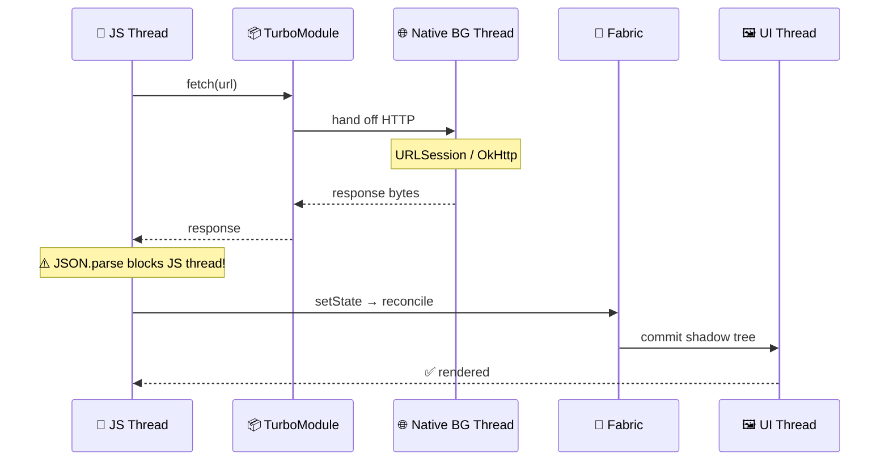

# 🎯 React Native Theory Prep — SHORT (Top 10)

> **Mục đích:** Bản rút gọn 10 câu KHÔNG THỂ TRƯỢT. Đọc nhanh sát giờ phỏng vấn và review hằng ngày trong 5 ngày.
>
> **🏷 Tag:** **[V#]** = vocab, **[S#]** = structure (lấy từ 2 file SpeakFun trong cùng folder).
>
> **⏱ Quy tắc:** Mỗi câu trả lời gọn trong **60–90 giây**.

---

## 🥇 Q1. New Architecture (JSI / Fabric / TurboModules) — explain in 60s

### 📊 Visual

```
┌────────────────── OLD BRIDGE ──────────────────┐    ┌──────────────── NEW ARCH (JSI) ────────────────┐
│                                                │    │                                                │
│   JS Thread                  Native Thread     │    │   JS Thread                  Native Thread     │
│      │                            ▲            │    │      │                            ▲            │
│      │  📤 JSON serialize         │            │    │      │  ⚡ direct C++ host objects │            │
│      ▼                            │            │    │      ▼  (synchronous, zero-copy)  │            │
│   [ async message queue ]         │            │    │   ─────────────  JSI  ─────────────            │
│      │                            │            │    │                                                │
│      │  📥 JSON deserialize       │            │    │   • TurboModules (lazy, type-safe)             │
│      └────────────►───────────────┘            │    │   • Fabric renderer (sync layout)              │
│                                                │    │                                                │
│   ❌ Slow, async, serialization cost           │    │   ✅ Fast, sync, no serialization              │
└────────────────────────────────────────────────┘    └────────────────────────────────────────────────┘
```

### 💬 Sample answer

> "**Let me walk you through** **[V29 / S7]** the change. The **old bridge** was async and JSON-serialized — every call paid a serialization cost.
>
> **The New Architecture solves this through** **[S39]** three pieces:
> - 🔌 **JSI** — JS holds C++ host objects, calls become synchronous and serialization-free.
> - 📦 **TurboModules** — type-safe native modules loaded lazily over JSI.
> - 🎨 **Fabric** — the new renderer with synchronous layout.
>
> **It's designed to be** **[S40]** more **scalable** **[V59]** with much lower native-call latency."

> ⚠️ **Bẫy:** Đừng nói "JSI replaces the bridge" — JSI thay cách *call*, không thay toàn bộ kiến trúc.

---

## 🥈 Q2. Step-by-step: `fetch()` → màn hình hiển thị data

### 📊 Sequence diagram



### 💬 Sample answer

> "**The flow goes through** **[S39]** seven steps:
>
> 1. JS calls `fetch()` on the **JS thread**.
> 2. Networking handed off to a native module (URLSession / OkHttp).
> 3. HTTP runs on a **native background thread** — JS thread stays free.
> 4. Response returns to JS; **JSON.parse runs on the JS thread**.
> 5. `setState` triggers React reconciliation.
> 6. Fabric computes shadow tree + Yoga layout, commits to UI thread.
> 7. **Native UI thread** mounts views.
>
> **A key aspect** **[S41]** is that big JSON payloads still block the JS thread, **so we could consider** **[S67]** streaming or native-side parsing for huge responses."

> ⚠️ **Bẫy:** Đừng nói "fetch chạy trên main thread".

---

## 🥉 Q3. Hermes — what & why?

### 📊 Visual

```
┌─────────────────────────────────────────┐
│  🏗  Build time                          │
│     JS source ──[Hermes compiler]──►    │
│                  📦 .hbc bytecode        │
└─────────────────────┬───────────────────┘
                      │ ship in bundle
                      ▼
┌─────────────────────────────────────────┐
│  🚀 App launch                           │
│     load .hbc → ⚡ skip parsing → run   │
│     ✅ faster startup                   │
│     ✅ smaller bundle                   │
│     ✅ lower RAM                        │
└─────────────────────────────────────────┘
```

### 💬 Sample answer

> "Hermes is Meta's JS engine, **designed to be** **[S40]** optimized for mobile RN. **The main benefit** **[S38]** is faster startup — JS is pre-compiled to bytecode at build time. It also has lower memory **footprint** and smaller bundle size. Default since RN 0.70, with a built-in Chrome-DevTools-compatible inspector."

---

## 🧵 Q4. Threading model — the three threads

### 📊 Visual

```
┌──────────────────┐  ┌──────────────────┐  ┌──────────────────┐
│  🧵 JS Thread    │  │  🖼 UI Thread    │  │  🌐 BG Threads   │
├──────────────────┤  ├──────────────────┤  ├──────────────────┤
│ • React          │  │ • Rendering      │  │ • Networking     │
│ • Your JS code   │  │ • Gestures       │  │ • Image decode   │
│ • JSON.parse     │  │ • View mount     │  │ • Yoga layout    │
│ • State logic    │  │ • Animations     │  │ • Crypto         │
│   (single!)      │  │   (native driver)│  │                  │
└──────────────────┘  └──────────────────┘  └──────────────────┘

         ⚠️ NEVER block the JS thread → app freezes
```

### 💬 Sample answer

> "Three main threads:
> - 🧵 **JS Thread** — runs JS + React reconciliation.
> - 🖼 **Main / UI Thread** — native rendering, gestures, view mounting.
> - 🌐 **Shadow Thread** — Yoga layout (old arch).
>
> Plus background threads for networking and image decoding. **It's essential to ensure that** **[S44]** crypto, image decoding, and big JSON parsing **never** **block** the JS thread, otherwise the **interface** **[V54]** will **lag** **[V90]** or **freeze** **[V89]**."

---

## 🧠 Q5. `useMemo` / `useCallback` / `React.memo` — when (not) to use

### 📊 Decision tree

```
┌─────────────────────────────────────────┐
│  ❓ Should I memoize this?              │
└─────────────────────────────────────────┘
              │
   ┌──────────┴──────────┐
   │                     │
   ▼                     ▼
🤔 Cheap primitive?   🤔 Expensive compute?
   │                     │
   ▼                     ▼
   ❌ NO                  ✅ YES (useMemo)
                          
   ┌──────────────────────────────────────┐
   │ Passing fn/object to memoized child? │
   └──────────────────────────────────────┘
              │
              ▼
          ✅ YES (useCallback)
          
   ┌──────────────────────────────────────┐
   │ Inside FlatList renderItem?          │
   └──────────────────────────────────────┘
              │
              ▼
          ✅ YES (React.memo on item)
```

### 💬 Sample answer

> "**My rule of thumb:** don't reach for them by default — they cost too.
>
> **Use when:**
> - Computation is genuinely expensive (filter 10k items, complex math).
> - Passing function/object to a memoized child.
> - Inside `FlatList renderItem` paired with `React.memo`.
>
> **Don't use when:**
> - Value is a cheap primitive.
> - Dep array changes every render anyway.
>
> **One thing I learned** at MSB is over-memoizing actually slowed things down because dep arrays were unstable."

---

## 📜 Q6. FlatList optimization checklist

### 📊 Windowing visual

```
                    Total list: 10,000 items
                    ━━━━━━━━━━━━━━━━━━━━━━━

           ╔════════════════════════════════╗
   ✂ unmount items above
           ║                                ║
           ║  🟦 buffer (windowSize)        ║   ← removeClippedSubviews
           ║                                ║
           ╠════════════════════════════════╣
           ║  🟩 Item 12  [rendered]        ║
           ║  🟩 Item 13  [rendered]   👀   ║   ← visible
           ║  🟩 Item 14  [rendered]   👀   ║
           ║  🟩 Item 15  [rendered]   👀   ║
           ║  🟩 Item 16  [rendered]        ║
           ╠════════════════════════════════╣
           ║                                ║
           ║  🟦 buffer                     ║
           ║                                ║
           ╚════════════════════════════════╝
   ✂ unmount items below
```

### 💬 Sample answer

> "**A key aspect** **[S41]** of FlatList performance:
> - 🔑 Stable `keyExtractor`.
> - 📐 `getItemLayout` for fixed-height rows → skips measurement.
> - ✂️ `removeClippedSubviews` on Android.
> - ⚙️ Tune `initialNumToRender`, `maxToRenderPerBatch`, `windowSize`.
> - 🧊 `renderItem` wrapped in `React.memo`.
>
> For very long lists (10k+), **we could consider** **[S67]** `@shopify/flash-list` — cell recycling like UICollectionView."

---

## 🔐 Q7. Why crypto must run native, not JS (Web3-critical)

### 📊 Key isolation diagram

```
┌──────────────────────────────────────────────┐
│            📱 JS Bundle                       │
│   ┌────────────────────────────────────┐     │
│   │  walletId  ✅                       │     │  ← only handles
│   │  signedTx  ✅                       │     │     (no secrets)
│   │  privateKey  ❌ NEVER               │     │
│   └────────────────┬───────────────────┘     │
└────────────────────┼─────────────────────────┘
                     │ JSI / TurboModule
┌────────────────────┼─────────────────────────┐
│                    ▼                         │
│   ┌────────────────────────────────────┐     │
│   │   ⚙ Native Crypto Module           │     │  ← raw key briefly
│   │   (Swift / Kotlin)                 │     │     in native heap
│   └────────────────┬───────────────────┘     │
└────────────────────┼─────────────────────────┘
                     │
┌────────────────────┼─────────────────────────┐
│                    ▼                         │
│   ┌────────────────────────────────────┐     │
│   │  🔒 Secure Enclave / StrongBox     │     │  ← key NEVER
│   │  (hardware, biometric-gated)       │     │     leaves chip
│   └────────────────────────────────────┘     │
└──────────────────────────────────────────────┘
```

### 💬 Sample answer

> "Two reasons.
>
> 🛡 **First — security.** Keys in JS sit in the Hermes heap, inspectable via debugger or memory dump. Native code keeps keys inside Secure Enclave / StrongBox — they never enter app memory.
>
> ⚡ **Second — performance.** ECDSA signing and BIP39 PBKDF2 are CPU-heavy; running on JS thread would **freeze** **[V89]** the **interface** **[V54]**.
>
> **A key aspect** **[S41]** is that JS only ever sees a **key handle** or signed result, never the raw key."

---

## 💾 Q8. Memory leak — top causes in RN

### 📊 Top 5 cheat sheet

```
┌────────────────────────────────────────────────────────────┐
│  🚨 LEAK SOURCE              🛠  FIX                        │
├────────────────────────────────────────────────────────────┤
│  ⏰ setInterval / setTimeout │ return clearXxx in useEffect│
│  📡 Native event listener   │ .remove() on cleanup        │
│  🔗 Navigation refs         │ null out in useEffect return│
│  🖼 Large image bitmaps     │ FastImage + proper resize   │
│  🪤 Closure traps           │ ref instead of state in fn  │
└────────────────────────────────────────────────────────────┘
```

### 💬 Sample answer

> "**One challenge** **[S35]** I've debugged multiple times:
> 1. ⏰ Uncleared `setInterval` / `setTimeout` in `useEffect`.
> 2. 📡 `DeviceEventEmitter.addListener` without `.remove()`.
> 3. 🔗 Navigation refs held after unmount.
> 4. 🖼 Large in-memory image bitmaps (use `FastImage`).
> 5. 🪤 Closure traps capturing big state.
>
> **My approach involves** **[S34]** profiling with Xcode Instruments and Android Profiler. Every `useEffect` with a subscription must return a cleanup."

---

## 🧭 Q9. Native Stack vs JS Stack — for a wallet, which?

### 📊 Comparison

| | 🍎 Native Stack | 🟨 JS Stack |
|---|---|---|
| **Implementation** | UINavigationController / Fragment | Pure JS + Reanimated |
| **Gestures** | ✅ True native swipe-back | ⚠️ JS-driven (good, not perfect) |
| **Performance** | ⚡ Fast | 🐢 Heavier |
| **Customization** | 🔒 Limited | 🎨 Full |
| **For wallet** | ✅ **Pick this** | ❌ |

### 💬 Sample answer

> "**Native Stack** uses platform containers — true native gestures, smoother transitions, proper system back. **JS Stack** is more customizable but heavier.
>
> **For a wallet, I'd go with** **[V101]** Native Stack — better feel, better performance, plays nicely with biometric prompts and modals."

---

## 🛡 Q10. Threat model on jailbroken / rooted device

### 📊 Defense in depth — 5 layers

```
        🎯 ATTACKER
            │
            ▼
   ┌────────────────────────────────┐
   │ 🛡 Layer 1: DETECT             │  Play Integrity / iOS probes
   ├────────────────────────────────┤
   │ 🛡 Layer 2: DEGRADE            │  disable signing, warn user
   ├────────────────────────────────┤
   │ 🛡 Layer 3: HARDWARE-BACK KEYS │  Secure Enclave / StrongBox
   ├────────────────────────────────┤
   │ 🛡 Layer 4: NETWORK            │  certificate pinning
   ├────────────────────────────────┤
   │ 🛡 Layer 5: CODE               │  Hermes bytecode + ProGuard
   └────────────────────────────────┘
            │
            ▼
        🔒 USER FUNDS
```

### 💬 Sample answer

> "**Honest answer:** no app is 100% safe on a compromised device — that's a fundamental limit. **But we can raise the cost of attack.**
>
> **My layered approach involves** **[S34]**:
> 1. 🛡 **Detect** — jailbreak / root checks (Play Integrity, iOS filesystem probes).
> 2. ⚠️ **Degrade** — on detection, disable signing or warn the user.
> 3. 🔒 **Hardware-back keys** — Secure Enclave keys are non-extractable.
> 4. 📡 **Cert pinning** — prevents MITM via custom CAs.
> 5. 🧬 **Obfuscation** — Hermes bytecode + ProGuard.
>
> **It's essential to ensure that** **[S44]** users are warned when running on a compromised device."

---

## ⚡ Cheat-sheet — 8 phrase mở đầu phải nhớ

| # | 💬 Phrase | 🏷 Tag |
|---|---|---|
| 1️⃣ | *"Sure, let me walk you through…"* | **[V29 / S7]** |
| 2️⃣ | *"The solution involves / consists of…"* | **[S37]** |
| 3️⃣ | *"A key aspect of this is…"* | **[S41]** |
| 4️⃣ | *"It's designed to be robust / scalable / reliable"* | **[S40]** |
| 5️⃣ | *"One challenge is… / One thing I learned is…"* | **[S35]** |
| 6️⃣ | *"We could consider + V-ing…"* | **[S67]** |
| 7️⃣ | *"It's essential to ensure that…"* | **[S44]** |
| 8️⃣ | *"So just to summarize…"* | **[S68]** |

---

## ⚡ 5 vocab "high-leverage" — nhồi vào câu trả lời

| 🎯 Word | 🏷 Tag | 💡 Cách dùng nhanh |
|---|---|---|
| **robust** | **[V7]** | "designed to be **robust** against jailbreak" |
| **scalable** | **[V59]** | "an architecture that's **scalable** to multi-chain" |
| **reliable** | **[V109]** | "we aim for a **reliable** signing flow" |
| **optimize** | **[V8]** | "we **optimize** RPC calls with multicall" |
| **dig into** | **[V95]** | "I had to **dig into** the network logs" |

---

## ⏰ Mock-time format

```
   ┌────────────────────────────────────────┐
   │  🎙 Read question OUT LOUD             │
   │            ↓                           │
   │  ⏱ Start 60–90s timer                  │
   │            ↓                           │
   │  💬 Answer WITHOUT looking at notes    │
   │            ↓                           │
   │  ▶️ Replay recording                   │
   │            ↓                           │
   │  ✅ Tick which cheat-sheet phrases     │
   │     came out naturally                 │
   └────────────────────────────────────────┘
              🎯 Goal: ≥ 5/8 phrases by Day 5
```

---

## 🎯 Sáng ngày phỏng vấn — checklist 10 phút

1. 📖 Đọc to **Q1, Q2, Q7, Q10** (4 câu nguy hiểm nhất).
2. 📋 Đọc cheat-sheet 8 phrase + 5 vocab.
3. 💧 Uống nước, hít sâu 3 lần.
4. 💪 Tin vào 7 năm experience.
