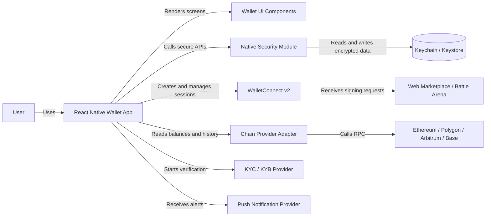
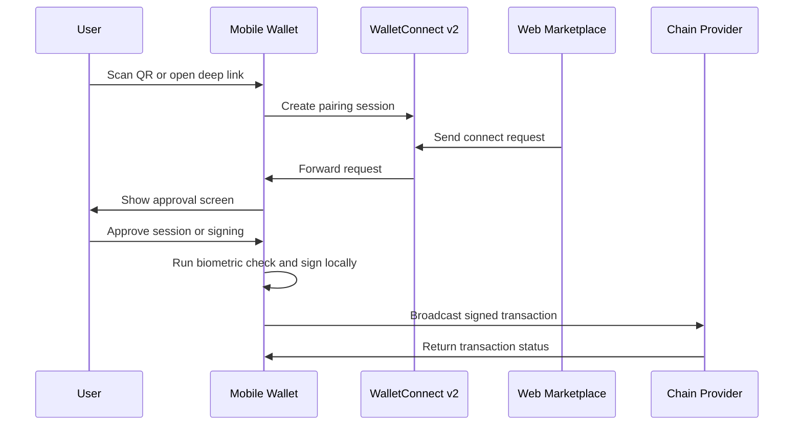

# React Native Wallet Interview Prep - VMO

Source:
- CV: `Nguyen_Nhat_Long_CV_Master.md`
- Vocab: `speakfun-english-it-professionals-vocabulary.md`
- Structures: `speakfun-english-it-professionals-structures.md`
- Job image: React Native mobile wallet, non-custodial key management, WalletConnect v2, KYC/KYB, multi-chain, biometrics, performance, CI/CD, collaboration.

## Highlight Rules

- `<mark>...</mark>` = sentence structure from the structures file.
- Underline + bold style = vocab from the vocabulary file.
- Normal text = role-specific technical term: BIP39, BIP44, WalletConnect, EVM, RPC, seed phrase, private key, signing.

## Visual Guide

Status: Draft interview prep. Date: 2026-04-25. Scope: high-level mobile wallet interview concepts, not production architecture.

Icon legend:
- 📱 Mobile app / React Native screen
- 🔐 Security, key, encrypted storage
- 🧬 Biometric check
- 🔗 WalletConnect session
- 🌐 Blockchain network / chain provider
- 🪪 KYC/KYB provider
- 🔔 Push notification
- ⚡ Performance / latency
- 🤝 Collaboration / team dependency
- ❓ Interview question
- 💬 Suggested answer

Diagram legend:
- Rectangle = app module or external system.
- Database shape = secure local storage.
- Solid arrow = direct call or user flow.
- Every arrow label explains the relationship.

### Diagram 1 - Mobile Wallet Architecture

### Diagram 2 - Secure Transaction Signing

```mermaid
flowchart LR
    Request["Transaction Request"] -->|"Show details"| Review["Review Screen"]
    Review -->|"User approves"| Bio["Biometric Check"]
    Bio -->|"Unlocks access"| Store[("Encrypted Key Storage")]
    Store -->|"Provides key operation"| Sign["Local Signing Module"]
    Sign -->|"Returns signed transaction"| Broadcast["Broadcast Transaction"]
    Broadcast -->|"Shows result"| Status["Transaction Status"]
```

### Diagram 3 - WalletConnect v2 Flow

## 🧭 Quick Positioning

### ❓ Q1. Tell me about yourself.

### 💬 Answer
<mark>My main responsibility is...</mark> to build <u>**reliable**</u>, <u>**robust**</u>, and <u>**user-friendly**</u> mobile apps.

<mark>I work on...</mark> React Native, native modules, mobile <u>**architecture**</u>, authentication, onboarding, release, and production <u>**issue**</u> handling.

For this role, I can connect my mobile fintech background with the wallet requirements: secure storage, biometric signing, WalletConnect, and cross-chain support.

### ❓ Q2. Why are you a good fit for this role?

### 💬 Answer
<mark>The goal is to...</mark> build a secure mobile wallet that is <u>**scalable**</u>, <u>**compatible**</u>, and <u>**responsive**</u> on iOS and Android.

<mark>That makes sense.</mark> My experience is close because I already <u>**work on**</u> fintech apps, native modules, authentication, and secure onboarding.

I have not shipped a full non-custodial wallet end-to-end yet, but I can <u>**look into**</u> the Web3-specific parts quickly because the mobile foundation is similar.

### ❓ Q3. What is your biggest strength for this job?

### 💬 Answer
<mark>One thing I did well is...</mark> building mobile flows that are stable, clear, and safe for users.

I can design the React Native <u>**interface**</u>, connect native modules, handle production <u>**issue**</u>, and work with backend, QA, and platform teams.

<mark>From a user perspective...</mark> trust is the most important part of a wallet, so the app must be <u>**reliable**</u> and easy to use.

## 📱 React Native Mobile Wallet

### ❓ Q4. How would you design the React Native wallet app?

### 💬 Answer
<mark>The solution involves...</mark> clear <u>**components**</u>: onboarding, wallet creation/import, secure storage, signing, WalletConnect, assets, transaction history, notifications, and settings.

<mark>A key aspect of this solution is...</mark> separating UI logic from security-sensitive logic.

React Native handles the user flow, while native modules or secure services handle biometric access, encrypted storage, and signing.

### ❓ Q5. How do you keep the app maintainable?

### 💬 Answer
<mark>I think we should prioritize...</mark> a modular <u>**architecture**</u> because wallet logic can become complex quickly.

I would keep screens, services, adapters, and domain logic separate.

<mark>This allows us to...</mark> add a new <u>**feature**</u>, chain, or provider without changing the whole app.

### ❓ Q6. How do you keep iOS and Android consistent?

### 💬 Answer
<mark>It's essential to ensure that...</mark> the wallet <u>**interface**</u> is clear, <u>**responsive**</u>, and <u>**user-friendly**</u> on both platforms.

<mark>The element is presented differently on...</mark> iOS and Android for biometrics, permissions, keyboard behavior, and secure storage.

I would hide those differences behind platform adapters so the React Native screens can use one stable interface.

### ❓ Q7. How do you handle platform-specific behavior?

### 💬 Answer
<mark>Maybe we can break this down into...</mark> permissions, biometrics, secure storage, deep links, push notifications, and app lifecycle.

Each area should have a small platform service with typed input and predictable output.

If there is a <u>**bug**</u>, this design makes it easier to <u>**identify**</u> and <u>**resolve**</u> the source.

## 🧩 Native Modules

### ❓ Q8. What is your experience with native modules?

### 💬 Answer
<mark>Let me walk you through...</mark> my approach. I keep the bridge small, explicit, and easy to <u>**review**</u>.

The JavaScript side sends clear input, the native side returns a predictable result, and both sides map errors consistently.

<mark>The main benefit is...</mark> React Native can stay productive while native code handles <u>**critical**</u> platform <u>**functionality**</u>.

### ❓ Q9. What native modules would this wallet need?

### 💬 Answer
<mark>The solution consists of...</mark> secure storage, biometric authentication, signing support, push notification handling, and maybe deep link/session handling.

For iOS, I would use Keychain and LocalAuthentication. For Android, I would use Keystore and BiometricPrompt.

<mark>A key aspect of this solution is...</mark> not leaking private data across the bridge.

### ❓ Q10. How do you debug a bridge issue?

### 💬 Answer
<mark>If there is a bug in...</mark> the native bridge, I check the input, output, <u>**function**</u>, <u>**variable**</u>, native logs, and JavaScript logs.

<mark>This happens when...</mark> the JS contract and native implementation are not aligned.

I would <u>**reproduce**</u> it on both platforms, <u>**diagnose**</u> the root cause, and create a small <u>**fix**</u>.

## 🔐 Non-Custodial Key Management

### ❓ Q11. What does non-custodial mean?

### 💬 Answer
<mark>My explanation is...</mark> non-custodial means the user controls the private key, not the company.

The app can help create, store, and use the key, but it should never send the key to the backend.

<mark>From a user perspective...</mark> this gives control, but it also makes security and recovery very important.

### ❓ Q12. How would you protect private keys?

### 💬 Answer
<mark>One challenge is...</mark> private keys and seed phrases must never be exposed in logs, analytics, screenshots, or normal storage.

<mark>The solution involves...</mark> encrypted local storage, Keychain/Keystore, biometric access, no plaintext persistence, and strict error handling.

I would also keep signing in a controlled module so the UI only receives the final result.

### ❓ Q13. What do BIP39 and BIP44 do?

### 💬 Answer
<mark>My explanation is...</mark> BIP39 defines mnemonic seed phrases, and BIP44 defines account derivation paths.

BIP39 helps users back up a wallet. BIP44 helps the wallet derive accounts in a standard way.

<mark>Just to clarify, does this mean that...</mark> the app supports one account first, or multiple accounts from the same seed?

### ❓ Q14. What mistakes must we avoid with seed phrases?

### 💬 Answer
<mark>It's essential to ensure that...</mark> the seed phrase is not logged, cached, copied, screenshotted, or sent to analytics.

The app should guide the user clearly and reduce unsafe actions.

<mark>I'd like to point out that...</mark> a small security mistake can have a big <u>**impact**</u> because wallet transactions cannot be reversed.

### ❓ Q15. How would you design encrypted local storage?

### 💬 Answer
<mark>The solution involves...</mark> platform secure storage, app-level encryption, biometric access, and careful key rotation.

I would define a small storage interface: save, read, delete, migrate, and validate.

<mark>This allows us to...</mark> keep storage <u>**robust**</u>, testable, and easier to <u>**troubleshoot**</u>.

## 🔗 WalletConnect v2

### ❓ Q16. How would you integrate WalletConnect v2?

### 💬 Answer
<mark>The system can integrate with other platforms such as...</mark> a web marketplace or battle arena through WalletConnect v2.

The mobile wallet acts as a secure signer. The web app asks for connection or signing, and the user approves on mobile.

<mark>Maybe we can break this down into...</mark> pairing, session approval, message signing, transaction signing, session storage, and disconnect handling.

### ❓ Q17. What are the risks in WalletConnect?

### 💬 Answer
<mark>One challenge is...</mark> users may approve a malicious request if the app does not show clear information.

The wallet should show chain, dApp name, address, amount, gas, and action type before signing.

<mark>It's essential to ensure that...</mark> the approval screen is clear, <u>**user-friendly**</u>, and hard to misuse.

### ❓ Q18. How do you handle WalletConnect sessions?

### 💬 Answer
<mark>The solution involves...</mark> storing session metadata securely, validating chain permissions, and cleaning up expired sessions.

The app should let users view active sessions and disconnect them.

If session state becomes wrong, I would <u>**look into**</u> storage, event handling, reconnect logic, and recent <u>**changes**</u>.

### ❓ Q19. What would you ask the blockchain team about WalletConnect?

### 💬 Answer
<mark>Let's align on...</mark> supported chains, RPC providers, signing methods, transaction payload format, and expected error codes.

<mark>One dependency here is...</mark> the final chain config and smart contract input.

Without that, the mobile implementation may be <u>**pending**</u> or may need rework later.

## 🌐 Multi-Chain Support

### ❓ Q20. How would you support Ethereum, Polygon, Arbitrum, and Base?

### 💬 Answer
<mark>I think we should prioritize...</mark> a chain-agnostic wallet service because it keeps the app <u>**scalable**</u>.

<mark>The solution consists of...</mark> shared wallet logic plus chain-specific adapters for RPC, explorer URL, token list, gas, and transaction history.

<mark>This allows us to...</mark> add a new chain without duplicating UI or business logic.

### ❓ Q21. How would you track balances and transaction history?

### 💬 Answer
<mark>The solution involves...</mark> a provider layer that can read balances, tokens, and history per chain.

I would cache carefully, refresh on focus, and avoid too many unnecessary network calls.

<mark>We could improve by...</mark> using batching and <u>**cut down on**</u> repeated RPC requests.

### ❓ Q22. How do you handle different RPC failures?

### 💬 Answer
<mark>There's an issue with...</mark> RPC reliability when providers are slow, rate-limited, or unavailable.

The app should show a safe error state and avoid duplicate signing or broadcasting.

<mark>It's an intermittent problem, so...</mark> I would collect chain, provider, request type, latency, and error response before I <u>**escalate**</u>.

### ❓ Q23. Ethers.js or Viem: how would you choose?

### 💬 Answer
<mark>That makes sense.</mark> Both can work, so I would choose based on team standard, bundle size, typing, API clarity, and ecosystem support.

If the team already has contracts and utilities in one library, I would <u>**go with**</u> that to reduce integration risk.

<mark>Just to clarify, does this mean that...</mark> the team already has a preferred Web3 library?

## 🧬 Biometric Integration

### ❓ Q24. How would you use FaceID, TouchID, or Fingerprint?

### 💬 Answer
<mark>The solution involves...</mark> using platform biometric APIs to protect app access and transaction signing.

Biometrics should unlock access to the key operation, not replace the private key itself.

<mark>It's essential to ensure that...</mark> fallback behavior is safe when biometrics are unavailable or enrollment changes.

### ❓ Q25. What edge cases would you handle?

### 💬 Answer
<mark>Maybe we can break this down into...</mark> biometric unavailable, user cancels, too many failed attempts, OS change, device change, and key invalidation.

The app should show clear errors and never continue signing after a failed biometric check.

<mark>From a user perspective...</mark> the flow must be secure but still <u>**user-friendly**</u>.

### ❓ Q26. How do you avoid unsafe biometric signing?

### 💬 Answer
<mark>A key aspect of this solution is...</mark> binding the biometric check to a specific transaction intent.

The approval screen should show what the user is signing before the biometric prompt.

<mark>I'd like to point out that...</mark> approving a generic prompt is risky because users cannot verify the real action.

## ⚡ Performance and Latency

### ❓ Q27. What would you do if signing became slow?

### 💬 Answer
<mark>There's an issue with...</mark> transaction signing latency.

<mark>This happens when...</mark> the user approves a transaction, the app checks biometrics, signs locally, and broadcasts the transaction.

I would measure each step, <u>**identify**</u> the bottleneck, and <u>**optimize**</u> the slow part.

### ❓ Q28. What would you do if broadcasting failed?

### 💬 Answer
<mark>I've encountered a problem with...</mark> production flows where failures can happen at different layers.

I would check the transaction payload, signature, nonce, gas, RPC provider, network state, and backend logs.

<mark>So just to summarize...</mark> I would <u>**reproduce**</u>, <u>**diagnose**</u>, <u>**resolve**</u>, and then add monitoring to prevent the same <u>**issue**</u>.

### ❓ Q29. How do you reduce UI lag?

### 💬 Answer
<mark>We could improve by...</mark> moving heavy work out of the render path, reducing unnecessary state updates, and profiling slow screens.

I would also keep large lists virtualized and avoid blocking the JavaScript thread.

<mark>From a user perspective...</mark> <u>**lag**</u> makes the wallet feel unsafe, even if the transaction is correct.

### ❓ Q30. How do you monitor production quality?

### 💬 Answer
<mark>The solution involves...</mark> crash reporting, performance metrics, transaction latency logs, and safe error tracking.

I would track signing time, broadcast time, RPC failures, app <u>**crash**</u>, app <u>**freeze**</u>, and short <u>**outage**</u>.

<mark>Overall, the system is...</mark> healthier when the team can detect and <u>**resolve**</u> problems before many users complain.

## 🪪 KYC / KYB and Onboarding

### ❓ Q31. How would you design social-to-wallet onboarding?

### 💬 Answer
<mark>The main purpose of this flow is to...</mark> <u>**onboard**</u> users with less friction while still protecting account and wallet security.

<mark>It offers several useful features such as...</mark> social login, wallet creation, recovery guidance, KYC/KYB handoff, and status tracking.

The flow should be short, clear, and safe for first-time wallet users.

### ❓ Q32. How would you integrate KYC/KYB providers?

### 💬 Answer
<mark>The system can integrate with other platforms such as...</mark> Sumsub, Onfido, or another compliance provider.

I would keep provider logic behind an adapter, so we can change provider without changing the whole onboarding flow.

<mark>A key aspect of this solution is...</mark> handling pending, approved, rejected, and retry states clearly.

### ❓ Q33. How do you keep onboarding easy but secure?

### 💬 Answer
<mark>One challenge is...</mark> balancing low friction with compliance and wallet security.

<mark>We could improve by...</mark> splitting the flow into small <u>**deliverables**</u>: social login, wallet setup, KYC/KYB, and first transaction.

Each step should meet <u>**acceptance criteria**</u> before the team can <u>**sign off on**</u> it.

## 🔔 Push Notifications

### ❓ Q34. How would you use push notifications in a wallet?

### 💬 Answer
<mark>The main purpose of this feature is to...</mark> give users a fast <u>**update**</u> about transaction status, security alerts, and important wallet events.

The notification should not expose sensitive data like private key, full address, or transaction details.

<mark>From a user perspective...</mark> the message should be clear, <u>**reliable**</u>, and useful.

### ❓ Q35. What notification risks would you consider?

### 💬 Answer
<mark>One challenge is...</mark> notifications may leak sensitive context if the message is too detailed.

I would keep notification text minimal and open the app for full details after authentication.

<mark>It's essential to ensure that...</mark> the notification flow is secure, <u>**responsive**</u>, and not noisy.

## 🚀 CI/CD and Store Deployment

### ❓ Q36. How do you prepare a mobile app release?

### 💬 Answer
<mark>Overall, we are on track for...</mark> release when tests pass, QA has checked key flows, and the app meets <u>**acceptance criteria**</u>.

<mark>Ready to go live</mark> means the build is signed, release notes are ready, product can <u>**sign off on**</u> it, and rollback is clear.

I would also check store requirements, environment config, and versioning.

### ❓ Q37. What should release notes include?

### 💬 Answer
<mark>The main purpose of this section is to...</mark> explain what changed in a clear and short way.

For a wallet, <u>**release notes**</u> should mention user-facing <u>**feature**</u>, security improvement, bug fix, and known limitation if needed.

<mark>Let's align on...</mark> what is public, what is internal, and what is <u>**out of scope**</u>.

## 🤝 Collaboration

### ❓ Q38. How do you work with smart contract and blockchain infrastructure teams?

### 💬 Answer
<mark>Let's align on...</mark> chain config, transaction format, ABI, RPC behavior, error codes, and <u>**acceptance criteria**</u>.

<mark>One dependency here is...</mark> mobile needs stable contract inputs and backend APIs before implementation can be <u>**complete**</u>.

I prefer small <u>**action item**</u> lists, early <u>**feedback**</u>, and clear owners.

### ❓ Q39. How do you handle unclear requirements?

### 💬 Answer
<mark>Just to clarify, does this mean that...</mark> the first release supports only EVM chains and WalletConnect signing?

<mark>Should we include...</mark> KYC/KYB, biometrics, and push notifications in the first sprint?

If something is unclear, I would <u>**clarify**</u> scope before implementation to avoid rework.

### ❓ Q40. How do you report progress?

### 💬 Answer
<mark>Yesterday, I worked on...</mark> WalletConnect pairing and completed the main flow.

<mark>Today, I will focus on...</mark> biometric signing and transaction broadcast handling.

<mark>I've encountered a blocker with...</mark> RPC error mapping, so I will <u>**escalate**</u> it to the blockchain team.

## 🎯 If They Challenge Your Web3 Experience

### ❓ Q41. You have mobile experience, but do you have enough Web3 wallet experience?

### 💬 Answer
<mark>I see your point.</mark> My Web3 wallet experience is not as deep as my mobile fintech experience.

<mark>My main focus in the first few weeks will be to...</mark> <u>**familiarize**</u> myself with your wallet <u>**architecture**</u>, WalletConnect flow, signing rules, chain support, and security standards.

I can still contribute quickly because the role also requires React Native, native modules, biometrics, secure storage, performance, release, and production <u>**troubleshoot**</u> skills.

### ❓ Q42. How would you ramp up quickly?

### 💬 Answer
<mark>Could you please show me how to...</mark> your current team handles key generation, transaction signing, provider errors, and WalletConnect sessions?

Then I would read the <u>**repository**</u>, run the app, check current <u>**issue**</u> list, and ask for early <u>**feedback**</u>.

<mark>So just to summarize...</mark> I would learn the domain quickly while using my mobile strengths to deliver stable features.

## ❓ Questions You Should Ask Them

- <mark>Just to clarify, does this mean that...</mark> the first release supports only Ethereum, Polygon, Arbitrum, and Base?
- <mark>Should we include...</mark> biometric signing in the MVP?
- <mark>One dependency here is...</mark> the smart contract ABI. Is it stable now?
- <mark>How many story points do you think this would be?</mark> for WalletConnect session handling?
- <mark>Is there anything specific I should know about...</mark> your security review process?
- <mark>Can you review...</mark> my understanding of the signing and broadcast flow?
- <mark>Let's align on...</mark> which parts are MVP and which parts are <u>**out of scope**</u>.

## 🧠 Short Phrases To Reuse

- <mark>My main responsibility is...</mark> mobile wallet delivery.
- <mark>I work on...</mark> <u>**architecture**</u>, native modules, and production <u>**issue**</u>.
- <mark>One challenge is...</mark> secure key handling.
- <mark>The solution involves...</mark> encrypted storage and native biometric access.
- <mark>This allows us to...</mark> keep the app <u>**robust**</u> and <u>**reliable**</u>.
- <mark>Maybe we can break this down into...</mark> smaller <u>**deliverable**</u> items.
- <mark>I think we should prioritize...</mark> security, performance, and user trust.
- <mark>I'll look into...</mark> logs, recent <u>**change**</u>, and device behavior.
- <mark>I'd like to point out that...</mark> signing latency has a direct <u>**impact**</u> on user trust.
- <mark>So just to summarize...</mark> the app must be secure, <u>**scalable**</u>, <u>**responsive**</u>, and <u>**user-friendly**</u>.
