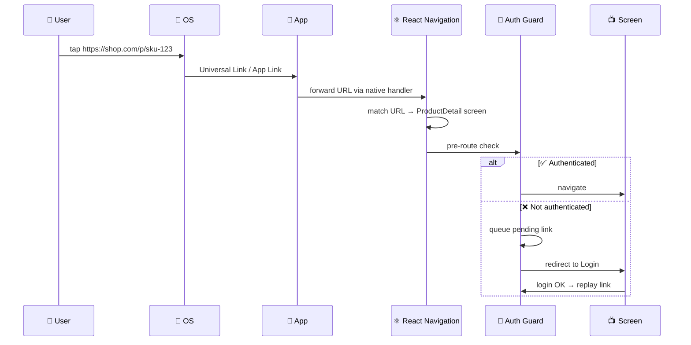
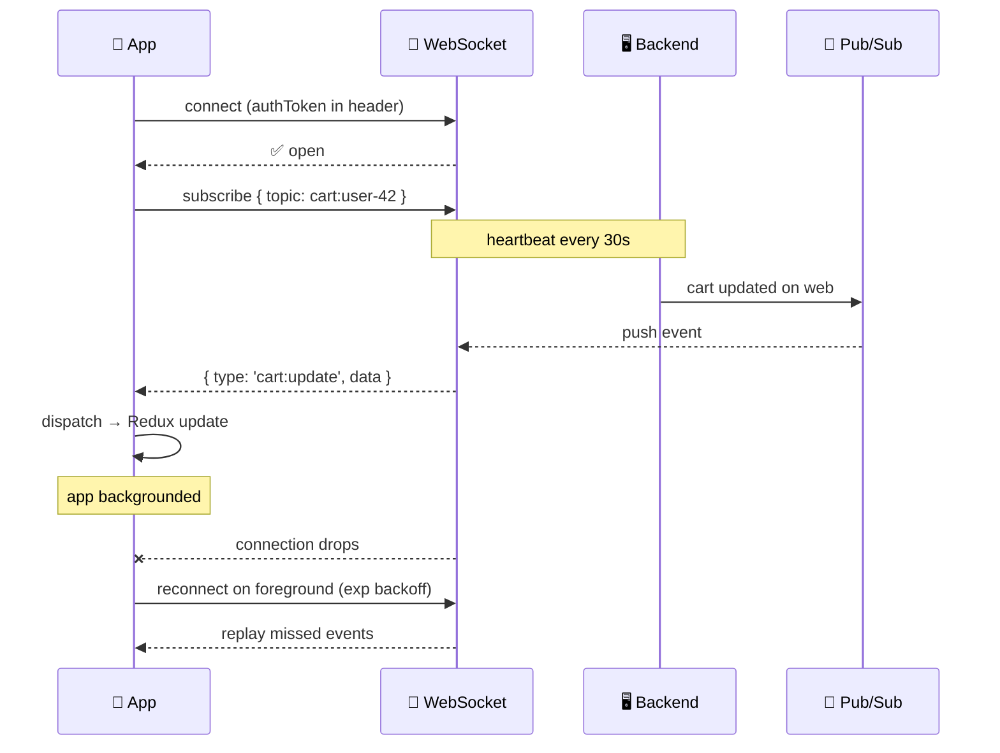
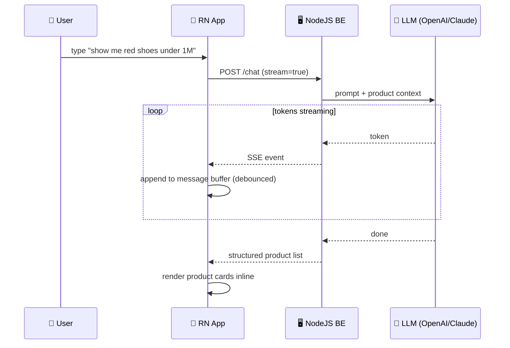

# 📚 Taureau.ai — React Native Mobile Interview Prep (25 questions)

> **🎯 Mục đích:** Bộ câu hỏi & câu trả lời mẫu phỏng vấn vị trí **React Native Mobile** tại **Taureau.ai** (E-Commerce + AI applications, RN + ReactJS + NextJS).
>
> **🏷 Tag:** **[V#]** = vocab, **[S#]** = structure (lấy từ 2 file SpeakFun trong cùng folder).
>
> **📋 Cách dùng:** Đọc câu hỏi → tự trả lời 60s → mở sample answer so sánh → highlight phrase chưa nhớ.
>
> **🏢 Job context (từ JD):**
> - 25–35M, 2 slots, 2+ years RN/React/Next, Đại Mỗ HN
> - Build **E-Commerce & AI mobile + web apps** (NextJS + ReactJS + RN)
> - **REST API, TCP/IP, Firebase, WebSocket**, Redux, TypeScript
> - **AI Coding Assistant** (Copilot/Claude/Cursor), Scrum/Agile
> - Nice to have: AI app, NodeJS, UI perf metrics, English

---

## 🗺 Map of all 25 questions

```
┌──────────────────────────────────────────────────────────────┐
│  📦 Nhóm A — RN Core & Architecture        Q1–Q4   (P0)     │
│  ⚡ Nhóm B — Performance for E-Commerce     Q5–Q9   (P0)     │
│  🧭 Nhóm C — State, Navigation, Storage    Q10–Q13 (P1)     │
│  🌐 Nhóm D — Server Communication           Q14–Q17 (P0)     │
│  🔗 Nhóm E — Cross-platform Web + Mobile   Q18–Q20 (P1)     │
│  🧪 Nhóm F — TypeScript, Testing, Review   Q21–Q22 (P1)     │
│  🤖 Nhóm G — AI Integration & AI Tooling   Q23–Q24 (P0)     │
│  💬 Nhóm H — Process & Soft Skills          Q25         (P1) │
└──────────────────────────────────────────────────────────────┘
```

---

# 📦 Nhóm A — RN Core & Architecture (P0)

## Q1. Old Bridge vs New Architecture (JSI / Fabric / TurboModules)

### 📊 Diagram

```
┌────────── 📜 OLD BRIDGE ──────────┐    ┌────────── ⚡ NEW ARCH (JSI) ──────────┐
│                                   │    │                                        │
│  🧵 JS  ──📤 JSON──► 🧵 Native    │    │  🧵 JS  ── ⚡ JSI (sync) ──► 🧵 Native │
│         async, serialized         │    │  ┌─ 📦 TurboModules (lazy, type-safe) │
│         ❌ slow for animations    │    │  ├─ 🎨 Fabric renderer (sync layout)  │
│                                   │    │  └─ 🤝 C++ host objects (zero-copy)   │
└───────────────────────────────────┘    └────────────────────────────────────────┘
```

### 💬 Sample answer

> "Sure, **let me walk you through** **[V29 / S7]** the difference. **In the old bridge**, JS and Native talk through an **asynchronous, serialized message queue** — every call is JSON-serialized, sent across, then deserialized. **One challenge** **[S35]** was bottlenecks for high-frequency events like animations or scroll.
>
> **The New Architecture solves this through** **[S39]** three pieces:
> - 🔌 **JSI** — JS gets direct access to C++ host objects, calls are synchronous, no serialization.
> - 📦 **TurboModules** — native modules loaded lazily, type-safe via Codegen.
> - 🎨 **Fabric** — new renderer with concurrent rendering and synchronous layout.
>
> **For an E-Commerce app**, this matters most for product list scrolling and image-heavy screens — frame drops disappear. **It's designed to be** **[S40]** more **scalable** **[V59]** and **robust** **[V7]**."

> ⚠️ **Bẫy:** Đừng nói "JSI replaces the bridge" — JSI thay cho cách *call*, không thay toàn bộ kiến trúc.

---

## Q2. Hermes engine — vì sao nên bật cho app E-Commerce?

### 📊 Diagram

```
   🏗 BUILD TIME                    🚀 RUNTIME
   ┌──────────────────┐             ┌──────────────────┐
   │  📝 JS source    │             │  📦 .hbc bytecode│
   │        │         │  ──ship──►  │        │         │
   │        ▼         │             │        ▼         │
   │  [Hermes]        │             │  ⚡ skip parsing │
   │  compile         │             │  ✅ run faster   │
   └──────────────────┘             └──────────────────┘
                                       │
                                       ▼
                          ⚡ Faster startup (TTI ↓)
                          📉 Lower RAM usage
                          📦 Smaller bundle
                          🔍 React Native DevTools support
```

### 💬 Sample answer

> "Hermes is a JS engine open-sourced by Meta, **designed to be** **[S40]** optimized for React Native on mobile.
>
> **The main benefit** **[S38]** is faster startup — Hermes pre-compiles JS to bytecode at build time, so the app skips parsing on launch. **For E-Commerce**, this is critical because **time-to-interactive on the home screen** directly affects conversion. It also has lower memory footprint and smaller APK/IPA size.
>
> **A key aspect** **[S41]** for debugging: Hermes ships with a built-in inspector compatible with React Native DevTools. Since RN 0.70 it's the default engine."

---

## Q3. Threading model trong RN

### 📊 Visual

```
┌────────────────┐  ┌────────────────┐  ┌────────────────┐
│  🧵 JS Thread  │  │  🖼 UI Thread  │  │  🌐 BG Threads │
├────────────────┤  ├────────────────┤  ├────────────────┤
│ • React        │  │ • Rendering    │  │ • Networking   │
│ • Your JS code │  │ • Gestures     │  │ • Image decode │
│ • JSON.parse   │  │ • View mount   │  │ • Yoga layout  │
│ • State logic  │  │ • Animations   │  │ • Crypto       │
│ ⚠️ single!     │  │   (native drv) │  │                │
└────────────────┘  └────────────────┘  └────────────────┘
            🚫 NEVER block JS thread → app freezes
```

### 💬 Sample answer

> "There are three main thread families:
> - 🧵 **JS Thread** — runs your JavaScript and React reconciliation. It's **single-threaded**.
> - 🖼 **Main / UI Thread** — handles native rendering, gestures, view mounting.
> - 🌐 **Background threads** — networking, image decoding, file I/O.
>
> **It's essential to ensure that** **[S44]** heavy work — large JSON parsing, image processing, sorting a 5k-product list — never **runs** on the JS thread, otherwise the **interface** **[V54]** will **lag** **[V90]** or **freeze** **[V89]**.
>
> **For an E-Commerce app**, a common pitfall is parsing a huge product catalog response on the JS thread — **the solution is** **[S37]** to paginate, or move heavy parsing into a native module if needed."

---

## Q4. Functional components + hooks vs class components — vì sao chuyển?

### 📊 Quick compare

| | 🏛 Class | ⚡ Functional + Hooks |
|---|---|---|
| **Boilerplate** | High (`this`, binding) | Minimal |
| **Logic reuse** | HOC / render-props | Custom hooks |
| **Tree-shaking** | Worse | Better |
| **Concurrent React** | Limited | Full support |
| **Lifecycle** | Scattered methods | Co-located in `useEffect` |

### 💬 Sample answer

> "**Functional components with hooks** are the modern default. **The main benefit** **[S38]** is that related logic — fetching, subscriptions, cleanup — sits together in one `useEffect`, instead of being **scattered** across `componentDidMount`, `componentDidUpdate`, `componentWillUnmount`.
>
> **Custom hooks** make logic reuse trivial: `useCart`, `useProductSearch`, `useAuth` can be lifted out of components and tested in isolation.
>
> **A key aspect** **[S41]** for new RN features: concurrent rendering, transitions, `useDeferredValue` — these require functional components. Class components don't support concurrent features properly.
>
> **One thing I learned** is that classes still appear in legacy code, so being able to refactor them gracefully is important — that's where most of my code-review work went at MSB."

---

# ⚡ Nhóm B — Performance for E-Commerce (P0)

## Q5. FlatList vs ScrollView vs FlashList — long product list

### 📊 Comparison

| | 📜 ScrollView | 📋 FlatList | ⚡ FlashList |
|---|---|---|---|
| **Renders** | All eagerly | Virtualized | Cell-recycled |
| **Best for** | < 20 items | Long flat lists | Very long lists (1k+) |
| **Memory** | High | Low | ⚡ Lowest |

### 📊 FlatList windowing

```
                  Total: 10,000 products
                  ━━━━━━━━━━━━━━━━━━━━

         ╔════════════════════════════╗
   ✂ unmount above
         ║   🟦 buffer (windowSize)   ║
         ╠════════════════════════════╣
         ║   🟩 Item 12  [rendered]   ║
         ║   🟩 Item 13  [rendered] 👀║   ← visible
         ║   🟩 Item 14  [rendered] 👀║
         ║   🟩 Item 15  [rendered]   ║
         ╠════════════════════════════╣
         ║   🟦 buffer                ║
         ╚════════════════════════════╝
   ✂ unmount below
```

### 💬 Sample answer

> "**ScrollView** renders all children eagerly — fine for short lists (< 20 items). **FlatList** virtualizes — only renders visible items + a buffer. **FlashList** (from Shopify) goes further by **recycling cells** like UICollectionView, giving much better memory and frame rate for very long lists.
>
> **For an E-Commerce product list, I always go with** **[V101]** FlatList or FlashList. **A key aspect** **[S41]** of optimization:
> - 🔑 Stable `keyExtractor` (use product ID, never index).
> - 📐 `getItemLayout` if card heights are fixed → skips measurement pass.
> - ✂️ `removeClippedSubviews` on Android.
> - ⚙️ Tune `initialNumToRender`, `maxToRenderPerBatch`, `windowSize`.
> - 🧊 Wrap `renderItem` in `React.memo` with stable equality.
>
> **For 5k+ products** — like a category landing page — **we could consider** **[S67]** `@shopify/flash-list`. **The main benefit** **[S38]** is roughly 2-3× lower memory."

---

## Q6. `useMemo`, `useCallback`, `React.memo` — khi nào dùng, khi nào KHÔNG?

### 📊 Decision tree

```
   ❓ Should I memoize?
        │
   ┌────┴────────────────────────────┐
   │                                 │
   ▼                                 ▼
🤔 Cheap value?                🤔 Expensive compute?
   │                                 │
   ▼                                 ▼
   ❌ NO (skip)                      ✅ useMemo

   🤔 Passing fn to memoized child?  → ✅ useCallback
   🤔 Inside FlatList renderItem?    → ✅ React.memo on item
   🤔 Dep array unstable?            → ❌ memoization useless
```

### 💬 Sample answer

> "**My rule of thumb:** don't reach for them by default — they have a cost too: extra memory and dependency-array bookkeeping.
>
> **Use them when:**
> - The compute is genuinely expensive (filtering 10k products, complex price calc).
> - Passing a function or object to a memoized child that re-renders on identity change.
> - Inside `FlatList renderItem` and the item is wrapped in `React.memo`.
>
> **Don't use them when:**
> - The value is a primitive cheap to compute.
> - The dep array changes every render anyway — memoization becomes pure overhead.
>
> **One thing I learned** at MSB is that **over-memoizing actually slowed things down** because dep arrays were unstable — the compare cost outweighed the saved render."

---

## Q7. Image optimization cho product gallery

### 📊 Image pipeline

```
        🌐 CDN URL
            │
            ▼
   ┌──────────────────────┐
   │ 📐 Request RIGHT size│   ← never download 4000px for a 80px thumbnail
   │   (?w=300&q=80)      │
   └──────────┬───────────┘
              ▼
   ┌──────────────────────┐
   │ 🖼 expo-image / FastImage│
   │   • disk + memory cache  │
   │   • placeholder + blurhash│
   │   • progressive loading   │
   └──────────┬───────────┘
              ▼
   ┌──────────────────────┐
   │ 🪟 Lazy + viewport   │   FlatList virtualization handles this
   └──────────────────────┘
```

### 💬 Sample answer

> "**For an E-Commerce gallery, images are usually the #1 perf issue.** **My approach involves** **[S34]** four layers:
>
> 1. 📐 **Request the right size from the CDN** — never download a 4000px image for an 80px thumbnail. Use URL params like `?w=300&q=80`. This single change often cuts data usage 80%.
> 2. 🖼 **Use `expo-image` or `FastImage`** instead of the built-in `<Image>` — they have proper disk + memory cache, support `placeholder`, `blurhash`, and progressive loading.
> 3. 🪟 **Lazy load** by only mounting images visible in the viewport — `FlatList` virtualization handles this for you if you wrap the card properly.
> 4. ✂️ **Decode off the JS thread** — both libraries do this natively.
>
> **A key aspect** **[S41]** is preloading the next-page images right before the user reaches the bottom — improves perceived smoothness."

---

## Q8. Memory leak trong RN — top sources?

### 📊 Top 5 sources

```
┌──────────────────────────────────────────────────────────┐
│  🚨 SOURCE                  🛠 FIX                       │
├──────────────────────────────────────────────────────────┤
│ ⏰ setInterval/Timeout     → return clearXxx in effect   │
│ 📡 Native event listener   → .remove() on cleanup       │
│ 🔌 WebSocket / Firestore   → unsubscribe on unmount     │
│ 🖼 Large image bitmaps     → expo-image + resize        │
│ 🪤 Closure traps           → use ref instead of state   │
└──────────────────────────────────────────────────────────┘
```

### 💬 Sample answer

> "**One challenge** **[S35]** I've seen many times:
>
> 1. ⏰ **Uncleared timers** — `setInterval` / `setTimeout` not cleared in `useEffect` cleanup.
> 2. 📡 **Native event listeners** — `DeviceEventEmitter.addListener` without `.remove()`.
> 3. 🔌 **WebSocket / Firestore subscriptions** — forgetting to call `.unsubscribe()` on screen unmount. **For a chat or live cart sync feature, this is the #1 leak source.**
> 4. 🖼 **Image cache** — large in-memory bitmaps; fix with proper resizing and `expo-image`.
> 5. 🪤 **Closure traps** — long-lived callbacks capturing huge state objects.
>
> **My typical approach involves** **[S34]** profiling with Xcode Instruments (Allocations) and Android Studio Profiler. **From a code perspective** **[V100]**, every `useEffect` with a subscription must return a cleanup."

---

## Q9. Cách debug khi app **lag** **[V90]** hoặc tụt FPS?

### 📊 Debug flowchart

```
        🐢 App lags
            │
            ▼
   ┌──────────────────┐
   │ Run on REAL      │  ❌ simulator FPS misleading
   │ device           │
   └────────┬─────────┘
            ▼
   ┌──────────────────┐
   │ Open Perf Monitor│
   └────┬─────────────┘
        │
   ┌────┴────────┐
   ▼             ▼
🧵 JS FPS ↓   🖼 UI FPS ↓
   │             │
   ▼             ▼
 Profile JS    Profile native
 (DevTools)    (Xcode/Android)
```

### 💬 Sample answer

> "**My approach involves** **[S34]** four steps:
>
> 1. **Reproduce** **[V93]** the lag on a real device — simulator FPS is misleading.
> 2. Open **Perf Monitor** in dev menu — check JS FPS vs UI FPS. JS drop → JS work bottleneck; UI drop → native rendering bottleneck.
> 3. Use **React Native DevTools** Profiler to find components re-rendering too often.
> 4. **Dig into** **[V95]** suspects — usually it's missing memoization, expensive `renderItem`, or layout thrash from non-fixed heights.
>
> **One thing I learned**: if the JS thread is starved, the simplest win is to **cut down on** **[V99]** unnecessary state updates — batch them or move to a ref.
>
> **For UI metrics analysis** (which the JD mentions), I track **TTI**, **JS FPS**, **UI FPS**, and **scroll-jank rate** in Sentry Performance, then correlate spikes with deploys."

---

# 🧭 Nhóm C — State, Navigation, Storage (P1)

## Q10. Redux Toolkit vs Zustand vs Context — chọn cho E-Commerce app?

### 📊 Decision matrix

```
┌──────────────┬──────────────┬────────────┬──────────────────┐
│   📦 Tool    │ ⚡ Re-render │ 📜 Boiler  │ 🎯 Best for      │
├──────────────┼──────────────┼────────────┼──────────────────┤
│ Context      │ Whole tree   │ Low        │ Theme / locale   │
│ Redux Toolkit│ Selector ok  │ Medium     │ Big app, devtools│
│ Zustand      │ ⚡ Selector  │ ✅ Minimal │ Most apps        │
│ React Query  │ Server state │ Low        │ API cache        │
└──────────────┴──────────────┴────────────┴──────────────────┘
```

### 💬 Sample answer

> "**Each tool has its place — and they actually combine well.**
>
> - **Context** — fine for low-frequency global state (theme, locale, current user). Bad for cart or product list because every consumer re-renders.
> - **Redux Toolkit** — solid for E-Commerce: cart, checkout flow, order history. Great DevTools (time-travel, action log) which helps debugging payment issues. Boilerplate is way down vs old Redux.
> - **Zustand** — minimal API, no provider, selector-based subscriptions. I'd use it for UI-local state like a filter panel.
> - **React Query / RTK Query** — for **server state** (product list, search results). Keeps client state separate from cache, with built-in stale-while-revalidate.
>
> **My typical setup** for an E-Commerce app: Redux Toolkit for cart/auth, RTK Query for catalog/orders, Zustand for ephemeral UI, Context for theme. **A key aspect** **[S41]** is keeping server state out of Redux — it just bloats the store and creates stale-data bugs."

---

## Q11. React Navigation — Native Stack vs JS Stack + deep linking flow

### 📊 Quick compare

| | 🍎 Native Stack | 🟨 JS Stack |
|---|---|---|
| **Engine** | UINavigationController / Fragment | Reanimated |
| **Gestures** | ✅ Native swipe-back | ⚠️ JS-driven |
| **Performance** | ⚡ Fast | 🐢 Heavier |
| **Customization** | 🔒 Limited | 🎨 Full |

### 📊 Deep link sequence



### 💬 Sample answer

> "**Native Stack** uses platform-native screen containers — `UINavigationController` on iOS, fragment transitions on Android. **The main benefit** **[S38]** is true native gestures and smoother transitions. **JS Stack** is fully JS / Reanimated — more customizable but heavier.
>
> **For an E-Commerce app, I'd go with** **[V101]** Native Stack — better feel, better perf for product detail navigation.
>
> **For deep linking** — say a marketing email links to a specific product:
> 1. **OS handoff** — iOS Universal Links via `apple-app-site-association`; Android App Links via `assetlinks.json`.
> 2. **Native receive** — `application:openURL:` on iOS, `Intent.getData()` on Android, forwarded to RN.
> 3. **React Navigation `linking` config** — maps URL patterns to route names + params.
> 4. **Auth-aware routing** — if the link requires login (e.g. checkout), push it onto a **pending** **[V20]** queue, complete auth, then replay."

---

## Q12. AsyncStorage vs MMKV — chọn cho cart và session?

### 📊 Storage choices

```
                 ⚡ MMKV
              ┌─────────────────────────────┐
              │  ✅ Cart, session, prefs    │   ~30× faster than AsyncStorage
              │  ✅ Filters, recent search  │   sync API, encryption built-in
              │  ✅ Wishlist (small data)   │
              └─────────────────────────────┘

           🐌 AsyncStorage
        ┌─────────────────────────────────┐
        │  ❌ Avoid for hot paths         │   slow, JS-thread, async only
        │  ⚠️ OK for small one-off configs│
        └─────────────────────────────────┘

         🗄 SQLite (op-sqlite / WatermelonDB)
       ┌──────────────────────────────────┐
       │  Order history, large catalog    │   relational, queryable
       └──────────────────────────────────┘

         🔒 Keychain / EncryptedStorage
       ┌──────────────────────────────────┐
       │  Refresh token, payment token    │   hardware-backed
       └──────────────────────────────────┘
```

### 💬 Sample answer

> "**It depends on the data type:**
>
> - 🐌 **AsyncStorage** — JS-thread, slow, async. Avoid for hot paths.
> - ⚡ **MMKV** — native, ~30× faster, sync API, supports encryption. **For a cart**, this is the right pick — every add/remove is instant, no async juggling, and survives app kill.
> - 🗄 **SQLite** — for relational data: order history, large product cache.
> - 🔒 **Keychain / EncryptedStorage** — for refresh token and payment token. Never plaintext in MMKV.
>
> **A key aspect** **[S41]** for a cart: persist on every change with debouncing — if the user kills the app mid-checkout, they should come back to the same cart."

---

## Q13. Form handling — React Hook Form vs Formik

### 📊 Compare

| | 🌀 Formik | 🪝 React Hook Form |
|---|---|---|
| **Re-render** | On every keystroke | Uncontrolled, only on submit/error |
| **Bundle** | ~13kB | ~9kB |
| **DX** | Verbose | Hook-based, clean |
| **Validation** | Yup / custom | Zod / Yup / custom |
| **Perf on big forms** | 🐢 | ⚡ |

### 💬 Sample answer

> "**For a checkout form with 15+ fields, I'd go with** **[V101]** **React Hook Form** — it uses uncontrolled inputs, so it doesn't re-render the whole form on every keystroke. Significantly **smoother** on mid-tier Android devices.
>
> **My typical setup**: React Hook Form + **Zod** schema for validation — the Zod schema also drives the TypeScript type via `z.infer`, so the form data and the API contract stay in sync.
>
> **A key aspect** **[S41]** is `<Controller>` for wrapping non-native inputs (e.g. a custom date picker) and using `mode: 'onBlur'` to avoid validating on every keystroke. **It's designed to be** **[S40]** fast and **reliable** **[V109]**."

---

# 🌐 Nhóm D — Server Communication (P0 theo JD)

## Q14. REST API best practices + React Query / RTK Query

### 📊 Server-state pattern

```
   ┌────────────────────────────────────────────────┐
   │   📡 REST API                                  │
   │     /products?cursor=xxx                       │
   └──────────────┬─────────────────────────────────┘
                  ▼
   ┌────────────────────────────────────────────────┐
   │   🪝 React Query / RTK Query                   │
   │   • cache by queryKey                          │
   │   • stale-while-revalidate                     │
   │   • dedupe in-flight requests                  │
   │   • retry with backoff                         │
   │   • infinite scroll via getNextPageParam       │
   └──────────────┬─────────────────────────────────┘
                  ▼
   ┌────────────────────────────────────────────────┐
   │   ⚛️ Component (auto subscribes)               │
   │   const { data, isLoading } = useProducts()    │
   └────────────────────────────────────────────────┘
```

### 💬 Sample answer

> "**My typical approach** **[S34]**:
>
> - **REST design** — RESTful resources, cursor-based pagination for product lists (offset doesn't scale), proper status codes, and a consistent error envelope.
> - **Server state via React Query / RTK Query** — never put server data in Redux directly. Cache key = endpoint + params.
> - **Stale-while-revalidate** — show cached data instantly, refetch in background. **For an E-Commerce home page**, this means the user sees products in < 100ms.
> - **Optimistic updates** for cart add/remove — UI updates immediately, rollback on error.
> - **Retry with exponential backoff** for transient failures.
> - **Request dedupe** — if two screens mount the same query, only one network call fires.
>
> **A key aspect** **[S41]** for an E-Commerce app is **prefetching**: when the user views a product card, prefetch its detail in the background — feels instant on tap."

---

## Q15. WebSocket integration cho real-time (live cart, AI chat)

### 📊 WS lifecycle



### 💬 Sample answer

> "**The solution consists of** **[S37]** several pieces:
>
> 1. **Connect on app foreground**, disconnect on background — saves battery, avoids zombie connections.
> 2. **Auth via token in connect header** — handshake fails fast if the token is invalid.
> 3. **Subscribe per topic** — `cart:user-42`, `chat:room-7` — backend only pushes events you care about.
> 4. **Heartbeat / ping every 30s** — detect dead connections behind NAT or carrier proxies.
> 5. **Exponential backoff reconnect** — on drop, retry at 1s → 2s → 4s → up to a cap.
> 6. **Resume token / sequence number** — replay missed events on reconnect; otherwise the cart could go out of sync.
>
> **For a real use case**: **AI chat streaming** — open a WS, server streams tokens, client appends to the message buffer. **A key aspect** **[S41]** is **debouncing UI updates** — don't `setState` on every token; batch every 50ms or use a ref + animation frame, otherwise the JS thread chokes.
>
> **Library-wise**, native WebSocket API is fine for simple cases; for chat I'd reach for `socket.io` or a custom thin client with reconnection logic."

---

## Q16. Firebase trong RN — Auth, Firestore, FCM, Remote Config

### 📊 Firebase modules used in E-Commerce

```
   📱 React Native App
        │
        ├─ 🔐 Firebase Auth
        │     ├─ Email + password
        │     ├─ Google / Apple SSO
        │     └─ Phone OTP
        │
        ├─ 📂 Firestore
        │     ├─ user profile
        │     ├─ wishlist
        │     └─ live cart sync (multi-device)
        │
        ├─ 📨 FCM (Cloud Messaging)
        │     ├─ order status push
        │     └─ promo notifications
        │
        ├─ 🎚 Remote Config
        │     ├─ feature flags
        │     └─ A/B test homepage layouts
        │
        └─ 📊 Analytics + Crashlytics
              └─ funnel tracking & crash triage
```

### 💬 Sample answer

> "**Firebase covers a lot of the BaaS surface for an E-Commerce mobile app.**
>
> - 🔐 **Auth** — `@react-native-firebase/auth` for email, Google, Apple, phone OTP. The session token is auto-refreshed.
> - 📂 **Firestore** — great for **live cart sync across devices** — onSnapshot delivers updates in real time. Use it for low-write, high-read collections; for big catalog data, REST + a real DB is better.
> - 📨 **Cloud Messaging (FCM)** — order status notifications. Pair with `notifee` for rich notification UI on Android.
> - 🎚 **Remote Config** — feature flags and A/B test homepage layouts without a release.
> - 📊 **Analytics + Crashlytics** — funnel tracking and crash triage.
>
> **My typical setup uses** `@react-native-firebase/*` over the JS SDK — native Firebase is much faster and integrates with iOS/Android native push handling.
>
> **A key aspect** **[S41]** for production: **upload dSYM and ProGuard mapping** to Crashlytics in CI, otherwise stack traces are unreadable."

---

## Q17. TCP/IP vs HTTP vs WebSocket — khi nào dùng cái nào?

### 📊 Choose by use case

```
┌───────────────────┬──────────────────────────────────────┐
│ 🌐 Protocol       │ 🎯 Use case                          │
├───────────────────┼──────────────────────────────────────┤
│ HTTP / REST       │ CRUD: product list, order placement  │
│ HTTP/2 + SSE      │ One-way server stream (notifications)│
│ WebSocket         │ Bi-directional realtime (chat, cart) │
│ Raw TCP           │ Custom protocol, IoT, low-level      │
│ gRPC              │ Strongly-typed microservice calls    │
└───────────────────┴──────────────────────────────────────┘
```

### 💬 Sample answer

> "**Each protocol has its sweet spot:**
>
> - **HTTP / REST** — request/response, stateless. **Default** for product list, search, order placement.
> - **HTTP/2 + Server-Sent Events (SSE)** — server pushes events one-way. Lighter than WS, great for **AI streaming responses** if you don't need client→server messages.
> - **WebSocket** — full-duplex, low latency. **Use for chat, live cart sync, live price tickers.**
> - **Raw TCP/IP** — rare in mobile apps; you'd use it for custom binary protocols or IoT device control.
> - **gRPC** — typed, efficient, but Mobile RN tooling is heavier.
>
> **For Taureau's stack**, my expectation: REST for everything CRUD, WebSocket for chat / live features, and Firebase for push notifications.
>
> **A key aspect** **[S41]** is **protocol overhead vs flexibility** — don't reach for WebSocket if a single REST poll every 30s works."

---

# 🔗 Nhóm E — Cross-platform Web + Mobile (P1 — Taureau dùng cả NextJS + RN)

## Q18. Code sharing giữa NextJS + ReactJS + RN — strategy?

### 📊 Sharing layers

```
   ┌─────────────────────────────────────────────────────┐
   │  ✅ SAFE TO SHARE (platform-agnostic)               │
   │   • Domain types & DTOs                             │
   │   • Zod schemas                                     │
   │   • Pure utility functions (price, date, format)    │
   │   • API client (axios + interceptors)               │
   │   • State machines (Zustand, XState)                │
   │   • i18n strings                                    │
   └─────────────────────────────────────────────────────┘

   ┌─────────────────────────────────────────────────────┐
   │  ⚠️ SHARE WITH CARE                                 │
   │   • React Query hooks (different cache config)      │
   │   • Form schemas (different field UX)               │
   └─────────────────────────────────────────────────────┘

   ┌─────────────────────────────────────────────────────┐
   │  ❌ NEVER SHARE — platform-specific                 │
   │   • UI components (View vs div, no CSS in RN)       │
   │   • Navigation (React Navigation vs Next router)    │
   │   • Image / file APIs                               │
   └─────────────────────────────────────────────────────┘
```

### 💬 Sample answer

> "**The solution consists of** **[S37]** drawing a clear line between *shared logic* and *platform UI*.
>
> **Safe to share** in a `@app/core` package:
> - Domain types and DTOs.
> - Zod validation schemas — same checkout schema runs on Next, React, and RN.
> - Pure utilities — currency formatting, date math, slugifiers.
> - The API client — axios with interceptors.
> - State logic — Zustand stores or XState machines that have no DOM/RN dependency.
>
> **Don't share UI** — `<View>` vs `<div>`, Tailwind doesn't run in RN, navigation models are different. Trying to share UI via `react-native-web` is possible but adds friction; for **Taureau's stack**, I'd let the Next/React side use a design system like Tailwind/Radix and the RN side use NativeWind or its own primitives.
>
> **My typical setup uses** Turborepo or Nx for the monorepo, with `apps/web` (Next), `apps/admin` (React), `apps/mobile` (RN), and shared packages in `packages/*`. **A key aspect** **[S41]** is keeping shared code framework-agnostic — no `useRouter`, no `Image` from `next/image` in shared modules."

---

## Q19. NextJS SSR/SSG vs RN — giải thích sự khác biệt rendering model

### 📊 Compare

```
   🌐 NextJS                              📱 React Native
   ┌──────────────────────┐               ┌──────────────────────┐
   │ Render path:         │               │ Render path:         │
   │  1. Server renders   │               │  1. JS runs in app   │
   │     HTML (SSR/SSG)   │               │  2. React reconciles │
   │  2. Browser hydrates │               │  3. Fabric → native  │
   │  3. React takes over │               │     UI components    │
   │                      │               │                      │
   │ Output: HTML + CSS   │               │ Output: native views │
   │ Routing: file-based  │               │ Routing: stack-based │
   │ Fetch: SWR / RSC     │               │ Fetch: React Query   │
   └──────────────────────┘               └──────────────────────┘
```

### 💬 Sample answer

> "**Same React, very different runtime.**
>
> - **NextJS** renders to **HTML** — either at build time (SSG) or per-request (SSR), then hydrates in the browser. RSC (React Server Components) lets some components stay server-only, shrinking the client bundle. **The main benefit** **[S38]** is **SEO and first-paint speed for product pages**.
> - **React Native** has no HTML — React reconciles to a tree of *native* views (UIView/ViewGroup) via Fabric. There's no SSR concept; the app boot loads JS, mounts the root, and renders.
>
> **What this means in practice for Taureau:**
> - The product detail page on Next can ship as static HTML (SSG) for great SEO.
> - The same screen in RN must handle its own loading state, skeletons, and React Query cache.
> - **You can't share the page component** — but you can share the data-fetching layer and the Zod schema.
>
> **A key aspect** **[S41]** is recognizing that 'cross-platform' here means *shared logic + parallel UI*, not literally one component everywhere."

---

## Q20. Monorepo (Turborepo / Nx) cho web + mobile — vì sao và setup ra sao?

### 📊 Monorepo layout

```
   📦 taureau-monorepo
   ├── apps/
   │   ├── web/         ← NextJS storefront
   │   ├── admin/       ← ReactJS dashboard
   │   └── mobile/      ← React Native
   ├── packages/
   │   ├── core/        ← types, schemas, utils
   │   ├── api-client/  ← axios + interceptors
   │   ├── i18n/        ← shared strings
   │   └── ui-tokens/   ← color, spacing, typography
   ├── turbo.json       ← task pipelines, cache
   └── pnpm-workspace.yaml
```

### 💬 Sample answer

> "**The main benefit** **[S38]** of a monorepo is **atomic changes across web + mobile + shared packages** in one PR — no version bumping dance, no out-of-sync types.
>
> **My typical setup:**
> - **pnpm workspaces** for dependency hoisting.
> - **Turborepo** for cached task pipelines (`turbo build`, `turbo test`) — only rebuilds what changed.
> - Apps in `apps/`, shared packages in `packages/`.
> - Each shared package has its own `package.json` and is consumed via workspace protocol (`'@app/core': 'workspace:*'`).
>
> **One challenge** **[S35]** with RN in a monorepo is **Metro bundler config** — Metro doesn't follow symlinks well by default. **The solution involves** **[S37]** adding the workspace root to `watchFolders` and disabling hierarchical lookup. Once that's set, hot reload works across packages.
>
> **A key aspect** **[S41]** is keeping CI fast — Turborepo cache + GitHub Actions cache means PR builds finish in 2-3 minutes."

---

# 🧪 Nhóm F — TypeScript, Testing, Code Review (P1)

## Q21. TypeScript patterns hữu ích trong RN cho E-Commerce

### 📊 Top patterns

```
1️⃣ Discriminated union for API state:
   type ProductState =
     | { status: 'idle' }
     | { status: 'loading' }
     | { status: 'success'; data: Product }
     | { status: 'error'; error: ApiError }

2️⃣ Typed navigation params:
   type RootStackParamList = {
     ProductDetail: { sku: string };
     Checkout: { cartId: string };
   }

3️⃣ Branded types for IDs:
   type Sku = string & { __brand: 'Sku' }
   type OrderId = string & { __brand: 'OrderId' }

4️⃣ Zod → TS type derivation:
   const CheckoutSchema = z.object({...})
   type Checkout = z.infer<typeof CheckoutSchema>
```

### 💬 Sample answer

> "Four patterns I rely on:
>
> 1️⃣ **Discriminated unions for screen state** — the compiler forces you to handle every case in a `switch`, no missed loading states.
>
> 2️⃣ **Typed `RootStackParamList`** — `navigation.navigate('ProductDetail', { sku })` is fully type-safe. Catches typos at compile time.
>
> 3️⃣ **Branded types for IDs** — `Sku` vs `OrderId` vs `UserId` — you can't accidentally pass an order ID where a SKU is expected.
>
> 4️⃣ **`as const` over enum** — TypeScript enums create runtime objects and break tree-shaking. `const` unions are zero-cost.
>
> 5️⃣ **Zod → TS** — define the schema once, derive the TS type via `z.infer`, share with the backend if it's NodeJS. **One thing I learned** is that this single pattern eliminates a whole class of 'API and client out of sync' bugs."

---

## Q22. Testing strategy + code review checklist

### 📊 Test pyramid

```
                    🔺
                   ╱   ╲
                  ╱  E2E ╲          🎬 Maestro
                 ╱  (slow) ╲           Full user flow
                ╱───────────╲
               ╱             ╲
              ╱   Component   ╲      ⚛️ RNTL
             ╱    (medium)     ╲       Render + fireEvent
            ╱───────────────────╲
           ╱                     ╲
          ╱       Unit            ╲   🧪 Jest
         ╱     (fast, lots)        ╲    Hooks, reducers, logic
        ╱─────────────────────────  ╲
```

### 📊 Code review checklist

```
   ✅ TypeScript: no `any`, narrowed unions
   ✅ Hooks: deps array correct, cleanup returned
   ✅ Lists: keyExtractor stable (not index)
   ✅ Re-renders: memoization where it actually helps
   ✅ Error boundaries on each top-level screen
   ✅ Loading + empty + error UI states all handled
   ✅ Accessibility: testID, accessibilityLabel
   ✅ No console.log left behind
   ✅ Network: timeout + retry policy
   ✅ Strings via i18n, not hardcoded
```

### 💬 Sample answer

> "**My typical pyramid:**
> - 🧪 **Unit (Jest + RNTL)** — pure logic, hooks, reducers, Zod schemas. Runs on every commit.
> - ⚛️ **Component tests (RNTL)** — render, fire events, assert. Cover top business components.
> - 🎬 **E2E (Maestro)** — full flows like 'browse → add to cart → checkout'. I prefer Maestro over Detox now — YAML config, much faster setup, less flaky on CI.
>
> **For code review**, my checklist is: TypeScript discipline (no `any`, narrowed unions), correct `useEffect` deps and cleanup, stable `keyExtractor`, all UI states handled (loading / empty / error), no leftover `console.log`, and strings via i18n. **One thing I learned** is that adding even a 5-line PR template covering these speeds up reviews significantly.
>
> **A key aspect** **[S41]** for E-Commerce is testing the **price + discount + tax pipeline** against fixed test vectors — money bugs are the most expensive."

---

# 🤖 Nhóm G — AI Integration & AI Coding Assistant (P0 — Taureau là AI company)

## Q23. Tích hợp AI features vào E-Commerce mobile app — kiến trúc?

### 📊 Common AI features + how to ship them

```
   ┌─────────────────────────────────────────────────────────┐
   │ 🤖 AI feature              📡 Pattern                    │
   ├─────────────────────────────────────────────────────────┤
   │ Smart product search       REST → embeddings → re-rank  │
   │ Personalized recommend     server-side, cached per user │
   │ Visual search (image→prod) upload → vision API → match  │
   │ AI chatbot (support)       WebSocket / SSE streaming    │
   │ Auto product description   server-side gen, cached      │
   │ Try-on (AR + AI)          on-device CoreML / TFLite    │
   └─────────────────────────────────────────────────────────┘
```

### 📊 Streaming chat flow



### 💬 Sample answer

> "**The solution depends on the feature**, but most AI work in a mobile app should be **server-side** — the LLM lives behind your NodeJS backend, never called directly from the client.
>
> **My typical pattern for an AI chatbot:**
> 1. Client opens an SSE or WebSocket to `/chat`.
> 2. Server runs the LLM with product catalog context (RAG-style — embed user query, retrieve top products, inject into prompt).
> 3. Server streams tokens back; client appends them to the message buffer.
> 4. **A key aspect** **[S41]** is **debouncing UI updates** — don't `setState` per token, batch every ~50ms or use a ref + animation frame, otherwise the JS thread freezes on long responses.
> 5. When the model emits structured output (e.g. a product list), render product cards inline.
>
> **For visual search** — image to product — upload the image to a vision endpoint, get back top matches, render. Don't do model inference on-device unless the use case really needs it (latency, offline) — battery and download size are huge.
>
> **It's essential to ensure that** **[S44]** the API key never lives in the client — always proxied through your NodeJS BE."

---

## Q24. AI Coding Assistant (Copilot / Claude / Cursor) trong daily workflow

### 📊 What I use AI for vs what I don't

```
   ✅ GREAT FOR                     ❌ DON'T BLINDLY TRUST
   ─────────────────────            ─────────────────────────
   • Boilerplate (forms, types)     • Architecture decisions
   • Test scaffolding               • Security-sensitive code
   • Refactor mechanics             • Domain logic (price, tax)
   • Doc lookup                     • SQL with user input
   • Convert JS → TS                • Crypto / signing
   • Explain unfamiliar code        • Anything you'd merge unread
```

### 💬 Sample answer

> "**I use AI assistants daily — Cursor for the editor, Claude for longer reasoning tasks, Copilot for inline completion.** They genuinely speed me up, but I treat them like a fast junior — useful, but every line gets reviewed.
>
> **Where AI shines for me:**
> - 📝 **Boilerplate** — generating Zod schemas from a sample JSON, scaffolding forms, writing initial test cases.
> - 🔄 **Mechanical refactors** — 'rename this hook everywhere', 'convert these class components to functional'.
> - 🧠 **Explaining unfamiliar code** when I drop into a new module.
> - 📚 **Doc lookup** — faster than searching the React Navigation docs.
>
> **Where I don't trust it blindly:**
> - 🏗 **Architecture** — Cursor doesn't know our domain.
> - 🔒 **Security-sensitive code** — auth, signing, anything with money.
> - 📊 **Domain logic** — price + tax + discount must be reviewed.
>
> **My typical workflow with Cursor**: write the test first (TDD), let the AI propose the impl, then I refactor for readability and edge cases. **One thing I learned** is that **the better my prompt + context, the better the output** — selecting the relevant files into the context window matters a lot.
>
> **For Taureau**, this fits perfectly — fast prototyping for AI features, but human review before merge."

---

# 💬 Nhóm H — Process & Soft Skills

## Q25. Scrum/Agile experience + cách estimate và work với product/design

### 📊 My Scrum cadence

```
   🌅 Daily standup (15min)
   ├─ yesterday / today / blocker
   └─ async on Slack if remote

   📋 Sprint planning (2 weeks)
   ├─ refine backlog
   ├─ estimate (Fibonacci or t-shirt)
   └─ commit to sprint goal

   ✅ Sprint review + 🪞 retro
   ├─ demo to stakeholders
   └─ what worked / what didn't / action items

   🎨 Design ↔ Dev sync
   ├─ Figma walkthrough before sprint starts
   └─ catch UX gaps early
```

### 💬 Sample answer

> "**I've worked in Scrum for most of my career** — daily standups, 2-week sprints, planning, review, retro.
>
> **My estimation approach:**
> - **Break tickets down to ≤ 2 days** of work — anything bigger gets split.
> - Use **Fibonacci story points** (1, 2, 3, 5, 8) — relative sizing, not hours.
> - Account for **unknowns** explicitly — if a ticket touches a system I haven't seen, I add a spike.
>
> **Working with product:**
> - Read the spec, then ask **'what's the metric?'** — every feature should ladder up to a measurable outcome.
> - **Push back early** if the ticket is ambiguous — much cheaper than rework.
>
> **Working with design:**
> - **Figma walkthrough before sprint planning** — I want to know edge cases (empty state, error, loading, very long text).
> - **Component handoff** — agree on tokens (color, spacing, typography) up front so we don't argue per-screen.
>
> **One thing I learned** at MSB and Hisoft is that the **slowest PR is the one with no spec** — 30min of clarification up front saves hours of churn later.
>
> **My long-term goal** is to grow into a Tech Lead / Engineering Manager role, so I deliberately practice clear writing, code review, and mentoring. That fits well with what I read about Taureau's team culture."

---

## ⚡ Cheat Sheet — Phrase mở đầu câu trả lời

| 🎯 Khi cần | 💬 Dùng |
|---|---|
| Mở đầu giải thích | *"Sure, let me walk you through…"* **[V29 / S7]** |
| Trình bày giải pháp | *"The solution involves / consists of…"* **[S37]** |
| Nhấn mạnh điểm quan trọng | *"A key aspect of this is…"* **[S41]** |
| Mô tả chất lượng | *"It's designed to be robust / scalable / reliable"* **[S40]** |
| Chuyển sang trade-off | *"One challenge is… / One thing I learned is…"* **[S35]** |
| Đề xuất softly | *"We could consider + V-ing…"* **[S67]** |
| Nhấn nguyên tắc | *"It's essential to ensure that…"* **[S44]** |
| Wrap up | *"So just to summarize…"* **[S68]** |

---

## 🏢 Bonus — Câu hỏi reverse (hỏi lại nhà tuyển dụng Taureau)

```
1. Team đang dùng Expo managed, Expo + Dev Client, hay Bare workflow?
2. RN version hiện tại + đã bật New Architecture chưa?
3. Mobile và Web (NextJS) đang sharing code thế nào? Monorepo?
4. AI features đang ở giai đoạn nào — prototype, beta, hay production?
5. Có CI/CD pipeline cho mobile chưa? Fastlane? EAS?
6. Quy trình code review — bao nhiêu reviewer required, SLA?
7. Performance budget cho app — TTI target, bundle size cap?
8. Cách team đo impact của mỗi feature — analytics stack?
9. Roadmap 6 tháng tới có gì lớn?
10. Đội mobile hiện tại bao nhiêu người, tỉ lệ junior/mid/senior?
```

---

## 📅 Plan ôn 4 ngày trước phỏng vấn

```
┌──────┬──────────────────────────────────────────────────────────┐
│ 📅   │ ✅ TASK                                                  │
├──────┼──────────────────────────────────────────────────────────┤
│ Day 1│ Q1–Q9 (Core + Performance) → đọc to mỗi câu 2 lần       │
│ Day 2│ Q10–Q17 (State + Server) + nghiên cứu Firebase RN setup │
│ Day 3│ Q18–Q24 (Cross-platform + AI) + thử Cursor 1 task thật  │
│ Day 4│ 🎙 Mock interview — record 8 câu, sửa pronunciation     │
│       │ 🔍 Research thêm về Taureau (LinkedIn, GitHub, sản phẩm)│
└──────┴──────────────────────────────────────────────────────────┘
```

---

## 📝 Note thực tế khi pitch về kinh nghiệm cá nhân

> Khi nhà tuyển dụng hỏi về kinh nghiệm, link mỗi câu trả lời với một dự án cụ thể từ CV:
>
> - **Performance / FlatList** → Mydio (audio streaming, RN list-heavy)
> - **WebSocket + native module** → MyClip (video streaming, native bridge)
> - **Super-app + Module Federation** → MSB (banking, RN micro front-end)
> - **Native iOS bridge + Expo Dev Client** → ABC Education (FamilyControls)
> - **Code review + tech lead** → Hisoft Vietnam (4 năm)
> - **NestJS BE + AI integration** → Musaic (Flutter + NestJS + Gemini/Suno/Mubert AI pipeline)
> - **Firebase / Auth / Crashlytics** → hầu hết dự án
>
> **Anchor mỗi câu trả lời tech vào một dự án thật** — interviewer tin câu trả lời hơn nhiều.
