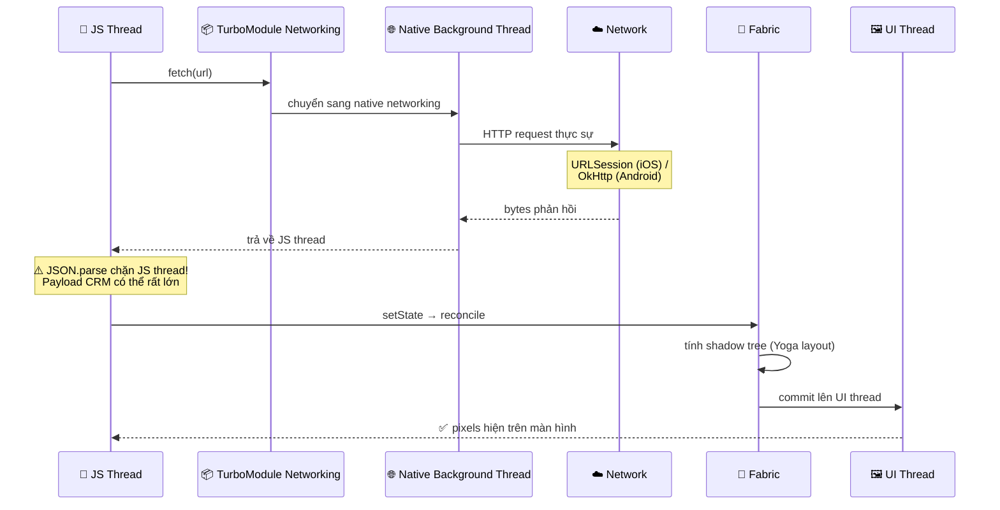
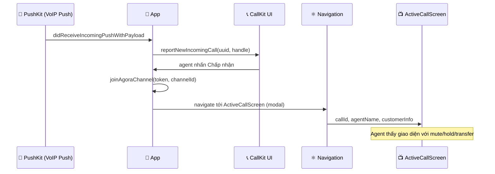
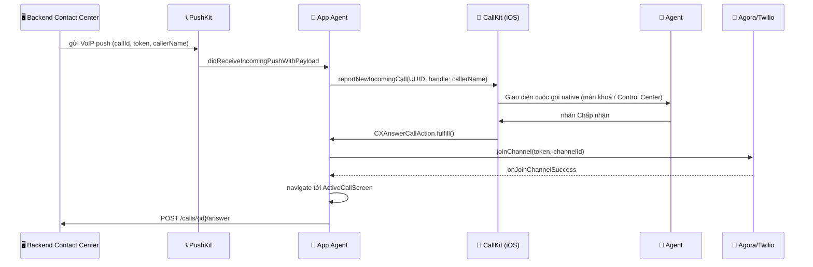

# 📚 Ôn phỏng vấn React Native — Zenify Contact Center (33 câu)

> **🎯 Mục đích:** Ôn lý thuyết React Native cho phỏng vấn senior tại **Zenify** (https://zenify.vn — nền tảng Contact Center SaaS: ứng dụng mobile cho agent/supervisor xử lý cuộc gọi VoIP, chat thời gian thực, tích hợp CRM).
>
> **⚠️ Đặc thù domain:** Xoay quanh **VoIP** (CallKit, Agora, Twilio), **WebSocket** thời gian thực, **PushKit** cho VoIP push, bộ nhớ đệm CRM ngoại tuyến, và quản lý audio session. Không có BLE/firmware — tập trung hoàn toàn vào truyền thông thời gian thực.
>
> **📋 Cách dùng:** Đọc câu hỏi → tự trả lời 60 giây → mở phần giải thích so sánh → đánh dấu điểm còn yếu.

---

## 🗺 Bản đồ 33 câu hỏi

```
┌──────────────────────────────────────────────────────────────────────┐
│  📦 Nhóm A — Bridge & Kiến trúc               Q1–Q5  (P0)           │
│  ⚡ Nhóm B — Hiệu năng & Rendering            Q6–Q10 (P0)           │
│  🧭 Nhóm C — Navigation, State, Storage      Q11–Q15 (P1)           │
│  🧪 Nhóm D — Testing & TypeScript            Q16–Q18 (P1)           │
│  📡 Nhóm E — VoIP & Truyền thông thời gian thực  Q19–Q25 (P0*)     │
│  🔔 Nhóm F — Native iOS/Android cho VoIP     Q26–Q30 (P0*)          │
│  🧮 Nhóm G — Thuật toán & Coding Test        Q31–Q33 (P1)           │
└──────────────────────────────────────────────────────────────────────┘

* P0 riêng cho Zenify: VoIP + real-time là sản phẩm cốt lõi — gần như chắc chắn hỏi sâu.
```

---

# 📦 Nhóm A — Bridge & Kiến trúc (P0 — gần như chắc chắn hỏi)

## Q1. So sánh Old Bridge với New Architecture (JSI / Fabric / TurboModules)

### 📊 Sơ đồ

```
┌────────────── 📜 OLD BRIDGE ──────────────┐    ┌────────────── ⚡ NEW ARCH (JSI) ──────────────┐
│                                           │    │                                                │
│   🧵 JS              🧵 Native            │    │   🧵 JS  ───── ⚡ JSI (đồng bộ) ──► 🧵 Native  │
│      │                  ▲                 │    │                                                │
│      │ 📤 Serialize JSON│                 │    │   ┌─ 📦 TurboModules (lazy, type-safe)        │
│      ▼                  │                 │    │   ├─ 🎨 Fabric renderer (layout đồng bộ)      │
│   [ hàng đợi bất đồng bộ ]               │    │   └─ 🤝 C++ host objects (không copy dữ liệu)│
│      │                  │                 │    │                                                │
│      │ 📥 Deserialize JSON                │    │                                                │
│      └────────► ────────┘                 │    │                                                │
│                                           │    │                                                │
│   ❌ Chậm • bất đồng bộ • tốn chi phí    │    │   ✅ Nhanh • đồng bộ • không serialize        │
└───────────────────────────────────────────┘    └────────────────────────────────────────────────┘
```

### 💡 Giải thích

**Old Bridge** hoạt động như thế nào: JS và Native không thể gọi nhau trực tiếp. Mọi lệnh gọi phải đi qua một **hàng đợi bất đồng bộ** ở giữa — JS serialize dữ liệu ra chuỗi JSON, gửi qua bridge, Native nhận và deserialize lại thành object gốc. Chiều ngược lại cũng tương tự. Đây là nguồn gốc của mọi vấn đề về **độ trễ** và **tắc nghẽn** trong các sự kiện tần số cao như tín hiệu cuộc gọi đến hay tin nhắn chat.

**New Architecture** giải quyết bằng 3 thành phần:

- **JSI (JavaScript Interface)** — lớp C++ nằm giữa JS và Native. JS không gửi JSON nữa mà giữ trực tiếp một con trỏ đến object C++. Gọi hàm là đồng bộ, không có chi phí serialize.
- **TurboModules** — Native Module thế hệ mới, gọi qua JSI, chỉ khởi tạo khi JS cần (lazy), và type-safe nhờ Codegen.
- **Fabric** — bộ render mới; tính toán layout đồng bộ, hỗ trợ concurrent rendering.

> ⚠️ **Bẫy hay gặp:** Đừng nói "JSI thay thế hoàn toàn Bridge" — JSI thay thế *cơ chế giao tiếp*, không phải toàn bộ kiến trúc. Bridge vẫn tồn tại ở chế độ tương thích ngược.

---

## Q2. Hermes engine là gì? Tại sao quan trọng với Contact Center app?

### 📊 Sơ đồ

```
   🏗 LÚC BUILD                      🚀 LÚC CHẠY
   ┌──────────────────┐             ┌──────────────────┐
   │  📝 Mã JS nguồn  │             │  📦 Bytecode .hbc│
   │        │         │  ──ship──►  │        │         │
   │        ▼         │             │        ▼         │
   │  [Hermes]        │             │  ⚡ Bỏ qua parse │
   │  biên dịch trước │             │  ✅ Chạy ngay    │
   └──────────────────┘             └──────────────────┘
                                       │
                                       ▼
                          ⚡ Khởi động nhanh hơn
                          📉 RAM thấp hơn (quan trọng khi đang gọi)
                          📦 Bundle nhỏ hơn
                          🔍 Tương thích Chrome DevTools
```

### 💡 Giải thích

Hermes là JS engine được Meta phát triển riêng cho React Native trên mobile. Điểm khác biệt cốt lõi: thay vì parse mã JS lúc runtime (như V8), Hermes **biên dịch trước thành bytecode** ngay lúc build. Khi app chạy, nó bỏ qua bước parse — khởi động nhanh hơn đáng kể.

Với Contact Center app, điều này quan trọng vì:
- Agent cần mở app và **nhận cuộc gọi ngay lập tức** — startup chậm 1–2 giây có thể khiến cuộc gọi bị bỏ lỡ.
- RAM thấp hơn giúp app duy trì phiên VoIP nền mà không bị iOS/Android giết tiến trình.

Kể từ React Native 0.70, Hermes là engine mặc định.

---

## Q3. Từng bước: chuyện gì xảy ra khi gọi `fetch()` từ JS đến khi data hiển thị?

### 📊 Sơ đồ tuần tự



### 💡 Giải thích

**Luồng đầy đủ trong New Architecture:**

1. JS gọi `fetch(url)` trên **JS thread**.
2. Yêu cầu được chuyển qua TurboModule Networking sang **native background thread** (URLSession trên iOS, OkHttp trên Android) — JS thread vẫn tự do trong lúc này.
3. Khi phản hồi về, dữ liệu trả về JS thread. `JSON.parse()` chạy **trên JS thread** trong Hermes — đây là điểm nguy hiểm.
4. `setState` → React lên lịch re-render → Fabric tính shadow tree với Yoga layout → commit lên UI thread → pixels xuất hiện.

**Điểm cần nhớ cho Zenify:** Payload CRM (lịch sử cuộc gọi, thông tin khách hàng) có thể rất lớn. `JSON.parse` lớn sẽ chặn JS thread — nếu đang có cuộc gọi đang diễn ra, giao diện sẽ bị giật. Giải pháp: phân trang, lazy loading, hoặc đẩy parsing sang native module.

---

## Q4. Mô hình luồng (Threading model) trong RN — đặc biệt khi có cuộc gọi VoIP đang hoạt động

### 📊 Sơ đồ luồng

```
┌────────────────┐  ┌────────────────┐  ┌────────────────┐  ┌──────────────────┐
│  🧵 JS Thread  │  │  🖼 UI Thread  │  │  🌐 BG Thread  │  │  🎵 Audio Thread │
├────────────────┤  ├────────────────┤  ├────────────────┤  ├──────────────────┤
│ • React        │  │ • Render view  │  │ • HTTP/fetch   │  │ • Agora/Twilio   │
│ • Logic JS     │  │ • Xử lý cử chỉ│  │ • WebSocket    │  │   audio engine   │
│ • JSON.parse   │  │ • Mount view   │  │ • Đồng bộ CRM  │  │ • Triệt tiếng ồn │
│ • State logic  │  │ • Animation    │  │ • Sự kiện call │  │ • Khử echo       │
│ ⚠️ chỉ 1 luồng │  │   (native drv) │  │                │  │ ⚠️ THỜI GIAN THỰC│
└────────────────┘  └────────────────┘  └────────────────┘  └──────────────────┘
            🚫 KHÔNG BAO GIỜ chặn JS thread hay Audio thread
```

### 💡 Giải thích

React Native có 3 luồng chính, cộng thêm **audio thread** quan trọng với VoIP:

- **JS Thread** — chạy toàn bộ JavaScript: React reconciliation, logic nghiệp vụ, JSON.parse. Chỉ có **một luồng duy nhất** — nếu bị chặn, toàn bộ UI đứng.
- **UI Thread (Main Thread)** — render view native, xử lý cử chỉ chạm, mount/unmount view.
- **Background Threads** — HTTP, WebSocket, đồng bộ CRM, các sự kiện cuộc gọi.
- **Audio Thread** (Agora/Twilio) — xử lý âm thanh thời gian thực. Chạy hoàn toàn native, **phải được ưu tiên tuyệt đối**. Bất kỳ sự chậm trễ nào trên luồng này sẽ gây ra tiếng rè, đứt quãng cuộc gọi.

**Quy tắc vàng cho Zenify:** Khi agent đang trong cuộc gọi, tránh parse payload CRM lớn hay thực hiện tính toán nặng trên JS thread — sẽ gây giật lag giao diện và ảnh hưởng trải nghiệm gọi điện.

---

## Q5. Tại sao các thao tác VoIP phải chạy native, không chạy trên JS?

### 📊 Ranh giới tin cậy & hiệu năng

```
┌─────────────────────────────────────────────────────┐
│           📱 JS Bundle (không tin cậy)              │
│   ┌─────────────────────────────────────────────┐   │
│   │  agentId, roomToken         ✅ OK            │   │
│   │  sự kiện trạng thái cuộc gọi ✅ OK          │   │
│   │  API credentials / token    ❌ KHÔNG BAO GIỜ│   │
│   └─────────────────┬───────────────────────────┘   │
└─────────────────────┼───────────────────────────────┘
                      │ JSI bridge
                      ▼
┌─────────────────────────────────────────────────────┐
│        ⚙️ Native VoIP Module (tin cậy)              │
│   Agora RTC SDK / Twilio Voice SDK                  │
│   Credentials lưu trong Keychain/Keystore           │
│   AVAudioSession / AudioManager                     │
└─────────────────────┬───────────────────────────────┘
                      │
                      ▼
┌─────────────────────────────────────────────────────┐
│   🎵 Audio Engine thời gian thực                    │
│   (khử echo, triệt ồn, mã hoá codec)               │
└─────────────────────────────────────────────────────┘
```

### 💡 Giải thích

Có hai lý do bắt buộc:

**1. Độ trễ (Latency):** Thu âm, khử echo, và mã hoá codec phải diễn ra với chu kỳ dưới 20ms. JS là đơn luồng và có garbage collector — bất kỳ lần GC nào cũng có thể tạo ra khoảng dừng 50–100ms, đủ để gây tiếng rè hoặc đứt cuộc gọi. SDK Agora/Twilio chạy trên luồng audio riêng trong native, hoàn toàn không bị GC của JS ảnh hưởng.

**2. Bảo mật (Security):** API credentials (Agora App ID, Twilio Access Token) nếu đặt trong JS thì nằm trong bộ nhớ Hermes heap, có thể bị đọc qua debugger hoặc memory dump. Native module lưu chúng trong Keychain (iOS) / Keystore (Android) — được bảo vệ bởi phần cứng, không bao giờ lộ ra JS.

**Nguyên tắc:** JS chỉ nhận sự kiện trạng thái (`callConnected`, `callEnded`, `audioLevelUpdate`) — không bao giờ quản lý luồng RTP thô hay lưu trữ credentials trực tiếp.

---

# ⚡ Nhóm B — Hiệu năng & Rendering (P0)

## Q6. `useMemo`, `useCallback`, `React.memo` — khi nào dùng trong Contact Center app?

### 📊 Cây quyết định

```
   ❓ Có nên memoize không?
        │
   ┌────┴──────────────────────────────────┐
   │                                       │
   ▼                                       ▼
🤔 Tính toán rẻ?                   🤔 Tính toán đắt?
   │                                       │
   ▼                                       ▼
   ❌ KHÔNG (bỏ qua)                       ✅ useMemo

   🤔 Truyền hàm xuống child đã memo?     → ✅ useCallback
   🤔 renderItem trong FlatList call log? → ✅ React.memo cho item
   🤔 Mảng dependency không ổn định?      → ❌ memoize vô ích

   📌 Điểm nóng trong Contact Center:
   - Lọc/sắp xếp danh sách agent (100+ người)  → useMemo
   - Tìm kiếm lịch sử cuộc gọi                 → useMemo
   - handleMute, handleHold, handleTransfer      → useCallback → truyền xuống button
```

### 💡 Giải thích

**Quy tắc cơ bản:** Đừng memoize theo phản xạ — bản thân memoize có chi phí (tạo closure, so sánh dependency). Chỉ dùng khi đã đo được vấn đề.

**Dùng `useMemo` khi:**
- Lọc hoặc sắp xếp danh sách agent lớn, danh sách cuộc gọi.
- Tính toán trạng thái phái sinh từ thời lượng cuộc gọi và trạng thái.

**Dùng `useCallback` khi:**
- Truyền `onMute`, `onHold`, `onTransfer` xuống các button đã được bọc bởi `React.memo` — tránh button re-render mỗi lần component cha cập nhật.

**Không nên dùng khi:**
- Dependency thay đổi mỗi lần render — memoize không có tác dụng, chỉ tốn thêm bộ nhớ.
- Giá trị là kiểu nguyên thuỷ (number, string), tính rất nhanh.

> ⚠️ **Thực tế:** Memoize quá nhiều với dependency không ổn định tạo ra nhiều rác hơn là tiết kiệm — đã gặp trường hợp này với dashboard supervisor.

---

## Q7. FlatList vs ScrollView vs SectionList — dùng cái nào cho call log và danh sách agent?

### 📊 Bảng so sánh

| | 📜 ScrollView | 📋 FlatList | 📑 SectionList |
|---|---|---|---|
| **Cách render** | Tất cả cùng lúc | Ảo hoá (virtualize) | Ảo hoá + nhóm |
| **Tốt nhất cho** | < 20 phần tử | Danh sách phẳng dài | Nhóm theo tiêu đề |
| **Bộ nhớ** | Cao | Thấp | Thấp |
| **Trong Contact Center** | ❌ call log | ✅ danh sách agent | ✅ lịch sử theo ngày |

### 📊 Cơ chế ảo hoá của FlatList

```
               Tổng: 10.000 cuộc gọi
               ━━━━━━━━━━━━━━━━━━━━━

      ╔═══════════════════════════════╗
✂ unmount phía trên
      ║                               ║
      ║  🟦 buffer (windowSize)       ║
      ║                               ║
      ╠═══════════════════════════════╣
      ║  🟩 Cuộc gọi 12  [rendered]  ║
      ║  🟩 Cuộc gọi 13  [rendered] 👀║  ← vùng nhìn thấy
      ║  🟩 Cuộc gọi 14  [rendered] 👀║
      ║  🟩 Cuộc gọi 15  [rendered]  ║
      ╠═══════════════════════════════╣
      ║                               ║
      ║  🟦 buffer                    ║
      ║                               ║
      ╚═══════════════════════════════╝
✂ unmount phía dưới
```

### 💡 Giải thích

**ScrollView** render toàn bộ con ngay lập tức — ổn cho danh sách ngắn cố định (dưới 20 phần tử). **FlatList** ảo hoá — chỉ render những item đang hiển thị cộng thêm vùng đệm theo `windowSize`. **SectionList** là FlatList có thêm nhóm và tiêu đề dính.

**Trong Contact Center:**
- **Danh sách agent** → FlatList. Supervisor có thể theo dõi 200+ agent cùng lúc.
- **Lịch sử cuộc gọi** → SectionList, nhóm theo ngày: "Hôm nay", "Hôm qua", "Thứ 2, 5/5".
- **Các nút thao tác trong modal cuộc gọi** → ScrollView (dưới 10 phần tử).

**Tối ưu FlatList quan trọng:**
- `keyExtractor` trả về call ID ổn định.
- `getItemLayout` nếu chiều cao hàng cố định → bỏ qua bước đo.
- Bọc component item bằng `React.memo` với hàm so sánh tùy chỉnh.
- Cân nhắc **@shopify/flash-list** nếu danh sách vượt 500 hàng — tái sử dụng cell như UICollectionView, hiệu năng tốt hơn nhiều.

---

## Q8. Memory leak trong RN — đặc thù với WebSocket và event listener cuộc gọi

### 📊 Nguồn leak phổ biến trong Contact Center

```
┌─────────────────────────────────────────────────────────┐
│  🚨 NGUỒN LEAK               🛠 CÁCH SỬA               │
├─────────────────────────────────────────────────────────┤
│ 🔌 WebSocket listener       → ws.close() trong cleanup  │
│ ☎️ Event emitter cuộc gọi   → subscription.remove()    │
│ ⏰ setInterval đồng hồ gọi  → clearInterval trong cleanup│
│ 📡 Agora engine listener    → agoraEngine.release()     │
│ 🖼 Avatar agent bitmap      → FastImage + resize        │
│ 🪤 Closure giữ callId       → dùng ref thay vì state   │
└─────────────────────────────────────────────────────────┘
```

### 💡 Giải thích

**Các nguồn leak đặc thù cho app thời gian thực:**

1. **WebSocket listener** — nếu gắn `ws.onmessage` trong component rồi unmount mà không gọi `ws.close()`, kết nối vẫn sống và handler bị rò rỉ.

2. **Call event emitter** — `DeviceEventEmitter.addListener('callStatusChanged', handler)` không gọi `.remove()` khi unmount. Listener tích lũy qua mỗi lần mount.

3. **Đồng hồ thời lượng cuộc gọi** — `setInterval` cho bộ đếm HH:MM:SS không được xoá khi cuộc gọi kết thúc hoặc component unmount. Nhớ: `return () => clearInterval(timerId)` trong `useEffect`.

4. **Agora engine** — không gọi `agoraEngine.release()` sau phiên làm việc; engine native vẫn giữ tài nguyên audio phần cứng.

**Quy tắc:** Mọi `useEffect` có subscription đều phải có cleanup function. Dùng Xcode Instruments (Allocations) cho iOS và Android Studio Memory Profiler để xác nhận sau khi fix.

---

## Q9. Reanimated 2/3 vs Animated API — áp dụng cho giao diện điều khiển cuộc gọi

### 📊 So sánh luồng xử lý

```
┌─────────────── Animated API ───────────────┐    ┌─────── Reanimated 2/3 ───────┐
│                                            │    │                              │
│  📝 Định nghĩa animation trên JS thread    │    │  📝 Worklet biên dịch sang UI│
│             │                              │    │             │                │
│             ▼                              │    │             ▼                │
│  bridge ↔ UI thread (qua bridge)           │    │  Chạy trực tiếp UI thread   │
│                                            │    │                              │
│  ❌ JS bận (đang parse CRM)                │    │  ✅ Mượt dù JS bận           │
│     → button animation bị giật            │    │  🔧 useSharedValue đa luồng  │
└────────────────────────────────────────────┘    └──────────────────────────────┘
```

### 💡 Giải thích

**Animated API** mặc định chạy trên JS thread. Với `useNativeDriver: true` có thể offload transform/opacity sang UI thread — nhưng chỉ áp dụng cho một số thuộc tính giới hạn.

**Reanimated 2/3** dùng **worklet** — các hàm JS nhỏ được biên dịch để chạy trực tiếp trên UI thread. Kết quả: animation mượt 60fps ngay cả khi JS thread đang bận xử lý payload CRM lớn.

**Ứng dụng quan trọng trong Contact Center:**
- Sheet cuộc gọi đến trượt lên (incoming call slide-up) phải cảm giác tức thì — dùng Reanimated với `withSpring`.
- Nút bấm nhấp nháy khi đang tắt tiếng (mute pulse animation) — UI thread, không phụ thuộc JS.
- Nếu dùng Animated API cho những animation này, khi agent vừa nhận cuộc gọi vừa đang tải dữ liệu CRM sẽ bị giật rõ ràng.

---

## Q10. Cách debug khi app bị lag trong khi có cuộc gọi đang hoạt động

### 📊 Quy trình debug

```
        🐢 App bị lag khi đang gọi
              │
              ▼
   ┌─────────────────────────┐
   │ Thiết bị thật, không    │  ❌ Simulator không có audio engine
   │ dùng simulator          │
   └──────────┬──────────────┘
              ▼
   ┌─────────────────────────┐
   │ Mở Perf Monitor         │  Xem JS FPS và UI FPS
   └────┬────────────────────┘
        │
   ┌────┴────────────┐
   │                 │
   ▼                 ▼
🧵 JS FPS giảm   🖼 UI FPS giảm
   │                 │
   ▼                 ▼
Tìm trong JS:    Kiểm tra Agora SDK:
- Parse CRM      - Cảnh báo jitter
- WebSocket msg  - Packet loss
- State update   - Audio config
  thừa
```

### 💡 Giải thích

**Quy trình gồm 4 bước:**

1. **Tái hiện trên thiết bị thật** — simulator không chạy audio stack của Agora/Twilio, không phản ánh thực tế.

2. **Mở Perf Monitor** (từ dev menu) — nếu JS FPS giảm mà UI FPS ổn, vấn đề nằm ở JS (thường là parse CRM hay WebSocket message khi đang gọi). Nếu UI FPS giảm, vấn đề ở native rendering.

3. **Dùng React Profiler** — tìm component nào re-render không cần thiết trong khi gọi. Thường thủ phạm là bộ đồng hồ: `setInterval` mỗi giây kích hoạt re-render cascade.

4. **Xem Agora SDK logs riêng** — các cảnh báo âm thanh (jitter, packet loss) là vấn đề khác hoàn toàn với RN performance.

**Bài học thực tế:** Đồng hồ đếm thời gian gọi — lưu giá trị trong `useRef`, chỉ gọi `setState` để cập nhật chuỗi hiển thị → giảm đáng kể số lần re-render không cần thiết.

---

# 🧭 Nhóm C — Navigation, State, Storage (P1)

## Q11. React Navigation — cấu trúc cho Contact Center app (màn gọi + tab nav)

### 📊 Cấu trúc navigator

```
Root Stack
   │
   ├─ Auth Stack ─────── Đăng nhập / Quên mật khẩu
   │
   └─ App (Tab Navigator)
          │
          ├─ 📞 Tab Cuộc gọi (Native Stack)
          │       ├─ Danh sách cuộc gọi
          │       └─ Chi tiết cuộc gọi
          │
          ├─ 💬 Tab Chat (Native Stack)
          │       ├─ Danh sách hội thoại
          │       └─ Màn chat
          │
          ├─ 👥 Tab Liên hệ
          │       └─ Thông tin khách hàng CRM
          │
          └─ ⚙️ Tab Cài đặt
                  └─ Hồ sơ agent

   ⚠️ Đặc biệt: ActiveCallScreen → Full-screen modal (ngoài Tab Navigator)
                Màn cuộc gọi đến → Modal hiện lên trên tất cả
```

### 💡 Giải thích

**Cấu trúc Tab Navigator** ở gốc (Cuộc gọi, Chat, Liên hệ, Cài đặt) với Native Stack bên trong mỗi tab — đây là cách tổ chức chuẩn.

**Phần phức tạp nhất:** Màn hình cuộc gọi đang hoạt động (`ActiveCallScreen`) cần phủ lên toàn bộ mọi thứ, kể cả tab bar. Giải pháp: đặt `ActiveCallScreen` là **modal full-screen ở root stack**, bên ngoài Tab Navigator — không phải bên trong một tab cụ thể nào.

**Thách thức điều hướng với cuộc gọi đến:** Agent đang ở bất kỳ màn nào, nhận thông báo cuộc gọi đến và nhấn → app phải navigate đến modal cuộc gọi không phụ thuộc vào vị trí hiện tại. Giải pháp: dùng `navigation ref` và gọi `navigationRef.current?.navigate(...)` từ ngoài component (trong handler của PushKit/FCM).

---

## Q12. Cuộc gọi đến (incoming call) → luồng deep link và điều hướng end-to-end

### 📊 Sơ đồ tuần tự



### 💡 Giải thích

**Luồng gồm 3 lớp:**

1. **PushKit delivery** — Payload VoIP đến qua PushKit (không phải APNs thông thường) vì PushKit đảm bảo wake app ngay cả khi đang bị treo. Payload chứa `callId`, `callerId`, `channelToken`.

2. **Báo cáo lên CallKit** — Gọi `CXProvider.reportNewIncomingCall()` ngay lập tức (trong vòng vài giây hoặc iOS sẽ terminate app). CallKit hiển thị giao diện cuộc gọi native trên màn khoá, Control Center.

3. **Điều hướng trong RN** — Từ callback của CallKit (đang nằm ngoài React component), gọi `navigationRef.current?.navigate('ActiveCallScreen', { callId })`. Navigation ref phải được khởi tạo trước khi app mount xong.

> ⚠️ **Điểm quan trọng:** Navigation ref phải hoạt động cả khi app đang ở background hoặc vừa được wake lên từ trạng thái bị dừng. Thứ tự khởi tạo: navigation ref → sau đó mới drain hàng đợi pending call.

---

## Q13. Quản lý state cho cuộc gọi thời gian thực + trạng thái agent — Zustand hay Redux?

### 📊 Phân chia store

```
┌───────────────────────────────────────────────────────────┐
│ 📞 Call State (thời gian thực, nhiều cập nhật/giây)       │
│   Zustand store: callStore                                │
│   ├─ currentCall: CallSession | null                      │
│   ├─ callStatus: 'idle'|'ringing'|'connected'|'ended'    │
│   ├─ isMuted: boolean                                     │
│   ├─ isOnHold: boolean                                    │
│   └─ callDuration: number                                 │
│                                                           │
│ 👥 Agent Status (supervisor xem, cập nhật qua WebSocket) │
│   Zustand store: agentStore                               │
│   ├─ agents: Map<agentId, AgentStatus>                    │
│   └─ onlineCount: number                                  │
│                                                           │
│ 📋 CRM (server state, ít thay đổi hơn)                   │
│   @tanstack/react-query                                   │
│   └─ thông tin khách hàng, lịch sử gọi, tag              │
└───────────────────────────────────────────────────────────┘
```

### 💡 Giải thích

**Mỗi công cụ có chỗ đứng riêng:**

- **Zustand** cho `callStore` và `agentStore` — API tối giản, subscription theo selector. Khi trạng thái cuộc gọi thay đổi 10 lần/phút, chỉ những component subscribe vào slice đó mới re-render, không phải toàn bộ cây.

- **@tanstack/react-query** cho dữ liệu CRM — xử lý cache, background refetch, optimistic update khi agent gắn tag cuộc gọi. Server state và client state tách bạch rõ ràng.

- **Tránh Redux** trong trường hợp này — boilerplate không xứng đáng trừ khi team cần time-travel debugging cho audit trail cuộc gọi.

**Điểm mấu chốt:** Tin nhắn WebSocket cập nhật `agentStore` trực tiếp. Với middleware `subscribeWithSelector` của Zustand, dashboard supervisor chỉ re-render đúng hàng agent vừa đổi trạng thái — không phải toàn bộ danh sách 200 agent.

---

## Q14. Phân cấp lưu trữ cho Contact Center app — call log, cache CRM, credentials

### 📊 Các tầng lưu trữ

```
              🔒 Keychain / Keystore
             ┌──────────────────────┐
             │  Agora App ID,       │   ← được bảo vệ phần cứng
             │  Twilio Access Token │
             │  Session JWT agent   │
             └──────────────────────┘
           🔐 MMKV (mã hoá)
          ┌─────────────────────────┐
          │  Tuỳ chọn giao diện     │   ← nhanh, mã hoá
          │  Cài đặt nhạc chuông    │
          │  Tab đang xem cuối cùng │
          └─────────────────────────┘
       🗄 SQLite (op-sqlite / WatermelonDB)
      ┌───────────────────────────────┐
      │  Lịch sử cuộc gọi             │   ← xem được ngoại tuyến
      │  Cache thông tin khách hàng   │
      │  Hàng đợi tin nhắn chat       │
      └───────────────────────────────┘

      ❌ AsyncStorage — không dùng cho credentials
         (chậm, chặn JS thread, không mã hoá)
```

### 💡 Giải thích

**Phân loại theo mức độ nhạy cảm:**

- **Keychain/Keystore** — Agora App ID, Twilio token, session JWT của agent. Tuyệt đối không được dùng AsyncStorage hoặc MMKV không mã hoá. Được bảo vệ bởi Secure Enclave (iOS) / StrongBox (Android).

- **MMKV (mã hoá)** — tuỳ chọn giao diện agent, cài đặt nhạc chuông, số lượng chưa đọc. Nhanh hơn AsyncStorage khoảng 30 lần. Mã hoá tầng ứng dụng.

- **SQLite** — lịch sử cuộc gọi (xem được khi không có mạng), cache thông tin khách hàng CRM, hàng đợi tin nhắn chat gửi khi mất kết nối.

**Điểm mấu chốt cho Zenify:** Hàng đợi tin nhắn trong SQLite là yếu tố then chốt cho offline support — khi agent mất kết nối giữa chừng, tin nhắn được xếp hàng và gửi ngay khi WebSocket kết nối lại. AsyncStorage một mình không thể đáp ứng: chậm, không đồng bộ giao dịch, không đảm bảo thứ tự.

---

## Q15. Chiến lược CI/CD và phát hành cho Contact Center app

### 📊 Quy trình phát hành

```
   💻 Push lên feature branch
        │
        ▼
   🧪 GitHub Actions CI
        ├─ Lint + TypeScript check
        ├─ Jest unit tests
        └─ Detox / Maestro smoke test
        │
        ▼
   📦 EAS Build (staging)
        ├─ iOS: TestFlight → QA team
        └─ Android: Internal track → QA team
        │
        ✅ QA xác nhận
        │
        ▼
   🚀 EAS Build (production)
        ├─ Phát hành dần: 10% → 50% → 100%
        ├─ Theo dõi crash rate qua Sentry
        └─ EAS Update (OTA) cho hotfix chỉ JS

   ⚠️ Thay đổi liên quan PushKit + CallKit
      → KHÔNG được OTA → bắt buộc qua App Store review
```

### 💡 Giải thích

**Quy trình chuẩn với EAS Build + EAS Update:**

1. **CI** — GitHub Actions chạy lint, TypeScript, Jest trên mỗi PR.
2. **Staging** — EAS Build tạo bản nhị phân iOS + Android → TestFlight / Android Internal Track cho QA kiểm thử.
3. **Production** — phát hành dần (10% → 50% → 100%) với Sentry giám sát crash rate. Nếu rate tăng đột biến → rollback.
4. **OTA (EAS Update)** — cho hotfix chỉ ảnh hưởng JS: lỗi hiển thị giao diện, format trường CRM. Không cần review store, phát hành trong vài phút.

**Ràng buộc đặc thù Contact Center:** Thay đổi liên quan đến CallKit entitlement, cấu hình PushKit, hay cập nhật Agora/Twilio SDK native → **bắt buộc phải build mới và qua App Store review**. Cần tài liệu rõ ràng phân biệt "code có thể OTA" và "code phải qua store".

---

# 🧪 Nhóm D — Testing & TypeScript (P1)

## Q16. Chiến lược kiểm thử cho Contact Center app

### 📊 Kim tự tháp kiểm thử

```
                    🔺
                   ╱   ╲
                  ╱  E2E ╲          🎬 Maestro / Detox
                 ╱  (chậm) ╲           Luồng cuộc gọi đầy đủ
                ╱───────────╲
               ╱             ╲
              ╱   Component   ╲      ⚛️ RNTL
             ╱    (trung bình) ╲       Render card, fire events
            ╱───────────────────╲
           ╱                     ╲
          ╱        Unit           ╲   🧪 Jest
         ╱  (nhanh, số lượng lớn)  ╲    State machine, parse WS
        ╱────────────────────────── ╲
```

### 💡 Giải thích

**Kim tự tháp 3 tầng:**

- **Unit (Jest)** — máy trạng thái cuộc gọi (idle → ringing → connected → ended), parse tin nhắn WebSocket, logic bộ đếm thời gian. Nhanh, chạy trên mỗi commit.

- **Component (RNTL)** — render `CallCard`, nhấn nút tắt tiếng, kiểm tra icon thay đổi. Mock Agora SDK bằng jest.mock.

- **E2E (Maestro)** — luồng đầy đủ: đăng nhập → nhận cuộc gọi đến → trả lời → tắt tiếng → kết thúc. Chạy trên thiết bị thật trong CI mỗi đêm.

**Điểm then chốt với Contact Center:** Máy trạng thái cuộc gọi là thứ khó kiểm thử thủ công nhất nhưng lại dễ unit test nhất. Một tin nhắn WebSocket giả định phải xác định chuyển trạng thái một cách nhất quán — viết unit test cho điều này trước khi làm UI.

---

## Q17. Các pattern TypeScript — discriminated union cho trạng thái cuộc gọi

### 📊 3 pattern quan trọng nhất

```typescript
// 1️⃣ Discriminated union cho trạng thái cuộc gọi:
type CallState =
  | { status: 'idle' }
  | { status: 'ringing';    callId: string; callerId: string }
  | { status: 'connecting'; callId: string; channelToken: string }
  | { status: 'connected';  callId: string; startedAt: number; isMuted: boolean }
  | { status: 'on_hold';    callId: string }
  | { status: 'ended';      callId: string; duration: number; endReason: EndReason }
  | { status: 'error';      error: Error }

// 2️⃣ Typed navigation params — navigate() type-safe:
type RootStackParamList = {
  CallList:   undefined;
  ActiveCall: { callId: string; channelToken: string };
  CallDetail: { callId: string };
}

// 3️⃣ Branded types — tránh nhầm ID:
type CallId     = string & { __brand: 'CallId' }
type AgentId    = string & { __brand: 'AgentId' }
type CustomerId = string & { __brand: 'CustomerId' }
// ❌ TypeScript báo lỗi nếu truyền CustomerId vào chỗ cần AgentId
```

### 💡 Giải thích

**Discriminated union cho trạng thái cuộc gọi** — trình biên dịch bắt buộc xử lý mọi case trong `switch`. Khi backend thêm trạng thái mới (`transferring`), TypeScript báo lỗi ở mọi nơi chưa xử lý — không bao giờ bị bỏ sót lặng lẽ.

**Typed React Navigation params** — `navigate('ActiveCall', { callId, channelToken })` được kiểm tra kiểu hoàn toàn. Sai tên route hay thiếu tham số → lỗi build, không phải lỗi runtime.

**Branded types cho ID** — `CallId`, `AgentId`, `CustomerId` đều là string nhưng không thể dùng lẫn nhau ở tầng kiểu. Ngăn bug nghiêm trọng như truyền customer ID vào endpoint chỉ dành cho agent.

**Dùng `as const` thay vì `enum`** — TypeScript enum tạo object runtime và cản tree-shaking. `as const` union không có chi phí runtime.

---

## Q18. Discriminated union vs class hierarchy — khi nào dùng cái nào?

### 📊 Bảng chọn lựa

```
┌──────────────────────────────┬──────────────────────────────┐
│   📋 Discriminated Union     │   🏛️ Class Hierarchy          │
├──────────────────────────────┼──────────────────────────────┤
│ • Máy trạng thái cuộc gọi   │ • Các nhà cung cấp VoIP      │
│ • Sự kiện WebSocket          │ • AgoraProvider vs           │
│ • Response API               │   TwilioProvider             │
│ • Trạng thái View            │ • Interface dùng chung       │
│ • Không có behaviour         │ • Cần kế thừa, đa hình       │
└──────────────────────────────┴──────────────────────────────┘

Ví dụ trong Contact Center:
  - CallState → discriminated union ✅
  - VoIPProvider (Agora vs Twilio) → abstract class ✅
```

### 💡 Giải thích

**Discriminated union** — cho các cấu trúc dữ liệu không có hành vi: trạng thái cuộc gọi, sự kiện WebSocket, response API. Kết hợp hoàn hảo với `switch` exhaustiveness check của TypeScript.

**Class hierarchy** — khi cần phương thức dùng chung, đóng gói, đa hình. Ví dụ cụ thể: `VoIPProvider` là abstract class với `joinChannel()`, `leaveChannel()`, `muteAudio()` — sau đó `AgoraProvider` và `TwilioProvider` cài đặt riêng. Cho phép đổi SDK mà không cần sửa logic gọi điện.

**Với hầu hết React state** → union thắng vì gọn, type-safe, không cần instantiate.

---

# 📡 Nhóm E — VoIP & Truyền thông thời gian thực (P0* — Trọng tâm của Zenify)

## Q19. Expo vs Bare workflow — tại sao Contact Center app cần Bare?

### 📊 Bảng so sánh

```
┌──────────────────┬──────────────┬─────────────────────────────────────────┐
│  Workflow        │ ⚡ Tốc độ   │ 🎯 Với Contact Center                   │
├──────────────────┼──────────────┼─────────────────────────────────────────┤
│ Expo managed     │ ⚡⚡⚡         │ ❌ Không có CallKit, không có PushKit    │
│ Expo + Dev Client│ ⚡⚡          │ ✅ Nếu dùng Expo Modules (còn giới hạn) │
│ Bare workflow    │ ⚡           │ ✅ CallKit + Agora SDK + Twilio đầy đủ   │
└──────────────────┴──────────────┴─────────────────────────────────────────┘
```

### 💡 Giải thích

**Expo managed** — khởi đầu nhanh nhất, không cần Xcode/Android Studio cho hầu hết tính năng. Giới hạn: CallKit và PushKit yêu cầu entitlement native và mã native không thể thêm vào Expo managed.

**Bare workflow** — toàn quyền kiểm soát native. Thêm CallKit qua `react-native-callkeep`, Agora qua SDK native link trực tiếp.

**Khuyến nghị cho Contact Center:** Bare workflow (hoặc Expo với Dev Client + native module custom). CallKit là bắt buộc cho trải nghiệm VoIP chuyên nghiệp trên iOS — không có nó, cuộc gọi đến không hiển thị trên màn khoá, không tích hợp với AirPods hay Control Center.

---

## Q20. Tích hợp Agora / Twilio SDK — cách bọc vào Native Module RN

### 📊 Luồng wrapper SDK

```
   📝 NativeVoIPModule.ts
   (TypeScript spec — developer định nghĩa)
        │
        ▼
   🤖 Codegen (TurboModule spec)
        │
        ├──► 🍎 iOS (Swift)
        │       ├─ AgoraRtcEngineKit
        │       ├─ joinChannel(token, channelId, uid)
        │       ├─ leaveChannel()
        │       ├─ muteLocalAudioStream(muted: Bool)
        │       └─ Emit events: onUserJoined, onAudioVolumeIndication
        │
        └──► 🤖 Android (Kotlin)
                ├─ RtcEngine
                ├─ joinChannel(token, channelId, uid)
                ├─ leaveChannel()
                └─ IRtcEngineEventHandler callbacks
```

### 💡 Giải thích

**Luồng phát triển phía iOS (New Architecture):**

1. **Định nghĩa spec bằng TypeScript** — `joinChannel(token, channelId, uid)`, `leaveChannel()`, `muteLocalAudio(muted)`, và callback sự kiện: `onCallEnded`, `onAudioLevel`.
2. **Codegen** tự động tạo header Objective-C++ và interface type-safe.
3. **Cài đặt bằng Swift** — `AgoraRtcEngineKit.sharedEngine()`, cài đặt `AgoraRtcEngineDelegate`, emit sự kiện về RN qua `sendEvent(withName:body:)`.
4. **Android tương tự** — Kotlin với `RtcEngine.create()` và `IRtcEngineEventHandler`.

**Thách thức thực tế:** iOS SDK dùng callback `didJoinChannel`, Android dùng `onJoinChannelSuccess`. Tên khác nhau nhưng TypeScript spec chuẩn hoá thành một tên event duy nhất → JS không cần biết platform đang chạy.

---

## 📦 Agora trong dự án Recbook — Tóm tắt thực chiến

> **Context:** Recbook là ứng dụng ghi âm cuộc gọi. Agora được dùng để:
> (1) truyền audio real-time giữa các bên, và (2) ghi lại toàn bộ cuộc gọi trên cloud.
> Tài liệu chi tiết: [`agora-react-native-deep-dive.md`](./agora-react-native-deep-dive.md)

### 📊 Kiến trúc Recbook — Agora Stack

```
┌─────────────────────────────────────────────────────────────────┐
│                         Recbook Architecture                     │
└─────────────────────────────────────────────────────────────────┘

📱 Host App (React Native)           📱 Guest App (React Native)
  createAgoraRtcEngine()               createAgoraRtcEngine()
  channelProfile:                      channelProfile:
    LIVE_BROADCASTING                    LIVE_BROADCASTING
  clientRole: BROADCASTER              clientRole: BROADCASTER
  joinChannel(token, channelId, uid)   joinChannel(token, channelId, uid)
         │                                        │
         └──────────────┬─────────────────────────┘
                        │ audio stream (SD-RTN)
                        ▼
            ┌───────────────────────┐
            │  Agora Media Server   │
            │      (SD-RTN)         │
            └──────────┬────────────┘
                       │
                       ▼
         ┌─────────────────────────────┐
         │  Cloud Recording Bot        │
         │  (join như invisible user)  │
         │  ghi audio → upload S3/GCS  │
         └─────────────────────────────┘
                       │
                       ▼
         ┌─────────────────────────────┐
         │  S3 Bucket: recbook-audio/  │
         │  {appId}_{channel}_{ts}.aac │
         └─────────────────────────────┘
```

### 💡 Các điểm quan trọng phân biệt Recbook vs Contact Center

**1 — Channel profile: LIVE_BROADCASTING (không phải COMMUNICATION)**

```typescript
// Recbook: có thể có audience nghe không phát
engine.initialize({
  channelProfile: ChannelProfileType.ChannelProfileLiveBroadcasting,
  audioScenario: AudioScenarioType.AudioScenarioGameStreaming,
  // GameStreaming → ít xử lý tín hiệu hơn → âm thanh trung thực hơn
  // (Contact Center dùng VoiceChatroom → tối ưu clarity, lọc noise nhiều hơn)
})

// Host (người record): BROADCASTER
engine.setClientRole(ClientRoleType.ClientRoleBroadcaster)

// Listener (chỉ nghe lại): AUDIENCE
engine.setClientRole(ClientRoleType.ClientRoleAudience)
```

**2 — AudioProfile: chất lượng cao hơn để ghi âm trung thực**

```typescript
engine.setAudioProfile(
  AudioProfileType.AudioProfileMusicStandard, // 48kbps (vs 18kbps của VoIP)
  AudioScenarioType.AudioScenarioGameStreaming
  // Giữ nguyên âm thanh thô — không lọc noise quá mạnh
)
```

**3 — Token UID management: backend generate cố định**

```typescript
// UID phải cố định và duy nhất trong session
// Backend tạo:  hash(userId + sessionId) % 2147483647
// Lý do: Cloud Recording cần biết uid của từng người
//         để ghi đúng track trong chế độ individual recording
```

### 📊 Cloud Recording — Luồng REST API đầy đủ

```
📱 Host bắt đầu ghi âm → App gọi Backend

Backend → Agora Cloud Recording API (3 bước):

BƯỚC 1 — Acquire resource:
  POST /v1/apps/{appId}/cloud_recording/acquire
  body: { clientRequest: { resourceExpiredHour: 24 } }
  ← { resourceId: "abc123" }

BƯỚC 2 — Start recording:
  POST /v1/apps/{appId}/cloud_recording/resourceid/{rid}/mode/mix/start
  body: {
    cname: channelName,
    uid: "0",              ← Recording bot dùng uid riêng
    clientRequest: {
      token: recordingToken,
      storageConfig: {     ← Nơi lưu file
        vendor: 1,         ← 1=AWS S3
        bucket: "recbook-recordings",
        region: 14,        ← ap-southeast-1 (Singapore)
        accessKey: "...",
        secretKey: "..."
      },
      recordingConfig: {
        channelType: 1,    ← 1=LIVE (phải khớp với channel profile)
        streamTypes: 0,    ← 0=audio only
        audioProfile: 2,   ← HE-AAC v2 (chất lượng cao, file nhỏ)
        maxIdleTime: 60    ← Dừng nếu channel trống 60 giây
      }
    }
  }
  ← { sid: "session456" }

BƯỚC 3 — Stop (khi cuộc gọi kết thúc):
  POST .../stop
  ← { serverResponse: { uploadingStatus: "uploaded" } }
```

### 📊 Xử lý mạng đứt giữa chừng — Điểm dễ bị hỏi

```
Tình huống: Host mất mạng 40 giây giữa cuộc ghi âm

Cloud Recording:  vẫn chạy trên Agora server (không biết host mất mạng)
                  → Có khoảng im lặng trong file
                  → Sau 60s (maxIdleTime) nếu channel trống hẳn → dừng

Sau khi reconnect: Backend kiểm tra recording còn sống không:
  GET /v1/apps/{appId}/cloud_recording/resourceid/{rid}/sid/{sid}/mode/mix/query
  → { status: 5 } = đang chạy ✅ → tiếp tục bình thường
  → { status: 4 } = đã stop  ❌ → start recording mới, ghép file sau

Ghép file bị split (nếu recording bị cắt):
  ffmpeg -i concat:file1.aac|file2.aac -c copy merged.aac
  → Backend tự động ghép trước khi trả URL cho app
```

### 📊 Webhook — Biết khi nào file sẵn sàng phát lại

```
Agora gọi webhook của bạn khi upload xong:
POST /webhooks/agora
{
  "eventType": 32,          ← 32 = file upload hoàn tất
  "serviceType": 4,         ← 4 = cloud recording
  "details": {
    "fileList": [
      { "fileName": "xxx_yyy.aac", "isPlayable": true }
    ]
  }
}

Backend nhận → lưu URL vào DB → notify app qua WebSocket
App → phát lại bằng AVPlayer (iOS) / ExoPlayer (Android)
```

### ⚠️ Checklist Recbook-specific (trả lời phỏng vấn)

```
□ channelProfile = LIVE_BROADCASTING (không phải COMMUNICATION)
□ audioProfile = MusicStandard hoặc MusicHighQuality (không phải SpeechStandard)
□ audioScenario = GameStreaming (giữ âm thanh thô, không lọc quá mạnh)
□ UID cố định từ backend — không dùng uid=0 khi có Cloud Recording
□ maxIdleTime: 60 (buffer dài hơn cho mạng yếu)
□ Query recording status sau khi reconnect
□ Webhook endpoint để nhận file-ready event
□ ProGuard keep rules cho Agora SDK (Android release build)
□ engine.release() sau mỗi session — không giữ engine giữa các recording
□ Không hardcode App ID — lấy từ Keychain/Keystore
```

---

## Q21. Quản lý vòng đời WebSocket — chiến lược kết nối lại cho chat thời gian thực

### 📊 Máy trạng thái kết nối lại

```
              ┌─────────────────────────────┐
              │         ĐANG KẾT NỐI        │
              └────────────┬────────────────┘
                           │ onOpen
                           ▼
              ┌─────────────────────────────┐
              │         ĐÃ KẾT NỐI          │◄──── nhận tin nhắn
              └────────────┬────────────────┘
                           │ onClose / onError
                           ▼
              ┌─────────────────────────────┐
              │       MẤT KẾT NỐI           │
              └────────────┬────────────────┘
                           │ bắt đầu timer kết nối lại
                           ▼
              ┌─────────────────────────────┐
              │   ĐANG KẾT NỐI LẠI         │
              │   Exponential backoff:      │
              │   1s → 2s → 4s → 8s → 30s  │
              │   (tối đa 30s, thêm jitter) │
              └────────────┬────────────────┘
                           │ thành công
                           ▼
                    ĐÃ KẾT NỐI ✅

   📤 Hàng đợi tin nhắn gửi: lưu trong SQLite
      → drain khi kết nối lại (đảm bảo ít nhất 1 lần gửi)
```

### 💡 Giải thích

WebSocket cho Contact Center cần chiến lược **kết nối lại tự động** vì agent làm việc ca dài — mất kết nối phải tự hồi phục không cần can thiệp thủ công.

**Cách triển khai:**

1. Dùng máy trạng thái: `CONNECTING` → `CONNECTED` → `DISCONNECTED` → `RECONNECTING` → `CONNECTED`.
2. **Exponential backoff** với jitter: 1s → 2s → 4s → 8s → tối đa 30s. Jitter ngẫu nhiên ngăn hiện tượng "thundering herd" — hàng trăm agent không kết nối lại cùng một lúc sau khi server restart.
3. Khi kết nối lại: xác thực lại bằng JWT hiện tại, đồng bộ tin nhắn bị bỏ lỡ qua REST endpoint.

**Hàng đợi tin nhắn gửi:** Tin nhắn chat gửi trong lúc mất kết nối được lưu vào SQLite, không mất khi app restart. Khi WebSocket kết nối lại, drain hàng đợi theo thứ tự — đảm bảo **at-least-once delivery** (gửi ít nhất một lần).

---

## Q22. PushKit VoIP push vs APNs / FCM — tại sao Contact Center bắt buộc cần PushKit?

### 📊 So sánh chi tiết

```
┌─────────────────────────────────────────────────────────────────────┐
│                      📱 iOS Push landscape                           │
├──────────────────────────────┬──────────────────────────────────────┤
│  📬 APNs (push thông thường) │  📞 PushKit (VoIP push)             │
├──────────────────────────────┼──────────────────────────────────────┤
│ Gửi theo nỗ lực tốt nhất     │ Đảm bảo gửi (ưu tiên cao)          │
│ Có thể bị throttle           │ KHÔNG bị throttle                   │
│ App không cần wake ngay      │ App PHẢI gọi CallKit trong vài giây │
│ Banner / badge / âm thanh    │ Không hiện thị — kích hoạt CallKit  │
│ Giới hạn background fetch    │ Wake app từ trạng thái treo          │
│ ✅ Cho thông báo chat/CRM    │ ✅ CHỈ cho cuộc gọi VoIP đến        │
└──────────────────────────────┴──────────────────────────────────────┘

Android: FCM high-priority + Foreground Service (không có tương đương PushKit)
```

### 💡 Giải thích

**APNs thông thường** — push đa mục đích của Apple. Có thể bị throttle trong chế độ tiết kiệm pin, app không cần wake ngay lập tức. Phù hợp cho thông báo chat, cập nhật CRM.

**PushKit** — chuyên dùng cho VoIP. Lý do bắt buộc với Contact Center:
- **Đảm bảo gửi** — OS wake app ngay lập tức từ bất kỳ trạng thái nào (kể cả bị terminate).
- **Ràng buộc bắt buộc** — khi nhận PushKit payload, app phải gọi `reportNewIncomingCall()` cho CallKit trong vài giây, nếu không iOS sẽ terminate app.
- **Payload đầy đủ** — phải chứa `callId`, `channelToken`, `callerName` để hiển thị CallKit UI mà **không cần** round-trip mạng (vì lúc wake, mạng có thể chưa sẵn sàng).

**Android** — không có tương đương PushKit. Giải pháp: FCM high-priority data push + khởi động Foreground Service để Android không kill app khi chuông đang đổ.

---

## Q23. Luồng tích hợp CallKit — từ đầu đến cuối khi agent nhận cuộc gọi

### 📊 Sơ đồ đầy đủ



### 💡 Giải thích

**Luồng gồm 4 bước cốt lõi:**

1. **PushKit wake** — `PKPushRegistryDelegate.didReceiveIncomingPush()` nhận payload. Gọi ngay `CXProvider.reportNewIncomingCall()` — bước này là bắt buộc và phải thực hiện **trong cùng call stack** (không được async).

2. **Giao diện CallKit** — iOS hiển thị màn hình cuộc gọi native giống ứng dụng điện thoại. Tương thích với nút phần cứng (âm lượng, nút ngủ), AirPods, CarPlay.

3. **Agent chấp nhận** — `CXAnswerCallAction` được kích hoạt. Gọi `action.fulfill()` để xác nhận, sau đó join Agora channel bằng token từ push payload.

4. **Điều hướng RN** — dùng navigation ref để navigate đến `ActiveCallScreen` theo kiểu imperative (ngoài component React).

> ⚠️ **Thách thức khi app bị terminate:** PushKit wake app lên nhưng RN chưa mount xong. Giải pháp: dùng một `pendingCall` queue — lưu thông tin cuộc gọi ngay khi wake, drain queue sau khi navigation ref sẵn sàng.

---

## Q24. Quản lý audio session — xử lý loa ngoài, tai nghe, Bluetooth headset

### 📊 Định tuyến âm thanh

```
iOS — AVAudioSession:
   ┌─────────────────────────────────────────────────────┐
   │ Category: .playAndRecord                            │
   │ Mode: .voiceChat (tự động bật khử echo, triệt ồn)  │
   │ Options: .allowBluetooth, .allowBluetoothA2DP       │
   └─────────────────────────────────────────────────────┘
        │
        ├─ Bluetooth headset kết nối → route tự động chuyển
        ├─ Agent nhấn loa ngoài → override sang .speaker
        ├─ Cuộc gọi điện thoại đến → audio session bị gián đoạn
        └─ App vào nền → audio tiếp tục (background mode: voip)

Android — AudioManager:
   ┌─────────────────────────────────────────────────────┐
   │ MODE_IN_COMMUNICATION                               │
   │ isSpeakerphoneOn = true / false                     │
   │ startBluetoothSco() cho Bluetooth headset           │
   └─────────────────────────────────────────────────────┘
```

### 💡 Giải thích

Định tuyến âm thanh là một trong những phần phức tạp nhất của ứng dụng VoIP.

**iOS:** Cấu hình `AVAudioSession` với category `.playAndRecord` và mode `.voiceChat` — mode này tự động bật khử echo và triệt tiếng ồn mà không cần code thêm. Bật Bluetooth bằng option `.allowBluetooth`. Khi agent nhấn nút loa ngoài, gọi `setPreferredOutput` để chuyển route sang loa.

**Android:** `AudioManager.MODE_IN_COMMUNICATION` bật khử echo tích hợp. `setSpeakerphoneOn(true)` cho loa ngoài, `startBluetoothSco()` cho Bluetooth headset.

**Xử lý gián đoạn:** Khi có cuộc gọi điện thoại thường đến, `AVAudioSession` bị gián đoạn. Lắng nghe `AVAudioSession.interruptionNotification` và đặt cuộc gọi VoIP ở chế độ chờ qua CallKit khi bị gián đoạn, tiếp tục khi gián đoạn kết thúc.

> ⚠️ **Quan trọng:** Cấu hình audio session phải xảy ra **trước** khi join Agora/Twilio channel — không phải sau.

---

## Q25. Checklist tối ưu bản phát hành cho Contact Center app

### 📊 Danh sách kiểm tra

```
  ✅ Hermes BẬT (iOS + Android)
  ✅ Inline requires trong metro.config
  ✅ ProGuard / R8 với keep rules cho Agora/Twilio SDK
  ✅ CallKit entitlement (com.apple.developer.pushkit.services)
  ✅ Background modes: voip, audio, fetch (Info.plist)
  ✅ PushKit certificate PRODUCTION (không phải sandbox)
  ✅ Xoá console.log (babel-plugin-transform-remove-console)
  ✅ Sentry + Crashlytics upload dSYM trong CI
  ✅ Tắt RN dev menu trong bản release
  ✅ EAS credentials + code signing qua Fastlane
  ✅ App Store privacy manifest cho AVAudioSession VoIP
  ──────────────────────────────────────────────────────
  ⚡ Mục tiêu: agent khởi động nhanh, không mất cuộc gọi vì lỗi cấu hình
```

### 💡 Giải thích

**Các điểm dễ bỏ sót đặc thù Contact Center:**

- **CallKit entitlement** (`com.apple.developer.pushkit.services`) và background mode `voip` trong Info.plist — thiếu một trong hai thì PushKit im lặng không hoạt động, khó debug.
- **PushKit production certificate** — certificate sandbox chỉ hoạt động khi dev. Nhiều team ship sản phẩm với certificate sai mà không biết cho đến khi agent báo cáo không nhận được cuộc gọi trên thiết bị thật.
- **ProGuard keep rules** cho Agora/Twilio native class — thiếu keep rules, bản release Android crash khi gọi SDK class bị obfuscate.
- **App Store privacy manifest** — iOS 17+ yêu cầu khai báo sử dụng `AVAudioSession` cho VoIP.
- **Sentry dSYM** — để crash report từ native audio stack có stack trace đọc được, không phải địa chỉ bộ nhớ.

---

# 🔔 Nhóm F — Native iOS/Android cho VoIP (P0* — Trọng tâm Zenify)

## Q26. Vòng đời app iOS vs Android — đặc biệt khi có cuộc gọi trong nền

### 📊 Vòng đời + VoIP

```
iOS:
  Active → Cuộc gọi đến → CallKit hiển thị (mọi trạng thái, kể cả Suspended)
  Active → Background → Suspended (VoIP: KHÔNG bị suspend khi có cuộc gọi)
  Background mode "voip" → app giữ audio session sống vô thời hạn

Android:
  Foreground → Background → có thể bị kill (tuỳ RAM)
  Giải pháp: Foreground Service (ưu tiên cao, có thông báo)
              → OS không kill khi service đang chạy

RN AppState events:
  'active'     → agent đang xem app, cập nhật UI đầy đủ
  'background' → giảm tần suất polling WS, giữ cuộc gọi sống
  'inactive'   → iOS: bị gián đoạn (ví dụ: cuộc gọi điện thoại)
```

### 💡 Giải thích

**iOS** — với background mode `voip` và `audio`, hệ thống **không** đặt app vào trạng thái treo (suspend) khi có cuộc gọi đang diễn ra. Audio session và Agora SDK tiếp tục chạy. Khi có cuộc gọi mới trong lúc app đang treo, PushKit wake app ngay lập tức.

**Android** — không có cơ chế "voip" tương đương. Giải pháp bắt buộc: **Foreground Service** chạy suốt cuộc gọi, hiển thị thông báo cố định ("Bạn đang trong cuộc gọi…"). OS không kill foreground service dưới điều kiện bộ nhớ bình thường.

**Trong React Native:** Lắng nghe `AppState.addEventListener('change', handler)`:
- `'background'` → giảm tần suất polling WebSocket để tiết kiệm pin.
- `'active'` → khôi phục tần suất đầy đủ.

> ⚠️ Phải cleanup listener `AppState` trong return của `useEffect` — đây là nguồn leak thường gặp.

---

## Q27. CallKit (iOS) vs Android Telecom API — tích hợp VoIP cấp hệ thống

### 📊 So sánh

```
┌─────────────────────────────────────────────────────────────┐
│              iOS — CallKit (CXProvider)                      │
├─────────────────────────────────────────────────────────────┤
│ reportNewIncomingCall(UUID, CXCallUpdate)                   │
│ → Giao diện cuộc gọi native (màn khoá / Control Center)   │
│ CXAnswerCallAction → agent chấp nhận                        │
│ CXEndCallAction → kết thúc cuộc gọi                         │
│ CXSetHeldCallAction → chờ / tiếp tục                        │
│ CXSetMutedCallAction → tắt tiếng                            │
│ ✅ Nút phần cứng, CarPlay, AirPods                          │
└─────────────────────────────────────────────────────────────┘

┌─────────────────────────────────────────────────────────────┐
│        Android — ConnectionService (Telecom API)            │
├─────────────────────────────────────────────────────────────┤
│ TelecomManager.addNewIncomingCall()                         │
│ → Giao diện cuộc gọi native / thông báo hệ thống           │
│ Connection.onAnswer() → chấp nhận                           │
│ Connection.onDisconnect() → kết thúc                        │
│ ✅ Tích hợp bộ quay số hệ thống, Bluetooth headset         │
│ ⚠️ Cấu hình phức tạp hơn iOS                               │
└─────────────────────────────────────────────────────────────┘

Thư viện RN: react-native-callkeep (bọc cả hai)
```

### 💡 Giải thích

**iOS CallKit** — `CXProvider` báo cáo cuộc gọi cho OS. OS render màn hình cuộc gọi native (giống app Điện thoại). Thao tác của agent (chấp nhận, tắt tiếng, chờ) đến qua các `CXAction` intent. Thư viện `react-native-callkeep` bridge CallKit sang RN.

**Android Telecom API** — `ConnectionService` + `TelecomManager`. Phức tạp hơn để thiết lập nhưng cho kết quả tương đương: thông báo cuộc gọi cấp hệ thống, định tuyến Bluetooth, bỏ qua chế độ không làm phiền.

**Lý do không thể bỏ qua:** Nếu không dùng CallKit/Telecom và chỉ hiển thị local notification thông thường:
- Không xuất hiện trên màn khoá.
- Không tích hợp với AirPods/Bluetooth headset.
- Không có nút trả lời trên Control Center.
- Agent phải mở app mới có thể trả lời cuộc gọi — trải nghiệm thấp cấp hơn nhiều.

---

## Q28. ARC (iOS) và Kotlin GC — tại sao quan trọng khi giữ Agora engine reference

### 📊 So sánh quản lý bộ nhớ trong ngữ cảnh VoIP

```
iOS — ARC (Automatic Reference Counting):
   AgoraRtcEngineKit (singleton) → strong ref trong module
   Delegate (self) → ⚠️ PHẢI là weak
   
   Nguy cơ retain cycle:
   AgoraModule → strong → AgoraDelegate
   AgoraDelegate → strong → AgoraModule
   → CẢ HAI bị leak, tài nguyên audio không được giải phóng
   → Sửa: weak var delegate: AgoraRtcEngineDelegate?

Android — Kotlin JVM GC:
   RtcEngine (singleton) → hard ref trong companion object
   IRtcEngineEventHandler → anonymous object
   
   Nguy cơ Context leak:
   RtcEngine.create(activityContext, ...)
   → Activity không được GC sau onDestroy
   → Sửa: dùng applicationContext thay Activity context
```

### 💡 Giải thích

**iOS ARC** quản lý reference count tự động. Vòng lặp giữ (retain cycle) xảy ra khi hai object giữ strong reference đến nhau — cả hai không bao giờ được giải phóng dù không còn ai dùng.

Với Agora SDK: `AgoraModule` thường tự đăng ký là delegate của `AgoraRtcEngineKit`. Nếu cả hai là strong → retain cycle → tài nguyên audio bị giữ vô thời hạn kể cả sau khi cuộc gọi kết thúc. Sửa: `weak var delegate: AgoraRtcEngineDelegate?` — ARC tự set nil khi object bị dealloc.

**Kotlin JVM GC** xử lý cycle tự động, nhưng Context leak vẫn là bẫy thường gặp. Nếu `RtcEngine.create(activity, ...)` và RtcEngine lưu trong singleton → Activity không được GC sau `onDestroy`. Sửa: dùng `context.applicationContext`.

> ⚠️ **Sau mỗi cuộc gọi:** Gọi `AgoraRtcEngineKit.destroy()` (iOS) và `RtcEngine.destroy()` (Android) để giải phóng tài nguyên phần cứng audio — không chỉ đơn giản là drop reference.

---

## Q29. Xử lý cuộc gọi trong nền — iOS vs Android, điểm khác biệt then chốt

### 📊 So sánh vòng đời cuộc gọi trong nền

```
iOS — Vòng đời cuộc gọi nền:
   PushKit push → app được wake (suspended → background)
   reportNewIncomingCall() → CallKit hiện giao diện native
   Agent chấp nhận → app lên foreground
   Trong cuộc gọi → app ở foreground (agent thấy UI)
   Agent nhấn Home → nền
     → AVAudioSession + Agora vẫn chạy (background mode: voip, audio)
     → CallKit live activity vẫn hiển thị trên Dynamic Island

Android — Vòng đời cuộc gọi nền:
   FCM high-priority → broadcast receiver thức dậy
   Khởi động Foreground Service ("Đang trong cuộc gọi…")
   ConnectionService.onAnswer() → kết nối audio
   Trong cuộc gọi → Foreground Service giữ tiến trình sống
   Agent nhấn Home → app vào nền
     → Service vẫn chạy, audio tiếp tục
     → Kết nối vẫn active trong Telecom stack
```

### 💡 Giải thích

**iOS** — trong cuộc gọi đang diễn ra, app ở nền nhưng **không bị treo** nhờ background mode `voip` và `audio`. AVAudioSession giữ micro và loa hoạt động. Agent thấy CallKit live activity trên Dynamic Island (iPhone 14+); nhấn vào đó sẽ đưa app lên foreground.

**Android** — Foreground Service bắt buộc phải chạy suốt cuộc gọi. Nếu không có service này, OS có thể kill app sau khoảng 1 phút ở nền. Service hiển thị thông báo cố định với nút tắt tiếng/loa ngoài quick-action — agent có thể điều khiển cuộc gọi mà không cần mở app.

**Vấn đề thực tế:** Khi agent switch về app trong lúc cuộc gọi đang ở nền, đôi khi audio session cần được reactivate. Xử lý bằng cách lắng nghe `AppState.addEventListener('change')` → khi `'active'`, kiểm tra audio session còn active không và kích hoạt lại nếu cần.

---

## Q30. Máy trạng thái cuộc gọi thời gian thực — thiết kế cho agent app

### 📊 Sơ đồ máy trạng thái

```
                    ┌─────────┐
                    │  RẢNH   │ ◄──────────────────────┐
                    └────┬────┘                         │
       cuộc gọi đến      │      cuộc gọi đi             │ cuộc gọi kết thúc
                    ┌────▼────┐                          │
                    │CHUÔNG   │ ──── hết giờ/từ chối ──►│
                    └────┬────┘                          │
          agent chấp nhận│                              │
                    ┌────▼──────────┐                   │
                    │ ĐANG KẾT NỐI  │                   │
                    │ (join channel)│                   │
                    └────┬──────────┘                   │
           join thành công│                             │
                    ┌────▼──────────┐                   │
              ┌─────│  ĐÃ KẾT NỐI  │─────┐             │
              │     └────┬──────────┘     │             │
         tắt tiếng│      │chờ      chuyển máy           │
              ▼         ▼                │              │
         ┌─────────┐ ┌──────────┐        │              │
         │TẮT TIẾNG│ │  CHỜ     │        │              │
         └─────────┘ └──────────┘        │              │
                                         ▼              │
                                ┌─────────────┐         │
                                │ĐANG CHUYỂN  │         │
                                └──────┬──────┘         │
                                       └────────────────►┘
```

### 💡 Giải thích

**Máy trạng thái cuộc gọi** là nguồn sự thật duy nhất cho trạng thái cuộc gọi hiện tại của agent. Mô hình hoá bằng discriminated union TypeScript và lưu trong Zustand store.

**Các trạng thái:** `idle` → `ringing` → `connecting` → `connected` → (`muted` / `on_hold` / `transferring`) → `idle`.

**Chuyển trạng thái được kích hoạt bởi:**
- **PushKit/FCM**: `idle` → `ringing`
- **Agent chấp nhận**: `ringing` → `connecting` (Agora đang join channel)
- **Agora `onJoinChannelSuccess`**: `connecting` → `connected`
- **Agent nhấn tắt tiếng**: `connected` → `muted` (trạng thái con)
- **Agent nhấn kết thúc**: gọi `leaveChannel()` + gọi backend `POST /calls/{id}/end` → `idle`

**Nguyên tắc thiết kế quan trọng:** UI không được tự ý chuyển trạng thái — máy trạng thái điều khiển UI, không phải ngược lại. Nút "tắt tiếng" dispatch một action; máy trạng thái quyết định xem tắt tiếng có hợp lệ không ở trạng thái hiện tại. Điều này ngăn race condition khi sự kiện WebSocket đến đồng thời với thao tác của người dùng.

**Lợi ích:** Unit test mọi chuyển trạng thái bằng Jest mà không cần WebSocket thật. Thêm trạng thái mới (ví dụ `recording`) chỉ cần thêm một case vào discriminated union — TypeScript báo lỗi ở mọi nơi chưa xử lý.

---

# 🧮 Nhóm G — Thuật toán & Coding Test (P1)

## Q31. Phân tích Big-O — các pattern phổ biến trong coding test

### 📊 Bảng độ phức tạp

```
O(1)       — Tra cứu hash map, truy cập index mảng
O(log n)   — Tìm kiếm nhị phân, BST cân bằng
O(n)       — Duyệt một lần: two-pointer, sliding window, prefix sum
O(n log n) — Merge sort, heap sort, sắp xếp hiệu quả nhất
O(n²)      — Vòng lặp lồng nhau (brute force), bubble sort
O(2ⁿ)      — Liệt kê tập con đệ quy

Không gian:
O(1) thêm   — two-pointer, in-place
O(n) thêm   — hash map, stack, tập đã thăm
O(n²) thêm  — ma trận kề

Ví dụ Contact Center:
- Tìm agent có cuộc gọi dài nhất hôm nay → O(n) một lần duyệt
- Tìm tất cả agent online cùng lúc → interval overlap → O(n log n)
- Định tuyến cuộc gọi đến agent rảnh → priority queue → O(log n) mỗi thao tác
```

### 💡 Giải thích

**Tư duy khi tiếp cận bài toán:**

- **O(1)** — hash map là công cụ chủ chốt: cache `agentId → trạng thái` để tra cứu tức thì.
- **O(log n)** — tìm kiếm nhị phân: tìm time slot cho cuộc gọi đến trong lịch đã sắp xếp.
- **O(n)** — duyệt một lần: tìm agent có số cuộc gọi cao nhất bằng một vòng lặp.
- **O(n²)** — vòng lặp lồng nhau: luôn tự hỏi "hash map có loại bỏ được vòng lặp trong không?"

**Quy tắc khi phỏng vấn:** Nói phức tạp trước khi code — "brute force của tôi là O(n²) nhưng có thể tối ưu xuống O(n) bằng hash map" — rồi mới implement phiên bản tối ưu.

---

## Q32. Two-pointer và Sliding Window — khi nào dùng, code mẫu?

### 📊 Các pattern

```
Pattern 1: Hai đầu (mảng đã sắp xếp)
  [1, 2, 3, 4, 5, 6]   target = 7
   T               P
   1+6=7 ✅ → tìm thấy

Pattern 2: Cùng chiều (nhanh/chậm)
  Loại bỏ phần tử trùng trong mảng đã sắp xếp

Sliding window: cửa sổ cố định hoặc biến đổi
  "tổng lớn nhất của k phần tử liên tiếp"
  [2, 1, 5, 1, 3, 2]  k=3
   ├───┤              tổng=8
      ├───┤           tổng=7
         ├───┤        tổng=9 ← lớn nhất

Biến thể Contact Center:
  "Tìm khoảng thời gian dài nhất tất cả N agent đều online"
  → sliding window trên chuỗi sự kiện thời gian
```

### 💡 Giải thích

**Two-pointer** — dùng khi có mảng đã sắp xếp hoặc cần so sánh từ hai đầu / di chuyển con trỏ theo điều kiện.

**Sliding window** — dùng cho bài toán mảng con/chuỗi con: "max/min/đếm trong cửa sổ kích thước k", "chuỗi con dài nhất không có ký tự lặp".

**Ví dụ — Two Sum II (mảng đã sắp xếp):**
```typescript
function twoSum(numbers: number[], target: number): [number, number] {
  let trai = 0, phai = numbers.length - 1;
  while (trai < phai) {
    const tong = numbers[trai] + numbers[phai];
    if (tong === target) return [trai + 1, phai + 1];
    tong < target ? trai++ : phai--;
  }
  return [-1, -1];
}
// O(n) thời gian, O(1) không gian — so với O(n²) brute force
```

**Điểm mấu chốt:** Two-pointer cho O(n) ở những bài thoạt nhìn có vẻ O(n²). Nói điều này trước khi code.

---

## Q33. Hash Map và BFS/DFS — pattern cốt lõi cho bài toán đồ thị/cây

### 📊 BFS vs DFS

```
BFS (Queue — duyệt theo cấp):
  Dùng cho: đường đi ngắn nhất, duyệt từng cấp
  Contact Center: tìm đường leo thang ngắn nhất agent → supervisor → manager

DFS (Stack / Đệ quy — duyệt theo chiều sâu):
  Dùng cho: phát hiện chu trình, thành phần liên thông, sắp xếp topo
  Contact Center: duyệt đồ thị chuyển tiếp cuộc gọi (phát hiện vòng lặp chuyển máy)

Các pattern Hash Map:
  - Two Sum: giá trị → index
  - Gom cuộc gọi theo agent: agentId → [callIds]
  - Ghi nhớ (memoize): callId → kết quả đã tính
  - Sliding window: timestamp → số lượng
```

### 💡 Giải thích

**Hash map** là công cụ tối ưu số 1 — vòng lặp O(n) bên trong trở thành tra cứu O(1).

**Ví dụ kinh điển — Two Sum:**
```typescript
function twoSum(nums: number[], target: number): [number, number] {
  const daThay = new Map<number, number>(); // giá trị → index
  for (let i = 0; i < nums.length; i++) {
    const canTimThem = target - nums[i];
    if (daThay.has(canTimThem)) return [daThay.get(canTimThem)!, i];
    daThay.set(nums[i], i);
  }
  return [-1, -1];
}
// O(n) thời gian, O(n) không gian — so với O(n²) brute force
```

**BFS** — dùng khi cần **đường đi ngắn nhất** hoặc duyệt **từng cấp**. BFS kết hợp tập đã thăm là pattern chuẩn cho đồ thị không trọng số.

**DFS** — dùng cho **phát hiện chu trình**, **thành phần liên thông**, **sắp xếp topo**, **liệt kê mọi đường đi**.

> ⚠️ **Luôn nhớ:** Theo dõi tập `visited` khi duyệt đồ thị để tránh vòng lặp vô hạn. Trong phỏng vấn, hỏi rõ đồ thị có hướng hay vô hướng, có chu trình không — trước khi bắt đầu code.

---

## 🔑 Bảng thuật ngữ chuyên ngành — Zenify

| 📌 Thuật ngữ | 📝 Giải thích ngắn |
|---|---|
| **VoIP** (Voice over IP) | Gọi thoại qua Internet, không qua mạng điện thoại truyền thống |
| **CallKit** | Framework của Apple để tích hợp cuộc gọi VoIP vào hệ thống iOS |
| **PushKit** | Cơ chế push đặc biệt của Apple chỉ dành cho VoIP — đảm bảo delivery |
| **Agora RTC** | SDK của Agora cho gọi thoại/video thời gian thực |
| **Twilio Voice** | SDK của Twilio cho gọi thoại VoIP |
| **WebSocket** | Giao thức kết nối hai chiều liên tục, dùng cho chat và cập nhật trạng thái |
| **Exponential backoff** | Chiến lược kết nối lại: tăng thời gian chờ theo luỹ thừa (1s→2s→4s→…) |
| **CXProvider** | Class iOS để báo cáo cuộc gọi đến/đi cho CallKit |
| **CXAnswerCallAction** | Intent iOS gửi khi agent nhấn chấp nhận cuộc gọi |
| **Foreground Service** | Dịch vụ Android chạy nền với thông báo cố định — OS không kill |
| **AVAudioSession** | API iOS quản lý phiên làm việc audio (category, mode, routing) |
| **Khử echo** (Echo cancellation) | Kỹ thuật loại bỏ âm thanh phản hồi khi dùng loa ngoài |
| **Triệt tiếng ồn** (Noise suppression) | Kỹ thuật lọc tiếng ồn nền khi thông thoại |
| **At-least-once delivery** | Đảm bảo tin nhắn được gửi ít nhất một lần (có thể gửi trùng) |
| **Discriminated union** | Pattern TypeScript: union type với trường phân biệt kiểu (status, type...) |
| **CRM** | Customer Relationship Management — hệ thống quản lý thông tin khách hàng |
| **Contact Center** | Trung tâm liên lạc — nơi agent xử lý cuộc gọi, chat với khách hàng |
| **Agent** | Nhân viên trực tiếp xử lý cuộc gọi/chat với khách hàng |
| **Supervisor** | Người giám sát hoạt động của nhóm agent |
| **Retain cycle** | Vòng lặp tham chiếu trong iOS khiến object không bao giờ được giải phóng |
| **Branded type** | TypeScript pattern: string/number kèm nhãn để phân biệt cùng loại dữ liệu |

---

## ⚠️ Những lỗi cần tránh — phỏng vấn Zenify

| ❌ Sai | 💥 Hậu quả |
|---|---|
| Dùng APNs thông thường cho cuộc gọi đến | Không đảm bảo delivery → agent bỏ lỡ cuộc gọi |
| Không gọi `reportNewIncomingCall` ngay lập tức | iOS terminate app sau vài giây → cuộc gọi mất |
| Lưu Agora token trong AsyncStorage | Không mã hoá → rủi ro bảo mật |
| Xử lý audio session trong JS | GC pause của JS gây tiếng rè, đứt cuộc gọi |
| Bỏ qua Foreground Service trên Android | OS kill app sau ~1 phút nền → mất cuộc gọi |
| Không có chiến lược reconnect WebSocket | Agent mất kết nối → bỏ lỡ tin nhắn |
| Quên `visited` set trong BFS/DFS | Vòng lặp vô hạn trên đồ thị có chu trình |
| Chỉ biết RN, không biết CallKit/native VoIP | Zenify cần hiểu sâu native — CallKit là cốt lõi |
| Lưu giá trị đồng hồ trong state (mỗi giây setState) | Re-render toàn bộ tree mỗi giây → lag giao diện |
| Không có cleanup trong useEffect có listener | Listener tích lũy → memory leak, crash về sau |

---

## 📅 Kế hoạch ôn tập 5 ngày — Phiên bản Zenify

```
┌──────┬──────────────────────────────────────────────────────────────────────┐
│ Ngày │ ✅ Nhiệm vụ                                                          │
├──────┼──────────────────────────────────────────────────────────────────────┤
│  1   │ Q1–Q5 (Bridge + Tại sao VoIP cần native) + Q19–Q22 (SDK + WS + Push)│
│      │ → Thực hành: xây app CallKit toy: PushKit → reportIncomingCall      │
│  2   │ Q6–Q10 (Hiệu năng) + Q23–Q25 (CallKit flow + Audio + Release)       │
│      │ → Thực hành: cài đặt WebSocket reconnect với exponential backoff    │
│  3   │ Q11–Q15 (Nav + State + Storage) + Q26–Q30 (Native VoIP lifecycle)   │
│      │ → Thực hành: thiết kế máy trạng thái cuộc gọi + Zustand store       │
│  4   │ Q16–Q18 (Testing + TypeScript) + Q31–Q33 (Thuật toán)               │
│      │ → Code: Two Sum, Sliding Window Max, BFS đường đi ngắn nhất         │
│  5   │ 🎙 Mock phỏng vấn lần 1 — ghi âm 10 câu kỹ thuật (focus VoIP)     │
│      │ 🎙 Mock phỏng vấn lần 2 — full set, chú ý diễn đạt rõ ràng         │
└──────┴──────────────────────────────────────────────────────────────────────┘
```
