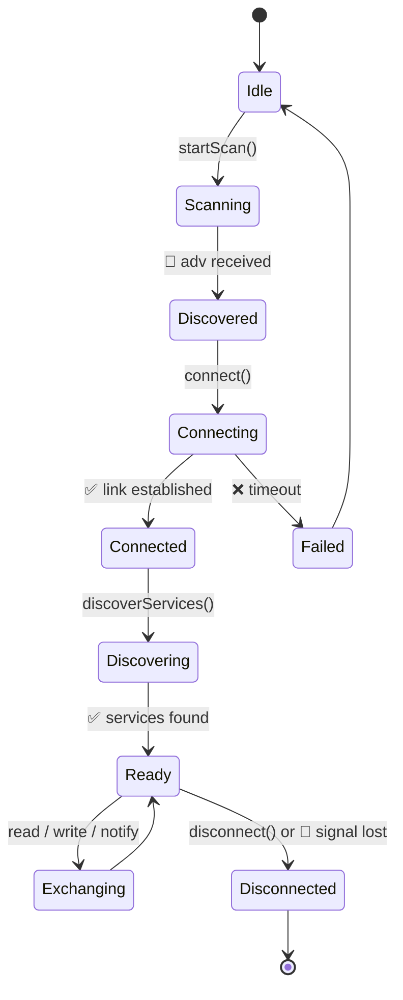
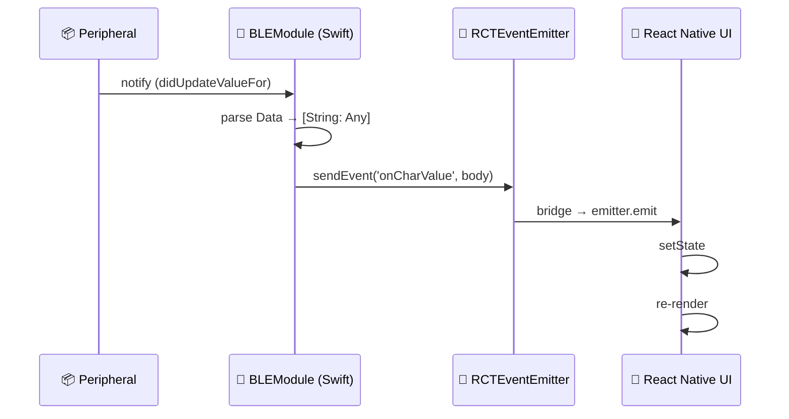
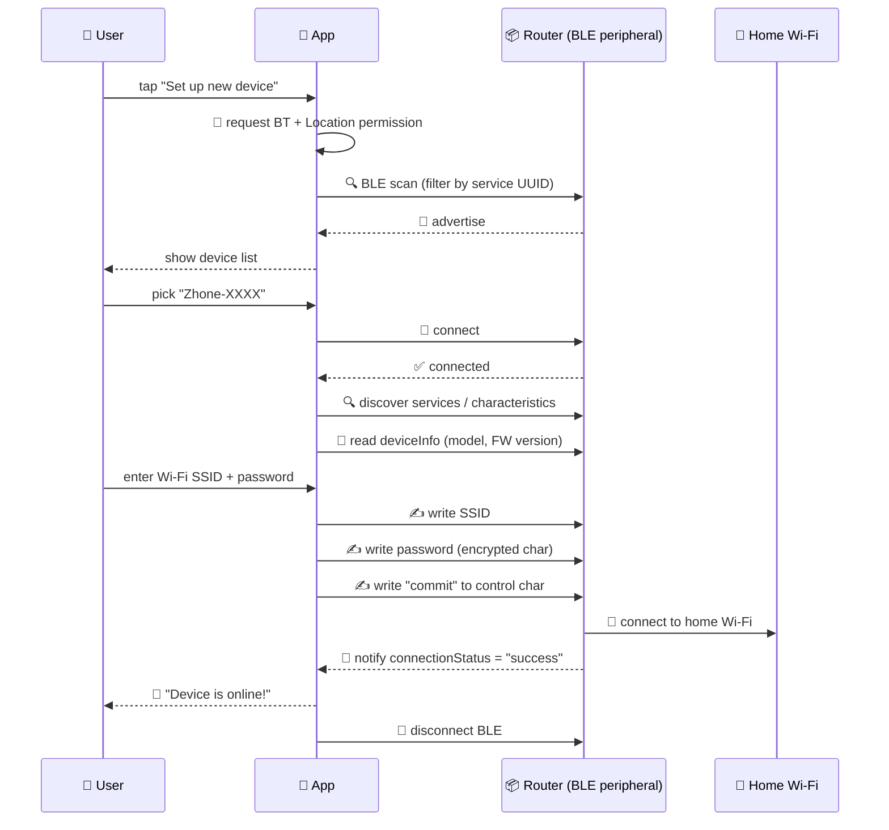

# 🚀 Zhone Onboarding — BLE × Native Swift × React Native

> **🎉 Chúc mừng anh đã pass phỏng vấn Zhone/Netcomm!**
>
> **🎯 Mục đích file này:** Hệ thống hoá kiến thức base về Bluetooth Low Energy, Swift (CoreBluetooth), và cầu nối React Native — đủ để anh đi làm ngày đầu tiên có thể đọc hiểu code repo, hỏi đúng câu, code đúng pattern.
>
> **📖 Cách dùng:** Đọc theo thứ tự — mỗi phần xây dựng trên phần trước. Code sample copy-paste được, đã test pattern.

---

## 🗺 Bản đồ kiến thức

```
┌──────────────────────────────────────────────────────────────────┐
│                                                                  │
│   📡 PHẦN 1 — BLE Fundamentals          (3 buổi đọc)            │
│        └─► Hiểu thiết bị giao tiếp thế nào                       │
│                                                                  │
│   🍎 PHẦN 2 — Swift + CoreBluetooth     (2 buổi)                │
│        └─► Code iOS side để nói chuyện BLE                       │
│                                                                  │
│   🌉 PHẦN 3 — RN Native Bridge          (2 buổi)                │
│        └─► Đưa BLE data từ Swift → React Native UI               │
│                                                                  │
│   🔁 PHẦN 4 — Real Companion App Flows  (1 buổi)                │
│        └─► Provisioning, OTA, monitoring — full E2E              │
│                                                                  │
│   📚 PHẦN 5 — Libraries & Learning Path                          │
│                                                                  │
└──────────────────────────────────────────────────────────────────┘
```

---

# 📡 PHẦN 1 — Bluetooth Low Energy Fundamentals

## 1.1 BLE vs Classic Bluetooth — khác gì?

### 🧠 Mental model nhanh

> **Classic Bluetooth = "Cuộc gọi điện thoại"** — quay số → giữ máy → nói chuyện liên tục → cúp máy.
>
> **BLE = "Gửi tin nhắn SMS"** — soạn tin → gửi → đóng app → mở lại khi cần.

### 📊 Frequency & Channels — chúng dùng sóng khác nhau

```
   📡 BĂNG TẦN 2.4 GHz (cả 2 đều dùng dải này)
   ─────────────────────────────────────────────
   
   🔵 CLASSIC BLUETOOTH
   ┌──────────────────────────────────────────────────┐
   │ 79 channels × 1 MHz spacing                      │
   │ [ch0][ch1][ch2]...[ch78]                         │
   │                                                  │
   │ 🔀 Frequency Hopping Spread Spectrum (FHSS)     │
   │    Nhảy ngẫu nhiên 1600 lần/giây giữa các kênh   │
   │    để tránh nhiễu                                │
   └──────────────────────────────────────────────────┘
   
   ⚡ BLUETOOTH LOW ENERGY (BLE)
   ┌──────────────────────────────────────────────────┐
   │ 40 channels × 2 MHz spacing                      │
   │                                                  │
   │ [37][38][39] = ADVERTISING channels  📣           │
   │     (đặt rải rác để tránh nhiễu Wi-Fi)            │
   │                                                  │
   │ [0–36]      = DATA channels  📦                   │
   │     (chỉ dùng sau khi đã kết nối)                 │
   └──────────────────────────────────────────────────┘
```

**Tại sao quan trọng?**
- BLE chỉ có **3 advertising channels** → scan rất nhanh (vài chục ms tìm được device).
- Classic phải sweep cả 79 channels khi "inquiry" → tốn 10–30 giây để discover.

### 📊 Cơ chế Discovery — tìm thiết bị thế nào?

```
   🔵 CLASSIC: 2 bước phức tạp
   ─────────────────────────────
   
   📱 Phone                              🎧 Headphone
        │                                    │
        │  1️⃣ INQUIRY (sweep 32+ channels)   │
        │ ─────────────────────────────────► │
        │ ◄───── 📋 device address ─────────  │
        │  (mất 5–10 giây)                   │
        │                                    │
        │  2️⃣ PAGE (ping địa chỉ vừa biết)   │
        │ ─────────────────────────────────► │
        │ ◄───── 🤝 connection ──────────────  │
        │                                    │

   ⚡ BLE: 1 bước, đơn giản
   ───────────────────────
   
   📱 Phone                              📦 Sensor
        │                                    │
        │  🔍 SCAN 3 adv channels            │
        │ ◄──── 📣 ADV packet (every 20ms)  ─ │
        │      (chứa luôn name + services)    │
        │  (50–200ms thấy device!)            │
        │                                    │
```

### 📊 Connection Model — sau khi kết nối thì sao?

```
   🔵 CLASSIC BLUETOOTH                  ⚡ BLUETOOTH LE
   ━━━━━━━━━━━━━━━━━━━                  ━━━━━━━━━━━━━━━━
   
   Connect ──────────────────►          Connect ──►
       │                                    │
       │ 🔊 Streaming liên tục              │ 📦 Exchange
       │ ═══════════════════════            │   data
       │ 🔊 (ví dụ audio A2DP)              │ ──►
       │ ═══════════════════════            │
       │                                    │ 💤 Idle
       │ 🔊 stay connected                  │   (sleep)
       │   for hours                        │
       │                                    │ 📦 Wake
       │                                    │   exchange
       │                                    │ ──►
       │                                    │
       │                                    │ 💤 ...
       Disconnect                           │
                                            Disconnect
                                            (or stay
                                             low-power)
```

### 📊 Power Consumption — số liệu thật

```
   🔋 BATTERY DRAIN COMPARISON (peripheral side)
   ──────────────────────────────────────────────
   
   🔵 Classic Audio (A2DP streaming):
       ▓▓▓▓▓▓▓▓▓▓▓▓▓▓▓▓▓▓▓▓  ~30–100 mW
       → Tai nghe Bluetooth: 5–10h pin
   
   ⚡ BLE (peripheral idle + occasional notify):
       ▓                      ~0.01–10 mW
       → Smart watch / sensor: nhiều tháng đến năm
   
   📏 Tỉ lệ: BLE tiết kiệm pin ~100–1000× so với Classic
```

### 📊 Throughput — tốc độ data thực tế

```
   📊 SPEED COMPARISON
   ────────────────────
   
   🔵 Classic Bluetooth (BR/EDR):
       1–3 Mbps theoretical
       → đủ stream MP3 (128–320 kbps), AAC, aptX
   
   ⚡ BLE (1M PHY, default):
       ~1 Mbps theoretical
       ~30–100 kbps thực tế (sau overhead, MTU)
       → không stream audio chất lượng được
       → đủ cho sensor, config, OTA firmware (chậm hơn)
   
   ⚡ BLE 5.0 (2M PHY):
       ~2 Mbps theoretical
       → OTA firmware nhanh hơn 2×
```

### 📊 Bảng so sánh đầy đủ

```
┌──────────────────────────┬──────────────────────────┬──────────────────────────┐
│   🎯 Đặc điểm             │   🔵 Classic BT           │   ⚡ BLE                  │
├──────────────────────────┼──────────────────────────┼──────────────────────────┤
│ Channels                 │ 79 × 1 MHz               │ 40 × 2 MHz               │
│ Discovery time           │ 5–30 giây                │ 50–200 ms                │
│ Connection model         │ Continuous (streaming)   │ Burst (connect → idle)   │
│ Power (peripheral)       │ 30–100 mW                │ 0.01–10 mW               │
│ Battery life             │ Hours                    │ Months – Years           │
│ Throughput               │ 1–3 Mbps                 │ ~100 kbps practical      │
│ Range                    │ 10–100 m                 │ 10–50 m (LE 2M: ngắn hơn)│
│ Use cases                │ Audio, file, HID kbd     │ Sensor, IoT, beacon, OTA │
│ Pairing UX               │ Phức tạp (PIN, settings) │ Pair-less mode được      │
│ Data model               │ Profiles (A2DP, HFP...)  │ GATT (services/chars)    │
│ ⭐ iOS app access        │ ❌ Restricted (chỉ MFi)   │ ✅ Free via CoreBluetooth│
└──────────────────────────┴──────────────────────────┴──────────────────────────┘
```

### 🍎 Cách truy cập trên iOS — đây là điểm quan trọng NHẤT

Đây là sự thật **gây sốc nhiều dev mới làm iOS BT**:

```
   ┌─────────────────────────────────────────────────────────┐
   │                                                         │
   │  🔵 Classic Bluetooth từ app iOS thông thường           │
   │                                                         │
   │     ❌ KHÔNG truy cập trực tiếp được                    │
   │                                                         │
   │     iOS chỉ cho phép:                                   │
   │     • External Accessory Framework (EAKit)              │
   │       → CHỈ với accessory có MFi certificate            │
   │       → Phải xin license từ Apple, tốn $$$              │
   │     • AVAudioSession để route audio Bluetooth           │
   │       (không control connection được, chỉ chọn output)  │
   │                                                         │
   │  ⚡ BLE từ app iOS                                      │
   │                                                         │
   │     ✅ Truy cập đầy đủ qua CoreBluetooth framework     │
   │     ✅ Mọi app đều dùng được, free, không cần MFi      │
   │     ✅ Scan / Connect / Read / Write / Notify           │
   │                                                         │
   └─────────────────────────────────────────────────────────┘

   ⮕ Đây là lý do CHÍNH tại sao 99% companion apps cho IoT
     đều dùng BLE: vì iOS không cho lựa chọn khác!
```

### 💻 Swift code: minh hoạ sự khác biệt

#### 🔵 Classic Bluetooth — code rất hạn chế

```swift
import ExternalAccessory  // chỉ cho MFi accessories
import AVFoundation       // chỉ để route audio

// ❌ KHÔNG có API để scan/pair Classic Bluetooth tự do
// ❌ KHÔNG thể "tìm tai nghe BT bất kỳ rồi connect"
// → User phải vào Settings > Bluetooth > pair thủ công

// ✅ CHỈ làm được: liệt kê MFi accessory đã pair sẵn
class ClassicBTExample {
    func listConnectedAccessories() {
        let manager = EAAccessoryManager.shared()
        let accessories = manager.connectedAccessories
        for acc in accessories {
            print("Name:", acc.name)
            print("Manufacturer:", acc.manufacturer)
            print("Protocols:", acc.protocolStrings)
            // ⚠️ acc.protocolStrings chỉ có giá trị nếu MFi
        }
    }

    // ✅ Route audio output sang BT device đã pair
    func routeAudioToBluetooth() throws {
        let session = AVAudioSession.sharedInstance()
        try session.setCategory(
            .playAndRecord,
            options: [.allowBluetooth, .allowBluetoothA2DP]
        )
        try session.setActive(true)
        // → Không control device cụ thể nào, OS tự chọn
    }
}
```

**Tóm lại:** muốn code Classic BT trên iOS → hoặc anh trở thành đối tác MFi của Apple, hoặc anh "chịu". Đó là **vùng cấm** với dev thường.

#### ⚡ BLE — code thoải mái, đầy quyền

```swift
import CoreBluetooth

// ✅ Free access — không cần license gì
class BLEExample: NSObject, CBCentralManagerDelegate, CBPeripheralDelegate {
    private var central: CBCentralManager!
    private var connectedPeripheral: CBPeripheral?

    override init() {
        super.init()
        central = CBCentralManager(delegate: self, queue: nil)
    }

    // 1️⃣ Đợi BT bật xong
    func centralManagerDidUpdateState(_ central: CBCentralManager) {
        guard central.state == .poweredOn else { return }
        // 2️⃣ SCAN — không cần user thao tác gì
        central.scanForPeripherals(withServices: nil)
    }

    // 3️⃣ Tìm thấy device — có name, RSSI, advertisement data
    func centralManager(
        _ central: CBCentralManager,
        didDiscover peripheral: CBPeripheral,
        advertisementData: [String : Any],
        rssi RSSI: NSNumber
    ) {
        // Có thể filter theo manufacturer / service UUID / name
        if peripheral.name?.hasPrefix("Zhone-") == true {
            connectedPeripheral = peripheral  // strong ref!
            central.stopScan()
            // 4️⃣ CONNECT — không cần pop-up user, không cần PIN
            central.connect(peripheral, options: nil)
        }
    }

    // 5️⃣ Connected!
    func centralManager(_ central: CBCentralManager, didConnect peripheral: CBPeripheral) {
        peripheral.delegate = self
        peripheral.discoverServices(nil)
    }

    // 6️⃣ Discover services
    func peripheral(_ p: CBPeripheral, didDiscoverServices error: Error?) {
        for service in p.services ?? [] {
            p.discoverCharacteristics(nil, for: service)
        }
    }

    // 7️⃣ Đọc/ghi data — full control
    func peripheral(
        _ p: CBPeripheral,
        didDiscoverCharacteristicsFor service: CBService,
        error: Error?
    ) {
        for char in service.characteristics ?? [] {
            // 📖 Đọc
            if char.properties.contains(.read) {
                p.readValue(for: char)
            }
            // 🔔 Subscribe notification
            if char.properties.contains(.notify) {
                p.setNotifyValue(true, for: char)
            }
        }
    }
}
```

**Tóm lại:** BLE trên iOS = dev có toàn quyền, code rõ ràng, không phụ thuộc cài đặt user.

### 🎯 Tại sao Zhone (và 99% IoT) chọn BLE?

```
┌──────────────────────────────────────────────────────────────┐
│                                                              │
│  🏆 5 LÝ DO BLE THẮNG CHO IoT / COMPANION APP                │
│                                                              │
│  1. 🔋 Router/sensor chạy pin/nguồn nhỏ → BLE tiết kiệm     │
│                                                              │
│  2. 🔍 Discovery 50–200ms → UX onboarding nhanh             │
│                                                              │
│  3. 🍎 iOS cho phép app code thoải mái (Classic thì không)   │
│                                                              │
│  4. 📦 Data nhỏ (config, status, OTA) → không cần băng       │
│       thông cao của Classic                                  │
│                                                              │
│  5. 🌐 Sau khi setup xong, device chuyển sang Wi-Fi/Ethernet │
│       → BLE chỉ là "đường mòn cấu hình"                       │
│                                                              │
└──────────────────────────────────────────────────────────────┘

→ Zhone companion app = BLE để onboarding + monitor,
   data lớn chuyển qua Wi-Fi của router sau đó.
```

### ⚠️ Bẫy hay gặp khi giải thích cho người mới

> ❌ "BLE chậm hơn Classic"
> ✅ **Đúng** về throughput, nhưng **sai** về use case — BLE thiết kế cho data nhỏ + tần suất thấp + tiết kiệm pin. So sánh tốc độ là so sai mục đích.

> ❌ "BLE là phiên bản mới của Classic"
> ✅ **Sai** — BLE là **protocol stack riêng**, không tương thích Classic. Chip BT 4.0+ thường hỗ trợ **cả hai** (dual-mode) hoặc **chỉ BLE** (single-mode, gọi là "Bluetooth Smart").

> ❌ "Pair một lần là dùng mãi"
> ✅ Classic: đúng (bonded forever). BLE: tuỳ — có thể **pairing-less** (mỗi session kết nối lại từ đầu) hoặc **bonded** (lưu key, tự reconnect).

## 1.2 BLE Stack — 5 lớp anh cần biết

```
┌───────────────────────────────────────────────┐
│  📱 Your App                                  │  ← bạn code ở đây
├───────────────────────────────────────────────┤
│  📚 GATT (Generic Attribute Profile)          │  ← services & characteristics
├───────────────────────────────────────────────┤
│  📡 GAP (Generic Access Profile)              │  ← discovery, connection
├───────────────────────────────────────────────┤
│  🔧 L2CAP / ATT / SMP / HCI                  │  ← OS xử lý, không cần đụng
├───────────────────────────────────────────────┤
│  📻 PHY (Radio)                               │  ← phần cứng
└───────────────────────────────────────────────┘
```

**Cần nhớ:** 90% công việc của anh sẽ ở **GAP** (tìm và kết nối thiết bị) và **GATT** (đọc/ghi data).

## 1.3 Roles — Central vs Peripheral

```
                    📡 BLE Communication
                    ━━━━━━━━━━━━━━━━━━━━

   📱 CENTRAL                          📦 PERIPHERAL
   (companion app)                     (router / ONT)
        │                                    │
        │  1. 🔍 Scan for advertisements     │
        │ ◄────────────────────────────────  │  📣 Advertising
        │                                    │
        │  2. 🤝 Connect request             │
        │ ─────────────────────────────────► │
        │                                    │
        │  3. 🔍 Discover services           │
        │ ◄────────────────────────────────► │
        │                                    │
        │  4. 📖 Read / ✍️ Write / 🔔 Notify │
        │ ◄────────────────────────────────► │
        │                                    │
        │  5. 👋 Disconnect                  │
        │ ─────────────────────────────────► │
        │                                    │
```

**Cần nhớ:**
- Phone = **Central** (chủ động đi tìm)
- Router/ONT/Gateway của Zhone = **Peripheral** (quảng cáo sự tồn tại, chờ kết nối)
- Một số setup nâng cao Phone cũng có thể làm Peripheral, nhưng hiếm trong companion app

## 1.4 GATT — Services & Characteristics

GATT là model dữ liệu của BLE. Hình dung như JSON nhưng định nghĩa bằng **UUID 16-bit hoặc 128-bit**.

```
📦 Peripheral (Zhone Router)
└── 🔷 Service: Device Info        (UUID: 180A)
│   ├── 📄 Characteristic: Model    (UUID: 2A24)  → READ
│   ├── 📄 Characteristic: Firmware (UUID: 2A26)  → READ
│   └── 📄 Characteristic: Serial   (UUID: 2A25)  → READ
│
├── 🔷 Service: Wi-Fi Config       (UUID: vendor-specific 128-bit)
│   ├── 📄 SSID        → READ + WRITE
│   ├── 📄 Password    → WRITE only (security!)
│   └── 📄 Status      → NOTIFY (push updates to phone)
│
└── 🔷 Service: OTA Firmware       (UUID: vendor-specific)
    ├── 📄 Control      → WRITE
    ├── 📄 Data Packet  → WRITE (chunked binary)
    └── 📄 Progress     → NOTIFY
```

### 5 thuộc tính của Characteristic (PHẢI THUỘC)

```
┌──────────────────┬────────────────────────────────────────────┐
│  🔧 Property      │  💡 Meaning                                 │
├──────────────────┼────────────────────────────────────────────┤
│ 📖 READ           │ Central có thể đọc giá trị                  │
│ ✍️ WRITE          │ Central ghi, peripheral confirm             │
│ ✍️ WRITE_NO_RESP  │ Central ghi, KHÔNG đợi confirm (fast/lossy)│
│ 🔔 NOTIFY         │ Peripheral push khi value đổi (no ack)      │
│ 🔔 INDICATE       │ Như NOTIFY nhưng có ack (chậm hơn, đảm bảo) │
└──────────────────┴────────────────────────────────────────────┘
```

**Cần nhớ:**
- `NOTIFY` ≠ `INDICATE` — câu này hay bị hỏi: NOTIFY không acknowledgement, INDICATE có.
- Khi push data lớn (OTA), dùng `WRITE_NO_RESP` để nhanh, nhưng app phải tự handle mất gói.

## 1.5 Advertising & Scanning

```
        📦 Peripheral                      📱 Central
        ────────────                       ─────────
        
        📣 Send ADV packet
        ─ name, services UUID,
          manufacturer data ─
        ──────────────►
                                            🔍 Scan starts
        📣 (every adv interval)
        ──────────────►
                                            👀 sees ADV
                                            
                                            🤔 filter:
                                            - name = "Zhone-*"?
                                            - has service 0x180A?
                                            - manufacturer = 0xZHN?
                                            
                                            ✅ matched → show in list
```

**Advertising data có giới hạn 31 bytes** (legacy) hoặc 255 bytes (extended) → không thể nhồi nhiều, thường chỉ có:
- Tên thiết bị
- 1-2 service UUIDs
- Manufacturer data (short payload để quảng bá metadata)

## 1.6 Connection lifecycle — luồng đầy đủ



**Các state quan trọng anh sẽ phải handle trong code:**
- `bluetoothOff` — user tắt BT
- `unauthorized` — chưa cấp permission
- `disconnected unexpectedly` — mất kết nối giữa chừng (rất hay xảy ra với BLE)

## 1.7 Pairing & Bonding — Security

```
   PAIRING                              BONDING
   ━━━━━━━                              ━━━━━━━
   
   One-time key exchange                Saves keys for future
   (just this session)                  (auto-reconnect later)
   
   Methods:
   • Just Works   (no PIN, easiest, weakest)
   • Passkey      (6-digit PIN shown)
   • Numeric Comp (both show same number, confirm)
   • OOB          (out-of-band, e.g. NFC)
```

**Trong Zhone companion app**, thường sẽ là:
- **Provisioning flow**: chỉ pairing tạm thời để config Wi-Fi (sau đó device chuyển sang TCP/IP qua Wi-Fi)
- Một số scenarios cần bonding để app tự reconnect khi user trở lại nhà

## 1.8 MTU — Maximum Transmission Unit

```
Default MTU = 23 bytes (ATT)
→ Mỗi packet chỉ chở được 20 bytes payload (3 bytes header)

🔧 Negotiate larger MTU on connect:
   Request MTU 247 → peripheral đồng ý 185
   → Mỗi packet chở 182 bytes
   → OTA firmware sẽ nhanh hơn rất nhiều!
```

**Code sample:** trong react-native-ble-plx:
```ts
const mtu = await device.requestMTU(247)
console.log('Negotiated MTU:', mtu) // có thể bị peripheral hạ xuống
```

---

## 1.10 Bus Types (UART / USB / SDIO / SPI / Virtual)

> **🎯 Mục đích section:** Giải thích sâu các loại "bus" mà HCI chạy trên đó. Dev mobile thường không đụng trực tiếp, nhưng hiểu được sẽ giúp anh đọc datasheet, log driver, và hỏi đúng câu với firmware/hardware team.

### 🧠 Mental model chung

> Tất cả 5 cái này đều là **"đường dây dẫn"** giữa 2 con chip trên cùng 1 board mạch. Chúng khác nhau ở:
> - **Số sợi dây** (1 sợi vs 4 sợi vs 8 sợi)
> - **Tốc độ** (kbps vs Mbps vs Gbps)
> - **Cách "đồng bộ" tín hiệu** (có clock hay không)
> - **Topology** (1-1 hay 1-nhiều)

```
   📱 Trên board mạch điện thoại:

   ┌──────────────────────────────────────────────┐
   │                                              │
   │   🧠 CPU                  📡 BT chip          │
   │   ┌────┐                  ┌────┐            │
   │   │    │ ════ 🚌 bus ════ │    │            │
   │   │    │                  │    │            │
   │   └────┘                  └────┘            │
   │                                              │
   └──────────────────────────────────────────────┘

   "Bus" = mấy sợi dây đồng nối giữa 2 chip
```

---

### 1️⃣ UART (Universal Asynchronous Receiver/Transmitter)

#### 📊 Cơ chế

```
   🧠 CPU                        📡 BT Chip
   ┌────────┐                    ┌────────┐
   │     TX │ ─────────────────► │ RX     │
   │     RX │ ◄───────────────── │ TX     │
   │    GND │ ─────────────────  │ GND    │
   └────────┘                    └────────┘
        2 sợi data + 1 GND (đôi khi thêm CTS/RTS để flow control)
```

#### 🔧 Đặc điểm

- **Asynchronous** — KHÔNG có clock chung. 2 chip phải **thoả thuận trước baud rate** (ví dụ: 115200 bps, 921600 bps, 3 Mbps cho BT hiện đại).
- **Full-duplex** — gửi & nhận đồng thời (vì TX và RX là 2 sợi riêng).
- **Đơn giản** — chỉ cần 2 chân GPIO trên mỗi chip.

#### 📨 Cách gửi 1 byte

```
   Idle (HIGH) ──╮                                ╭── Idle
                 │ START                          │
                 ╰─┐  D0  D1  D2  D3  D4  D5  D6  D7 ─┐STOP
                   ╰──┐──┐──┐──┐──┐──┐──┐──┐──┐──────╯
                      bits gửi từ thấp đến cao

   1 byte = 1 start bit + 8 data bits + (parity?) + 1 stop bit
   = 10 bits trên dây để truyền 8 bits data
```

#### ⚡ Tốc độ

- Truyền thống: 9600 → 115200 bps (slow)
- BT modern UART: **3 Mbps, 4 Mbps** (đủ cho BLE; chật cho A2DP audio)
- HCI UART chuẩn: thường 1.5–4 Mbps

#### 🎯 Trong Bluetooth

→ **90% phones hiện nay** dùng UART để kết nối SoC ↔ chip BT.
→ Lý do: rẻ, ít chân, đủ tốc độ cho BLE.

```
   Ví dụ thực: Qualcomm WCN39xx hoặc Broadcom BCM4356
   thường nối với SoC qua UART HS (High Speed) 3-4 Mbps

   📄 Tên gọi trong code/log: "btuart", "h4", "h5", "BCSP"
   (H4/H5/BCSP là các framing protocol khác nhau trên UART)
```

---

### 2️⃣ USB (Universal Serial Bus)

#### 📊 Cơ chế

```
   🧠 Host (CPU/PC)              📡 BT Dongle
   ┌────────┐                    ┌────────┐
   │    VCC │ ────── +5V ──────► │ VCC    │  ← cấp điện
   │     D+ │ ◄═════ data ═════► │ D+     │  ← cặp differential
   │     D- │ ◄═════ data ═════► │ D-     │
   │    GND │ ────── 0V ──────── │ GND    │
   └────────┘                    └────────┘
        4 sợi (cấp điện + 2 data + GND)
```

#### 🔧 Đặc điểm

- **Differential signaling** — 2 sợi data luôn ngược pha → chống nhiễu cực tốt.
- **Hot-plug** — cắm/rút khi đang chạy được (UART thì không).
- **Cấp điện luôn** — VCC 5V trên dây.
- **Phức tạp** — có cả 1 stack driver (descriptor, endpoint, control transfer...).

#### ⚡ Tốc độ

- USB 1.1: 12 Mbps
- USB 2.0: 480 Mbps (đủ cho mọi loại BT)
- USB 3.0+: vài Gbps

#### 🎯 Trong Bluetooth

→ Dùng cho **USB Bluetooth dongle cắm vào PC/Laptop**.
→ Hầu hết laptops cũ có BT chip nối qua USB **nội bộ** (USB hub trong main board).
→ **Điện thoại KHÔNG dùng USB cho BT** — phí điện, phí chân.

```
   Ví dụ: cắm BT dongle vào MacBook → OS detect:

   $ system_profiler SPUSBDataType | grep -A 5 Bluetooth
   Bluetooth USB Host Controller:
     Product ID: 0x828f
     Vendor ID: 0x05ac (Apple Inc.)
     Speed: Up to 12 Mb/s   ← USB 1.1
```

---

### 3️⃣ SDIO (Secure Digital Input/Output)

#### 📊 Cơ chế

```
   🧠 SoC                        📡 Combo Wi-Fi+BT chip
   ┌────────┐                    ┌────────┐
   │    CLK │ ─────────────────► │ CLK    │  ← clock chung
   │    CMD │ ◄═════ commands ══► │ CMD    │
   │    D0  │ ◄═════ data    ══► │ D0     │
   │    D1  │ ◄═════ data    ══► │ D1     │   4-bit hoặc
   │    D2  │ ◄═════ data    ══► │ D2     │   8-bit mode
   │    D3  │ ◄═════ data    ══► │ D3     │
   └────────┘                    └────────┘
        6 sợi (4 data + clock + cmd)
```

#### 🔧 Đặc điểm

- **Synchronous** — có clock riêng → đồng bộ chính xác.
- **Bắt nguồn từ thẻ SD card** — chuẩn được mở rộng để nối với chip khác.
- **Half-duplex** — 1 lúc chỉ gửi hoặc nhận (data line dùng chung).
- **Băng thông cao** — đủ chở Wi-Fi (vài trăm Mbps).

#### ⚡ Tốc độ

- SDIO 2.0: ~25 MB/s
- SDIO 3.0: ~104 MB/s (UHS-I)
- SDIO 4.0: vài trăm MB/s

#### 🎯 Trong Bluetooth

→ Khi **Wi-Fi và Bluetooth dùng chung 1 chip combo** (rất phổ biến trong điện thoại 2010-2020).
→ Lý do dùng SDIO: Wi-Fi cần nhiều băng thông → SDIO đủ nhanh; BT "ăn ké" cùng bus.

```
   Ví dụ: Broadcom BCM4339 (combo Wi-Fi + BT)
   - Wi-Fi data: qua SDIO
   - BT HCI:     qua UART RIÊNG (vì BT cần thấp delay)

   Hoặc combo chip dùng cả SDIO cho Wi-Fi + UART cho BT
   trên cùng 1 die silicon.
```

→ Hiện tại điện thoại flagship đã chuyển sang **PCIe** cho Wi-Fi, BT vẫn UART.

---

### 4️⃣ SPI (Serial Peripheral Interface)

#### 📊 Cơ chế

```
   🧠 Master                     📡 Slave (BT chip)
   ┌────────┐                    ┌────────┐
   │   SCLK │ ─────── clock ───► │ SCLK   │
   │   MOSI │ ─── master→slave ─► │ MOSI   │  Master Out Slave In
   │   MISO │ ◄── slave→master ── │ MISO   │  Master In  Slave Out
   │     SS │ ─── chip select ──► │ SS     │  (active low)
   │    GND │ ─────────────────── │ GND    │
   └────────┘                    └────────┘
        4 sợi tín hiệu + GND
```

#### 🔧 Đặc điểm

- **Synchronous** — clock từ master → chính xác cao.
- **Full-duplex** — gửi & nhận đồng thời (2 line riêng MOSI/MISO).
- **1 Master nhiều Slave** — mỗi slave 1 SS line riêng.
- **Tốc độ rất cao** — vài chục MHz dễ dàng.

#### ⚡ Tốc độ

- Phổ biến: 10–50 Mbps
- Cao: lên tới 100+ Mbps

#### 🎯 Trong Bluetooth

→ Hiếm dùng cho điện thoại.
→ **Phổ biến trong IoT/embedded** — microcontroller (ESP32, STM32) kết nối module BT qua SPI.

```
   Ví dụ: ESP32 + module nRF52 BLE qua SPI
   - Microcontroller chính (ESP32) làm Master
   - BLE module nRF52 làm Slave
   - SPI tốc độ ~10 Mbps đủ cho mọi BLE use case

   → Setup này phổ biến trong: smart locks, beacons,
     industrial sensors, wearables custom.
```

---

### 5️⃣ Virtual / Internal (không có bus vật lý)

#### 📊 Cơ chế

```
   Trong 1 con chip SoC (System on Chip):

   ┌─────────────────────────────────────────────┐
   │  🪙 Một die silicon                          │
   │                                             │
   │   ┌──────┐        ┌──────┐        ┌──────┐ │
   │   │ CPU  │ ◄═══►  │ Mem  │ ◄═══► │ BT   │ │
   │   │ Cores│  on-   │ Ctrl │  on-  │ Block│ │
   │   └──────┘  chip  └──────┘  chip └──────┘ │
   │             bus              bus            │
   │           (AXI/AHB)         (AXI/AHB)       │
   │                                             │
   │   ⚡ Tốc độ: GB/s, latency cực thấp          │
   └─────────────────────────────────────────────┘
```

#### 🔧 Đặc điểm

- **KHÔNG có dây ngoài** — BT block nằm cùng silicon với CPU.
- Giao tiếp qua **bus nội bộ AXI/AHB** (ARM AMBA) — bus hiệu năng cực cao.
- Trên log/driver vẫn thấy "HCI Transport" nhưng nó là **virtual** — chỉ là memory-mapped registers chứ không qua dây vật lý.

#### 🎯 Trong Bluetooth

→ **Apple Silicon** (iPhone 12+, Mac M1+): BT là một block trong SoC.
→ **Qualcomm Snapdragon Gen 2+**: BT/Wi-Fi tích hợp một phần vào SoC.

```
   Ví dụ: Apple M2 chip
   - 8 CPU cores
   - 10 GPU cores
   - Neural Engine
   - 🔵 Bluetooth 5.3 block      ← ngay trong chip
   - 📶 Wi-Fi 6E block          ← ngay trong chip

   → Không có "UART HCI bus" vật lý
   → Driver vẫn dùng giao thức HCI nhưng qua shared memory
   → Latency thấp hơn, tốn ít điện hơn
```

---

### 📋 Bảng so sánh tổng

```
┌────────┬──────────┬─────────┬───────────────┬──────────────────┐
│  🚌    │ Sợi dây  │ Speed   │ Đồng bộ?      │ Phổ biến ở đâu   │
├────────┼──────────┼─────────┼───────────────┼──────────────────┤
│ UART   │ 2-4      │ 3-4Mbps │ ❌ Async      │ 📱 90% phones    │
│        │          │         │ (baud thoả)   │                  │
│ USB    │ 4        │ 480Mbps │ ✅ Sync       │ 💻 PC dongles    │
│ SDIO   │ 6+       │ 100MB/s │ ✅ Sync       │ 📱 Combo Wi-Fi+BT│
│ SPI    │ 4+       │ ~50Mbps │ ✅ Sync       │ 🤖 IoT/embedded │
│ Virtual│ 0 (chip) │ GB/s    │ ✅ AXI/AHB    │ 📱 SoC modern    │
└────────┴──────────┴─────────┴───────────────┴──────────────────┘
```

---

### 🎯 Tại sao dev mobile cần biết?

```
┌──────────────────────────────────────────────────────────────┐
│                                                              │
│  💡 KHI NÀO KIẾN THỨC NÀY THỰC SỰ DÙNG ĐẾN?                  │
│                                                              │
│  1. 🐛 Debug log lỗi BT khó hiểu                              │
│     "btuart_open failed" → UART driver lỗi → reset chip BT   │
│                                                              │
│  2. ⚡ Hiểu giới hạn tốc độ OTA firmware                     │
│     UART 4Mbps → chia cho overhead → throughput thật ~2Mbps  │
│     → file FW 10MB sẽ mất tối thiểu ~40 giây                 │
│                                                              │
│  3. 🔋 Hiểu power management                                  │
│     UART có HCI low-power mode → cho phép chip BT sleep      │
│     khi không có traffic → tiết kiệm pin                     │
│                                                              │
│  4. 🤝 Nói chuyện với firmware/hardware team                  │
│     "Bus nào đang dùng?" → biết UART thì hỏi baud rate       │
│     biết SDIO thì hỏi clock speed, biết shared với Wi-Fi     │
│     thì hiểu vì sao BT chậm khi tải file qua Wi-Fi.          │
│                                                              │
└──────────────────────────────────────────────────────────────┘
```

---

### ⚠️ Bẫy thường gặp

> ❌ "UART chậm hơn USB nên BT trên phone chậm hơn dongle"
> ✅ **Sai** — bottleneck của BLE không phải bus mà là **air interface** (sóng radio). UART 3Mbps đã thừa cho BLE 1Mbps. USB 480Mbps cũng không nhanh hơn.

> ❌ "iPhone dùng USB cho BT vì có cổng Lightning/USB-C"
> ✅ **Sai** — USB-C/Lightning chỉ là cổng ra ngoài. Bên trong, BT block tích hợp luôn trong A-series/M-series SoC (Virtual bus).

> ❌ "SDIO là dây dữ liệu cho thẻ nhớ SD, không liên quan BT"
> ✅ **Đúng nguồn gốc, nhưng** chuẩn SDIO được mở rộng thành interface chung cho "thiết bị input/output" — Wi-Fi/BT combo chip dùng chính chuẩn đó.

---

### 🔬 Thực hành quan sát — bus thật trên máy anh

Trên macOS:
```bash
# Xem BT chip + transport bus
system_profiler SPBluetoothDataType

# Chi tiết hơn (BT controller chain)
ioreg -p IOService -r -n "AppleHSBluetoothInterface" -l 2>/dev/null | head -50
```

Trên Linux:
```bash
# Xem BT adapter info (bus type là 1 dòng)
hciconfig -a
# → Bus: USB/UART/SDIO

# Hoặc chi tiết hơn:
dmesg | grep -i "bluetooth\|btuart\|btusb"
```

---

# 🍎 PHẦN 2 — Swift & CoreBluetooth

## 2.1 Swift refresher — concepts anh sẽ dùng hàng ngày

### Optional & Optional binding
```swift
var name: String? = nil  // có thể có hoặc không

// ❌ Sai (force unwrap):
print(name!) // crash nếu nil

// ✅ Đúng:
if let realName = name {
    print(realName)
}

// ✅ Đúng (guard early-return):
guard let realName = name else {
    return
}
print(realName)
```

### Closures
```swift
// Closure = lambda của Swift
let callback: (Int) -> Void = { value in
    print("got \(value)")
}

// Khi closure capture self (rất hay gây leak):
let timer = Timer(...) { [weak self] _ in
    self?.update()  // weak để tránh retain cycle
}
```

### Protocol
```swift
protocol BluetoothScanner {
    func startScan()
    func stopScan()
}

class CoreBTScanner: BluetoothScanner {
    func startScan() { /* ... */ }
    func stopScan()  { /* ... */ }
}
```

### Delegate pattern (CỰC QUAN TRỌNG cho CoreBluetooth)
```swift
class MyManager: NSObject, CBCentralManagerDelegate {
    func centralManagerDidUpdateState(_ central: CBCentralManager) {
        // BLE state changed
    }
}
```

## 2.2 CoreBluetooth — kiến trúc

```
┌──────────────────────────────────────────────────────┐
│                                                      │
│  CBCentralManager  ◄── bạn dùng cái này              │
│       │                                              │
│       │ delegate: CBCentralManagerDelegate           │
│       ▼                                              │
│  CBPeripheral      ◄── đại diện cho 1 router        │
│       │                                              │
│       │ delegate: CBPeripheralDelegate               │
│       ▼                                              │
│  CBService         ◄── group of characteristics      │
│       │                                              │
│       ▼                                              │
│  CBCharacteristic  ◄── data unit                     │
│                                                      │
└──────────────────────────────────────────────────────┘
```

## 2.3 CoreBluetooth — Hello World

### Bước 1: Permission trong `Info.plist`
```xml
<key>NSBluetoothAlwaysUsageDescription</key>
<string>App cần Bluetooth để cấu hình router</string>
```

### Bước 2: Scan
```swift
import CoreBluetooth

class BLEManager: NSObject, CBCentralManagerDelegate {
    private var central: CBCentralManager!
    private var discovered: [CBPeripheral] = []

    override init() {
        super.init()
        // Tạo manager → delegate sẽ nhận callback state
        central = CBCentralManager(delegate: self, queue: nil)
    }

    // 🔔 BLE state thay đổi (on/off/unauthorized…)
    func centralManagerDidUpdateState(_ central: CBCentralManager) {
        guard central.state == .poweredOn else {
            print("BT not ready: \(central.state.rawValue)")
            return
        }
        // ✅ Sẵn sàng scan
        startScan()
    }

    func startScan() {
        // nil = scan tất cả; [serviceUUID] = chỉ thiết bị có service đó
        central.scanForPeripherals(
            withServices: nil,
            options: [CBCentralManagerScanOptionAllowDuplicatesKey: false]
        )
    }

    // 🔔 Phát hiện peripheral
    func centralManager(
        _ central: CBCentralManager,
        didDiscover peripheral: CBPeripheral,
        advertisementData: [String : Any],
        rssi RSSI: NSNumber
    ) {
        print("Found: \(peripheral.name ?? "?") RSSI: \(RSSI)")
        // Filter theo tên hoặc manufacturer data
        if peripheral.name?.hasPrefix("Zhone-") == true {
            discovered.append(peripheral)
        }
    }
}
```

### Bước 3: Connect & Discover Services
```swift
func connect(_ peripheral: CBPeripheral) {
    central.stopScan()
    peripheral.delegate = self  // ⚠️ NHỚ set delegate
    central.connect(peripheral, options: nil)
}

// 🔔 Connected
func centralManager(_ central: CBCentralManager, didConnect peripheral: CBPeripheral) {
    print("Connected!")
    peripheral.discoverServices(nil)  // nil = tất cả services
}

// 🔔 Services found
extension BLEManager: CBPeripheralDelegate {
    func peripheral(_ p: CBPeripheral, didDiscoverServices error: Error?) {
        guard let services = p.services else { return }
        for service in services {
            p.discoverCharacteristics(nil, for: service)
        }
    }

    // 🔔 Characteristics found
    func peripheral(
        _ p: CBPeripheral,
        didDiscoverCharacteristicsFor service: CBService,
        error: Error?
    ) {
        for char in service.characteristics ?? [] {
            print("Char: \(char.uuid), props: \(char.properties)")

            // Subscribe to notifications
            if char.properties.contains(.notify) {
                p.setNotifyValue(true, for: char)
            }

            // Read initial value
            if char.properties.contains(.read) {
                p.readValue(for: char)
            }
        }
    }

    // 🔔 Value updated (read result OR notification)
    func peripheral(
        _ p: CBPeripheral,
        didUpdateValueFor char: CBCharacteristic,
        error: Error?
    ) {
        guard let data = char.value else { return }
        print("Char \(char.uuid) → \(data as NSData)")
    }
}
```

### Bước 4: Write
```swift
func writeWiFiPassword(_ password: String, to char: CBCharacteristic) {
    let data = password.data(using: .utf8)!
    peripheral.writeValue(
        data,
        for: char,
        type: .withResponse  // .withoutResponse for OTA fast path
    )
}

func peripheral(
    _ p: CBPeripheral,
    didWriteValueFor char: CBCharacteristic,
    error: Error?
) {
    if let err = error {
        print("Write failed: \(err)")
    } else {
        print("Write OK")
    }
}
```

## 2.4 Modern Swift: async/await với CoreBluetooth

CoreBluetooth là callback-based. Để clean code hơn, wrap thành async:

```swift
extension CBPeripheral {
    func discoverServicesAsync() async throws -> [CBService] {
        try await withCheckedThrowingContinuation { cont in
            // Lưu continuation, khi delegate callback thì resume
            self.serviceContinuation = cont
            self.discoverServices(nil)
        }
    }
}

// Usage:
let services = try await peripheral.discoverServicesAsync()
let configChar = try await peripheral.discoverChar(uuid: configUUID)
try await peripheral.writeAsync(data, to: configChar)
```

→ **Mẹo:** Trong dự án thật, library kiểu `AsyncBluetooth` (Swift Package) đã wrap sẵn — kiểm tra xem repo Zhone đã có chưa trước khi tự viết.

---

# 🌉 PHẦN 3 — React Native Native Bridge

## 3.1 Recap: tại sao cần bridge?

```
   📱 React Native (JS)
        │
        │  ❌ JS không truy cập được CoreBluetooth/Android Bluetooth API
        │
        ▼
   🌉 Native Module Bridge
        │
        ▼
   🍎 Swift (CoreBluetooth)  /  🤖 Kotlin (BluetoothAdapter)
```

→ Anh sẽ viết **1 Native Module bằng Swift**, expose các method scan/connect/read/write/onNotification cho JS gọi.

## 3.2 Old Architecture — Native Module truyền thống

### Bước 1: Tạo Swift class
```swift
// BLEModule.swift
import Foundation
import React

@objc(BLEModule)
class BLEModule: RCTEventEmitter {
    private let manager = BLEManager()

    // ⚙️ Export method cho JS
    @objc
    func startScan(_ resolve: @escaping RCTPromiseResolveBlock,
                   rejecter reject: @escaping RCTPromiseRejectBlock) {
        manager.startScan { result in
            switch result {
            case .success: resolve(nil)
            case .failure(let err): reject("SCAN_ERR", err.localizedDescription, err)
            }
        }
    }

    @objc
    func connect(_ deviceId: String,
                 resolver resolve: @escaping RCTPromiseResolveBlock,
                 rejecter reject: @escaping RCTPromiseRejectBlock) {
        // ...
    }

    // 🔔 Event names để JS subscribe
    override func supportedEvents() -> [String]! {
        return ["onDeviceFound", "onCharacteristicValue", "onDisconnected"]
    }

    // 🔔 Khi BLE callback đến, emit lên JS
    func notifyDeviceFound(_ device: CBPeripheral) {
        sendEvent(withName: "onDeviceFound", body: [
            "id": device.identifier.uuidString,
            "name": device.name ?? "Unknown"
        ])
    }

    // ⚙️ Bắt buộc nếu module dùng main thread (CoreBluetooth thì OK background)
    @objc
    override static func requiresMainQueueSetup() -> Bool {
        return false
    }
}
```

### Bước 2: Header bridging (Objective-C)
```objc
// BLEModule.m
#import <React/RCTBridgeModule.h>
#import <React/RCTEventEmitter.h>

@interface RCT_EXTERN_MODULE(BLEModule, RCTEventEmitter)

RCT_EXTERN_METHOD(startScan:(RCTPromiseResolveBlock)resolve
                  rejecter:(RCTPromiseRejectBlock)reject)

RCT_EXTERN_METHOD(connect:(NSString *)deviceId
                  resolver:(RCTPromiseResolveBlock)resolve
                  rejecter:(RCTPromiseRejectBlock)reject)

@end
```

### Bước 3: JS side
```ts
// BLE.ts
import { NativeModules, NativeEventEmitter } from 'react-native';

const { BLEModule } = NativeModules;
const emitter = new NativeEventEmitter(BLEModule);

export const ble = {
  startScan: () => BLEModule.startScan(),

  connect: (deviceId: string) => BLEModule.connect(deviceId),

  onDeviceFound: (cb: (device: Device) => void) =>
    emitter.addListener('onDeviceFound', cb),
};

// Usage in a screen:
useEffect(() => {
  const sub = ble.onDeviceFound((device) => {
    setDevices(prev => [...prev, device]);
  });
  ble.startScan();
  return () => sub.remove();
}, []);
```

## 3.3 New Architecture — TurboModule (anh nên hỏi team có dùng NewArch chưa)

```
   📝 NativeBLEModule.ts (TypeScript spec)
        │
        ▼
   🤖 Codegen → ObjC++ headers + Kotlin interfaces
        │
        ▼
   🍎 BLEModule.swift implements protocol
   🤖 BLEModule.kt   implements interface
        │
        ▼
   ⚡ JS: TurboModuleRegistry.getEnforcing<Spec>('BLEModule')
```

### Spec file (JS layer)
```ts
// specs/NativeBLEModule.ts
import { TurboModule, TurboModuleRegistry } from 'react-native';

export interface Spec extends TurboModule {
  startScan(): Promise<void>;
  connect(deviceId: string): Promise<void>;
  readCharacteristic(deviceId: string, charUUID: string): Promise<string>;
  writeCharacteristic(deviceId: string, charUUID: string, data: string): Promise<void>;
}

export default TurboModuleRegistry.getEnforcing<Spec>('BLEModule');
```

**Khác biệt chính so với old:**
- ✅ Type-safe (codegen check types ở build time)
- ✅ Sync calls qua JSI (không qua bridge queue)
- ✅ Lazy load — module chỉ init khi JS gọi lần đầu

## 3.4 Event flow — BLE notify → JS UI update



## 3.5 Threading — đừng dính bẫy

```
┌────────────────────────────────────────────────────────┐
│  📍 Where does callback run?                            │
├────────────────────────────────────────────────────────┤
│  CoreBluetooth → callback queue you specified           │
│                  (nil = main queue)                     │
│                                                         │
│  ⚠️ Don't process heavy data on main queue              │
│  ⚠️ Don't call UIKit from background queue              │
│                                                         │
│  💡 Best practice:                                      │
│     • BLE manager on a background DispatchQueue         │
│     • Parse data on background                          │
│     • Send to JS via sendEvent (RN handles threading)   │
└────────────────────────────────────────────────────────┘
```

```swift
let bleQueue = DispatchQueue(label: "com.zhone.ble", qos: .userInitiated)
let central = CBCentralManager(delegate: self, queue: bleQueue)
```

---

# 🔁 PHẦN 4 — Companion App Flows (E2E)

## 4.1 Wi-Fi Provisioning Flow (luồng phổ biến nhất)



**Common pitfalls:**
1. **iOS không cần Location permission cho BLE từ iOS 13+**, nhưng **Android cần** (BLE scan = location).
2. Password phải mã hoá end-to-end nếu link không bonded — đừng gửi plaintext qua một `WRITE` thô.
3. Sau `commit`, device sẽ disconnect BLE (vì nó chuyển sang Wi-Fi) — đừng coi disconnect là lỗi.

## 4.2 OTA Firmware Update Flow

```
   📱 App                          📦 Router
   ─────                          ────────
   
   1. ✍️ Write "OTA_START" + total size
                                    ▼
                                  prepare flash partition
                                    │
   2. 🔔 Notify "READY"             │
   ◄────────────────────────────────┘
   
   3. Split firmware into chunks (e.g. 200 bytes each)
      for chunk in chunks:
          ✍️ Write chunk (WRITE_NO_RESP for speed)
          if chunk_index % 50 == 0:
              wait for "ACK_50_CHUNKS" notify (flow control)
   
   4. ✍️ Write "OTA_END"
                                    ▼
                                  verify checksum
                                  reboot
   
   5. 🔔 Notify "OTA_SUCCESS" or "OTA_FAILED"
```

**Key concerns:**
- **MTU negotiation** trước OTA — MTU lớn = nhanh hơn nhiều (185 vs 20 bytes/packet).
- **Flow control** — đừng gửi quá nhanh, peripheral có buffer giới hạn. Pattern: write N chunks → wait for ACK → tiếp.
- **Progress UI** — peripheral notify progress %, JS render progress bar.
- **Resume on failure** — track last-acked chunk, có thể resume thay vì restart.

## 4.3 Mesh / Multi-device monitoring

```
   📱 App
   │
   ├── 🔗 Connect Router A (BLE) → monitor status notify
   ├── 🔗 Connect Mesh Node B (BLE) → monitor status notify
   └── 🔗 Connect Mesh Node C (BLE) → monitor status notify

   ⚠️ iOS limit: ~5-10 concurrent BLE connections
   ⚠️ Connection interval ảnh hưởng power & throughput
```

**Pattern thường dùng:**
- Connect tuần tự (không song song) để tránh conflict.
- Sau khi đọc xong → disconnect → connect device tiếp theo.
- Background mode: dùng **State Preservation & Restoration** của CoreBluetooth nếu cần persist connection khi app suspended.

## 4.4 Background BLE (iOS) — khó nhằn

```
   📱 App
   │
   ├── Foreground: full BLE OK
   │
   ├── Background: cần khai báo trong Info.plist
   │   <key>UIBackgroundModes</key>
   │   <array>
   │     <string>bluetooth-central</string>
   │   </array>
   │
   │   → vẫn scan/connect được nhưng:
   │   • scan rate giảm
   │   • cannot scan with empty service UUID list
   │   • must use State Preservation
```

---

# 📚 PHẦN 5 — Libraries & Tooling

## 5.1 RN BLE libraries — anh sẽ gặp 1 trong các thằng này

| Library | Pros | Cons |
|---|---|---|
| 🥇 **react-native-ble-plx** | Production-ready, well-maintained, Promise-based | Cần thêm cấu hình cho RN 0.72+ |
| **react-native-ble-manager** | Lâu đời, nhiều ví dụ | API cũ kỹ, callback hell |
| **react-native-ble-advertiser** | Khi cần phone làm Peripheral | Niche |

### Quick start với ble-plx
```ts
import { BleManager } from 'react-native-ble-plx';

const manager = new BleManager();

// Scan
manager.startDeviceScan(null, null, (error, device) => {
  if (error) return console.error(error);
  if (device?.name?.startsWith('Zhone-')) {
    console.log('Found:', device.name);
  }
});

// Connect & read
const device = await manager.connectToDevice(deviceId);
await device.discoverAllServicesAndCharacteristics();
const char = await device.readCharacteristicForService(serviceUUID, charUUID);
console.log('Value:', char.value); // base64
```

→ **Nếu Zhone đã có custom Native Module** (rất có thể, vì họ control hardware), anh sẽ làm việc trên module đó thay vì library này. Nhưng hiểu ble-plx giúp anh **đọc hiểu pattern** repo của họ.

## 5.2 Debug tools

```
┌────────────────────────────────────────────────────────┐
│  🔧 Tool                  🎯 Use                        │
├────────────────────────────────────────────────────────┤
│ nRF Connect (mobile)     Scan/inspect any BLE device   │
│ LightBlue (iOS)          Same, Apple-ecosystem         │
│ PacketLogger (macOS)     Low-level BLE packet capture  │
│ Xcode Console            CoreBluetooth state logs      │
│ Wireshark + Ubertooth   Wire-level sniffing (advanced)│
│ React Native DevTools    JS-side debug                 │
└────────────────────────────────────────────────────────┘
```

**⭐ nRF Connect** là tool quan trọng nhất — anh dùng nó để **xem peripheral của Zhone** đang advertise những gì, có service/characteristic nào, mà không cần app — cực kỳ hữu ích khi onboarding.

---

# 📅 PHẦN 6 — Learning Path (3 tuần đầu đi làm)

```
┌─────────────────────────────────────────────────────────────────┐
│ 📅 WEEK 1 — Hiểu sản phẩm                                       │
│   • Đọc lại file này (PHẦN 1 + 2)                               │
│   • Cài nRF Connect, scan thử 1 router của Zhone                │
│   • Đọc README + Architecture doc của repo                      │
│   • Setup dev env: Xcode + RN, build app demo lên device thật   │
│   • Pair với 1 senior, xem họ làm 1 ticket nhỏ                  │
├─────────────────────────────────────────────────────────────────┤
│ 📅 WEEK 2 — Code cùng team                                      │
│   • Đọc PHẦN 3 (RN Bridge)                                      │
│   • Lấy 1 ticket S-size: UI hoặc fix bug ở JS layer             │
│   • Tự code 1 mini Swift Native Module (hello-BLE) ngoài giờ    │
│   • Bắt đầu đọc code Swift của repo, hỏi pattern                │
├─────────────────────────────────────────────────────────────────┤
│ 📅 WEEK 3 — Sâu vào BLE                                         │
│   • Đọc PHẦN 4 (E2E flows)                                      │
│   • Take 1 ticket BLE thật: ví dụ fix flow provisioning         │
│   • Capture packet với nRF Connect khi debug                    │
│   • Document những gì học được vào personal wiki                │
└─────────────────────────────────────────────────────────────────┘
```

---

# ⚠️ PHẦN 7 — Common Pitfalls (đọc trước, đỡ trầy)

## 7.1 iOS gotchas

```
❌ Quên set peripheral.delegate = self trước khi discoverServices
   → callback didDiscoverServices không bao giờ gọi

❌ Hold strong reference đến CBPeripheral 
   → nếu không, peripheral bị deallocate giữa chừng

❌ Scan với serviceUUID = nil trong background
   → iOS ignore, không thấy device

❌ Quên handle .poweredOff state
   → app crash khi user tắt BT

❌ Multiple writes liên tiếp không đợi didWriteValueFor
   → một số peripheral fail, một số OK — flaky bug
```

## 7.2 Android gotchas (anh cũng có thể đụng)

```
❌ Không xin Location permission → BLE scan không trả device nào
❌ Quên BLUETOOTH_SCAN/BLUETOOTH_CONNECT từ Android 12 (API 31)
❌ Connect rồi mà chưa gọi discoverServices() → write/read fail
❌ Reconnect spam → Android bluetooth stack có thể bị stuck, phải bật tắt BT
```

## 7.3 BLE general

```
⚠️ Adv data 31 bytes hard limit (legacy) — không nhồi được nhiều
⚠️ MTU mặc định 23, request lớn hơn ngay sau khi connect
⚠️ NOTIFY có thể mất gói, INDICATE mới chắc — chọn đúng
⚠️ Peripheral có connection interval cố định, không phải app muốn nhanh là nhanh
⚠️ Two-phase commit cho config: write từng field → write "apply" cuối cùng
```

---

# 🎯 Cheatsheet — In ra dán bàn làm việc

```
┌──────────────────────────────────────────────────────────────┐
│                                                              │
│  🔑 BLE Roles:    Phone = Central, Router = Peripheral       │
│                                                              │
│  🔑 GAP = discover & connect                                 │
│  🔑 GATT = services → characteristics → data                 │
│                                                              │
│  🔑 5 char props:                                            │
│      READ • WRITE • WRITE_NO_RESP • NOTIFY • INDICATE        │
│                                                              │
│  🔑 Connection: scan → connect → discoverServices            │
│                 → discoverCharacteristics → read/write/notify│
│                                                              │
│  🔑 MTU 23 default → request larger on connect (up to 247)   │
│                                                              │
│  🔑 iOS API: CoreBluetooth                                   │
│      CBCentralManager + delegate                             │
│      CBPeripheral + delegate                                 │
│                                                              │
│  🔑 RN bridge: Swift @objc method + RCTEventEmitter          │
│                                                              │
│  🔑 Threading: BLE callbacks on bleQueue                     │
│                Heavy parsing off main, then sendEvent to JS  │
│                                                              │
└──────────────────────────────────────────────────────────────┘
```

---

# 🚀 Bước tiếp theo cần làm

1. **📥 Cài nRF Connect ngay hôm nay**, scan 1 thiết bị BLE bất kỳ (tai nghe, smartwatch) để quen UI.
2. **🛠 Tạo project Swift mới**, copy code section 2.3 vào, chạy thử trên iPhone — scan đại các thiết bị xung quanh.
3. **🌉 Tạo mini RN project** với 1 Native Module Swift in ra "hello from native" — chỉ để quen workflow.
4. **📚 Bookmark 2 link nguồn chính**:
   - Apple CoreBluetooth Programming Guide
   - react-native-ble-plx documentation
5. **❓ Vào ngày đầu đi làm, hỏi team đúng 5 câu**:
   - "Repo dùng Old hay New Architecture?"
   - "BLE module tự viết hay dùng ble-plx?"
   - "Pattern handle reconnect khi mất kết nối thế nào?"
   - "OTA firmware chunk size & MTU strategy hiện tại?"
   - "Test với hardware thật như nào? Có dev device không?"

Có 3 hướng em có thể support tiếp:

1. **Soạn file `zhone-onboarding-day-1-checklist.md`** — checklist 1 trang mang đi ngày đầu (chuẩn bị máy, hỏi gì, đọc gì).
2. **Soạn file `swift-ble-mini-project.md`** — tutorial step-by-step build 1 mini Swift BLE scanner để luyện trước ngày đi làm.
3. **Soạn file `rn-native-module-mini-project.md`** — tutorial build mini Native Module Swift cho RN để hiểu sâu cầu nối.

Anh chọn cái nào trước? Hoặc cả 3?